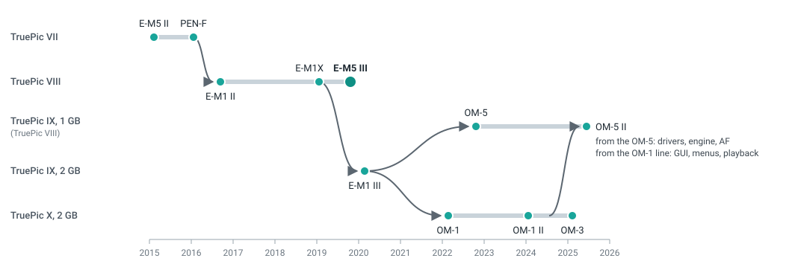

# Firmware source lineage: technical notes

<!-- house style -->
> **Technical reading.** The detailed version of [Firmware source lineage](lineage.md), for readers who want the internals.

*Last reviewed 2026-11-27.*

This page traces where the code in each body's main program comes from. It also lists the functions that some bodies
build as empty stubs. All of it is a desk
comparison of the firmware files. No program was run for it.[^fw1]

The bodies compared are the E-M5 II 4.1, PEN-F 3.1, E-M1 II 3.7, E-M1X 2.4, E-M5 III 1.7, E-M1 III 1.6, OM-1 1.9,
OM-5 1.2, OM-1 II 1.3, OM-3 1.1 and OM-5 II 1.1. For each, we compared the main MN103 program (block0), with its
compressed sections expanded. The E-M5 (Mark I) is left out, because it uses another base and little carries over
([Body comparison](comparison-technical.md)).

The small numbers after a fact link to [Sources and dates](#sources-and-dates), which say how the fact is known and when.
On the notes site the number's colour shows the evidence: green = seen on our camera, blue = read in the firmware,
grey = inferred.

## Method

- **Finding functions.** Functions are found with our function-span rule. On the E-M5 III this gives 102,117 functions,
  and 102,083 of them start at a function in our symbol table.[^fw1]
- **Matching functions.** Functions are matched between bodies in three passes.[^fw1]
    1. By identical code, after masking addresses.
    2. By unique sets of debug strings.
    3. By position: the n-th call of a matched caller, the n-th code pointer, or the same slot between matched
       neighbours.
- A stub has no code of its own, so it is only found by position.[^fw1]
- **Emptied functions.** A function is "emptied" when one body has a real body (4 or more instructions) and another has
  a bare return (`retf`, `ret`, `rets`) or a constant return (`clr d0` or `mov n,d0`, then return).[^fw1]
- **Grades.** Grade A means the stub and the full version are called from the same matched caller, and the full
  versions agree in size.[^fw1]
- **Check.** The method finds the OM-5 II AF-point setter stubs for tracking and DL that we had earlier found by
  hand.[^fw1]

## Two code lines

*Code lines over time, one lane per image processor. TruePic IX has two lanes, because the OM-5 uses the E-M5 III's 1 GB chip and the E-M1 III a 2 GB version. Dots sit at each body's release year. Arrows show where code split off to a new processor and where it joined back. Shares are in the table below. Our E-M5 III is the larger dot.*

The table gives the share of the smaller body's functions that are byte-identical after masking addresses.[^fw1]

| pair | identical | pair | identical |
|---|---:|---|---:|
| E-M5 II and PEN-F | 77% | OM-1 and OM-1 II | 82% |
| E-M1 II and E-M1X | 74% | OM-1 II and OM-3 | 87% |
| E-M1X and E-M5 III | 74% | OM-5 and OM-5 II | 77% |
| E-M1X and E-M1 III | 81% | OM-1 line and OM-5 II | 58% |
| E-M1 III and OM-5 | 85% | E-M1 III and OM-1 | 52% |
| E-M1 II and E-M5 III | 72% | E-M5 II and E-M1 II | 46% |

*Identical functions between pairs of bodies, as a share of the smaller body's functions.*

- **The E-M1 II line.** It runs from the E-M1 II to the E-M1X, then to the E-M5 III and the E-M1 III, then to the
  OM-5.[^fw1]
    - 62% of E-M5 III functions are identical in all three of the E-M1 II, E-M1X and E-M1 III.[^fw1]
    - The E-M5 III's closest single parent is the E-M1X.[^fw1]
    - The E-M1 III's closest parent is also the E-M1X (81%). The OM-5's is the E-M1 III (85%).[^fw1]
- **The OM-1 line.** It runs from the OM-1 to the OM-1 II, then to the OM-3.[^fw1]
    - 80% of OM-1 II functions are identical in the OM-1. 78% of OM-3 functions are identical in both.[^fw1]
    - 47% of OM-1 functions are identical in both the E-M1 III and the OM-5.[^fw1] The OM-1 came out before the OM-5,
      so the two were most likely developed side by side from the same E-M1 III code.[^inf1]
- **The older line.** The E-M5 II and the PEN-F share 77%. The E-M1 II keeps 42% of its functions identical to
  them.[^fw1]
- **The OM-5 II is a merge.**[^fw1]
    - 25% of its functions are identical only to the OM-5.
    - 51% are identical to both the OM-5 and the OM-1 line.
    - 9.6% are identical only to the OM-1 line.
    - 7% have a changed counterpart, and 7% have none.

The OM-1-line part of the OM-5 II is the application layer.[^fw1] It covers the GUI panels and menus (GC panels,
cursor and menu actuators, touch handling, MyMenu), the playback and edit components, shooting-sequence parts and the
Wi-Fi remote. Drivers, the image pipeline and AF come from the OM-5.[^fw1] This matches the OM-5 II's OM-1-style user
interface.

For playback this was checked in detail.[^fw1] The playback GUI and capability classes match the OM-1 1.9 method by
method. The C play engine keeps the E-M1 II-line tasks and edit table.

See also: [Playback, OM-5 II compared](../firmware/playback-technical.md#om-5-ii-11-compared).

## What split and what merged

The table gives, for each OM-1 region, the share of its instructions that are identical in the E-M1 III or the
OM-5.[^fw1] Regions are 1 MB, named by the names found there. The names come from debug strings, so this is a rough
map.

| OM-1 subsystem | identical | changed | no counterpart |
|---|---:|---:|---:|
| app framework: `Cap*`, `Cmp*` components, `OlyHfw*` operations | 52–68% | 27–34% | 3–18% |
| camera and sensor drivers (`cam`, `cam_seq`, `cam_frame`) | 21% | 31% | 48% |
| AF (`iaf`, `FCS`) | 9% | 30% | 61% |
| video codec stack (`CAvpi*`, H.264/HEVC, MP4/TS) | 5–14% | 22–27% | 59–73% |
| GUI actuators (cursor, AF target, menus) | 9% | 31% | 60% |

*OM-1 regions and how much of each is shared with the E-M1 III or OM-5.*

- **The OM-1 line is a fork.** It is a fork of the E-M1 III code that the OM-5 also grew from, not a separate
  codebase.[^fw1]
    - It kept the application framework.[^fw1]
    - It rewrote the layers that touch new hardware: sensor and capture drivers, AF, video codecs and the GUI.[^fw1]
    - That was likely driven by the new TruePic X platform, with 4 MN103 cores, DML, 2 GB and a stacked sensor (see
      [Body comparison](comparison-technical.md)).[^inf1]
- **The earlier split.** The same pattern appears there. The E-M1 II (TruePic VIII) keeps 46% of its functions
  identical to the E-M5 II and PEN-F (TruePic VII).[^fw1] So a new chip generation starts a new line from the previous
  line's code.[^inf1]
- **The E-M5 III is a sibling.** The E-M1 III is closer to the E-M1X (81%) than to the E-M5 III (72%). The E-M5 III is
  a sibling branch off the E-M1X, not the E-M1 III's parent.[^fw1]
- **The OM-5 II halves.** The OM-5 II keeps the OM-5's hardware half and takes the OM-1 line's app and GUI half (see
  [Two code lines](#two-code-lines)).[^fw1] Hardware layers likely follow the chip, while the app layer is kept as one
  shared line across the current bodies.[^inf1]
- **The OM-3.** It is an OM-1 II derivative.[^fw1]
    - 78% of its functions are identical in both the OM-1 and the OM-1 II, and 9% more only in the OM-1 II.[^fw1]
    - Its changed regions are touch and HDMI handling, camera operations and still capture.[^fw1] Some "new" regions
      may be data or unmatched code.
- **The OM-5 II and OM-3 shared branch.** These two share a small set of code that no older body has, about 1% of
  each.[^fw1]
    - It covers the file and DCF layer, GUI viewers (movie play, record info, BLE pairing menu, AF-adjust lens wizard),
      `AfFineTune` and the Wi-Fi HTTP server.[^fw1]
    - Both 2024-25 bodies were likely built from one current app-layer branch.[^inf1]

### Touch and gestures

- Only the OM-1 line (OM-1, OM-1 II, OM-3) has a software gesture recogniser in the main program.[^fw1]
- It is a state machine with press, click, double click, long press, slide, flick and liftoff states.[^fw1]
- It has tunable click, second-press and flick times and a palm flag.[^fw1]
- Its debug strings ("Gesture: Flick", `flick_tm`, "Palm Flag") are absent in the E-M1 II-line bodies, including the
  OM-5 II.[^fw1]
- The OM-3 keeps it almost unchanged.[^fw1]
    - Its touch-panel task is 82% identical to the OM-1 II's.
    - The double-press step grew from 64 to 96 instructions.
    - The touch dump now also prints a second contact id.
- These changes are likely tuning for a second finger or a double tap, not a new touch system.[^inf1]
- The HDMI driver changed little. Its open sequence is identical, and its infoframe setup is 82% identical.[^fw1]

## Emptied functions

555 function families have a full body in some bodies and a bare or constant return in others. 349 of them are grade
A.[^fw1]

| body | stubs | body | stubs |
|---|---:|---|---:|
| E-M5 II | 117 | OM-1 | 189 |
| PEN-F | 136 | OM-5 | 205 |
| E-M1 II | 158 | OM-1 II | 189 |
| E-M1X | 139 | OM-3 | 210 |
| E-M5 III | 207 | OM-5 II | 245 |
| E-M1 III | 158 | | |

*Emptied functions per body.[^fw1]*

- **Removed at compile time.** Where a function is emptied, its debug strings are missing from the image too.[^fw1]
    - For example, the strings `fcs_finetune_set_singly_test` and `fcs_coordinate_set_af_point_dl_body` exist in the
      E-M1 II to the OM-5 and are absent in the OM-1 line and the OM-5 II.[^fw1]
    - So the bodies are removed when the program is compiled, not patched out later.[^fw1] Per-body build switches are
      the likely cause.[^inf1]
- **Mostly debug.** Most stubs are debug and test commands, such as the display debug console, AF trace dumps, the NMI
  report and the EXP debug log.[^fw1] The OM-1 line keeps many debug bodies that the E-M1 II line builds empty.[^fw1]
- **Old shared constants.** Many constant-return rows are old and shared.[^fw1] There are 22 getters in one block of
  the OM-5 II that return a constant in every body that has them. Most date from the E-M1 II on, and a few from the
  E-M1 III or OM-1 on. So they are not OM-5 II changes.

### New in the OM-5 II (OM-5 has the body, the OM-1 line has no counterpart)

| function | OM-5 II | grade |
|---|---|---|
| `fcs_coordinate_set_af_point_dl_body` / `_parts1` / `_parts2` | `retf` | A |
| `fcs_coordinate_set_af_point_tracking_body` / `_parts1` / `_parts2` | `retf` | B (the OM-1 line has its own, larger setters) |
| unnamed AF-coordinate function (calls `status_change_callback_from_coordinate` on the E-M5 III) | `retf` | B |

*Functions that the OM-5 has in full and the OM-5 II builds empty. Addresses for each body are in the address reference.[^fw1]*

All three are AF-point plumbing next to the DL and tracking setters.[^fw1]

### Inherited by the OM-5 II from the OM-1 line

- **AF fine adjustment per lens** (`fcs_finetune_*`).[^fw1]
    - It has 10 functions: load, save, sort and count records, set a single or blanket value, and lens info. The
      callers are in `lens_serial`.
    - The functions are full from the E-M1 II to the OM-5, and empty or constant in the OM-1, OM-1 II, OM-3 and
      OM-5 II.
    - The OM-1 line likely stores AF fine adjustment elsewhere. This is not checked.[^inf1]
- **MyMenu table** `Common_MyMenu_List_Info_Manage::getDataTbl`.[^fw1]
    - It has 340 instructions and is called by `Menu_Viewer::part_my_menu_custom`.
    - It is full in the E-M1X, E-M1 III and OM-5, and `retf` in the OM-1 line and the OM-5 II.
    - The E-M5 III has no MyMenu code.
- **GUI helpers.** About 10 GUI helpers: panel updates for the menu, wizard and Direct panels, the LV-guide palette,
  `Cursor_2CNL_Actuator::left_base` and CEC enable. Also the HDMI "PlayCube" start
  `startPlayCubeSubAppStatePlayHdmi`.[^fw1]

### Emptied in the E-M5 III but full in a parent or in the OM-5

These matter for the stock E-M5 III.[^fw1] The notes column is an interpretation.[^inf1]

| what | E-M5 III | OM-5 | E-M1X | note |
|---|---|---|---|---|
| `digital_nd_tv` (Live ND shutter-speed limit) | constant | full | full | E-M5 III has no Live ND |
| `fcs_coordinate_init_af_area_data_internal` | constant | full (125 instructions) | constant | full only in OM-5, OM-1 line, OM-5 II |
| PTP "myset" backup (`tpc_olptp_get_myset_info`, `tpc_olptp_myset_notify_message` + 1) | constant | full | full | camera settings backup over PTP |
| `tpc_camc`, `ref_buff` | constant | full | full | PTP camera-control file info |
| AF trace dump group (5 functions, up to 627 instructions) | `ret` | full | full | debug |
| display debug commands (incl. `DISP_WHITE_MAGIC_ON`) | empty | empty too | no counterpart | full in the E-M1 III, debug |
| unnamed 753-instruction function near the USB config descriptors | constant | full | constant | full from OM-5 on, possibly the UVC descriptor builder (not checked) |

*Functions the E-M5 III builds empty and a parent or the OM-5 has in full.*

Some Wi-Fi and record-media helpers are empty in the E-M5 III, OM-5 and OM-5 II and full in the bigger bodies.[^fw1]
They are `wifi_remocon_through_notify_media_status`, `saveRecordFolderInfo`, a battery-genuine check at sleep, and
`wifi_mngr_get_wps_pin` with 8 BLE-remote neighbours. A "small body" build switch is the likely reason, such as one
card slot and no WPS.[^inf1]

### Full only in the E-M1X

- **Two AF gates.** Two AF gates in the OM-5 II return a constant in the E-M1 II, E-M5 III, E-M1 III, OM-5 and
  OM-5 II.[^fw1]
    - They are real code only in the E-M1X, with 14 and 23 instructions. The second calls
      `tracking_af_area_continue`.[^fw1]
    - Of the E-M1 II-line bodies, only the E-M1X has subject detection.[^fw1]
    - The OM-1 line has subject detection too, but on its own hardware (CPU3 and DML) and with its own AF code.[^fix1]
      The OM-1 has the first gate as a constant return. The OM-1 II and OM-3 have no counterpart to either gate.
    - The AF-link trace calls the second gate the gate of "another target source"
      ([SoC overview technical](../hardware/soc-overview-technical.md)).
- **Pixel-shift interface.** The `iseq_pixshift_sr_*` interface functions (pixel-shift high res) are full in the E-M1X
  and empty in the E-M1 III and the OM-1.[^fw1] The E-M1X likely runs high res on its slave chip.[^inf1]

## Address reference

Block0 addresses of the body named in each column (base `0x60021020`).

| function | E-M5 III | OM-5 | OM-5 II |
|---|---|---|---|
| `fcs_coordinate_set_af_point_dl_body` / `_parts1` / `_parts2` | `0x60662f85` / `0x6066312e` / `0x606632d7` | `0x606db054` / `0x606db202` / `0x606db3b0` | `0x606d9d45` / `0x606d9d48` / `0x606d9d4b` |
| `fcs_coordinate_set_af_point_tracking_body` / `_parts1` / `_parts2` | `0x60662738` / `0x606628e1` / `0x60662a8a` | `0x606da7ee` / `0x606da99c` / `0x606dab4a` | `0x606d99d6` / `0x606d99d9` / `0x606d99dc` |
| unnamed AF-coordinate function | `0x60665304` | `0x606dcc07` | `0x606db54a` |
| `fcs_finetune_*` | `0x606ac90f` to `0x606ad4b8` | `0x60730a7d` to `0x60731626` | `0x607303c5` to `0x60730451` |
| `Common_MyMenu_List_Info_Manage::getDataTbl` | none | `0x60e44641` | `0x60e202eb` |
| constant getters (22) | | | `0x606d8da0` to `0x606d8e5d` |
| `startPlayCubeSubAppStatePlayHdmi` | | | `0x60d184db` |

*AF, menu and playback functions in the E-M5 III, OM-5 and OM-5 II.*

| function | E-M5 III | OM-5 | E-M1X |
|---|---|---|---|
| `digital_nd_tv` | `0x60229305` | `0x60239c2d` | `0x6023c221` |
| `fcs_coordinate_init_af_area_data_internal` | `0x6065a3a5` | `0x606d9272` | |
| PTP "myset" backup (three functions) | `0x612a22d9` / `0x612a22dd` / `0x612a22e1` | `0x614bc206` / `0x614bc2b6` / `0x614bc3a3` | |
| `tpc_camc`, `ref_buff` | `0x6129e217` / `0x6129e209` | `0x614b5ca7` / `0x614af741` | |
| AF trace dump group | `0x606e1c8f` to `0x606e1c9b` | `0x60767205` to `0x60767a03` | `0x6073266e` to `0x60732e35` |
| display debug commands | `0x60184327` and nearby | | |
| unnamed 753-instruction function | `0x60c31b04` | `0x60cdb87f` | |

*Functions emptied in the E-M5 III, with their full versions.*

| item | body | address |
|---|---|---|
| AF gate 1 | OM-5 II | `0x606d8f97` |
| AF gate 2 ("another target source") | OM-5 II | `0x606d8f9b` |
| AF gate 1, full (14 instructions) | E-M1X | `0x606b054f` |
| AF gate 2, full (23 instructions) | E-M1X | `0x606b056f` |
| touch-panel task | OM-3 | `0x60213041` |
| double-press step | OM-3 | `0x60214d9b` |
| touch dump, second contact id | OM-3 | `0x6021425d` |

*AF gates and OM-3 touch code.*

## Sources and dates

The small numbers in the text point here. Each note says how a fact is known and when.

[^fw1]: Read in the firmware, 2026-11-25. A desk comparison of the main programs of 11 bodies, no camera runs.
[^fw2]: Read in the firmware, 2026-11-27. Our E-M5 III C compiled against the other body's block0, a desk check only.
[^inf1]: Inferred, 2026-11-25.
[^inf2]: Inferred, 2026-11-27.
[^fix1]: Corrected on 2026-11-25. The older reading is in [History](#history).

## History

- 2026-11-25: An earlier note said the OM-1 line lacked subject detection. It has it, on its own hardware (CPU3 and DML)
  and with its own AF code. The two AF gates are real code only in the E-M1X, a constant return in the OM-1, and absent
  in the OM-1 II and OM-3.
- 2026-11-27: The OM-1 was first read as starting from E-M1 III and OM-5 code. Release order makes a side-by-side start
  from the E-M1 III more likely.

