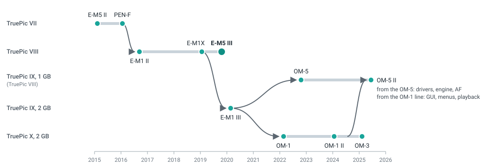

# Firmware source lineage

<!-- human page -->
<!-- house style -->

## Key points

- The Olympus and OM System bodies since the E-M1 II grew from two code lines, and the E-M5 III sits on the older one
  next to the E-M1 III and OM-5.
- The OM-5 II is a merge, with the OM-5's drivers, image pipeline and AF under the newer OM-1 line's menus and app
  layer.
- Most E-M5 III functions are the same code in the OM-5 and OM-5 II, at other addresses (desk check).
- Each body builds some functions as empty stubs. Most are debug tools, and a few show features that a body leaves
  out.

This page traces where the code in each camera's main program comes from. We compared the main programs of eleven
bodies function by function, from the E-M5 II and PEN-F to the OM-3 and OM-5 II. It is a desk comparison of the
firmware files.

It matters for our work because code that two bodies share can be studied once and carried across. It also shows which
features a body's firmware has switched off.

## Two code lines

*Code lines over time, one lane per image processor. TruePic IX has two lanes, because the OM-5 uses the E-M5 III's 1 GB chip and the E-M1 III a 2 GB version. Dots sit at each body's release year. Arrows show where code split off to a new processor and where it joined back. Our E-M5 III is the larger dot.*

The first line starts at the E-M1 II and runs through the E-M1X to the E-M5 III and the E-M1 III, and from there to the
OM-5. The E-M5 III and the E-M1 III are siblings. Both branch off the E-M1X, and neither is the other's parent.

The second line is the OM-1, the OM-1 II and the OM-3. It is not a separate codebase. The OM-1 and the OM-5 were most
likely developed side by side from the same E-M1 III code. The OM-1 came out first.

The OM-5 II is a merge of the two. Its drivers, image pipeline and autofocus come from the OM-5. Its menus, playback
screens and other application parts come from the OM-1 line. That fits the OM-5 II's OM-1-style user interface.

## What split and what merged

When the OM-1 line forked, it kept the application framework and rewrote the layers that touch new hardware. Those are
the sensor drivers, autofocus, the video codecs and the on-screen controls. The OM-1 generation uses a new processor
chip, and the same pattern appears at the earlier change from the E-M5 II generation to the E-M1 II. A new chip
generation starts a new line from the previous line's code.

The OM-3 grew from the OM-1 II. Its touch handling changed only a little. Only the OM-1 line has a software gesture
recogniser for taps, flicks and long presses.

## Empty functions

Some bodies build a function as an empty stub where another body has the full code. The stubs are made when the program
is compiled, not patched out later. Most of them are debug and test tools.

A few are features. The E-M5 III builds the Live ND shutter-speed limit empty, because it has no Live ND. The OM-5 II
empties some autofocus point helpers that the OM-5 has in full. It also takes over from the OM-1 line an empty per-lens
AF fine adjustment and an empty MyMenu table.

## Further reading

- [Firmware source lineage: technical notes](lineage-technical.md) has the method, the numbers for every pair of bodies,
  the lists of emptied functions and the addresses.
- [Body comparison](comparison.md) puts the bodies side by side by chip, memory and features.
