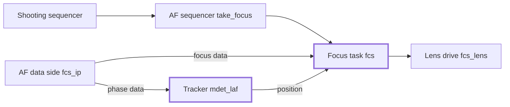

# Autofocus and tracking AF: technical notes

<!-- house style -->
> **Technical reading.** The detailed version of [Autofocus and tracking AF](autofocus.md), for readers who want the internals.

*Last reviewed 2026-11-27.*

This page explains how the autofocus (AF) system and continuous AF with tracking (C-AF+TR) work in the OM-5 II 1.1
program, read from its update file, with notes on the stock E-M5 III 1.7. It is desk research only, with no camera
builds. Addresses are OM-5 II 1.1 block0 addresses (base `0x60021020`) unless the E-M5 III is named. They are collected
in the [address reference](#address-reference).

The small numbers after a fact link to [Sources and dates](#sources-and-dates), which say how the fact is known and when.
On the notes site the number's colour shows the evidence: blue = read in the firmware, grey = inferred, amber = a
correction.

Related pages: [face and eye detection](face-detect-technical.md) (face and eye slots, target chooser order),
[subject detection](af-detect-technical.md), [SoC overview](../hardware/soc-overview-technical.md) ("Why AF ignores
the DL target"), [shooting sequencer](../firmware/shooting-sequencer.md), [Starry Sky AF](starry-sky-af-technical.md)
and [lineage](../bodies/lineage.md) (OM-5 II emptied setters).

## Summary

- **Layers.** The shooting sequencer states RdyFcsRdy1-3 start the AF sequencer task (`take_focus`, task 114, priority
  25). The AF sequencer drives the focus task (`fcs`, priority 25, `FCS_QUEUE_RECIEVE`). The focus task drives the lens
  (`fcs_lens_*`, `LensSpeedMode`).[^fw1] The focus task is task 98 on the E-M5 III and task 99 on the OM-5 II.[^fix1]
    - Beside them run the AF data side (`fcs_ip_*`, phase-detect and contrast values from the image pipeline) and the
      tracker (`mdet_laf_*`).[^fw1]
    - The tasks come from the CPU0 static task table.[^fw1] The arrows between them are inferred from names and call
      direction.[^inf1]
- **Two kinds of focus data.** On-sensor phase detect ("PFP" data: `p_varea_b`, `p_harea_b`, `p_vdoku_b`,
  `p_hdoku_b`, vertical and horizontal per area, still and live-view sets) gives a defocus amount per AF block
  (`[fcs]p_defocus_info`, `p_area_defocus`, `p_selected_block`).[^fw1] Contrast AF reads three high-pass filter values
  per area per frame (`HPF1/2/3`, `[contrast]get contrast start`). It scans the lens for the peak (`FCS FA SCAN LOOP`,
  `FullScanMode`, `4times scan`).[^fw1] That PFP means on-sensor phase pixels is a reading.[^inf1]
- **C-AF prediction** keeps a focus-position history and fits a curve. `C-AF inipos 2D_a/2D_b/2D_c` are the
  coefficients of a second-order fit of lens position over time. They place the lens for the next frame
  (`prediction.pos`, `NXT pos`, `spd`, `frat`). The history is logged too.[^fw1] "Quadratic fit" is inferred from the
  three coefficients.[^inf1]
- **C-AF lock-on** (`mode_af_lockon_level`) maps the menu level to how long and how large a focus jump C-AF ignores.
  See [Lock-on levels](#lock-on-levels).[^fw1]
- **Tracking** is the `mdet` "LAF" tracker.[^fw1] It has these parts.
    - 339 functions, named from its own profiling table.
    - Two search blocks in the image pipeline. **EMS1** does block motion search. **EMS2** does colour and size search.
    - Face and body results, a phase-detect depth tracker (PDT) and a deep-learning (DL) input.
    - A 274-value tuning table (parameter id `0x79a2`) that holds its thresholds.
- **Tracker to AF.** The tracker's position passes through `mdet_laf_get_fcs_coordinates`,
  `fcs_tracking_get_mdet_coordinates` and `fcs_coordinate_update_af_area_tracking`, which clamps it to 640 × 480, into
  the tracking slot. `fcs_coordinate_set_af_point_tracking` then writes it into the AF point block as kind 4.[^fw1]
- **The OM-5 II has the newer tracker.** The OM-5 II tracker is a newer generation than the stock E-M5 III 1.7's. Its
  tuning table has 274 values against 157. The first 155 are identical apart from three chase-frame values.[^fw1]

## Overview

*The AF parts. Arrows show data flow, the table says who starts each. The focus task and tracker have bold outlines.*

| from | to | what moves | path | started by | how often |
|---|---|---|---|---|---|
| shooting sequencer | AF sequencer | focus start | states RdyFcsRdy1-3[^inf1] | sequencer | each half-press |
| AF sequencer | focus task | focus jobs | `fcs` message queue[^fw1] | AF sequencer[^inf1] | not traced |
| focus task | lens | move commands | `fcs_lens_*`[^fw1] | focus task | not traced |
| AF data side | focus task | phase-detect and contrast values | `fcs_ip_*`[^fw1] | AF data side | every live-view frame |
| AF data side | tracker | phase data | `mdet_laf_set_fcs_ip_info`[^fw1] | AF data side | each frame |
| tracker | focus task | x, y position | `mdet_laf_get_fcs_coordinates`[^fw1] | focus side asks | not traced |

*One row per arrow in the diagram. The first three arrows are inferred from names and call direction.[^inf1]*

## Tasks and modules

| item | task and priority | note |
|---|---|---|
| focus task `fcs` | E-M5 III task 98, OM-5 II task 99 (stack 4608), priority 25 | message loop (`FCS_QUEUE_RECIEVE`, `FCS_RES_QUEUE_WRITE`, `FCS_END`, `FtAF_END`, `FCS_ASTRO_END`)[^fw1] |
| AF sequencer `take_focus` | task 114, priority 25 | `TAKE_FOCUS` on the E-M5 III. `=== LOCK_START ===`, `LOCK_START_END(_FAST)`, `LOCK_RESTART`, `LOCK_END`, `FOCUS_RING_LOCK_UPDATE`[^fw1] |
| other focus-area tasks | 96, 122 (priority 25), 146, 38 (`SERV_*`) | roles not traced[^fw1] |
| `fcs_ip_main_task` | | AF data side: `mdet locked/unlocked buffa`, `af_stop_sw_enable`, `aperture_drive`[^fw1] |
| tracker task | task 74, priority 55, near the mdet module | `MDET_CALC_MAIN_TASK`, `mdet_calc_event_send_main_cpu2`[^fw1] |
| tracker module | | `mdet_laf.c`, EMS1 and EMS2 drivers[^fw1] |
| focus input and output dump | | `FCS_COM_DATA [INPUT]` (com, area, frame, face, +MF, aspect, movie, drive, digital zoom) and `[OUTPUT]` (AF status, area, fcs_x/y, face, `TR stts fc_x fc_y x_yc y_yc`)[^fw1] |

*AF tasks and modules. Entry points and ranges are in the address reference.*

- On the E-M5 III, task record 99 is `LENS_ASKDATA`. The focus task is record 98, whose entry references
  `FCS_QUEUE_RECIEVE`.[^fix1] See also:
  [lens communication](../hardware/lens-communication-technical.md#requests-queue-and-tasks).
- The tracker's real-time log prints `[CPU0:…] [CPU2:…]` columns, so the tracker spans CPU0 and CPU2.[^fw1] How the
  work is split per function is inferred.[^inf1]

## Focus data

- **Phase detect.**[^fw1]
    - The AF data side names the phase-detect buffers `[fcs_ip]pfp_address.p_varea_b / p_harea_b / p_vdoku_b /
      p_hdoku_b`, with `TB_` and `STILL` variants.
    - The focus task logs `[fcs]p_pfp_b_dat[0/1]`, `p_pfp_still_data` and `p_area_exception`.
    - The defocus amount is logged as `[fcs_ip]defocus_quantity`, and a print reads `ask_defocus_value(LSB=1/512mm)`.
    - The sensor capture state is `cam_cap/lvpd/pd_info/af_clip_type`.
    - `CENTER_NOT_IN_AF_PIXEL` marks a target outside the phase-pixel area.
- **Contrast.**[^fw1]
    - Names: `fcs_ip_contrast_debug.c`, `iaf_value[%3d]`, `ContrastGetVDCount`.
    - A per-area dump prints `VD, Pulse, HPF1, HPF2, HPF3`.
    - Scan control is `[scan]scan_status/complete/start_dir/num`.
    - The peak fit is `Calculated_Peak_LD(offset)`, with `PEAK_NG2`, `OPT_RTRY` and `FCS_IAF_PHASE_CALC` (and its `_EDG`
      variant).
- **Hybrid.** The face and tracking interface prints `hyb_result_flag`, `hyb_object`, `hyb_detect_state`, `hyb_state`
  and `hyb_shield_flag`.[^fw1] A reading is that "hyb" is the combined phase, contrast and subject state.[^inf1]
- The contrast library is shared across bodies.[^fw1] See also: [Starry Sky AF](starry-sky-af-technical.md).

## C-AF prediction and lock-on

- **Prediction logs.** `C-AF inipos exp 1/3`, `prediction.tim`, `FPS`, `NXT base/ofst/pos`, `spd_org`, `NXT spd`,
  `NXT frat`, `doutai_result` (moving-body result), `2D_a/b/c`, `lens 120`, `CAM mode`, `dir`, `spd_coe`, `fno`,
  `max spd` and `NXT OCOEFF`.[^fw1]
- **History tables.** `C-AF PREDICTION INFOCUS HISTORY` and `C-AF RESERVSTION FOCUS POS. AND NEXT AF INITIAL POS.`,
  plus `update_cluster(S-AF/C-AF)`.[^fw1]
- **Scan fallback.** The strings are `C-AF SCAN:start/end`, `exec:rel-af`, `exec:pan/tilt` and
  `judge_reliability(all NG / OK->NG)`.[^fw1] A reading is that C-AF falls back to a contrast scan when phase data
  turns unreliable.[^inf1]

### Lock-on levels

The lock-on init function writes the level's values. `lock_on_exec` and `is_deter_lockon` read them.[^fw1]

| level | runs | lock_on_time | pulse_mag_th_plus | pulse_mag_th_minus |
|---|---|---:|---:|---:|
| −2 | no | 100 | 160 | 160 |
| −1 | yes | 200 | 160 | 80 |
| 0 | yes | 400 | 128 | 48 |
| +1 | yes | 800 | 96 | 40 |
| +2 | yes | 1600 | 66 | 32 |

*C-AF lock-on levels and their values, read in the firmware.*

A reading is that, while lock-on runs, a focus jump larger than the pulse thresholds is held off for up to
lock_on_time (likely milliseconds) before C-AF follows it.[^inf1] Which menu sign of C-AF sensitivity maps to which
level is not checked.

## AF target and AF point

The target chooser and the candidate slots are on the [face page](face-detect-technical.md#how-af-uses-it). The AF
target step switches on the mode through a table.[^fw1]

- 0 and 8, magnify ("C:0R mag").
- 1, 5 and 6, one-shot ("C:Oneshot").
- 2, "C:CAF Start".
- 3 and 4, "C:CAF Restart".
- 7.
- 9, hi-res.

C-AF start and restart ask the DL branch first.[^fw1]

- **AF point block.** It holds a kind byte (1 face, 2 touch face, 3 eye, 4 tracking, 8 clipped LV, 9 magnify), a
  position, a size and a grid point. Its getter has 26 callers.[^fw1]
- **Setters.** The OM-5 II keeps only setter kinds 1 to 4, 8 and 9.[^fw1]
    - The tracking body and part setters (kinds 5 to 7, `fcs_coordinate_set_af_point_tracking_*`) are bare returns.
    - The DL setters (kinds 10 to 12) are bare returns too.
    - So in the OM-5 II program a tracker body or part result cannot move the AF point. Only plain tracking (kind 4)
      can.

See also: [lineage](../bodies/lineage.md) and [SoC overview](../hardware/soc-overview-technical.md).

## The two AF gates

Two tiny functions right after `tracking_af_area_continue` return 0 (`clr d0; retf`) on the OM-5 II and in every
OM-5-line body. They are real code only on the E-M1X.[^fw2] See also: [lineage](../bodies/lineage.md).

### Gates in the OM-5 II AF flow

- Gate A is the only thing the first DL wrapper asks (non-zero gives 1).[^fw1]
    - That wrapper is the "is subject detection active" question.
    - The AF target step asks it at C-AF start and at restart. The frame display and the DL AF-point chain ask it too.
      It has ten callers in all.
- Gate B is asked by the second wrapper, which has five callers, among them restart and the display.[^fw1]
- In the AF-type helper, gate A equal to `0x700` or gate B non-zero makes the result 6. That is the same result as
  "plain tracking running and `tracking_af_area_continue`".[^fw1]

### Gates on the E-M1X

The E-M1X has an `fcs_dl` module in its focus code. Its strings are `[DL]fcs_dl_initialize`, `[DL]fcs_dl_start_tracking`,
`[DL]fcs_dl_update`, `[DL]mdet_dl_end_tracking` and `[DL]fcs_dl_end`.[^fw1]

`fcs_dl_start_tracking` takes the detection list (body count at +11, 38-byte body records from +20) and picks a body.
It sends the tracker a start message with the body's box. If that succeeds, it sets the DL tracking state word to
1.[^fw1]

- **Gate A** returns `0x700` when that DL tracking state is 1 and plain tracking is not running (take_focus tracking
  state +0x17 ≠ 1). Otherwise it returns 0.[^fw1] Its meaning is "the subject detector is driving the target".[^inf1]
- **Gate B** returns `0xe000` when plain tracking is running, `tracking_af_area_continue` says the area continues
  (`0x1000`), the tracking info byte +17 is 2 and flag +0x21 is set. Otherwise it returns 0.[^fw1] Its meaning is
  "tracking that the subject detector started is still holding the AF area". The meaning of +17 = 2 and of +0x21 is
  inferred.[^inf1]

### Gates on the OM-5 II and E-M5 III

- On the OM-5 II the gates are switched off and the `fcs_dl` starter does not exist. There are no `[DL]fcs_dl`
  strings in the OM-5 II or E-M5 III.[^fw1]
- The tracker side of the DL path (`mdet_laf_dl_*`) is present.[^fw1]
- The E-M5 III has the same constant gates and one `[DL]tracking type set` string.[^fw1]
- **Other emptied AF functions** on the OM-5 II are the DL setters, the tracking body and part setters, and one more
  function whose OM-5 counterpart calls `status_change_callback_from_coordinate`.[^fw2]
- The 22 small getters return constants in every body. So they are old switches, not OM-5 II changes.[^fw2]

### What the gates mean for subject detection

Making the DL branch win needs three things.[^inf1]

1. Gate A, or its wrapper, must say yes.
2. The DL AF-point setters must be restored.
3. For tracker-assisted subject AF, an `fcs_dl`-style starter must hand a detected body to the tracker and set the
   state that gates A and B read.

The E-M1X code is the reference.[^inf1]

### Empty tracking body and part setters

The `fcs_coordinate_set_af_point_tracking_body/parts1/parts2` strings exist in stock E-M5 III 1.7 and E-M1X 2.4. They
are absent from OM-5 II 1.1, together with the `_dl_*` strings.[^fw1]

A reading follows.[^inf1]

- The six setters belong to tracking a detected subject part by part (body, head, eye).
- On the E-M1X they only matter after its `fcs_dl` module hands a subject to the tracker.
- The OM-5 II ships without subject detection, so a build switch for that option emptied all six and dropped their
  strings.
- Plain C-AF+TR (kind 4) is unaffected.

## The tracker

The tracker is the `mdet_laf` module.

### Names

- The tracker module keeps a 513-entry profiling table of 36-byte records. Each record holds a `func0xNNNN` id string,
  flags, a name and a log formatter.[^fw1]
- Each traced function calls a counter (d0 = id, d1 = 1 on entry, 4 on exit) from 977 call sites.[^fw1]
- Matching the entry calls names **339 functions**, including the EMS1 and EMS2 drivers.[^fw1]
- The stock E-M5 III keeps only four `mdet_laf` strings and no profiling table names. So this naming is OM-5 II
  only.[^fw1]

### Hardware

- **EMS1.**[^fw1]
    - Driver functions `ems1_drv_open`, `_iocontrol`, `_start`, and a request queue (`[ems1 if queue info]`).
    - Interrupt names `EMS1_DRV_INT_BC1/BC11-14/BC2/BC21-24/TR1-3`.
    - Used for block motion search: `calc_quantity_movement`, `calc_trvec_a/b` (tracking vectors),
      `judge_mdet_block_trust`, moving-object detection with labelling
      (`mdet_laf_ems1_mod_area_decision_labeling`, `get_combine_label`) and camera shake removal
      (`mdet_laf_ems1_mod_gyro_variation_detect`). What each function does is inferred from these names.[^inf1]
- **EMS2.**[^fw1]
    - Driver functions `ems2_drv_iocontrol` and `_start`.
    - Areas `EMS2_DRV_AREA_IN1-3`, `SIM1-3` (similarity), `EVA1-3` (evaluation), `SA1-3` (search area) and
      `RD_STOP/WT_STOP`.
    - Used for a colour and size model of the target: `take_color3/4`, `take_balance`, `take_size`, `renew_tr_col`,
      `set_col_phase`, `set_col_shade`, `set_brightness`, `change_tgt_col`, `judge_trustworthy` and
      `mdet_laf_ems2_judge_color`. "Colour model" is inferred from the names.[^inf1]
    - Work buffer `IMGBUFF_ALOC_EMS2_BAYER` (`0x3700`).
- Both blocks also exist on the stock E-M5 III (`laf_ems1top`, `proems1/2`, `IMGBUFF_ALOC_EMS2_BAYER`).[^fw1]

See also: [Motion search unit (EMS1)](../hardware/motion-unit-technical.md).

### Per-frame pipeline

The call graph, with names from the profiling table.[^fw1]

1. `mdet_laf_chase_object_task` takes a message. Type 0 or 1 goes to `mdet_laf_exec_ems1`. Type 2 goes to
   `mdet_laf_exec_ems2`.
2. `exec_ems1` calls `mdet_laf_ems1_chase_object` (`read_data`, `calc_quantity_movement`, `judge_trustworthy`,
   `set_track_area_a/b`, `conv_coordinates`, `write_data`). Then it calls `mdet_laf_get_dl_data`,
   `mdet_laf_call_judge_color` (the EMS2 colour check) and `mdet_laf_end_frame`.
3. `exec_ems2` calls `mdet_laf_ems2_start` and `mdet_laf_ems2_chase_object` (`take_color4`, `take_balance`).
4. `mdet_laf_exec_trace` is the fusion step. It runs these in turn.
    - `judge_trust_ems2` and `pdt_judge_info` (depth tracker against face or body).
    - `judge_moving_area` and `judge_shield_on/off`. The EMS1, EMS2 and moving-object "shields" hold the target
      through occlusion.[^inf1]
    - `low_framerate`, face areas 1 and 2 and EMS areas 1 and 2 with `judge_priority_coordinates`, and
      `moving_correction`.
    - The DL steps `dl_detection_list`, `dl_search_tracking`, `dl_calc_cor`, `dl_detection_select`,
      `judge_dl_target_part`, `dl_slow_fps` and `dl_pos_set`.
    - `calc_ems12_offer_data`, `calc_trust_history` and `calc_offer_data`.
5. `calc_offer_data` calls `judge_frame_out`, `judge_lost`, `calc_chase_frame`, `calc_dz_info` (digital zoom),
   `calc_chase_coordinates_history`, `check_chase_frame_disp_edge` and `calc_tr_pd` (phase detect at the target).
6. Prediction is `mdet_laf_forecasting` and `_calculation`, `mdet_laf_dist_forecasting_calculation` (string only) and
   `mdet_laf_calc_fdbd_forecast`.

The focus side feeds the tracker its phase data each frame. `mdet_laf_set_fcs_ip_info` is called from the focus data
path.[^fw1]

### PDT (phase-detect depth tracker)

The depth tracker's functions are `calc_defocus_correlation`, `calc_subject_region`,
`scan_area_top/right/bottom/left`, `calc_center`, `calc_defocus_basic`, `judge_reliability`, `calc_vecter`,
`calc_predict_defocus`, `calc_predict_position`, `judge_occlusion`, `judge_pass_occlusion`, `judge_return_occlusion` and
`judge_reset`.[^fw1]

A reading from the names follows.[^inf1] It grows a region of similar defocus around the target in the phase-detect
map and follows it. It predicts the region's next depth and position, and it recognises when something passes in
front. Whether PDT runs in plain C-AF+TR on the OM-5 II is not checked.

### DL input

The tracker has an input for subject-detection results. It is a lead for our subject detection.[^fw1]

**The subject list** is 324 bytes. A 20-byte header is followed by up to 8 records of 38 bytes.[^fw1]

| offset | size | meaning |
|---|---|---|
| +0 | u32 | frame stamp (copied from `0xa272aee8`) |
| +4, +6 | u8, u16 | from `0xa272acfc` / `0xa272acfe` |
| +8 | u8 | basic-mode flag (from `0xa272ad00`) |
| +9 | u8 | set to 1 by the writer, selects the "hybrid" tracker mode |
| +10 | u8 | from the subject setting `0xa272b11c` via `0x6063c6b8` |
| +11 | u8 | record count (0-8) |
| +12-+19 | | subject setting copies (`0xa272b11a`/`b11c`/`b11e`) |
| record +0 | u8 | subject class |
| record +2, +14, +26 | 12 bytes each | three parts: u8 valid (1), u8, u16 x, u16 y, u16 w, u16 h, u8 score, u8 id |

*Layout of the subject list, read in the firmware. That the eleventh byte of a part is a score is inferred.[^inf1]*

- The three parts match the network's three outputs (body, head, eye).[^inf1] This is inferred from the bird net. See
  also: [SoC overview technical](../hardware/soc-overview-technical.md). The coordinate scale is not traced yet.
- **State bytes.** A valid byte of 0 makes the reader return 2 (no data). A ready byte is 1 when results are ready, and
  0 makes the reader return 3. A selected-record byte holds 0 to 7, or 255 for none.[^fw1]
- **Writer.** The MDET_DL result handler builds the list from the network decode arrays. It then calls the
  display-frame notify and keeps a history of 260 bytes per entry.[^fw1] In the OM-5 II program nothing calls it,
  because the network half is missing.[^fw1]
- The E-M1X uses the same layout. Its `[ for_fcs ]` copy and `fcs_dl_start_tracking` read the count at +11 and 38-byte
  records from +20.[^fw1]

**Reader.** `mdet_laf_get_dl_data` copies the list. It uses one copy routine when the tracker DL mode is 1 and
another otherwise. `mdet_laf_get_dl_detection_result` unpacks it.[^fw1]

- Header +9 ≠ 0 sets the tracker DL mode to 2 (hybrid). Otherwise +8 ≠ 0 sets it to 1.
- Per record it stores the class, the part valid flag, x, y, w and h, and byte +10.
- It moves the selected record to slot 0.

**When the tracker reads it.**[^fw1]

- Each EMS1 frame, `mdet_laf_exec_ems1` calls the reader when the message subtype is 2 and a read-block byte is 0. The
  byte is cleared by `mdet_laf_init_param`.
- It then takes the DL path when the **DL mode flag** is non-zero, and the plain path otherwise.
- The DL mode flag and a second flag beside it are set in the mode-change handler from message bytes +107 and +108.
- Those bytes come from the AF side. +107 is 1 when byte +24 of the live-view evaluation task's mode-change message is
  non-zero. That message comes from the AF state machine.

A reading is that byte +24 is the subject-detection setting as the AF side sees it.[^inf1]

**How DL tracking starts.** The E-M1X starts DL tracking from the focus side. `fcs_dl_start_tracking` picks a body and
calls `mdet_dl_start_tracking(id, part)`, which sets the DL tracking state to 1. A fourth function ends it. None of these
four has an OM-5 II or OM-5 counterpart.[^fw2] The newer tracker instead runs DL as a mode. It reads the list every frame
and picks the subject itself (`dl_search_tracking`, `dl_detection_select`).[^fw1]

### EMS1 and EMS2

See also: [Motion search unit (EMS1)](../hardware/motion-unit-technical.md), the EMS1 deep dive.

- **EMS1 is a shared motion engine, not a tracker.** A movie-evaluation task (`--take_mov_task--` with
  `frame_packets`/`frame_queue`) queues EMS jobs for several clients.[^fw1]
    - The clients are flicker (`flc`), noise reduction (`fnr`), tracking (`laf`, `laf_sub`), scene detection
      (`iauto`), subject detection (`dl`) and a parameter client.
    - Each client has an `ems1top` preset. Presets are parameter id `0x1994` (u32), 7 records of 26 words, keys 0, 2,
      `0x4002`, `0xa`, `0x400a`, `0xb` and `0x400b`. They are looked up by `get_ems_param_ems1top_address`.
    - The stock E-M5 III has the same parameter id.
- **Input.** The search runs on a resized copy of the live-view Bayer data.[^fw1]
    - `get_bayer_resize_datasize` returns the readout size per live-view mode (5184 × 3888, 2592 × 1944, 1728 × 1306
      and others).
    - `get_rsz` picks one of the resize modes 1-6, 9 and 12.
    - Together with the 320-wide size table in the [tuning table](#tuning-table-parameter-id-0x79a2), the search
      image is small. The search width is inferred.[^inf1]
- **Blocks and search range.** `mdet_laf_ems1_start` turns the job's config into a block width of (n+1) × 8 pixels
  and two search ranges of 4n + 8. It stores area positions as 21.11 fixed point (`lsr 11`).[^fw1]
  `set_track_area_a` then picks the per-frame search window from a step table.[^fw1] The labels are inferred.[^inf1]
- **EMS2 is a template matcher.**[^inf1]
    - Its set-up function writes about 250 registers. These are three input areas, three similarity, three evaluation
      and three search areas.[^fw1]
    - The tracker stores the target's colour, balance and size (`take_color3/4`, `take_balance`, `take_size`). EMS2
      scores the search area against it.[^fw1]
    - `judge_trustworthy` and `mdet_laf_judge_trust_ems2` decide whether the match is good enough.[^fw1]
- **Same hardware on three bodies.** The two register bases appear as literals in the stock E-M5 III, E-M1X 1.4 and
  OM-5 II block0 alike, 4-6 and 7-8 times. The E-M1X runs its subject-detection tracking on the same EMS
  blocks.[^fw1]
- **Subject-detection stability logic already exists.**
    - With subject detection on (DL mode flag = 1), `get_lost_count_thr` takes a lost-count limit per subject class.
      The class id is 100-108. The nine u16 limits are at +102..+118 of the parameter struct.[^fw1]
    - `mdet_laf_dl_lost_list`, `dl_hold_clear` and `dl_slow_fps` keep a detected subject while the network misses
      frames or runs slower than live view.[^fw1] That purpose is inferred.[^inf1]
- **Verdict.**[^inf1]
    - The hardware is a fixed block matcher plus a colour template matcher.
    - It is fast and good at frame-to-frame continuity, but has no idea what the subject is.
    - The weakness is more likely the small search image, the missing appearance model and the fixed timers than the
      hardware itself.
    - The same blocks carry the E-M1X's subject-aware tracking.
- **A neural tracker.**[^inf1]
    - A full network tracker that replaces EMS would need to run every live-view frame on the image engine.
    - The cheaper path is the native hybrid. The network proposes boxes a few times a second into the DL list. EMS1
      and EMS2 hold the subject between detections, with the per-class lost limits above.
    - A network trained for this must agree with the EMS result between detections, or the tracker will jump.

### Tracker generations

Function matching across bodies (structural matching) gives these counts for the OM-5 II tracker.[^fw2]

| part | functions | with an E-M5 III counterpart | with an E-M1X counterpart |
|---|---:|---:|---:|
| whole tracker | 935 | 131 | 196 |
| exec and fusion | 110 | 6 | 7 |
| forecast, lost, DL | 112 | 2 | 2 |
| EMS1 side | 66 | 4 | 4 |
| EMS2 side | 45 | 1 | 1 |
| PDT depth tracker | 75 | 0 | 0 |

*OM-5 II tracker functions with a counterpart in other bodies. The ranges are in the address reference.*

- The OM-5 1.2 has a counterpart for 926 and the E-M1 III 1.6 for 921. So the OM-5 II tracker is the E-M1 III / OM-5
  generation.[^fw2]
- The stock E-M5 III tracker is about 388 functions. 131 carry over, mostly coordinate conversion, buffers, debug and
  the iAuto and motion-AF interfaces.[^fw2]
- A reading is that the core (fusion, trust, lost logic, both EMS sides) was rewritten and the depth tracker is new.
  The E-M1X has the older tracker too, with its own DL starter. Whether the rewrite tracks better is not
  measured.[^inf1]

### Tuning table (parameter id 0x79a2)

- **Parameters.** They are read with the parameter reader (d0 = id, d1 = index).[^fw1]
    - The id's low nibble gives the element type (2 = u16, 4 = u32, bit 3 = signed).
    - id >> 4 picks a slot in the parameter registry, which boot fills from `{u16 id, u16 count, data}` records.
- **Id `0x79a2`** is 274 u16 values in block0. The stock E-M5 III has 157 values.[^fw1]
    - The first 155 match except index 57-59. Those are 12, 60 and 110 on the E-M5 III and 5, 25 and 480 on the OM-5
      II. They are read by `calc_chase_frame` and `check_chase_frame_disp_edge`.
- `mdet_laf_init_param` copies most of them into RAM at start.[^fw1]
- Index 72-81 are 320 240 320 214 320 180 240 240 180 240. These are 4:3, 3:2, 16:9, 1:1 and 3:4 sizes at a 320-pixel
  scale.[^fw1] That they are the tracker image size is inferred.[^inf1]
- **Reading the values.** The table is one parameter record in block0, found by its id and count. The debug logger
  can print many of them.[^fw1]

### When the tracker gives up

`mdet_laf_judge_lost` runs three elapsed-time clocks on three not-tracking conditions. The clocks use a timer that
counts down. Each condition has its own flag.[^fw1]

| set (selected by) | searching after | lost after a further | index |
|---|---|---|---|
| default | 500 000 / 500 000 | 1 000 000, never | 241-250 |
| second mode flag ≠ 0 | 500 000 / 500 000 | 1 000 000, never | 251-258 |
| DL mode flag = 1 | 166 666 / 1 000 000 | 1 000 000, never | 265-272 |

*The tracker's lost timers, read in the firmware. RAM locations are in the address reference.*

- When either first clock passes its limit, the tracker enters a searching state. It keeps a fallback box (index
  245/246 = 100/100).[^fw1]
- When searching lasts longer than the next limit, it sets lost.[^fw1]
- A reading is that the units are microseconds. So the target is searched for after 0.5 s without trust and dropped
  about 1 s later. The 1/6 s set likely belongs to a subject-detection mode.[^inf1]

### Tracker to AF point

1. `fcs_tracking_get_mdet_coordinates` calls `mdet_laf_get_fcs_coordinates`. It copies the result into the
   tracking-info struct (x, y, sizes, flags, a second box at +42..+65).[^fw1]
2. `fcs_coordinate_update_af_area_tracking` clamps x to 0-639 and y to 0-479. It fills the tracking slot (+1 valid,
   +4/+8 = 640/480, +12/+16 = x, y).[^fw1]
3. `fcs_coordinate_set_af_point_tracking` copies the slot into the AF point block as kind 4 and maps it to the AF
   grid.[^fw1]
4. The take_focus side keeps the tracking state machine. Its functions are `[TR]tracking_exec_state` (34 callers),
   `[TR]fcs_tracking_set_tracking_control_type`, `[TR]mvaf_vector_state`, `[TR]tracking continue`,
   `[TR]release_tracking_set [af_point type]` and `[TR]fcs_tracking_clear_info`.[^fw1]

## Limits of tracking

These are likely reasons why C-AF+TR loses subjects, from reading the code. Each is inferred unless marked. None is
tested.[^inf1]

1. **No learned subject model.** Without subject detection, the tracker follows a patch by block motion (EMS1) and a
   colour and size model (EMS2), helped by faces.[^fw1] Similar colours, crossing objects and changes of shape or light
   can pull it off the subject. This effect is general knowledge, not measured. The code to fuse a neural detector is
   present but has no input in the OM-5 II program.[^fw1]
2. **Low-resolution input.** The size table points to a picture about 320 pixels wide for the search. Small or distant
   subjects then cover few blocks.
3. **Tracking body or part does not move the AF point.** The OM-5 II emptied the tracking body and part setters
   (kinds 5 to 7). So only the single tracking point can steer focus.[^fw1]
4. **Hard timers.** Half a second without trust starts a search, and about a second later the target is dropped (see
   [When the tracker gives up](#when-the-tracker-gives-up)). An occluded subject that comes back later is not picked
   up again.
5. **Tracking and focus are separate loops.** The tracker hands an x, y position to the focus system.[^fw1] C-AF then
   uses phase data at that grid point with its own prediction and lock-on. A wrong tracker position is focused
   faithfully. A big depth jump at the new position can be held off by lock-on.

## Improvement ideas

Ranked, most promising first.

1. **Feed our subject detection into the tracker.** Write the network's boxes into the native DL list. Add an
   `fcs_dl`-style starter, modelled on the E-M1X's `fcs_dl_start_tracking`, that starts tracking on a detected body.
   Then answer the two gates. The OM-5 II tracker's own DL fusion would then run.[^inf1] A desk trace comes first. It
   should cover the list format, the tracker start message, and whether `mdet_laf_dl_*` runs without the DL setting.
2. **Tune the `0x79a2` table.** Thresholds such as the lost timers, trust history and chase frame are data. A card mod
   could rewrite the RAM copies after `mdet_laf_init_param`, or the table could be patched, with A/B camera runs. This
   needs a meaning map of the 274 indices first.[^inf1]
3. **Restore the tracking body and part setters** (kinds 5 to 7) from the OM-5 1.2, the same way as the DL setters,
   if the tracker produces body and part boxes in the OM-5 II program.[^inf1]
4. **Log the tracker on the camera.** The module has a full logger (`mdet log`, a real-time log, `[CPU0][CPU2]`
   lines, `MDET TRACK EMS1/EMS2 INFO` items).[^fw1] A probe that dumps the trust, shield and lost flags per frame would
   show which failure is most common.[^inf1]

## Open questions

- The tracker's input picture size and rate (EMS1 block grid, `get_bayer_resize_datasize`, `low_framerate`).
- The meaning of each `0x79a2` index. The debug logger can print many of them.
- Which conditions the three not-tracking flags stand for (EMS1, EMS2, face?).
- Whether PDT runs in plain C-AF+TR.
- How the lock-on level sign relates to the menu's C-AF sensitivity.
- The focus task's command set. `0x1100` (S-AF) and `0x1b00` (astro) are known from
  [Starry Sky AF](starry-sky-af-technical.md).

## Address reference

OM-5 II 1.1 block0 addresses (base `0x60021020`) unless the E-M5 III or E-M1X is named.

### Tasks and modules

| item | address |
|---|---|
| CPU0 static task table | `0x60038b68` |
| focus task `fcs` entry, E-M5 III (task 98) | `0x606d4467` |
| focus task `fcs` entry, OM-5 II (task 99) | `0x607564c3` |
| `FCS_ASTRO_END` | `0x60756bca` |
| `take_focus` entry, E-M5 III (`TAKE_FOCUS`) | `0x60700e86` |
| `take_focus` entry, OM-5 II | `0x6078523a` |
| `FOCUS_RING_LOCK_UPDATE` | `0x6078525b` |
| task 96 entry | `0x6070975a` |
| task 122 entry | `0x6070974d` |
| task 146 entry | `0x606fbe95` |
| task 38 entry (`SERV_*`) | `0x60796b29` |
| `fcs_ip_main_task` log | `0x607388bb` |
| tracker task 74 entry | `0x6062a92e` |
| tracker module | `0x6062a000`-`0x60670000` |
| EMS1 and EMS2 drivers | `0x60174767`-`0x60178b63` |
| focus input dump / output dump | `0x606d3657` / `0x606d3942` |

*Tasks and modules.*

### Focus data, prediction and lock-on

| item | address |
|---|---|
| phase-detect logs | `0x607392e6`, `0x607401a8` |
| `[fcs_ip]pfp_address` names with `TB_` and `STILL` variants | `0x607401a8`-`0x6074021c` |
| `[fcs]p_pfp_b_dat`, `p_pfp_still_data`, `p_area_exception` | `0x607392e6` |
| `[fcs_ip]defocus_quantity` | `0x607333da` |
| sensor capture state `cam_cap/lvpd/pd_info/af_clip_type` | `0x60711f54` |
| `CENTER_NOT_IN_AF_PIXEL` | `0x607217a8` |
| `[contrast]get contrast start` | `0x6071e02d` |
| contrast per-area dump | `0x606eb4c5`, `0x606efe38` |
| scan control `[scan]...` | `0x6074aa86`-`0x6074b1f6` |
| `FCS_IAF_PHASE_CALC` / `_EDG` | `0x6077ae8e` / `0x6077b010` |
| hybrid state prints | `0x606e695b` |
| C-AF prediction logs (`2D_a/b/c`) | `0x606de551`, `0x606de910` |
| C-AF history logs | `0x606dc9ad`, `0x606dcb44` |
| `update_cluster(S-AF/C-AF)` | `0x606ddb2b` |
| C-AF scan fallback strings | `0x6071b463`-`0x6071b4de` |
| lock-on init `mode_af_lockon_level` | `0x607199e3` |
| lock-on values | `0x62156fdc`-`0x62156fdf` |
| `lock_on_exec` | `0x60719caf` |
| `is_deter_lockon` | `0x6071a4d8` |

*Focus data, C-AF prediction and lock-on.*

### AF target, AF point and gates

| item | address |
|---|---|
| AF target step | `0x60720aae` |
| AF target mode table | `0x607e2830` |
| AF point block (kind byte) | `0xa2751110` |
| AF point grid point | `0xa2751112` |
| AF point position | `0xa2751118`-`0xa2751124` |
| AF point size | `0xa2751128` |
| AF point getter (26 callers) | `0x606d9d4e` |
| tracking body and part setters (kinds 5 to 7) | `0x606d99d6`, `0x606d99d9`, `0x606d99dc` |
| DL setters (kinds 10 to 12) | `0x606d9d45`, `0x606d9d48`, `0x606d9d4b` |
| other emptied AF function (OM-5 `0x606dcc07`) | `0x606db54a` |
| 22 constant getters | `0x606d8da0`-`0x606d8e5d` |
| gate A / gate B | `0x606d8f97` / `0x606d8f9b` |
| first DL wrapper (asks gate A) | `0x6071ff46` |
| its callers: C-AF start, restart, frame display, DL AF-point chain | `0x60720bc8`, `0x60720cbd`, `0x60721ffb`, `0x60723528` |
| second DL wrapper (asks gate B) | `0x6071ff5a` |
| its callers: restart, display, other | `0x60720caa`, `0x60722032`, `0x607221ec` |
| AF-type helper | `0x60721b41` |
| E-M5 III constant gates | `0x60661c85`, `0x60661c89` |
| E-M1X gate A / gate B | `0x606b054f` / `0x606b056f` |
| E-M1X `[DL]fcs_dl` strings | `0x607a4000` |
| E-M1X `fcs_dl_start_tracking` | `0x606b5d4a` |
| E-M1X body pick | `0x606d6575` |
| E-M1X `mdet_dl_start_tracking` (tracker start message) | `0x606179de` |
| E-M1X DL tracking end | `0x60617e11` |
| E-M1X DL tracking state word | `0x623aa304` |
| E-M1X `[ for_fcs ]` copy | `0x60617937` |
| tracking setter strings, E-M5 III 1.7 | `0x6074d980` |
| tracking setter strings, E-M1X 2.4 | `0x607a2df8` |

*AF target, AF point and the two gates.*

### Tracker

| item | address |
|---|---|
| profiling table (513 entries) | `0x607a1b60` |
| profiling counter | `0x606330d4` |
| EMS1 registers | `0x9b500000` |
| `ems1_drv_open` / `_iocontrol` / `_start` | `0x60174767` / `0x60174919` / `0x60175ee1` |
| EMS1 request queue | `0x60176dc8`, `0x60176ed2` |
| `[ems1 if queue info]` | `0x601770d3` |
| EMS2 registers | `0x9b600000` |
| `ems2_drv_iocontrol` / `_start` | `0x6017746d` / `0x60177c85` |
| EMS2 register set-up (about 250 registers) | `0x6017756b` |
| `judge_trustworthy` | `0x60664341` |
| `mdet_laf_ems2_judge_color` | `0x6066488e` |
| `mdet_laf_chase_object_task` | `0x6064a387` |
| `mdet_laf_exec_ems1` / `mdet_laf_exec_ems2` | `0x6064a5c6` / `0x6064aa8c` |
| `mdet_laf_ems1_chase_object` | `0x6065c70f` |
| `mdet_laf_get_dl_data` | `0x6065836d` |
| `mdet_laf_ems2_chase_object` | `0x60662086` |
| `mdet_laf_exec_trace` | `0x6064baae` |
| `calc_offer_data` | `0x6064f0a0` |
| `mdet_laf_judge_lost` | `0x6065b7f9` |
| `mdet_laf_forecasting` / `_calculation` | `0x6065521a` / `0x6065488f` |
| `mdet_laf_set_fcs_ip_info` | `0x60655def` |
| its caller in the focus data path | `0x60738a9b` |
| PDT functions | `0x606668e9`-`0x6066aa42` |

*Tracker functions and hardware.*

### DL input

| item | address |
|---|---|
| subject list (324 bytes) | `0xa272ad04` |
| first record | `0xa272ad18` |
| valid byte | `0xa272acbc` |
| ready byte | `0xa272aef8` |
| selected record | `0xa272aef9` |
| MDET_DL result handler | `0x60639253` / `0x60639496` (caller `0x6063910f`) |
| network decode arrays | `0xa272df9e`-`0xa272e09e` |
| display-frame notify | `0x60046998` |
| list history (260 bytes per entry) | `0xa2731ac0` (`0x6063c46d`) |
| list copy routines (DL mode 1 / otherwise) | `0x60638513` / `0x606385ed` |
| `mdet_laf_get_dl_detection_result` | `0x6065847a` |
| tracker DL mode (1 basic, 2 hybrid) | `0xa273630c` |
| record class / part valid | `0xa2736316` / `0xa2736326` |
| record x / y / w / h | `0xa273633e` / `0xa273636e` / `0xa273639e` / `0xa27363ce` |
| record byte +10 | `0xa27363fe` |
| read-block byte | `0xa27366d7` |
| DL mode flag / second mode flag | `0xa2735c9c` / `0xa2735c9d` |
| plain path | `0x6064b675` |
| mode-change handler | `0x60646248` |
| AF side message source (+107/+108) | `0x6059ecf0` |
| live-view evaluation mode-change message / sender | `0x602b2ed5` / `0x602b2e19` |
| AF state machine | `0x6059a8f5` |

*The tracker's subject-detection input.*

### EMS presets, tuning table and lost timers

| item | address |
|---|---|
| movie-evaluation task debug strings | `0x604708d4` |
| EMS client strings | `0x60470740`-`0x604708bf` |
| EMS1 presets (parameter id `0x1994`), OM-5 II | `0x600844f8` |
| EMS1 presets, stock E-M5 III | `0x6007e028` |
| `get_ems_param_ems1top_address` | `0x6066c8f2` |
| `get_bayer_resize_datasize` | `0x60661899` |
| `get_rsz` | `0x60661583` |
| `mdet_laf_ems1_start` | `0x6065bf37` |
| area positions (21.11 fixed point) | `0xa2736a0c`-`0xa2736a1c`, `0xa2736ba0`, `0xa2736ba8` |
| `set_track_area_a` | `0x6065e2b7` |
| search-window step table | `0xa2736a38`, `0xa2736a60` |
| `get_lost_count_thr` | `0x60659b32` |
| subject class id | `0xa2736418` |
| `mdet_laf_dl_lost_list` / `dl_hold_clear` / `dl_slow_fps` | `0x6065927a` / `0x606599c0` / `0x6065a3d6` |
| parameter reader | `0x6005faa9` |
| parameter registry | `0xa26b2348` |
| tuning table `0x79a2`, OM-5 II (file offset `0x69ff4`) | `0x6008b014` |
| tuning table `0x79a2`, stock E-M5 III | `0x60083f48` |
| `mdet_laf_init_param` | `0x60646cf7` |
| lost-timer clock (counting down) | `0x9890014c` |
| not-tracking flags | `0xa27352fc`, `0xa27350b0`, `0xa27350ac` |
| lost timers, default set (index 241-250) | `0xa27352b8`-`0xa27352c8` |
| lost timers, second-flag set (251-258) | `0xa27352cc`-`0xa27352d8` |
| lost timers, DL set (265-272) | `0xa27352e8`-`0xa27352f4` |
| searching state | `0xa273531c` |
| fallback box | `0xa2735e5c` |
| lost state | `0xa273531d` |

*EMS presets, the tuning table and the lost timers.*

### Tracker generations and tracker to AF point

| item | address |
|---|---|
| whole tracker | `0x6062a000`-`0x60670000` |
| exec and fusion | from `0x6064a387` |
| forecast, lost, DL | from `0x60655000` |
| EMS1 side | from `0x6065bdd3` |
| EMS2 side | from `0x60661b0d` |
| PDT depth tracker | `0x606668e9`-`0x6066aa50` |
| stock E-M5 III tracker | `0x605dd9e4`-`0x60601e88` |
| `fcs_tracking_get_mdet_coordinates` | `0x60782258` |
| `mdet_laf_get_fcs_coordinates` | `0x606521ea` |
| tracking-info struct pointer | `0xa2766060` |
| `fcs_coordinate_update_af_area_tracking` (called from `0x606d9e0f`) | `0x606da818` |
| tracking slot | `0xa2750f74` |
| `fcs_coordinate_set_af_point_tracking` | `0x606d9823` |
| AF grid mapping | `0x606db582`, `0x606db284` |
| `[TR]tracking_exec_state` | `0x60782107` |
| `[TR]fcs_tracking_set_tracking_control_type` | `0x607820b3` |
| `[TR]mvaf_vector_state` | `0x607821e2` |
| `[TR]tracking continue` | `0x6078248f` |
| `[TR]release_tracking_set [af_point type]` | `0x607825fd` |
| `[TR]fcs_tracking_clear_info` | `0x60781a4b` |

*Tracker generation ranges and the path from tracker to AF point.*

## Sources and dates

The small numbers in the text point here. Each note says how a fact is known and when.

[^fw1]: Read in the firmware of the OM-5 II 1.1, the stock E-M5 III 1.7 and, where named, the E-M1X, 2026-11-25.
[^fw2]: Function matching between the OM-5 II, OM-5, E-M1 III, E-M5 III and E-M1X firmware, 2026-11-25.
[^inf1]: Inferred, not traced to the end or not tested, 2026-11-25.
[^fix1]: Corrected 2026-11-25. The focus task number and entry first given for the E-M5 III were the OM-5 II's.

## History

- 2026-11-25: the focus task's E-M5 III task number and entry were corrected. The values first given were the OM-5
  II's (task 99). On the E-M5 III, record 99 is `LENS_ASKDATA` and the focus task is record 98.

