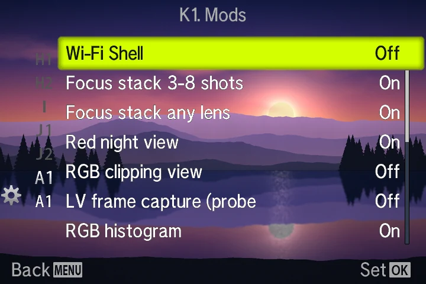
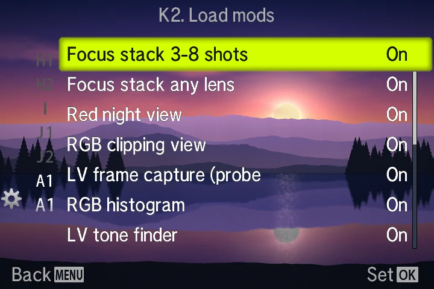

# Card mods

<!-- human page -->
<!-- house style -->

## Key points

- A card mod is a small piece of our own code that the camera loads from a file on the SD card.
- The camera is flashed once with a loader, and after that each test feature is a file on the card.
- Each mod is checked before it runs, and a row in the camera's own menu switches it on or off.
- Holding OK at power-on, or taking the card out, gives you a stock camera.

A card mod is a small piece of our own code that lives as a file on the SD card. The camera loads it at start-up, and
a row in the camera's own menu turns it on or off.

This changed how we test features on our own camera. Before, every change meant flashing the whole firmware again.
Now the camera is flashed once with a loader, and after that each test feature is a file on the card. This page
describes how that works. It is research notes, not a download.

## Loader

The flashed firmware carries only the loader. It is a small piece of code that starts late in the boot, after live
view is up. It hooks one place in the camera's start-up, and that hook does nothing but create a low-priority task.
The task then does the work.

1. It waits for every part of the main program to finish loading.
2. It checks whether OK is held, and stops if it is.
3. It opens the card, retrying for a while in case the card mounts late.
4. For each mod file, it checks the magic word, the length, the checksum and the version.
5. It copies the mod into a region of memory the camera never uses, and runs it.
6. The mod installs its own hooks into the running firmware and registers its menu row.

Because of the checks in step 4, a truncated or wrong-version file is ignored.

Whether each mod is on or off is kept in the unused tail of the camera's own settings. So it survives power-off along
with everything else you set.

## Menu page

The loader adds a letter "K. Mods" to the Custom Menu. It has one Off and On row per mod it found, plus a row for the
camera's own Wi-Fi debug shell.

*Left, the Mods page in the Custom Menu, where each row switches one mod on or off. Right, the second page in the newest test build, which picks the mods that load at the next power-on. Emulator screenshots.*

## Safety compared with flashing

Flashing writes the whole firmware. If the result does not boot, recovery depends on a small part of the firmware that
is never rewritten. Card mods leave that alone.

- A broken mod file is caught by the checks and ignored.
- A mod that behaves badly is switched off from the menu, or by deleting the file.
- Taking the card out, or holding OK at power-on, gives you the stock camera back.

The loader itself is still flashed, so it goes through the same pre-flash checks as any other build.

## Limits

- **Nothing loaded from the card runs during the boot.** Anything that has to act before the main program is ready
  stays in the flashed firmware. That includes boot guards and changes to what the boot copies.
- **Memory must be written through the right address.** The processor sees the same memory twice, once cached and once
  not. Writing code through the cached view resets the camera, so mods write through the uncached one.
- **Quick power off and on keeps mods loaded,** because that is not a real boot. A full power-off reloads them.
- **A mod that patches below a safe range is marked.** Those rows are listed last with a "!" so it is clear they reach
  deeper into the firmware than the rest.

## In use

Holding OK at power-on skips everything, and so does taking the card out. Either gives you a stock camera.

Some mods switch on and off live from their row. Others patch something the camera reads once at start-up, so their
row is marked as needing a restart.

## Status

The loader runs on our camera. Mods already working this way are focus stacking with any lens, the 3 to 8 shot count,
a red night view, an RGB clipping view and a few small fixes.

## Credit

The card-loader pattern comes from OMKit by necrostaz, which has run this way on the OM-5 II since October 2026. Some
of the safety ideas come from fenykl by atx. Keeping mod settings in the tail of the camera's own settings image
follows the Caduceus E-P7 and OM-3 projects.

## Further reading

- [Modifying the firmware](../firmware/patching-techniques.md#21-load-feature-code-from-the-card), section 21, has the loader's method and its pitfalls.
- [Saved settings and menu rows](saved-settings-and-menu-rows.md) explains the menu letter and how the rows are added.
- [Memory map](../hardware/memory-map.md) shows where the loader and the mods live.

