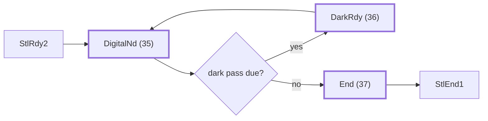

# Live ND: technical notes

<!-- house style -->
> **Technical reading.** The detailed version of [Live ND](live-nd.md), for readers who want the internals.

*Last reviewed 2026-11-27.*

Live ND is a digital ND filter. Instead of one long exposure through a dark filter, the camera takes several shorter
exposures and averages them into one photo. Moving water or clouds blur as if you had used a neutral density (ND)
filter, without the filter. The OM-5 has it. The E-M5 III has the same chip and sensor but doesn't. Bringing it over was
this project's main goal.

The firmware's internal names for it are `DIGITAL_ND`, `DigitalNd` and `iseq_nd`.

This page explains how Olympus built Live ND on the OM-5, how our port works on the E-M5 III, and what we learned
getting it to run. The research closed with Live ND working on test firmware.[^pol1] The builds are research builds
tested on one camera. Nothing is released to install.

The small numbers after a fact link to [Sources and dates](#sources-and-dates), which say how the fact is known and when.
On the notes site the number's colour shows the evidence: green = seen on our camera, blue = read in the firmware,
grey = inferred.

| term | meaning |
|---|---|
| ND2, ND4 … ND16 | the strength of the effect, 1 to 4 stops. ND8 means 8 frames merged. |
| job 11, job 12 | image-engine programs from the OM-5. Job 11 merges the frames of a photo and job 12 builds the live-view preview. See [Image engine](../hardware/image-engine.md). |
| route 4, StlUhs | the burst capture path we use to get frames. See [Shooting sequencer](../firmware/shooting-sequencer.md). |
| armed | the user has asked for Live ND, by a request file on the card plus S or M mode. Unarmed, every hook falls through to stock behaviour. |
| Tv | shutter time |
| N | number of frames |

*Terms used on this page.*

## Status

This is where the work stood when the research closed, on our E-M5 III using test firmware.

- One press takes a full Live ND shot. Our port of the OM-5's own Live ND shooting states takes N frames at the set
  shutter speed and merges them with the OM-5's image-engine job 11 into one photo. ND2, ND4, ND8 and ND16 work, at
  1/8 s and at 1/125 s, and several presses in a row work with no restart in between.[^cam2]
- The live-view preview works. With LV Simulation on, live view shows the Live ND blur as the photo will have it. It
  averages up to 240 frames with the OM-5's job 12, as on the OM-5.[^cam2] Details are in
  [Live-view preview](#live-view-preview).
- Noise reduction works at low ISO.[^cam6] At ISO 3200 it reset the camera at the save.[^cam6] A fix is built but was
  never run.[^fw9] Details are in [Noise reduction](#noise-reduction).
- Live ND has rows in the camera's own shooting menu, and the values survive power-off.[^cam6] Letting those rows drive
  Live ND, instead of our hidden settings page, is built and was never tested.[^fw9]
- Live ND in silent single drive, not only the drive we test with, is built and was never tested.[^fw9]
- The camera starts normally. The test builds used to restart the camera once at every power-on, and the cause is
  found.[^cam7] Details are in [Power-on restart](#power-on-restart).

## How Olympus does it (OM-5 1.2, our donor)

The OM-5 takes N frames at the shutter speed you set and averages them on the image engine. The "digital" shutter time
it shows is N × Tv.

- Live ND on is prop 7745, the ND number is prop 7761 and LV Simulation is prop 7777. Prop 7761 values 1 to 5 are ND2
  to ND32 in the menus.[^fw1]
- The photo path takes N ≤ 16 frames at the set Tv per frame. Image-engine job 11 merges them with a computed white
  balance clip (WBClip).[^fw1]
- ND codes 1 to 4 are ND2 to ND16. The light table caps at 16.[^fw1]
- The "digital" shutter time (N × Tv) is derived for display only.[^fw1]
- `frame_max` (30 × digital time) is used only by the live-view preview. That is job 12, in the module `iseq_ndlv`,
  with start, add and roll steps.[^fw1]
- Three shooting states run the shot, 31 DigitalNd, 32 DarkRdy and 33 End. They are entered when `continue_mode` is 4
  and the Live ND flag at ctx+2196 is set.[^fw1]
- DigitalNd sends its own type-7 sensor request, with kind `0x400`, flag 1 and fps 0. This lets frames be slower than
  1/15 s.[^fw1]
- The Tv limit is N × Tv ≤ 64 s.[^fw1]
- The OM-5 and OM-5 II engines stop at ND16. Their ND32, ND64 and ND128 strings are shared menu text.[^fw1]
- The OM-1 and OM-1 II have native ND64 and ND128 with the same `iseq_nd` design. Their levels go to 6 and 7, the light
  table to 64 and 128, and six `9BIT_BAYER` accumulators accumulate rather than hold frames. Their image-engine jobs
  can't be reused, but the logic can.[^fw1]
- The E-M1 III has the same engine and a 32-frame table.[^fw1]

## What the E-M5 III already has

- The OM-5 plumbing is compiled in but switched off. Take-parameters +119 and +120 are zero, the functions are identity
  stubs, and AE ids 299 to 302 exist.[^fw1]
- The image-engine jobs and the DigitalNd states are absent.[^fw1]
- The E-M5 III image engine runs OM-5 job 11 correctly and job 12 to completion.[^cam1]

## How our version works

- **Trigger.** A request file on the card chooses the ND level. The shot is taken with a silent high-speed burst press
  in S or M mode. Without the request, every change falls through to stock behaviour.[^cam1]
- **Shooting states.** Our port of the OM-5's three Live ND states, E-M5 III states 35 to 37, captures N frames and
  ends the shot, as on the OM-5.[^cam1]
- **Long frames.** The sensor request asks for kind `0x400` with fps 0, so each frame is as long as the set shutter
  time. It goes out only from the Live ND shot's own request builders.[^cam1]
- **Merge.** The frames are kept as they arrive. At the end, OM-5 job 11 averages them into a separate output frame,
  which the camera develops and saves as the photo. ND2, ND4, ND8 and ND16 use 2, 4, 8 and 16 frames.[^cam1]
- **Memory.** The main image pool has 20 slots in two blocks. Ids up to 8 are in the first block and ids 9 to 20 in the
  second, so a slot address must come from the pool, never from a stride. 16 frames fit, with spare slots for the
  stream.[^cam1]
- **Live view.** The OM-5's job-12 preview, described in [Live-view preview](#live-view-preview).

Only a silent single shot (drive 30) may read the request file or write logs. A burst writes nothing.[^fw3]

## What we measured on the camera

- A burst without the sensor request change runs at 60 fps (16.6 to 16.7 ms) at every shutter time, so frames clamp to
  about 1/60 s. With the request, frames follow the set time, 125.0 ms apart at 1/8 s.[^cam1]
- A merged ND8 (8 × 1/8 s) on a tripod has the same brightness as a single 1/8 s shot, within 0.03 EV.[^cam1]
- Job 11 takes 32.5 ms for 2 frames, about 87 ms for 8 and 142.5 ms for 16.[^cam1]
- The merged JPEG gets smaller as N rises, because there is less noise. It is 3.96 MB at ND2, 3.23 MB at ND4 and
  2.64 MB at ND8.[^cam1]
- 16 frames at 1/125 s arrive without loss, and Live ND works on several presses in a row.[^cam1]
- Testing a T/N exposure needs no firmware. Set Tv = T/N in M mode. The OM-5's shutter step tables are byte-identical
  in the E-M5 III.[^fw1]

## Porting the OM-5's own Live ND states

Our first versions merged frames ourselves after a native burst. The OM-5 instead runs three dedicated shooting states,
DigitalNd, DarkRdy and End. They capture exactly N frames, hand each to the merge engine and finish the shot. We ported
those states as E-M5 III states 35 to 37, so one press behaves like the OM-5.

The light frames are taken in DigitalNd. When a dark pass is due, DarkRdy prepares it and DigitalNd runs again with the
dark flag set, so the dark frames come in the same way. End then hands over to the native end states.[^cam6]

*The Live ND shooting states, our ported ones in bold. Arrows show the order of states.*

A dark pass is due when the shot was not aborted, the noise reduction flag is 1 and the dark flag is still 0.[^fw5]

### How it was solved

At first the camera either never ended the capture or reset itself about a second later. No log in memory survived the
reset. Tracing every run live over the camera's own [Wi-Fi debug shell](wifi-debug-shell.md) replaced that
guessing.[^cam2] Each traced run showed one place where an E-M5 III function behaves differently from the OM-5 function it stands in for.

- **Capture start.** The E-M5 III's start function writes -1 through three request pointers. That turns the N-frame
  sequence into an endless burst. A zero pointer there is a write to address 0, which was the reset. The port uses its
  own copy of the start without those writes.[^cam2]
- **Run-dry frame.** Near the end the OM-5 hands out a placeholder job with frame id 0 and skips the capture call for
  it. The port has to keep that check.[^cam2]
- **Display at the end.** The display task's "resume live view" handler waits, with no timeout, for a flag that only the
  sequencer's event 83 sets. The Live ND end state must handle events 81, 82 and 83.[^cam2]
- **Output frame.** The OM-5 merges all N frames into a separate output frame that the sensor never fills. Without the
  merge, the saved photo is an unwritten buffer.[^cam2]
- **Button release.** An event with no handler in the current state makes the dispatcher print a history dump. At fast
  shutter speeds the dump stalls the frame refill and loses frames. The release events need no-op handlers.[^cam2]

The general lesson is to compare each E-M5 III function that ported code calls with the OM-5 function it replaces, not
just the arguments.

See also: [Live ND port layers](../firmware/live-nd-port-layers.md), which has the addresses, the details and the seams
between ported and native code.

## Live-view preview

With LV Simulation on, the OM-5's live view shows what the Live ND photo will look like. It keeps a ring of recent
live-view frames. On every new frame it averages the last `frame_max` of them with image-engine job 12. `frame_max` is
30 per second of the digital exposure time, up to 240. The switch is made per frame inside the live-view module, not by
the shooting states.[^fw5]

The preview needs job 12 and also its setter, which fills the image engine's parameter window.[^fw1]

### What we built

The E-M5 III has none of that code, so we added it step by step.

| step | what it proved | result |
|---|---|---|
| plumbing | `frame_max` and the digital time from the E-M5 III's own AE match the OM-5's rule | passed[^cam2] |
| memory peeks | the live-view raw frame on the E-M5 III is 2912 × 544 pixels, in rows of 3328 bytes | passed[^cam2] |
| job 12 on stored frames | job 12 runs on E-M5 III frames. Its reset, add, slide and average steps give correct results. | passed[^cam2] |
| job 12 on live view | the per-frame hook works. Job records carry the CPU they run on, so jobs from the live-view task (CPU 1) must be counted separately. | first live preview, 8 frames[^cam2] |
| full window | the window follows the dial up to 240 frames, kept in up to 14 borrowed main frames. Live view runs at 30 fps with LV Simulation on, as on the OM-5. | passed[^cam2] |
| hand-back | borrowed frames go back before a photo. Menu and playback don't pass that point. | passed[^cam3] |
| restarts | the blur restarts when the shutter speed changes. The first frames after a photo are skipped. | passed[^cam4] |
| shake restart | the blur restarts when the camera moves, judged from the stabiliser's gyro readings as on the OM-5 | felt right in a first test, being tuned[^cam4] |

*The preview port step by step, with the camera result of each step.*

The borrowed frame memory goes back before each photo, and the preview comes back after it.[^cam3] The light lines that
showed for a moment after a photo are gone.[^cam4]

### Restarting the blur when the camera moves

If you move the camera, the averaged preview smears the old view into the new one. So the OM-5 throws the average away
and starts again. It decides from the stabiliser's gyro, not from the picture.[^fw2]

1. With each live-view frame, the stabiliser reports how far the camera turned.
2. The firmware converts that into live-view pixels, one number across and one up and down.
3. The OM-5 compares each number against a limit and restarts when either is over it.

The limit grows with the exposure time. It is normal up to 16 s, twice as large from 16 s and four times as large from
32 s, because with a long exposure a little movement is expected anyway. After a restart, the OM-5 keeps restarting for
500 ms, so the blur doesn't build up again while the camera is still settling.[^fw2]

The E-M5 III's stabiliser sends the same report once per live-view frame. Its firmware has the same conversion routines
but never applies them in live view. We call those native routines on each report and use the OM-5's rule.[^cam4]

| camera | gyro reading |
|---|---:|
| on a table | 0 |
| held still in the hand | about 13 |
| picked up | about 250 |
| panned | about 360 |

*Gyro readings on our E-M5 III, the larger of the two numbers per frame. Rough values.[^cam4]*

With a limit of 40, the preview kept building up when held still and restarted on a real move. That felt right in a
first test.[^cam4]

Our first try compared the pictures instead, using a sample of pixels from frame to frame. It reacted only to a big,
sudden move. A hand waved in front of the lens set it off while the gyro didn't change.[^cam4] A picture test can't tell
a moving subject from a moving camera. A moving subject, such as water or clouds, is exactly what Live ND is for, so the
gyro is the right input.

The limit, the exposure-time scaling and the hold time are copied or guessed values. They stay adjustable on the test
builds until they're tuned for other lenses, slow pans and long exposures.[^inf1]

See also: [Stabiliser](../hardware/stabiliser.md), which describes the gyro reports.

### Focusing

The preview survives repeated autofocus.[^cam5] Two problems had to be fixed for that.

- A logger we had added for camera requests wrote over the preview's settings words. After about ten autofocus presses
  the preview stopped for good. Turning the logger off fixed it.[^cam5]
- Each autofocus press asks the sensor for mode 9 at 120 fps and then for mode 0. Frames from those mode changes drew
  white lines over the preview with continuous AF (C-AF). The preview now skips frames by the requested sensor mode, and the
  lines are gone.[^cam5]

### Memory for the preview

The OM-5 keeps a dedicated ring of frame buffers for the preview. Like all its buffer pools, that ring is built at every
power-on and simply sits unused when the preview is off. There is no switch to a different memory layout.[^inf2]

On the E-M5 III we don't copy that. Adding pools at power-on would change the start-up code, and a mistake there can't
be recovered from the card. So our preview borrows main frames while it runs. A dedicated pool, if we add one, will be
made when the preview starts and removed when it ends.[^inf2]

The merge (job 11) and the preview (job 12) share the image engine. When a preview job is still running at the press,
the merge waits for it to finish.[^cam6]

## Noise reduction

On the OM-5, the dark pass is the camera's normal dark-frame noise reduction. After the light frames, it takes dark
frames. The image side builds the same job-11 record from them and stores the result as the dark frame for the normal
subtraction.[^fw5]

On the E-M5 III, the stock noise reduction decision says no for any sequential drive, before it reads the setting. The
port clears that for Live ND shots.[^fw6] The dark pass also has to send the single-shot request, as the OM-5 does, and
its finish request has to carry the OM-5's dark-pass values.[^fw6]

With Noise Reduction on, the camera merges the light frames, then the same number of dark frames, and saves a normal
photo. This worked at ND4 and ND16, at ISO 200.[^cam6]

At ISO 3200, Noise Reduction off works. Noise Reduction on reset the camera at the save, because the preview still held
frames that the dark pass needed.[^cam6] A fix that hands the preview frames back earlier is built and was never
tested.[^fw9] Until then, use Noise Reduction on only at low ISO.

## Menu

Live ND has rows in the camera's own shooting menu, and the values survive power-off.[^cam6] Letting those rows drive
Live ND, instead of our hidden settings page, is built and was never tested.[^fw9]

On the OM-5 II 1.1 the menu path is Shooting Menu 2, then 1. Computational Modes, then Live ND Shooting. That row is
greyed in P and enabled in S and M. Its page has Live ND Shooting Off or On, ND Number and LV Simulation. ND Number lists
ND2 to ND16 and wraps.[^emu1]

## Power-on restart

The test builds restarted the camera once at every power-on. The cause was one of our memory sections ending exactly
where another processor core's start-up code is staged. With the section end back at its stock value, the restart is
gone.[^cam7]

At every start, stock firmware stages a 6 KB block of code for the other two cores, and the restart paths copy it
again. Our builds had raised the end of section 10 so that it ended on the first byte of that block. The two did not
overlap, but there was no margin.[^fw7] The exact mechanism is not known.[^inf4] The strongest candidate is the boot
loader's access monitor. Until the section is ready, it watches a window that ends at the section end. Its end address
is inclusive, and it folds uncached addresses onto cached ones, so the raised window covered the first word of the
block. Cores 1 and 2 are started before the loader. Core 2 copies the block at once. Core 1 copies it only after
clearing about 4.7 MB, so its read can fall inside the armed window.[^fw7] Whether the monitor sees core 1 is
unproven.[^inf4] The emulator never reproduced the restart, because it doesn't model the start order of the
cores.[^emu2]

The lesson is a rule for every build. Never end a section or our region flush against memory another core uses. Leave
a gap of at least one cache line, and better a full 4 KB page.[^pol2] A cache line is 16 bytes on the MN103 cores and
32 bytes on the ARM Cortex-A9 cores. The margin proven on the camera is 12 KB, between the end of section 10
and the block on other test firmware.[^cam7] Our pre-flash check fails a build with less than 32 bytes of margin and warns under
4 KB.[^fw7]

See also: [Gotchas](../reference/gotchas.md) and [Caches](../hardware/caches.md).

## Limits

- At ND16 the main pool's 20 slots hold 16 frames plus 2 for the stream.[^fw1]
- ND32 has no native code to port on the OM-5 or OM-5 II.[^fw1] The plan was a two-pass merge or a running
  accumulator, as the OM-1 does natively.[^inf1]
- Another project, caduceus-om5, reports ND32 and ND64 working on an OM-5 II camera after two edits only.[^cam8] One edit
  extends the allowed list of setting 1710 to 1 to 6. The other extends the ND step selector to steps 5 and 6. The same
  selector exists in the OM-5 1.2 and in our E-M5 III port.[^fw8] That questions the verdict above that the engine
  stops at ND16. Whether their ND64 photo merges 64 frames or 16 dark ones is not recorded.

## Paths we tried and dropped (don't repeat)

- An earlier port based on the E-M1 III's Live ND was replaced by the OM-5 version. The OM-5's buffer layout fits the
  E-M5 III's memory of about 1 GB. The E-M1 III's needs about 2 GB.[^inf1]
- Capping the burst frame rate to get longer frames was the wrong model. The OM-5 never caps the frame rate. It asks
  the sensor for longer frames, with kind `0x400` and fps 0.[^cam1]

## On the E-M5 II and E-M5 (Mark I)

- **E-M5 II 4.1.** It has no Live ND code.[^fw4] Its image engine runs the same 320-bit program format. The stub and the
  memcpy job are byte-identical to the E-M5 III's, so the OM-5 jobs 11 and 12 might load.[^fw4] But the job setters,
  frame pools, sensor modes and capture path are different code on a different chip, with 21% of register constants
  shared.[^fw4] A port would be a new project with the PEN-F as the code reference, starting with one OM-5 job run on
  an E-M5 II.[^inf3]
- **E-M5 (Mark I) 2.3.** There are no programs of this format anywhere in the firmware, so there is no engine to run the
  merge.[^fw4] A port is very likely impossible.[^inf3]

See also: [Older bodies](../bodies/comparison-technical.md#older-bodies-e-m5-ii-and-e-m5-mark-i).

## Open questions

- **Single-drive trigger.** In single drive, the stream was cut after 1 frame, and the cause was not found.[^cam1] The
  trigger stayed the silent high-speed burst until the menu stage.
- **Shake restart.** The limit, scaling and hold time still need tuning for other lenses and focal lengths, slow pans and
  long exposures.[^cam4]
- **Noise reduction.** At ND16 with 1 s frames and ISO 200, no photo had hot pixels, so the subtraction is not
  visible.[^cam6] The merge with Noise Reduction on has lifted shadows, perhaps because the dark frame is applied with
  a black-level offset.[^inf5]
- **Power-on restart.** Whether the access monitor sees core 1's read is unproven.[^inf4]

## Address reference

E-M5 III 1.7 addresses unless a body is named. Functions are block0 addresses (base `0x60021020`).

| item | address |
|---|---|
| Live ND light table (OM-5) | `0xa26f0644` |
| ND step selector (OM-5 II) | `0x6023c850` |
| ND step selector (OM-5 1.2) | `0x60239afb` |
| ND step selector in our E-M5 III port | about `0x607a9d4f` |
| shutter step tables, byte-identical in OM-5 and E-M5 III | `0x604d32ae`, `0x604d3328`, `0x604d337a` |
| OM-5 per-frame preview | `0x6035d032` |
| OM-5 job-12 parameter setter | `0x6032a739` |
| OM-5 shake judge | `0x6059d3d8` |

*Live ND code and tables on the OM-5 and OM-5 II, and the twins we use.*

| item | address |
|---|---|
| main image pool, first block (ids up to 8) | `0xb0000000` |
| main image pool, second block (ids 9 to 20) | `0xc4000000` |
| image-engine parameter window | `0x9d000000` |
| E-M5 III capture start (writes -1 through the request pointers) | `0x602b0a5a` |
| event dispatcher | `0x602a0f90` |
| history dump called on an unhandled event | `0x60227bb0` |
| native no-op handler | `0x602a14bb` |
| live-view frame routine, preview hook point | `0x6034931b` |
| stabiliser reply completion | `0x601146f2` |
| stabiliser unit converters | `0x60129190`, `0x601291bc` |
| noise reduction decision | `0x602bb83e` |

*E-M5 III functions, tables and memory used by the port.*

| item | address |
|---|---|
| section-10 end word | `0x60045e24` |
| section-10 end, stock | `0x61478000` |
| section-10 end, raised in the test builds | `0x61483000` |
| section-10 end with the proven 12 KB margin | `0x61480000` |
| code block for the other two cores, staged at start | `0xa1483000` |
| flash source of that block | `0x41be2000` |

*Memory behind the power-on restart.*

## Sources and dates

The small numbers in the text point here. Each note says how a fact is known and when.

[^fw1]: Read in the firmware.
[^cam1]: Seen on our E-M5 III using test firmware.
[^inf1]: Inferred, not tested directly.
[^cam2]: Seen on our E-M5 III using test firmware, 2026-11-12, traced live over the Wi-Fi debug shell.
[^cam3]: Seen on our E-M5 III using test firmware. The hand-back fix was confirmed on 2026-11-15.
[^cam4]: Seen on our E-M5 III using test firmware, 2026-11-17.
[^cam5]: Seen on our E-M5 III using test firmware, 2026-11-18.
[^cam6]: Seen on our E-M5 III using test firmware, 2026-11-19.
[^cam7]: Seen on our E-M5 III using test firmware, 2026-11-22.
[^cam8]: Reported by the caduceus-om5 project on an OM-5 II camera, 2026-11-18. The matching addresses were read in the firmware by this project.
[^fw2]: Read in the OM-5 1.2 firmware, 2026-11-17.
[^fw3]: Read in the firmware, 2026-11-05.
[^fw4]: Read in the E-M5 II 4.1 and E-M5 2.3 firmware, 2026-11-21.
[^fw5]: Read in the OM-5 1.2 firmware, 2026-11-12.
[^fw6]: Read in the firmware, 2026-11-18 and 2026-11-19.
[^fw7]: Read in the firmware, 2026-11-22.
[^fw8]: Read in the firmware, 2026-11-18.
[^fw9]: Built in test firmware and never run on the camera. The noise reduction fix and the menu-driven version date from 2026-11-19, the silent single version from 2026-11-20.
[^inf2]: Read in the firmware, with the design choice inferred, 2026-11-15.
[^inf3]: Inferred from the firmware facts, 2026-11-21.
[^inf4]: Inferred from the firmware, 2026-11-22, not tested.
[^inf5]: Inferred, 2026-11-19, not tested on the camera.
[^emu1]: Seen in an emulator running the OM-5 II 1.1 firmware, 2026-11-05.
[^emu2]: Seen in an emulator, 2026-11-22.
[^pol1]: Project decision, 2026-11-24.
[^pol2]: Project rule, 2026-11-22, after the power-on restart was found.

## History

- 2026-11-05: giving the long-frame sensor request to every caller while Live ND was armed hung the camera at the
  arming single shot. Since then it goes only to the Live ND burst's own request builders.
- 2026-11-05: we first read the OM-5's first sensor frame as landing in the output frame, which made the first frame the
  merge target. Corrected 2026-11-12. The output frame is written only by the merge.
- 2026-11-12: we first thought the capture ends when the frame supplier runs dry. It ends because the OM-5 capture is an
  N-frame sequence. The E-M5 III start function had made it endless.
- 2026-11-12: a white photo at 1/125 s was first read as a per-frame resource limit. The cause was the button release
  having no handler, and the history dump it triggered.
- 2026-11-12: the E-M5 III live-view frame record was first thought to lack the raw frame handle at +16. It carries it,
  like the OM-5. Our dump showed 0 because the handle is cleared on release.
- 2026-11-12: before the preview port, live view after a Live ND shot ran at the shot's frame time. The long-frame
  request stayed on because `continue_mode` stayed 4 until the next Standby.
- 2026-11-17: advice to keep Noise Reduction off for Live ND was over-cautious. The port already skipped noise reduction
  for Live ND shots. The dark pass was added later.
- 2026-11-18: guarding the two image-engine dispatch hooks with the section ready bit did not remove the power-on
  restart, so they were not the cause.
- 2026-11-18: the preview dying after about ten autofocus presses was first blamed on stuck status words. The cause was
  the request logger.
- 2026-11-19: the C-AF white lines were first blamed on a live-view raw pool that overlaps the borrowed frames. The
  cause was the sensor mode change.
- 2026-11-19: a crash on the dark step was first read as a fault in a camera task handler. It was an external NMI with a
  bus-error signature. The likely cause was the dark pass sending the burst request instead of the single-shot request.

