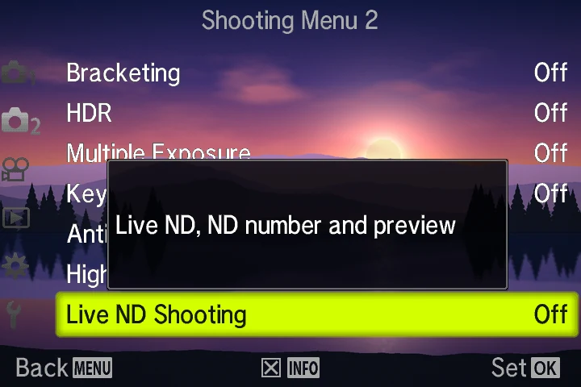
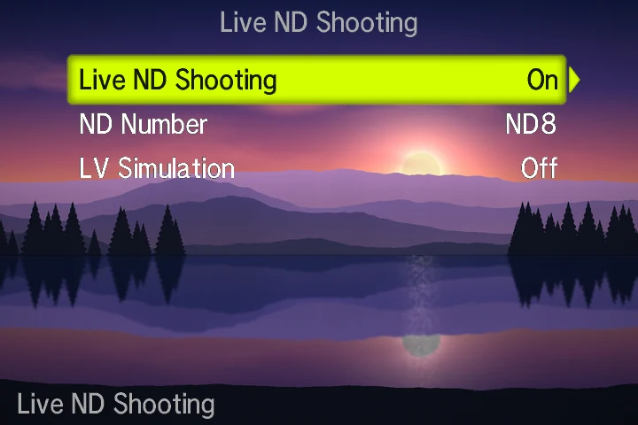
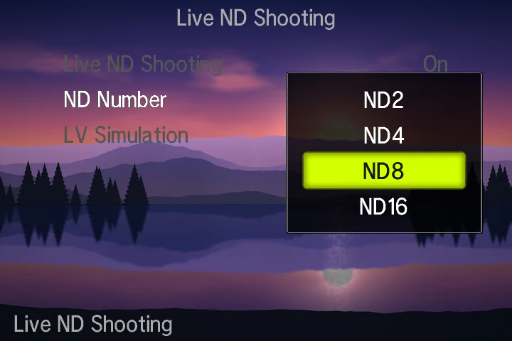

# Live ND

<!-- human page -->
<!-- house style -->

## Key points

- Live ND averages several shorter exposures into one photo, so moving water and clouds blur as behind a real ND filter.
- On our E-M5 III, test firmware ported from the OM-5 takes an ND2 to ND16 Live ND photo from one press.
- The live view shows the blur before you shoot, and noise reduction works at low ISO.
- The research has closed with the feature working on test builds, and nothing is released to install.

Live ND is a digital ND filter. Instead of one long exposure through a dark glass filter, the camera takes several
shorter exposures and averages them into one photo. Moving water and clouds blur as they would behind a real ND filter,
but nothing goes on the lens.

The OM-5 has Live ND. The E-M5 III has the same image chip and sensor but not the feature. Bringing it over was
the first big goal of this project. The research closed with Live ND working on test builds, as described below.
Nothing is released to install.

## On the OM-5

When you take a Live ND photo on the OM-5, it does not make one long exposure. It takes a short burst of frames, each
at the shutter speed you set, and the image chip's own programmable engine averages them as they arrive. ND8 means 8
frames, so a shot at 1/8 s per frame looks like 1 second through an ND8 filter. The camera shows that longer "digital"
shutter time on screen.

Three dedicated steps in the camera's shooting sequence run the shot. The first captures the frames, the second takes
dark frames for noise reduction, and the third finishes the photo. The averaging is done by a small program for the
image engine, which the camera loads when it needs it.

The live view preview works the same way. The camera keeps the most recent live view frames and averages them on every
new frame with a second engine program. The longer the digital shutter time, the more frames go into the average, up
to 240.

## The port

The E-M5 III already contains some of the OM-5's Live ND settings, compiled in but switched off. It does not have the
three shooting steps or the two engine programs. So the port brings those over.

- **The two engine programs come from the OM-5.** The E-M5 III's engine runs them unchanged, because it is the same
  engine.
- **The three shooting steps are rebuilt for the E-M5 III.** They call the E-M5 III's own functions wherever the OM-5
  calls its own.
- **The frames are stored in the camera's main photo memory,** which has room for 16 frames plus the ones still
  streaming in. That is why ND16 is the limit today.
- **The preview borrows frames from that same memory while it runs** and hands them back before every photo. The OM-5
  keeps a separate memory pool for the preview. Adding one would change the camera's start-up, and a mistake there
  can't be undone from the SD card.
- **Every change stays switched off unless you ask for Live ND.** Without that, the camera behaves exactly as stock.

## In use

This is how Live ND behaved on our E-M5 III using test firmware, at the last camera run.

- **One press takes a Live ND photo.** The camera takes 2, 4, 8 or 16 frames at the shutter speed you set (ND2 to
  ND16) and merges them into one photo. It works at slow and fast shutter speeds, and for several presses in a row.
- **Live view shows the blur before you shoot.** With LV Simulation on, the screen shows the averaged picture, just as
  the OM-5 does. The blur starts again when you turn the shutter dial or move the camera.
- **Noise reduction works at low ISO.** With Noise Reduction on, the camera takes the same number of dark frames after
  the light ones and subtracts them, like a normal long exposure. At high ISO this still needs a fix, which is built but
  was never tried.
- **Live ND has its own rows in the camera's shooting menu,** and the settings survive power-off.
- **The camera starts normally.** Early test builds restarted the camera once at every power-on. The cause is found
  and fixed (see [Lessons](#lessons)).

*Left, the Live ND Shooting row in the shooting menu, with its help text. Middle, the Live ND page with the on switch, the ND number and LV Simulation. Right, picking the ND number. Emulator screenshots.*

## Measurements

- A merged ND8 shot (8 frames at 1/8 s) on a tripod is as bright as a single 1/8 s shot, within 0.03 EV. Averaging
  keeps the exposure, and only the motion blur builds up.
- Merging takes about 33 ms for 2 frames and about 140 ms for 16.
- The merged photo gets smaller as the ND number rises, because averaging removes noise. A JPEG drops from about
  4.0 MB at ND2 to 2.6 MB at ND8.
- Sixteen frames at 1/125 s arrive without a loss.

## Lessons

**A ported function needs the same behaviour, not just the same arguments.** For a long time the camera either never
finished the shot or reset itself a second later. Watching every test live over the camera's own Wi-Fi debug shell
showed why. Each time, an E-M5 III function did something slightly different from the OM-5 function it stood in for.
One turned the fixed burst into an endless one. Another waited forever for a signal that only the OM-5's flow sends.
Comparing each function pair, not only how it is called, fixed all of them.

**The gyro is the right way to spot a camera move.** The preview has to start again when you move the camera, or it
smears the old view into the new one. Our first attempt compared the pictures, but a hand waved in front of the lens
set it off. A picture test can't tell a moving subject from a moving camera, and moving subjects are the whole point of
Live ND. The OM-5 uses the stabiliser's gyro readings, and so does our port now.

**Leave a gap next to memory another processor uses.** The power-on restart came from one of our memory sections ending
on the exact byte where another processor core keeps its start-up code. Moving the end back to where Olympus had it
fixed the restart. Our rule now is to leave a gap of at least one cache line, and preferably 4 KB, between our code
and memory another core uses.

**Copy the OM-5, not the E-M1 III.** The first port followed the E-M1 III, whose Live ND expects about 2 GB of memory.
The OM-5's version fits the E-M5 III's 1 GB, so the port switched to it.

## Other cameras

| camera | Live ND | notes |
|---|---|---|
| OM-5 | built in, ND2 to ND16 | the source of this port |
| OM-5 II | built in, ND2 to ND16 | another project reports ND32 and ND64 after two small edits. How those photos are made is not recorded. |
| E-M1 III | built in | same engine, needs about twice the memory |
| OM-1, OM-1 II | built in, up to ND64 or ND128 | a newer engine. The method carries over, the engine programs don't. |
| E-M5 III | our port | this page |
| E-M5 II | none | its engine reads the same program format, so a port might be possible, but everything around it is different code |
| E-M5 (Mark I) | none | no engine of this kind, so very likely impossible |

*Live ND on related cameras.*

## Status

The research closed with Live ND working on test builds. A photo, the live-view preview, noise reduction at low ISO
and the menu rows all worked on the camera. What was left was finishing work, not open questions. Each remaining item
already had a known cause, and two of them had a built fix.

Three things were left when the work stopped.

- Live ND should switch on from the menu rows instead of a hidden settings page.
- It should work in silent single-shot drive.
- The point where the preview restarts after a camera move needed tuning.

Builds for the first two were made but never tried on the camera.

We were satisfied with how it worked. So we stopped here, and put the time into documenting the camera's systems and
studying how far this hardware shares its design with newer bodies. The pages here stay as a record of how the feature
works and how it was brought over.

## Further reading

- [Live ND: technical notes](live-nd-technical.md) has the addresses, the shooting states, the measurements and the open items.
- [Feature ports](../guides/port-anatomy.md) walks through this port step by step.
- [Image engine](../hardware/image-engine.md) explains the engine programs that do the merging.
- [Wi-Fi debug shell](wifi-debug-shell.md) is how we watched the camera during tests.
