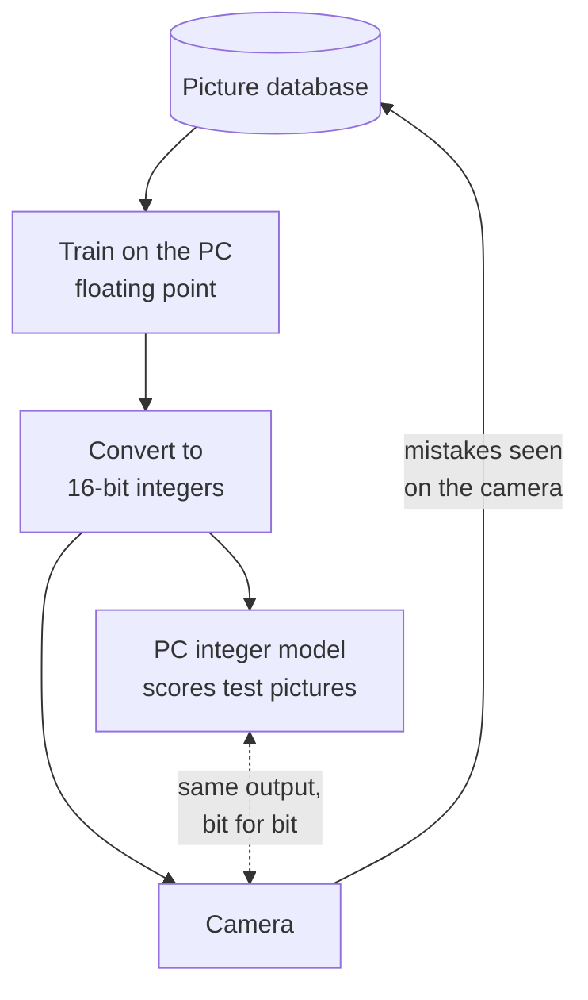

# Model training

<!-- human page -->
<!-- house style -->

## Key points

- We train our own detection models, only on public picture sets, for our network engine program.
- A PC model repeats the camera's integer arithmetic exactly, so we can test a model on thousands of pictures without the camera.
- Pictures without the subject matter as much as pictures with it. Together with a larger picture database, they took false birds from 41% of bird-free pictures to 7%.
- Our bird model finds heads and eyes better than the E-M1X network, and it is still a little behind on bodies.

This page describes how we train the detection models that run on our [network engine program](nn-engine-program.md).
It covers the network design, training for integer arithmetic, the picture database and how we measure the models.

## Network

Our network is called OWN-1. It is built for the engine program, not copied from a camera.

- The input is a 480 × 480 picture.
- The first layer halves the size. Later layers split each step into a cheap per-channel filter and a channel mix.
  This depthwise-separable design does the same job with far less arithmetic.
- Two output grids find subjects at two sizes, one 30 × 30 and one 15 × 15.
- For each grid cell the network gives boxes and scores for a subject's body, head and eye.

A pass costs 68 million multiply-adds. The E-M1X network needs 143 million.

## Training loop

*How a model is made and improved. The dotted line is the exactness check. Mistakes seen on the camera go back into
the picture database.*

### Integer training

The camera calculates in 16-bit integers. We train in floating point and then convert in three stages.

1. Train normally in floating point.
2. Measure how large every layer's values get on real pictures.
3. Choose a scale and a shift for each layer so the values fit in 16 bits with room to spare.

A PC model then repeats the camera's arithmetic exactly. Its output equals the camera's output bit for bit, so we can
test a model on thousands of pictures without the camera. The same check reports any gap between the integer model
and the floating-point one.

## Picture database

A model learns only what it is shown. Our first bird model was trained on bird photos only. On the camera it saw birds
in empty rooms.

The database now records, for every picture, which subjects are boxed and which a person has checked are absent.
Training sets are cut from it with as many subject-free pictures as pictures with a subject.

| source | used for |
|---|---|
| Open Images V7 | birds, cats, dogs and subject-free pictures |
| COCO 2017 | people, animals and subject-free pictures |
| CUB-200-2011 | close bird photos with part points (research use only) |

*Public picture sets in the database.*

## Measurement

Every model is scored on pictures it never saw in training. The E-M1X network is scored on the same pictures, with the
same decoding and the camera's own arithmetic.

| bird test, 8,000 pictures | E-M1X network | our first model | our current model |
|---|---:|---:|---:|
| body found (AP50) | 0.71 | 0.51 | 0.68 |
| head found | 0.51 | 0.48 | 0.60 |
| eye found | 0.15 | 0.20 | 0.26 |
| bird-free pictures with a false bird | 43% | 41% | 7% |
| time per pass | 59 ms | 14.4 ms | same program, about 14 ms |

*Bird models on the same 8,000 test pictures. A higher score is better.*

Our model replaces the E-M1X job only when it is better on every class and faster. It is faster now. The body score
is still 0.03 behind.

## Lessons

- Pictures without the subject matter as much as pictures with it.
- Give the output layers their own scales. Pinned to a fixed scale, confident subjects overflowed 16 bits and eye
  accuracy fell by more than half.
- Measure on varied pictures. A model that scored 0.90 on close bird photos scored 0.36 on everyday ones.
- One net per group of subjects works better than one net for everything. A shared bird, cat and dog net lost a
  little bird accuracy.
- A wider net cost twice the arithmetic and only improved eyes.
- Training on crops makes the close-up pass much better and costs almost nothing on the full picture.

## Hardware

Training runs on a desktop graphics card (RTX 5070 Ti). A bird model takes about two hours.

## Status

A bird model and an animal model are trained. The animal model treats cats and dogs as one subject, as the OM-1's
animal setting does. The bird model runs live on our E-M5 III using test firmware. Against the E-M1X bird network it
finds heads and eyes better and makes far fewer false detections. It is still a little behind on bird bodies.

## Further reading

- [Model training: technical notes](model-training-technical.md), including the
  [design notes for specialists](model-training-technical.md#design-notes)
- [Subject detection research](subject-detection.md)
- [Network engine program](nn-engine-program.md)
