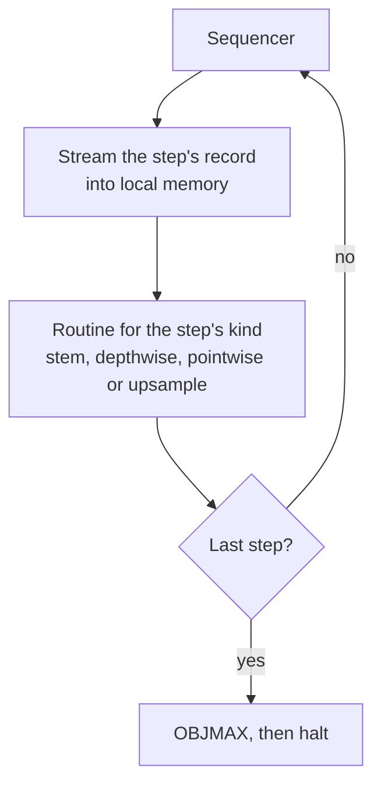

# Network engine program: technical notes

<!-- house style -->
> **Technical reading.** The detailed version of [Network engine program](nn-engine-program.md), for readers who want the internals.

*Last reviewed 2026-11-27.*

This page covers our own image-engine program for convolutional networks on the E-M5 III 1.7, the "NN player". We
wrote it from scratch on atx's field model of the 320-bit instruction word (fenykl, branch `feat-dsp`,
https://github.com/atx/fenykl, and https://m.atx.name/dsp.html). No Olympus or OM System microcode or data is used. The
only stock-derived constant is the idle word, checked against the field model's idle values.

The small numbers after a fact link to [Sources and dates](#sources-and-dates), which say how the fact is known and when.
On the notes site the number's colour shows the evidence: green = measured on our E-M5 III using test firmware,
blue = read in our own code and simulator, grey = inferred.

## Engine resources

| resource | what we rely on |
|---|---|
| instruction word | 320 bits. An op slot, four SIMD heads over 32 lanes, named S0, S1, S2 and S3, load and store ports, and X0 to X2 for scalar and immediate work.[^ext1][^cam1] |
| multiplier | S2. One 32-lane 16 × 16 multiply per word. S2 `0x5` reads its scalar as signed 16 bits.[^cam1] |
| adders | S0 and S1. A 32-bit sum is a low-half add on S0 with its carry mask passed through M into F1, then a high-half add on S1.[^cam1] |
| lane memory | about 64 KB of 32-lane int16 vectors for activations[^inf1] |
| local memory | 8 KB for layer records, weights and biases[^inf1] |
| program memory | 8,192 words[^fw1] |
| stream unit | main memory to lane or local memory and back, keyed commands on handed channel registers[^ext1][^cam1] |

*The engine resources the NN player relies on.*

## Program structure

One job runs the whole network. A sequencer loops over a step list and calls a routine per step.



*One network pass. The loop runs once per step in the list.*

```
pseudocode: one network pass (SEQ program)
for each step in the step list (in local memory):
    stream the step's record (sizes, shift, flags, buffer addresses) into local memory
    jump to the routine for the step's kind
        stem (3 x 3, stride 2, 3 or 4 input planes)
        depthwise 3 x 3 (stride 1 or 2)
        pointwise 1 x 1 (any channel counts)
        upsample 2x into a concat buffer
    routines return to the sequencer
after the last step:
    write the best objectness of every head row (OBJMAX)
    halt
```

- **One job per pass.** The 62 µs dispatch is paid once. The first job-list version needed 79 jobs.[^fw1]
- **Free concat.** A channel block is a run of planes. So the layer that makes one part writes straight into the concat
  buffer, and the upsampler writes the other part after it.[^fw1]
- **Row layout.** Each row is padded to whole 32-lane vectors, and the padding is kept at zero. So a layer's output
  feeds the next with no host step.[^fw1]
- **Packed small planes.** Planes 15 or fewer wide pack two rows per vector, in lanes 0 to 15 and 16 to 31. The routines
  pack and unpack with lane selects, because the stream unit cannot place rows at half-vector offsets.[^fw1]
- **Front step.** RGB1 turns the live-view picture (R G B 0 bytes) into planes on the engine in about 1 ms.[^fw1] On the
  CPU it took 250 to 330 ms.[^cam1]

## Arithmetic contract

The contract is shared with the training pipeline.

```
pseudocode: one output value
acc32 = bias
for each tap or input channel:
    acc32 += round_half_even(w * x / 2^shift)      # w, x int16
out = saturate_int16(acc32)
if the layer is leaky: out = max(out, floor(out * slope))   # slope 102/1024, or 1/8 in the new contract
```

- **Saturating adds.** The fast 1 × 1 loop adds each rounded term with S0 `0x29`, a saturating 16-bit add. That equals
  the 32-bit contract while every running partial stays inside int16. The quantiser caps terms and partials at 24,000 on
  256 calibration pictures.[^fw1]
- **A faster contract.** Per-tap rounding in 3 × 3 layers and a leaky slope of 1/8 cost no measurable accuracy. Both
  are in the player and exact in the simulator. A crop-trained model for them is trained and carded.[^fw1] On the
  camera it is exact and a 480 pass takes 13.91 ms, against 14.38 ms before.[^cam5] That is about 1.2 ms slower than
  modelled, and the cause is being measured.[^inf1]

See also: [Model training](model-training-technical.md).

## Routines

| routine | method | gain |
|---|---|---|
| stem (K3, stride 2) | banded rows. Even and odd lanes are split with S3 `0xd` and `0xc`, so only even output columns are computed. | 391 → 217 words per 480 row body |
| depthwise (K3) | a band loop streams each band plus halo rows, one pass per input plane, with partials kept in lane memory. Row bodies are unrolled up to 4 rows. | about 2×, to 14 to 15 multiply-adds per word at 60 to 120 wide |
| pointwise (PW) | two output vectors per iteration share each weight broadcast. A new input channel every 2 words. Weights for the next output channel stream in while the current one runs. | 2.84 million → 0.30 million words on a 96 → 128 test layer |
| upsample and concat (UP) | S3 `0x0a` duplicates lanes, and each row is stored twice | 94 words |

*The four layer routines.[^fw1]*

`sched.py` places loop bodies with a list scheduler. It respects unit, port, register (RAW, WAR, WAW) and lane-memory
hazards.[^fw1]

## Design notes

Each note gives the problem, the trick and what it bought.[^fw1]

**Amortised dispatch.** A job costs about 62 µs of ARM-side submit and completion, outside the engine.[^cam1] At 79 jobs
per pass that would be about 5 ms, a third of today's pass. The 79-job chain was only modelled.[^inf1] The sequencer
turns the network into one job. Each step streams a small record into local memory and jumps to a shared routine.
Dispatch is paid once. The cost is program space, since every routine lives in the same 8,192 words.

**Register-port pressure, not adder count.** The first 3 × 3 routine accumulated each tap in 32 bits on one adder. That
put three writes per product on one lane-file port, and the port set the pace, not the arithmetic. The fix splits the
32-bit sum. The low halves add on S0, whose carry mask goes through the M register into F1. The high halves add on S1
with that carry in. Each port now takes one write per product. With rows unrolled four at a time, the fix about doubled
depthwise speed, to 14 to 15 multiply-adds per word at 60 to 120 wide. The S0-to-F1 carry path was not in atx's
verified list. The SEQ2 camera run confirmed it, because every buffer came out exact.[^cam2]

**A saturating add that is still exact.** The contract is a 32-bit sum. The fast 1 × 1 loop instead adds each rounded
term with a saturating 16-bit add (S0 `0x29`), which frees a unit and a port per channel. That is only exact while every
running partial stays inside int16. The quantiser guarantees it. It bounds every term and every running partial at
24,000 on calibration pictures, leaving headroom for unseen ones. This is hardware and training co-design. The cheaper
instruction is correct because the model was built to keep it correct.

**Stride 2 on even lanes.** A stride-2 3 × 3 only needs even output columns. Each pair of input vectors is split into
even lanes E and odd lanes D with two lane selects (S3 `0xd`, S3 `0xc`). The three taps are then x-1 = D shifted down
one lane (lane 0 from the previous pair's D through U), x = E and x+1 = D. Half the columns are never computed. The 480
stem row body went from 391 to 217 words.

**Two rows per vector for small maps.** Maps 15 or fewer wide waste most of a 32-lane vector. They are stored with row
2m in lanes 0 to 15 and row 2m+1 in lanes 16 to 31. The 1 × 1 routine treats them as half-height 32-wide planes. The
3 × 3 routine builds its neighbour rows with lane selects, and the upsampler unpacks. The stream unit cannot place rows
at half-vector offsets, so all packing happens inside the routines. A 128 to 128 1 × 1 at 15 × 15 went from 10.4 to
23.1 multiply-adds per word.

**Shared weight broadcasts.** The 1 × 1 loop computes two output vectors per iteration. Both use the same weight
broadcast from the scalar file. So a new input channel starts every 2 words, and every unit is used at most once per
word.

**Hiding transfers.** The stream unit does one transfer at a time but overlaps compute.[^cam1] Depthwise bands and the
stem output are double-buffered. The 1 × 1 routine streams the next output channel's weights while the current one
runs. It loads inputs four channels per command, so each input is read once per layer instead of once per output
channel. Local-memory loads are 3.5 times slower than lane loads, so only parameters go there.[^cam1]

**A list scheduler under real hazards.** Loop bodies are placed by a small list scheduler. It knows each unit's latency,
port limits, register RAW, WAR and WAW hazards and lane-memory hazards. It also keeps one result bus free for the carry
mask. SEQ4 applied it to the 1 × 1 pair loop for the last 1 ms.

**Work around the network.** Two engine steps remove CPU work.

- RGB1 turns the live-view R G B 0 bytes into planes with even and odd lane extracts and 8-bit stores, in about 1 ms.
  On the CPU this took 250 to 330 ms.[^cam1]
- OBJMAX writes the highest objectness of each head row. The CPU decode reads those 15 vectors first, then only rows
  that pass. That is about 1,000 reads instead of 11,250.

**Exactness as the test oracle.** Every camera run writes its whole working memory, and the PC integer model must match
it byte for byte. A one-unit error anywhere shows up. So a camera run verifies timing and every instruction behaviour
at once.

### Efficiency by layer type

| layer type | example | MAC per word | limit |
|---|---|---:|---|
| 1 × 1, large map | 128 → 128 at 60 × 60 | 25 | multiplier and the weight broadcast |
| 1 × 1, small map, packed | 128 → 128 at 15 × 15 | 23 | multiplier |
| 1 × 1, small map, unpacked | 128 → 128 at 15 × 15 | 10 | idle lanes |
| depthwise 3 × 3, stride 1 | 64 channels at 120 × 120 | 15 | adder ports |
| depthwise 3 × 3, stride 2 | 64 channels at 240 × 240 | 10 | lane selects and memory waits |
| depthwise, tiny maps | 64 channels at 30 × 30, stride 2 | 4 | loop overhead and idle lanes |
| stem 3 × 3, stride 2, 3 inputs | 480 input | about 7 | the S3 lane-shuffle unit (even and odd split redone per output channel, in the program measured on camera) |

*Multiply-adds per instruction word by layer type. Modelled with the measured timing, before SEQ4's scheduler. The multiplier's ceiling is 32.[^fw2]*

Most of the arithmetic is in the large 1 × 1 layers, which run near the ceiling. The stem and the tiny maps are where
the remaining time is.

## Engine timing

A card of 21 timing jobs (TIM1) measured the engine.

| measure | value |
|---|---|
| clock | 3.471 ns per word |
| job dispatch | 62 µs (ARM-side submit and completion) |
| first run of a word | about 33 ns extra |
| lane-memory load | 196 ns per command + 4.35 bytes per ns |
| lane-memory store | 265 ns per command + 3.75 bytes per ns |
| local-memory load | about 208 ns + 1.15 bytes per ns |
| queued commands or a second channel | no gain, one transfer at a time |
| transfer beside compute | overlaps. A 32 KB × 64 load beside 2,000 words took 602 µs, where serial would be 1,007 µs. |

*Engine timing measured on our E-M5 III.[^cam1]*

## Speed line

OWN-1 at 480 × 480 needs 68.2 million multiply-adds per pass.

| run | change | camera | simulator |
|---|---|---:|---:|
| SEQ2 | whole network as one job, packed rows, S0/S1 split 32-bit sums | 17.48 ms | 17.46 ms |
| SEQ3 | depthwise bands and stem output double-buffered, 1 × 1 inputs four channels per load command | 15.38 ms | 15.18 ms |
| SEQ4 | 1 × 1 pair loop list-scheduled | 14.38 ms | 14.10 ms |
| E-M1X job, for comparison | | 59 ms | |

*Pass time per program version, on our E-M5 III and in our simulator.[^cam2]*

- Every run's whole arena, all 30 buffers, equals the PC integer model byte for byte.[^cam2]
- At SEQ4 the time splits into 1 × 1 about 8.1 ms, stem 3.2 ms and depthwise 2.6 ms. The stem is bound by the S3
  lane-shuffle unit, because the even and odd split is redone for every output channel.[^fw1]
- The peak, from the measured clock, is 32 multiply-adds per word, about 9.2 billion a second. OWN-1 reaches 4.74
  billion (about 51%). The E-M1X job (143 million in 59 ms) reaches 2.4 billion (about 26%).[^inf1]
- The camera program is 7,925 of 8,192 words. The new-contract program is 8,162, with 30 free.[^fw1]

## Live view

- The player runs 35 to 41 passes a second (mean 37 over 80 s), and every pass completes.[^cam3]
- A 320 × 320 crop pass around a found subject takes 9 to 11 ms, against 15 to 17 ms for a full pass.[^cam3]
- A crop card can share the full card's working memory, because one pass runs at a time.[^fw1]
- Back-to-back passes on a stale picture stopped the camera's live picture for 3 to 6 s.[^cam3] We now submit a pass
  only on a new picture. The likely cause is that the live-view job shares the engine.[^inf1]

## Bugs found on the camera

| run | symptom | cause | check added |
|---|---|---|---|
| first CONV1 | stock 100 ms timeout | control words left the op slot's R field (bits 120 to 122) at 7. Stock uses only 0 or 4. | scan every emitted op-slot combination against stock |
| second | done, no output written | stream waits named B0. Stock waits name the register handed just before. | assembler fills the wait register |
| third | done, no output written | our host code wrote the output address one parameter word too far | build script checks both address words |
| fourth | all seven cases exact | | |
| live, crop follow | crash on first pass | a newer runner include stopped writing words an older caller read | check every caller when a shared include changes |

*Bugs our camera runs found. All were in our code.[^cam4]*

The simulator still ignores the R field, so we scan every emitted op-slot combination against the stock programs.

## Open questions

| item | state |
|---|---|
| faster contract | exact on camera, 13.91 ms a pass, cause of the 1.2 ms gap to the model open |
| program size | 30 words free in the new program |
| stem | S3-bound, the slowest part per multiply-add |

*Work still open.*

## Sources and dates

The small numbers in the text point here. Each note says how a fact is known and when.

[^ext1]: atx's field model of the instruction word, verified on the E-M10 II (fenykl, branch `feat-dsp`).
[^fw1]: Read in our own code and simulator, 2026-11-24 to 2026-11-27.
[^fw2]: Modelled in our simulator with the measured timing, 2026-11-25.
[^cam1]: Measured on our E-M5 III using test firmware, timing card TIM1 and our first runs, 2026-11-25.
[^cam2]: Measured on our E-M5 III using test firmware, runs SEQ2 to SEQ4, 2026-11-25.
[^cam3]: Measured on our E-M5 III using test firmware in live view, 2026-11-26.
[^cam4]: Seen on our E-M5 III using test firmware, 2026-11-24 to 2026-11-26.
[^cam5]: Measured on our E-M5 III using test firmware, 2026-11-27.
[^inf1]: Inferred from the measurements above, not tested.

