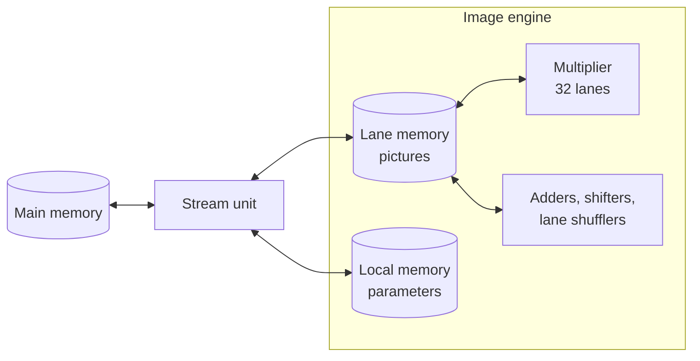

# Network engine program

<!-- human page -->
<!-- house style -->

## Key points

- We wrote our own program to run neural networks on the E-M5 III's image engine. It contains no Olympus or OM System code.
- It runs the whole network as one engine job and keeps every part of the engine busy at once.
- One pass of our bird detector at 480 × 480 pixels takes 14.4 ms, about four times faster than the E-M1X's detection job.
- Every number the camera produces matches our PC model bit for bit, so each camera run checks itself.

This page describes the program we wrote to run neural networks on the E-M5 III's image engine. It covers how the
program is laid out, how we measured the engine, and the steps that made it four times faster than the E-M1X's
detection job.

## Credit

The image engine's instruction set was decoded by atx in the fenykl project, on the E-M10 II. Our program is written
with their field model. Without that decode this work would not exist.

## Image engine

The image engine is a wide vector processor inside the main chip. Each instruction word is 320 bits long and drives
several units at once.

*The parts of the image engine our program uses. The grey box is the engine. Arrows show which way data moves.*

- A multiplier works on 32 lanes of 16-bit numbers in one step.
- Adders, shifters and lane shufflers run beside it in the same word.
- Lane memory holds the pictures being worked on. A smaller local memory holds parameters.
- A stream unit copies data between the camera's main memory and these two memories.

A program can keep all of these busy at once. Most of the speed work is about doing exactly that.

## Design

The network is a chain of about 30 layers. A simple approach runs each layer as its own engine job. That costs a fixed
start-up time per job, and our network would need 79 jobs.

Our program runs the whole network as one job instead.

- A small sequencer reads a list of steps.
- For each step it streams the layer's settings and weights into local memory.
- It then jumps to a shared routine for that kind of layer.

There are four routines. They cover the first layer, depthwise layers, one-by-one layers and upsampling. Joining two
layers' outputs costs nothing, because both layers write into one buffer. Two extra steps sit around the network. One
turns the live-view picture into the network's input, and one marks which output rows hold a likely subject.

## Arithmetic

The engine works in integers. Our program and our training share one fixed set of rules.

- Weights and results are 16-bit integers.
- Sums are kept exact in 32 bits.
- Each layer divides by a power of two, rounding halves to the even number.
- A layer ends by limiting the result to 16 bits, optionally followed by a gentle negative slope.

Because both sides follow the same rules, the PC can predict every number the camera produces. We use this to check
each camera run.

## Engine timing

A card of 21 small timing jobs measured the engine on the camera.

- One instruction word takes about 3.5 ns.
- Starting a job costs about 62 µs.
- The stream unit moves one transfer at a time.
- Transfers overlap with calculation.
- Loads into local memory are about 3.5 times slower than loads into lane memory.

These numbers went into our simulator. Its predicted pass time now matches the camera to within 2%.

## Speed steps

| step | change | time per pass |
|---|---|---:|
| first whole-network run | one job, packed rows for small layers | 17.5 ms |
| hide transfers | load the next band while the current one is calculated | 15.4 ms |
| schedule the busiest loop | place each operation in the earliest free slot | 14.4 ms |
| cheaper maths | a model trained for simpler rounding and a cheaper activation | 13.9 ms |

*How the pass time came down, measured on our E-M5 III using test firmware.*

Two earlier changes made the first run possible.

- Small layers are 15 pixels wide or less. They now hold two rows in one 32-lane vector, so fewer lanes sit idle.
- The 3 × 3 routine spreads its additions over two adders. The limit had been how many results one memory port can
  take per word.

## Engine use

At the measured speed, the multiplier could do about 9 billion multiply-adds a second if it never paused. Our network
needs 68 million per pass. At 14.4 ms that is about half of the peak. The E-M1X job reaches about a quarter.

The program on the camera fills 7,925 of the 8,192 words the engine can hold, so its size limits further unrolling.
The first layer is also slow for its share of the work. Its lane shuffler is the bottleneck, because it splits even and
odd columns again for every output channel.

## Lessons

- Our first camera runs failed on details the simulator ignored. One was a field in control words, and another was
  which register a wait names.
- We now scan every instruction combination our programs emit against the combinations the stock programs use.
- When a shared include changes, check every program that uses it.
- Only start a pass on a new live-view picture. Back-to-back passes on a stale picture starved the live view.

## Status

The program runs our bird detector on our E-M5 III using test firmware. One pass at 480 × 480 pixels takes 14.4 ms.
A model trained for cheaper maths takes 13.9 ms, about 1 ms slower than our simulator predicts. Every output matches
our PC model bit for bit.

## Further reading

- [Network engine program: technical notes](nn-engine-program-technical.md), including the
  [design notes for specialists](nn-engine-program-technical.md#design-notes)
- [Subject detection research](subject-detection.md)
- [Model training](model-training.md)
- [Image engine](../hardware/image-engine.md)
