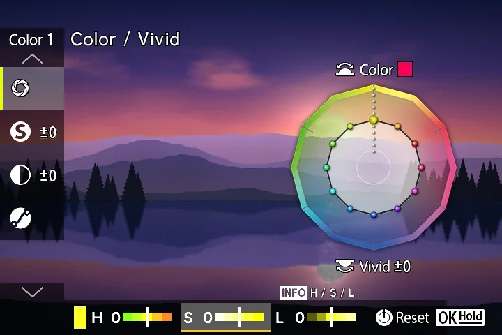
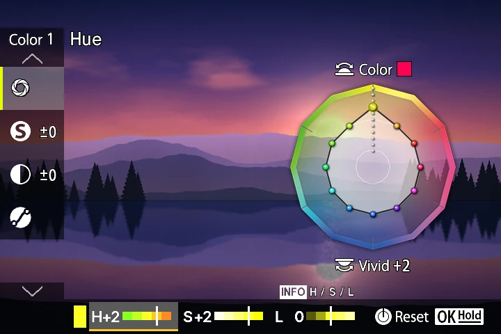
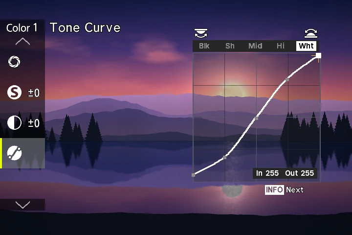

# Color and Monochrome Profiles

<!-- human page -->
> The dense reference for this page is [Color and Monochrome Profiles: technical notes](pen-f-profiles-technical.md).

The PEN-F and E-P7 have two picture modes that no other Olympus body offers to the user. Color Profile lets you set
the strength of twelve colours one by one. Monochrome Profile gives you a film-style black and white with a colour
filter, grain and edge shading. Both keep three saved slots, so you can build your own looks and switch between them.

The E-M5 Mark III does not offer either of them. Its firmware already contains the picture modes, the processing and
the saved settings. Only the way to pick and edit them was missing, and our test builds now add that.

## Status

As of 22 November 2026, on the E-M5 III:

- **Both modes can be picked** in the Picture Mode list, with three slots each, and the choice survives power-off.
- **There is an on-camera editor** with a colour wheel, reached the way you would expect from the picture mode.
- **The edits show in live view and in photos.**
- **The editor has a side bar** of rows: the wheel, Sharpness, Contrast, Highlight & Shadow, Midtone, and on
  Monochrome also Shading, Film Grain and Mono Color. Up and down move between rows, the dials change the value, and
  holding OK resets a row.
- **Each profile keeps its own tone curve.** Changing Highlight, Shadow or Midtone in a profile changes that profile
  only, and the curve row shows the camera's own curve grid with the live histogram behind it.
- **Hue, saturation and lightness per colour.** One row holds a strip of the twelve colours. INFO switches between
  saturation, hue and lightness, and the dials change the selected colour.
- **A free tone curve is in progress.** Instead of the Olympus controls, a profile can use a curve of five points you
  move yourself. It works in the emulator. On the camera the first version changed nothing, because the develop step
  only builds a curve when an Olympus tone value is set. The fix is built, and live view is still being traced.

Nothing is released to install.

## The look of the editor

The PEN-F puts its profile controls in a bar across the top of the screen. The OM-3 and OM-5 II use a side bar down
the left. We chose the side bar, because the dials keep the roles they have everywhere else in the camera, and it sits
better with the E-M5 III's own menus.

The colour wheel itself is drawn by Olympus's own code. The E-M5 III has the routines for it, but they are stubs that
print "not supported". The E-M1 III has complete ones that body never uses, so the editor uses those, together with
the wheel artwork, which comes from the PEN-F.

*The Color Profile editor. A colour is picked on the wheel, its hue and lightness change, then the free tone curve is bent into an S. Emulator screenshot.*

*Left, the colour row with the hue, saturation and lightness sliders along the bottom. Right, a free tone curve made from five points. Emulator screenshots.*

## Lessons

**A drawing can be correct and still invisible.** The relocated wheel drew into memory exactly as it should, but
nothing appeared. The camera's background routine stops early for these two wheel kinds, because no stock E-M5 III
screen uses them, and never finishes setting up the display layer. Dumping the drawing buffers over the Wi-Fi shell
showed the drawing was fine and pointed at the layer instead.

**Widgets have hidden limits.** A picture widget keeps at most eight picture states. Asking for a ninth read a stray
pointer and reset the camera.

**Live view and photos take different routes.** Several times an edit showed in a photo but not in live view, or the
other way round. Live view reads some values through its own pointers, and only takes the twelve colour values when
its parameter message is flagged for them.

## Credit

The idea of bringing these profiles to bodies that lack them comes from the Caduceus projects for the E-P7, OM-3 and
OM-5 II. The free tone curve was inspired by androidfanman. The wheel code and the artwork are Olympus's own, from the
E-M1 III and the PEN-F.

## Further reading

- [Color and Monochrome Profiles: technical notes](pen-f-profiles-technical.md) has the settings, addresses and the build history.
- [Settings and menus](../firmware/settings-and-menus.md) explains how saved settings and menu rows work.
- [Drawing on the GUI layers](../hardware/osd-drawing.md) covers how the editor's own graphics are drawn.
