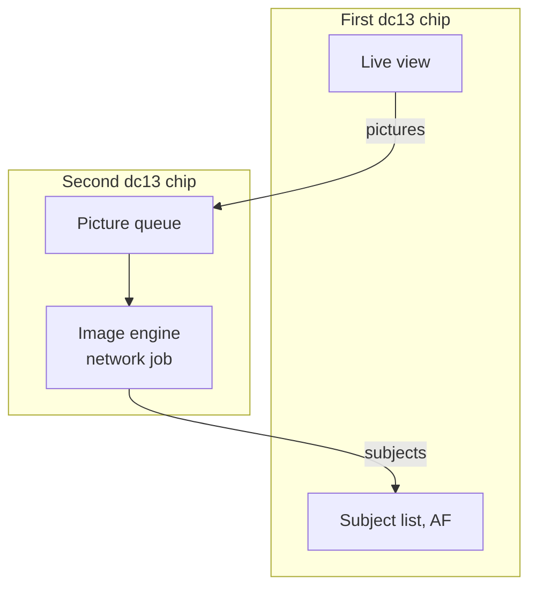

# Subject detection research: technical notes

<!-- house style -->
> **Technical reading.** The detailed version of [Subject detection research](subject-detection.md), for readers who want the internals.

*Last reviewed 2026-11-27.*

This page covers our research into deep-learning subject detection on the E-M5 III 1.7. We wrote two components of our
own. One is an image-engine network program, the "NN player". The other is a detection model with its training
pipeline. We benchmarked both against the E-M1X 2.4 detection job. No Olympus or OM System code or weights are part of
either component.

The small numbers after a fact link to [Sources and dates](#sources-and-dates), which say how the fact is known and when.
On the notes site the number's colour shows the evidence: green = measured on our E-M5 III using test firmware,
blue = read in the firmware or our own code, grey = inferred.

## Detection by body generation

| | E-M1X 2.4 | OM-1, OM-1 II, OM-3 | E-M1 III, OM-5, OM-5 II | E-M5 III 1.7 |
|---|---|---|---|---|
| chip | two dc13 chips (TruePic VIII class) | TruePic X | one dc13 chip | one dc13 chip |
| where the network runs | image engine of the second chip | DML block, driven from CPU3 | nowhere (master-side code only) | nowhere in stock |
| weights | about 6.6 MB data block on the second chip, 4 × 1.4 MB int16 networks | 5 (OM-1) or 6 (OM-1 II, OM-3) blobs of 9.3 MB | none | none |
| picture to the network | sent from the first chip to the second | handed to CPU3 | (sender stub) | (none) |
| results back | over a serial link to the first chip | from CPU3 | | |

*How each body generation runs detection.[^fw1]*

See also: [SoC overview](../hardware/soc-overview-technical.md) and [body comparison](../bodies/comparison-technical.md).

### E-M1X

The E-M1X splits detection across its two chips. The second chip runs its own MN103 program and greets with
"Hello DC13's Slave System".[^fw1]



*Detection across the E-M1X's two chips. Grey boxes are chip edges. Arrows show data flow.*

| from | to | what moves | path | started by | how often |
|---|---|---|---|---|---|
| first chip, live view | second chip | live-view pictures (`MDET_DL_SND_IMG`) | from chip to chip, link not named | first chip | not traced |
| picture queue | image engine | one picture per pass | an image-engine job | second chip | not traced |
| second chip | first chip | the subject list | serial link | second chip | per pass |

*Transfers in E-M1X detection.[^fw1] How often the E-M1X runs the job has not been traced.*

- The network job is 432 KB in the same 320-bit instruction format as the E-M5 III's own jobs.[^fw1]
- Four int16 weight sets of about 1.4 MB each are loaded at boot.[^fw1]
- Subjects are motor sports, aircraft, trains and birds.[^fw1]
- The network has 25 layers and 143 million multiply-adds at 480 × 480, with int16 weights and activations.[^fw1]
- Its head has 80 channels, read as 10 anchors × 8 values: a box, an objectness score and three part scores. The parts
  are body, head and eye.[^fw1]

### OM-1 family

Detection runs on CPU3 and the DML block.[^fw1]

- A 1/240 s phase counter hands a picture to the detector every 8 ticks (30 a second) or every 4 (in 60 a second
  mode).[^fw1]
- The newest frame wins.[^fw1]
- After 5 empty passes it drops into a power-saving rate.[^fw1]
- The tracker snaps onto a detection only when the chosen part is new. Otherwise detections only act as search windows
  for the tracker, up to 8 of them.[^fw1]
- The default part is the body, for S-AF, C-AF and tracking alike.[^fw1]

### Middle generation

The E-M1 III, OM-5 and OM-5 II carry the master half of the E-M1X design. That is the picture sender, the subject list
and the AF-point setters. None of them carries a network or weights. Their menus show subject names because the menu
text is shared across the range.[^fw1]

## Benchmark

We ran the E-M1X detection job on our E-M5 III's image engine to measure it. We use it only as a yardstick. We don't
publish it, its weights or its layer table.

| measure | value |
|---|---|
| time per pass, 480 × 480 | 57–65 ms (59 typical)[^cam1] |
| time per pass, 320 × 320 | 28.5 ms, same scores[^cam1] |
| live view beside it | about 47 of 55 frames a second[^cam1] |
| input | the whole 4:3 live-view frame, squeezed to 480 × 480, R G B 0 bytes[^cam1] |
| engine use | about 26% of the engine's peak multiply rate at the measured clock. Our program reaches about 51%.[^inf1] |

*The E-M1X detection job measured on our E-M5 III.*

- **The pass time is compute-bound, not contention.** Stepping the job's instruction words at our separately measured
  3.5 ns per word gives the camera's 59 ms, and 28.5 ms at 320. Live view sharing the engine adds little.[^cam1][^inf1]
- **The E-M1X has more headroom.** The second chip's engine is spare and serves no live view. So passes could run back
  to back, about 16 a second at this pass time. The chips are the same kind, so a pass should take about as long there.
  The E-M1X's real run rate is not traced.[^inf1]

A reference model of the network, written from our own reading of its layer table, reproduces the camera's kept bird
boxes on all 30 outputs of one camera run. That model is how we score the E-M1X network on PC test sets with the
camera's exact arithmetic.[^fw2]

## Engine program

Full notes: [network engine program](nn-engine-program-technical.md).

The NN player is built on atx's decode of the instruction set (fenykl, branch `feat-dsp`). Credit for the instruction
set is theirs.

- **One job for the whole network.** A small sequencer streams each layer's record and parameters into the engine's
  local memory and jumps to a shared layer routine. The camera's per-job start-up of about 62 µs is paid once.[^fw2]
- **Layer routines.** 3 × 3 stem, depthwise 3 × 3 (stride 1 and 2), 1 × 1 multi-channel, 2× upsample and
  concatenate.[^fw2]
- **Transfers overlap compute.** The 1 × 1 routine fetches the next output channel's weights while it computes the
  current one, and double-buffers its stores.[^fw2]
- **Arithmetic contract.** int16 weights, an exact 32-bit sum, an int32 bias and one shift per layer rounded half to
  even. Then int16 saturation and an optional leaky slope.[^fw2]

Pseudocode of one pass, in our own words:

```
pseudocode: one network pass
for each step in the layer list:
    stream the step's record and parameters into local memory
    for each output row block:
        prefetch the next weights
        multiply-accumulate across the 32 lanes
        shift, round half to even, saturate, optional leaky
        store the rows (double-buffered)
write the per-row best objectness so the CPU only decodes rows that matter
```

| step | time per pass at 480 |
|---|---:|
| first whole-network run (packed rows) | 17.5 ms |
| stem and depthwise double-buffered | 15.4 ms |
| list-scheduled 1 × 1 loop | 14.4 ms |
| E-M1X job, for comparison | 59 ms |

*Engine program speed-ups, measured on our E-M5 III.[^cam2]*

- Every buffer of the network matches our PC integer model byte for byte on the camera.[^cam2]
- Engine timing we measured: about 3.5 ns per instruction word, 62 µs per job dispatch and one transfer at a time.
  Transfers overlap compute.[^cam2]
- In live view it runs 35 to 41 passes a second (mean 37), and every pass completes.[^cam2]
- The program fills 7,925 of 8,192 instruction words, so size is now the limit.[^fw2]
- Two contract changes cost no measurable accuracy. They are per-tap rounding in 3 × 3 layers and a leaky slope of
  1/8.[^fw2] The program for them is exact in the simulator and modelled at 12.41 ms per pass. The camera check is
  pending.[^inf1]

## Model and training

Full notes: [model training](model-training-technical.md).

- **Network OWN-1.** Depthwise-separable, with heads at strides 16 and 32. About 68 to 72 million multiply-adds at 480,
  half the E-M1X network.[^fw2]
- **Pipeline.** Training in PyTorch on a desktop RTX 5070 Ti. The pipeline trains in float, calibrates on real
  pictures, quantises to the engine's int16 arithmetic and exports for the NN player. The integer model on the PC equals
  the camera bit for bit.[^fw2]
- **Picture database.** One manifest per source. For each picture it records which subjects are boxed and which a
  person verified absent. Sources are Open Images V7, COCO 2017 and CUB-200-2011 (non-commercial, research
  only).[^fw2]
- **Head scales.** Head layers need their own scales. Pinned to a fixed decode scale, confident subjects pushed head
  terms past int16, and eye accuracy fell from 0.52 to 0.19.[^fw2]
- **Subject-free pictures.** Train with them. A bird model trained only on bird photos saw birds everywhere when panning
  a room.[^cam3]

### Benchmark against the E-M1X bird network

Both networks were scored on the same 8,000 held-out pictures (4,000 with birds, 4,000 without). Both used the camera's
integer arithmetic and the same decode.[^fw2]

| | E-M1X bird network | OWN-1 birds v1 (CUB only) | OWN-1 birds v2 (database) |
|---|---:|---:|---:|
| body AP50 | 0.712 | 0.513 | 0.680 |
| head AP50 | 0.512 | 0.483 | 0.595 |
| eye AP50 | 0.148 | 0.204 | 0.255 |
| bird-free pictures with a false bird, score 0.3 | 42.5% | 41.4% | 6.8% |
| same, score 0.5 | 23.9% | 25.2% | 2.9% |
| engine time per pass at 480 | 59 ms[^cam1] | 14.4 ms[^cam2] | about 14 ms, same program[^inf1] |

*Our bird models against the E-M1X bird network. AP50 is average precision at 50% box overlap, higher is better.[^fw2]*

- **Acceptance rule.** Our model replaces the E-M1X job only when it is more accurate on every class and faster per
  pass, measured like for like. It is four times faster. Body AP is still 0.03 behind.[^pol1]
- **Fairest row.** Head and eye boxes on CUB follow rules fitted to the E-M1X network's own boxes, so the body row is
  the fairest.[^inf1]
- **Wider model.** A 1.5× wider model (133 million multiply-adds) gains only eye AP, 0.30 against 0.26.[^fw2]

### More subjects

- One net for birds, cats and dogs reaches bird AP 0.60, which is 0.04 below the bird-only net, with half its false
  birds. Cat AP is 0.36 and dog AP 0.46.[^fw2]
- The plan is one net per subject group, as the OM-1 offers one menu entry per group.[^inf1]
- People (COCO) reach body 0.35 and head 0.36.[^fw2]

### Crop passes

A second pass on a 320 × 320 crop around the subject lifts small detail. Training with half the batches cropped lifts
crop accuracy a lot, body 0.71 to 0.94 on CUB. It costs 0.01 on the full frame.[^fw2]

## Autofocus

We follow the OM-1's behaviour at each step before tuning anything. These are results on our E-M5 III using test
firmware.[^cam4]

- The AF point moves to the detected body in C-AF.
- A bird outside the chosen AF area is ignored, and the camera focuses normally.
- The display follows the OM-1. One white body frame turns green on focus, and a small square marks the eye.
- C-AF with tracking follows the bird. Re-finding a lost subject and tracking hand-over are in progress.

Between network passes, the camera's own motion estimator could shift a box. We have read it but not used it
yet.[^fw1]

## Open questions

| item | state |
|---|---|
| body accuracy above the E-M1X network | 0.03 behind |
| a faster engine contract (12.41 ms modelled) | model trained, camera check pending |
| tracking parity with the OM-1 | in progress |
| cats, dogs and people as their own nets | training |

*Work still open.*

## Sources and dates

The small numbers in the text point here. Each note says how a fact is known and when.

[^fw1]: Read in the firmware of each body, 2026-11-24 to 2026-11-26.
[^fw2]: Read in our own code and measured in our PC tests, 2026-11-24 to 2026-11-27.
[^cam1]: Measured on our E-M5 III using test firmware, 2026-11-24.
[^cam2]: Measured on our E-M5 III using test firmware, 2026-11-25 to 2026-11-26.
[^cam3]: Seen on our E-M5 III using test firmware while panning a room, 2026-11-26.
[^cam4]: Seen on our E-M5 III using test firmware, 2026-11-25 to 2026-11-26.
[^inf1]: Inferred from the measurements above, not tested.
[^pol1]: Our own acceptance rule, set 2026-11-25.

The instruction set is the work of atx, fenykl `feat-dsp` (https://github.com/atx/fenykl) and
https://m.atx.name/dsp.html.

