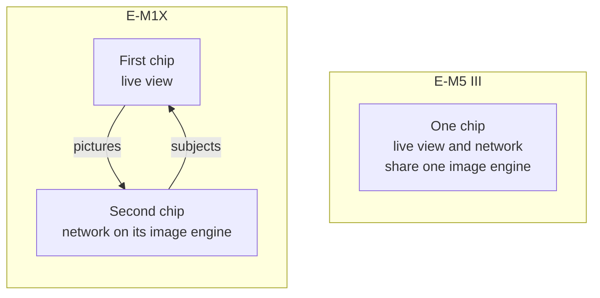

# Subject detection research

<!-- human page -->
<!-- house style -->

## Key points

- The E-M5 III's image engine is the same kind of hardware that runs subject detection on the E-M1X.
- Our own engine program runs a detection network about four times faster than the E-M1X's detection job.
- Our own bird model finds heads and eyes better than the E-M1X network and reports far fewer false birds. It is still a little behind on bodies.
- Autofocus follows a detected bird in tests on our E-M5 III, but tracking is not finished.

This page describes how Olympus and OM System cameras find birds, animals and vehicles, and our research into doing the
same on the E-M5 III. We wrote two parts of our own, a program for the camera's image engine and a detection model. We
measured both against the E-M1X's subject detection.

## Detection by camera

Subject detection uses a neural network. A network is a long chain of simple sums over the picture. It needs a lot of
arithmetic, so each camera generation found a different place to run it.

| camera | where the network runs |
|---|---|
| E-M1X | on its second main chip. The E-M1X has two chips of the same kind as the E-M5 III's. The first sends live-view pictures to the second, and the second runs the network on its image engine. |
| OM-1, OM-1 II, OM-3 | on a dedicated deep-learning block in a newer chip, driven by a fourth processor core. |
| E-M1 III, OM-5, OM-5 II | not at all. Their firmware carries parts of the code from a shared code base, but no network and no weights. |

*Where each camera runs its detection network.*

The E-M5 III has one chip of the E-M1X kind. So the E-M5 III's image engine is the same kind of hardware that runs
detection on the E-M1X.

*The E-M1X gives detection a whole spare chip. The E-M5 III has to fit it beside live view on one engine.*

The open question was whether one chip can do both.

## Image engine

The image engine is the part of the chip built for heavy pixel work. It develops RAW files, resizes pictures and merges
frames. The main processors give it short programs called jobs.

The instruction set of these jobs was decoded by atx in the fenykl project, on the E-M10 II. Our work builds on that
decode.

See also: [Image engine](../hardware/image-engine.md).

## Benchmark

We ran the E-M1X's own detection job on our E-M5 III's image engine, using test firmware, to measure it.

- One pass at 480 × 480 pixels took about 59 ms.
- That gives about 10 to 12 passes a second beside live view.
- Live view kept running at close to its normal rate.

The E-M1X has more headroom than our test. Its second chip's image engine is free for detection, with no live view to
serve. It could run passes back to back, up to about 16 a second, and it leaves the first chip's engine untouched. On
the E-M5 III, one engine does both jobs.

Each pass takes about as long on either camera. The 59 ms come from the job's own arithmetic, not from sharing. Our
timing model, built from engine speeds we measured separately, predicts the same figure. How often the E-M1X actually
runs the job has not been traced.

This showed that one chip can run a detection network. It also gave us a speed and accuracy target. We don't publish or
ship that job or its weights.

## Our engine program

We wrote our own network program for the image engine. It contains no Olympus or OM System code.

- It runs the whole network as one job, so the camera's start-up cost per job is paid once.
- It moves data while it calculates, so the engine rarely waits for memory.
- Our network at 480 × 480 takes about 14 ms per pass on the camera. That is about four times faster than the E-M1X
  job.
- Its results match our PC model bit for bit.

In live view it runs 35 to 41 passes a second.

See also: [Network engine program](nn-engine-program.md).

## Our model

We trained our own detection models on a desktop graphics card. They are built for our engine program.

- A bird model finds the body, head and eye of a bird.
- A second model covers cats and dogs.
- The training pictures are public photo sets plus pictures without any subject, so the model learns what is not a
  bird.

We compared our current bird model with the E-M1X bird network on the same 8,000 test pictures.

| measure | our bird model | E-M1X bird network |
|---|---:|---:|
| body score | 0.68 | 0.71 |
| head and eye | better | |
| bird-free pictures with a false bird | about 1 in 15 | about 2 in 5 |

*Our bird model against the E-M1X bird network on the same 8,000 test pictures. A higher score is better.*

Our rule is that our model replaces the E-M1X job only once it is better on every count and faster. It is faster now.
Body accuracy is still a little behind.

See also: [Model training](model-training.md).

## Autofocus

The focus point has to follow the detected subject, or detection only draws boxes. We follow what the OM-1 does at
each step, so the camera feels the same.

- A white frame shows the bird's body. It turns green when the bird is in focus.
- A small square marks the eye when one is found.
- The camera only jumps to a subject if the subject is inside the chosen AF area.

On our E-M5 III using test firmware, the focus point follows a detected bird in continuous AF. Tracking and re-finding
a lost subject still need work.

## Notes for mods

- A single chip of the E-M5 III's generation has enough image-engine power for subject detection.
- A detection model has to fit the engine's 16-bit integer arithmetic. Calibrating each layer on real pictures keeps
  the loss from the conversion small.
- Training needs pictures without the subject, or the model sees birds everywhere.

## Status

Research in progress. The engine program and the bird model run on our E-M5 III, using test firmware. Autofocus on a
detected subject works in tests, but it is not finished.

## Further reading

- [Subject detection research: technical notes](subject-detection-technical.md)
- [Face and subject AF options](af-detect.md)
- [Network engine program](nn-engine-program.md)
- [Model training](model-training.md)
- [Image engine](../hardware/image-engine.md)
- [SoC overview](../hardware/soc-overview.md)
