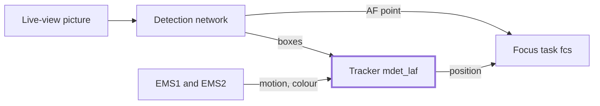

# Subject tracking: technical notes

<!-- house style -->
> **Technical reading.** The detailed version of [Subject tracking](subject-tracking.md), for readers who want the internals.

*Last reviewed 2026-11-27.*

This page covers how subject detection feeds the subject tracker and autofocus in OM System firmware, and what our
tests on the E-M5 III showed. It describes the OM-1 1.9 pathway, the E-M1X start, and the tracker side that the OM-5 II
1.1 firmware still carries without a network. Detection itself, with the networks, our engine program and our models,
is on [Subject detection research: technical notes](subject-detection-technical.md).

The tracker is the `mdet_laf` module. Deep learning (DL) is the firmware's name for network detection. The autofocus
modes are single AF (S-AF), continuous AF (C-AF) and C-AF with tracking (C-AF+TR). The focus task is `fcs`. Two search
blocks of the image pipeline feed the tracker, EMS1 (block motion) and EMS2 (colour and size).

Addresses are OM-5 II 1.1 block0 addresses (base `0x60021020`) unless the OM-1 1.9, the E-M1X or the stock E-M5 III 1.7
is named. Frame coordinates are in the tracker's 640 × 480 frame.

The small numbers after a fact link to [Sources and dates](#sources-and-dates), which say how the fact is known and when.
On the notes site the number's colour shows the evidence: green = seen on our E-M5 III using test firmware or on an
OM-1, blue = read in the firmware, grey = inferred, amber = a correction.

## Overview

*Detection, tracker and focus. The tracker, the subject of this page, has a bold outline. Arrows show data flow. The
table below says who starts each transfer.*

| from | to | what moves | path | started by | how often |
|---|---|---|---|---|---|
| detection network | tracker | up to 8 subjects, each with body, head and eye boxes | the subject list | detection writer sets the ready byte | per detection pass[^fw1] |
| detection network | focus task | an AF point on one box | DL AF-point setters, kinds 10 to 12 | the C-AF area chooser | each frame it takes a DL case[^fw1] |
| EMS1 and EMS2 | tracker | block motion, colour and size | per-frame result buffers | the tracker reads them | per frame[^fw1] |
| tracker | focus task | one position (the offer) | tracking slot, AF point kind 4 | focus side copies it | per frame[^fw1] |

*Transfers between detection, tracker and focus in the OM-5 II firmware.*

There are two ways into autofocus. The AF-point setters make the AF point jump to a detected box, with no tracker
fusion. The subject list puts the boxes into the tracker, which runs in its subject-detection mode and fuses them with
block motion, colour and depth. The tracker then hands one position to the focus task as the tracking AF point
(kind 4).[^fw1]

## Subject list

The detection side hands its results to the tracker in a fixed list. The E-M1X uses the same layout.[^fw7]

| offset | size | meaning |
|---|---|---|
| header +0 | u32 | frame stamp, used only for EXIF and not checked |
| header +4, +6 | | copies of DL request values, meaning unknown |
| header +8 | u8 | basic flag, filled from a DL request copy as well |
| header +9 | u8 | hybrid flag. The native writer sets 1. |
| header +10 | u8 | class of the subject menu setting |
| header +11 | u8 | record count, 0 to 8 |
| header +12, +14, +16 | | copies of the subject request bytes. +12 = 2 goes with hybrid mode. |
| record +0 | u8 | class. The native writer uses the class of the menu setting for every record. |
| record +2, +14, +26 | 12 bytes each | three parts, see below |

*The subject list, a 20-byte header and up to 8 records of 38 bytes.[^fw1]*

Each 12-byte part holds a valid byte (1), a byte the native writer never fills, then x, y, w and h as u16, a score
byte at +10 and an object id byte at +11.[^fw1]

- **Score.** It is compared with tuned thresholds that look like 50, so it is most likely 0 to 100.[^inf1]
- **Object id.** It is the same for all parts of a record.[^fw1]
- **Part 0 is the body.** The E-M1X logs it as `[DL]body`.[^fw7]
- **Parts 1 and 2.** The tracker treats them alike. `mdet_laf_judge_dl_target_part` picks the valid part nearest the
  current tracking position. `mdet_laf_dl_start` picks parts by a priority list from tuning indices 159 to 161. So the
  head and eye order is not critical, and we use part 1 = head and part 2 = eye to match the network.[^inf1]
- **Coordinates.** They are most likely centre x and y in the tracker's 640 × 480 frame.[^inf1]
  `mdet_laf_dl_search_tracking` takes the squared distance from list x, y to the tracker position.
  `mdet_laf_dl_pos_set` copies list-derived positions straight into that position. `calc_ems12_offer_data` clamps the
  same position against 640.[^fw1]

### Classes

A class mapper turns the subject setting (1 to 24) into the list class through a table.[^fw1]

| setting | 1 | 2 | 3 | 4 | 11 | 12 | 13 | 14 | 21 | 22 | 23 | 24 |
|---|---:|---:|---:|---:|---:|---:|---:|---:|---:|---:|---:|---:|
| class | 1 | 100 | 101 | 102 | 2 | 103 | 104 | 105 | 3 | 106 | 107 | 108 |

*Subject setting to list class. Any other setting gives class 0.[^fw1]*

- The tracker's per-class lost limits are indexed by classes 100 to 108. Other classes use a default lost limit.[^fw1]
- The reader does not filter by class.[^fw1]
- Settings 1, 11 and 21 take another writer branch.[^fw1]
- Which value is birds is not confirmed. With the menu order motorsport, aircraft, trains, birds, the bird setting
  would be 4, which gives class 102.[^inf1]

### Handshake

- A valid byte must be non-zero.[^fw1]
- A selection byte holds the selected record, 0 to 7, or 255 for none.[^fw1]
- The ready byte is set to 1 last. In hybrid mode the tracker sets it to 2 after reading, so 1 means a new list.[^fw1]

## Tracker DL mode

The tracker takes its DL path only while a mode flag is non-zero. The flag is reloaded at every mode change, from
message byte +107. That byte is the AF side's message byte +24 being non-zero.[^fw1]

The native source of byte +24 is a client mask.[^fw1]

1. The AF state machine builds the tracking object and stores it at +756 of the AF state.
2. It sets object +24 to bit 5 of halfword +1366 of the AF state.
3. Halfword +1366 is a copy of the live-view evaluation task's requested-client mask. The task's client update writes
   that mask, and another routine clears it bit by bit.

Bit `0x20` of the mask is a client that runs next to tracking, most likely the subject-detection client
`take_mov_ems_dl`.[^inf1]

Forcing the mode flag has side effects. It also changes the lost timers (a 1/6 s set), `calc_chase_frame`,
`judge_lost`, `get_lost_count_thr` and the EXIF writers, 25 readers in all.[^fw1] Setting bit `0x20` in the mask itself
would make the live-view evaluation task think a client is running.[^inf1]

### Per-frame reading

The per-frame reader in `mdet_laf_exec_ems1` needs bit 1 of the job parameter and a gate byte at 0.[^fw1]

- The mode-change handler sets the gate byte to 1 at tracking start. It skips that only when the tracking-start
  source is 2 and a record was selected at start. Only then does it call `mdet_laf_dl_start`.[^fw1]
- The start path reads the selected record from the list only when the source is 2.[^fw1]

### Tracking-start source

The tracking-start source is byte +7 of a 14-byte tracking-info struct. `mdet_laf_get_fcs_face_tracking_info` copies
the struct from the focus side at tracking start, and `mdet_laf_chase_get_fcs_fd_data` copies it every frame. When a
focus-side enable word is 0, the copy is zeroed.[^fw1][^fix1]

The focus side writes byte +7 in `[TR]release_tracking_set`, from the AF point type.[^fw1]

| AF point type | byte +7 | other |
|---|---:|---|
| 10, 11, 12 (the DL kinds) | 2 | |
| 9 | 0 | byte +8 = 1 |
| any other | 0 | |

*Tracking-start source by AF point type.[^fw1]*

So the native route into a tracker DL start is an AF point of type 10 to 12 when tracking is set. A direct write to
the tracker's copy of the source is overwritten at the next copy.[^fw1] In the OM-5 II firmware the three DL AF-point
setters for kinds 10 to 12 are empty stubs, and nothing writes source 2.[^fw1]

### AF gates

Two AF gates stay 0 in the OM-5 II firmware. The E-M1X needs them for its separate starter. The OM-5 II tracker mode
does not.[^fw1] The E-M1X starts DL tracking from the focus side. `fcs_dl_start_tracking` picks a body and calls the
tracker's `mdet_dl_start_tracking` with an id and a part.[^fw7]

## Re-centring

How the tracker treats a new detection decides whether the box pulls the tracker or only guides it.

### OM-5 II

The reader copies the selected record into the tracker each time the ready byte is 1.[^fw1]

1. `mdet_laf_exec_trace` runs `dl_detection_list` (or `dl_hold_clear`) and `dl_detection_select`.
2. `dl_detection_select` marks a ring slot as picked when it finds one.
3. The trace then calls `mdet_laf_dl_pos_set`, or `dl_slow_fps` when a slow-rate flag is 1.
4. While a slot is picked, that call overwrites the tracker's search positions and position with the DL time-series
   entry.

Whether the slot stays picked between our passes, so that the tracker re-centres every frame on the old box, is not
traced. No "hint only" flag was found in the list header.[^fw1]

### OM-1

The OM-1 keeps its tracker and uses detections as guidance.[^fw3]

- `dl_pos_set` only checks whether the tracker is still inside the detected box, and sets a flag when it is not.
- `dl_slow_fps` seeds a search in the current frame from the old box. Up to 8 detected boxes each become a search
  window, sized from tuning indices 187, 189, 33 and 58.[^fw3]
- The tracker snaps onto a detection only when the chosen subject part is new. There is no motion prediction.[^fw3]
- The "tracker left the box" flag does not steer AF. Its AF hook is empty. It sets byte +9 of the tracker's 114-byte
  report, and the report goes to the detection manager in the face-detection task. When byte +9 is 1, the manager
  re-picks its main subject as the detection nearest the tracker.[^fw3]

So the OM-1 never pulls the tracker back to an old box. When the two disagree, the detection side follows the tracker.
This difference is the likely cause of the lag our tests showed on fast circles.[^inf1]

## OM-1 detection pathway

[Subject detection research: technical notes](subject-detection-technical.md) has the short version of the
OM-1's detection rate. The detail follows.[^fw4]

- Each live-view frame steps a phase counter (frame +1360) in 1/240 s units, wrapping each second. The step is
  240 / fps class, with fps classes 15, 30, 60, 120 and 240.
- A frame gets a detector picture when the phase modulo N is 0. N is 8 (30 a second) by default. N is 4 (60 a second)
  when frame +76 is set or a mode bit `0x4000` is on. Frame +1412 = 1 forces 8. Detection must be on, and bit 0 of
  frame +1422 set.
- So at 60 fps every second frame goes to the detector, and at 120 fps every fourth, giving 30 a second. At 30 fps it
  is every frame, and at 15 fps 15 a second.
- The picture buffer is allocated per offered frame. A failed allocation is counted and skipped.
- The offer goes through `mdet_dl_offer_yc_data` and `request_cpu3` to the detect task on CPU3. The task keeps only the
  newest offer, and `get_last_yc_data_que` releases older pictures.
- The task runs one pass synchronously. It starts the engine, waits for an event, decodes, then pushes the result to
  the tracker. The detection rate is therefore the lower of 30 (or 60) and 1 / pass time.
- DL power saving stops passes after 5 offers in a row with no detection. It needs `af_dl_saving` on and the motion
  search (EMS1) seeing nothing. It resumes on a cancel or when motion is seen.
- `dl_slow_fps` is the tracker side of "detections come slower than frames". Between results it searches around the
  last boxes.[^inf2]

The OM-1's cadence matches our target of 30 a second, with the newest frame winning and no queue. Our two-frame overlap
is the same idea.[^inf2]

### Subject-type menu

- The menu value is property `0x1e71`. It is read into the shooting settings (+206) and kept as `subject_detect`.[^fw4]
- Values are 0 off, 1 motorsport, 2 airplane, 3 train, 4 bird and 5 animal. There is no people entry. Faces and eyes
  use the separate face-detection path.[^fw4]
- Live-view start sends DL START with the type. A menu change while detection runs sends CHANGE_MODE. Both go to CPU3
  through the cross-CPU call.[^fw4]
- On CPU3 the DL task stores the type. A loader task sees the change, maps type 1 to 5 to index 0 to 4 and looks up
  that entry of resource `0x800f`. It then sets up the engine for that network. So each type has its own
  network.[^fw4] The five entries are likely the five 9.3 MB blobs in bank 11.[^inf2]
- Per-type tuning sits in the tracker only. It picks its own row set of tuning `0x79a2` (rows 270 to 354) for the
  active type. Birds and animals enable more parts.[^fw4]
- No read of the menu property or of the type was found in the focus code, so AF itself is not tuned per type.[^fw4]
- A nearby byte, `tracking_status`, is a different value. It says what AF follows now, not the menu.[^fw4]

### Part choice

The OM-1 part chooser takes all its settings from tuning `0x79a2` at tracker start.[^fw4]

- The thresholds for head-like parts (indices 164 and 165) are 65535 against a 0 to 255 score. So on the camera's
  built-in tuning, the OM-1 tracker and AF follow the body for every subject type.
- Five per-type row sets, chosen by byte +12 of the detection start message, only change enables that cannot take
  effect.
- A start-up override table in RAM could replace tuning ids. Its contents are unknown.

In our tests the tracker's own part choice took the head when one was present.[^cam2]

The OM-1's AF-point setter dispatch, in its tracking case, reads the part byte and uses the DL body and part setters.
It falls back to the tracker point setter only when there is no part. The OM-5 II twin of that dispatch calls the
kind-4 tracker setter directly.[^fw4]

### Re-acquiring

- The OM-1 restarts the tracker every processing sequence when the tracking engine is stopped or paused.
  `mdet_laf_restart` gets the chosen detection's position, or else the last tracker position.[^fw4]
- The OM-5 II restart has one caller, `judge_chase_object`, and no per-sequence restart.[^fw4]
- So the OM-1 picks a bird back up as soon as the detector finds it.[^inf2]
- The OM-1 restart only fills a start request for its normal start path. The OM-5 II restart runs `start_exec`
  directly and skips the start handler that calls `start_notify`.[^fw4]

## Tracker lineage

Our lineage tables pair the 495 named OM-1 1.9 tracker functions with the other bodies.[^fw5]

| body | functions paired | note |
|---|---:|---|
| OM-1 II 1.3 | 443 | 323 with the same instruction count, 120 changed |
| OM-5 II 1.1 | 214 | low-level parts the same size, DL glue much smaller |

*OM-1 1.9 tracker functions found in the newer and smaller bodies.[^fw5]*

On the detection-to-AF path (25 functions), the OM-1 II has 18 at the same size. `judge_dl_subject`, `dl_add_list` and
`calc_offer_data` grew slightly. So the OM-1 II keeps the OM-1 design.[^fw5]

| function | OM-1 1.9 | OM-5 II 1.1 |
|---|---:|---:|
| `dl_calc_cor` | 148 | 148 |
| EMS1 register values | 125 | 125 |
| `int_lost_target` | 330 | 330 |
| `calc_subject_region` | 118 | 118 |
| `dl_add_list` | 586 | 48 |
| `dl_detection_list` | 310 | 134 |
| `dl_pos_set` | 142 | 69 |
| `dl_slow_fps` | 390 | 241 |

*Instruction counts of paired tracker functions. Pairs inside the DL block may be off by one function.[^fw5]*

The OM-1 II sizes for the grown functions are `judge_dl_subject` 425 (OM-1 406), `dl_add_list` 604 and
`calc_offer_data` 529 (OM-1 526).[^fw5]

So the OM-5 II runs the same tracker core with a cut-down detection feed. The gap to the OM-1 is in the glue, not in
the tracker core.[^inf2]

- The obstacle shield, distance forecast, lost event, `save_subject_info`, phase-detect depth tracker correction and
  pause exist in the OM-5 II at the same size and caller count.[^fw4]
- Only the OM-1 and OM-1 II have the EMS1 reliability decision with `ems1_pause`. It pauses the tracker on bad motion
  data and restarts it at the saved point. They also have a start-point priority step in `start_exec`.[^fw4]
- The pause is most likely the OM-1's answer to the drift our tests showed after a loss.[^inf2]

## From tracker to AF point

In the OM-5 II firmware the tracker's offer reaches the AF point in four steps.[^fw1]

1. `fcs_tracking_get_mdet_coordinates` copies the offer each frame.
2. `fcs_coordinate_update_af_area_tracking` clamps it to 640 × 480. It copies the offer only while
   `tracking_af_area_continue` returns 0.
3. The result goes into the tracking slot.
4. `fcs_coordinate_set_af_point_tracking` writes AF point kind 4 into the AF point block.

Only that setter writes AF kind 4.[^fw2][^cam2] The AF-point refresh, with 8 callers in the AF control loops, also switches
on the AF source byte and calls the setter for source 4. In C-AF+TR neither that call nor the OM-1-style dispatch call
ran in our tests.[^cam2][^fix2]

### Kind-4 branch at AF start

The focus task's target choice puts tracking first. It picks kind 4 when `tracking_af_area_continue` returns 1 and the
tracking slot is valid. Then come the DL and other kinds 8, 2, 9 and 3.[^fw1]

`tracking_af_area_continue` returns 1 only when all four conditions hold.[^fw1]

| # | condition | meaning |
|---:|---|---|
| 1 | the AF+MF state is not 2 | 2 is most likely "manual focus override active"[^inf1] |
| 2 | `area_continue` is not 0 | copied from byte +14 of the focus command, built from property `0x8c31` |
| 3 | the focus command is `0x1100` (S-AF) or `0x1200` (most likely C-AF) | it is `0x3000` at init |
| 4 | the tracker offer's in-area byte is 1 | 0 when the tracked centre leaves the AF-able area margins |

*The four conditions of the kind-4 branch.[^fw1]*

- Condition 4 uses margins of x +12/−10 and y +14/−8 inside the AF-able area's bounds. The byte starts at 1. So a track
  at the frame edge also blocks kind 4.[^fw1]
- In C-AF+TR holds the focus command was `0x1202`, `area_continue` was 0 and property `0x8c31` was 0. So conditions 2
  and 3 failed.[^cam1]
- `0x1202` is the C-AF hold command from `trigger_ready`. `0x1200` is the C-AF start.[^fw1]
- The same gate exists unchanged on the stock E-M5 III and the E-M1X. Property `0x8c31` is read on both, so it is not
  the subject-detection setting.[^fw6]

So this kind-4 branch is most likely a start-of-AF path. It continues the AF area from the last track at a new
`0x1100` or `0x1200` start when `0x8c31` is on. It is not the per-frame C-AF+TR path.[^inf1][^fix1]

### C-AF area chooser

The per-frame path is the C-AF area chooser. It runs while a C-AF state is 1 to 4 and switches on a case byte. It has
no priority order. The case byte picks one case per frame.[^fw1]

| case | AF point |
|---|---|
| 1 | kind 8 |
| 2 | kind 9 |
| 3 | kind 2 or 1 |
| 4, 5, 7, 8, 9 | DL kinds 10 to 12 when the DL AF gate is non-zero, else the normal area |
| 6 | kind 4 (tracking) when a halfword is non-zero, else the normal area |

*C-AF area chooser cases.[^fw1]*

Case 6 calls `fcs_coordinate_set_af_point_tracking`. It sets kind 4 in the AF point block, not in the focus task's
target kind byte.[^fw1]

The "C:CAF Restart" step picks the case. It tries the other AF gate first, then the DL gate, then tracking.[^fw1]

- The tracking branch writes case 6, with +16 = 1 for a point inside x 62 to 578 and y 60 to 420.
- It needs control type byte +85 of the focus-side tracking state to be 1, and `tracking_af_area_continue` to be
  non-zero.
- Byte +85 is 2 after a subject match, and that would skip tracking.

In our tests, C-AF+TR on a non-bird took case 6 (kind 4, every frame). On our bird it took case 7 (DL, kind 11, moving
once per detection pass). Idle frames took case 4 or 5.[^cam1] Tracking state byte +84 is 1 in C-AF+TR and 2 in plain
C-AF.[^cam1]

### S-AF

S-AF takes its area only in the AF-area init, at every AF start.[^fw1]

- The init picks a type, 8, 2 (touch), 1, 9, 3 or 5 (the normal area). It then dispatches to the setters, where 5 is
  the default.
- It never picks the tracking setter. That setter is reached only from the focus task's continuous step and the C-AF
  loop. Tracking runs only in C-AF+TR, so S-AF never reads the tracking point.
- The "C:..." chooser strings (`C:Oneshot`, `C:CAF Start`, `C:TR`) all belong to the C-AF module.[^inf1]

The init is not S-AF only. The focus command handler calls it for commands `0x1100`, `0x1200`, `0x1800` and `0x1a00`.
`abort_request` calls it too, and `special_af_frame` calls it directly from the focus-side task. The handler stores the
new command only after the init has returned. So during the init the command word still holds the previous command, and
a stale `0x1100` can show outside a half-press.[^fw1]

> [!WARNING]
> Code added inside the AF-area init also runs for other commands and from another task. A hook there reset our test
> camera about a second after it armed, and the reset cleared the RAM that held the crash trail.

The `0x1100` and `0x1200` start cases meet at one point after the init. A hook there is reached on every S-AF
half-press. There the DL target slots read invalid, so they need filling before a DL point can be set.[^cam1]

### User AF point and area

- A target slot holds the AF point index (+0, halfword, under 121 for the 11 × 11 grid), the area mode (+2), the grid
  type (+3), and the area width (+4) and height (+6) in AF points.[^fw2]
- The kind-0 setter converts the index and writes the centre and area into the AF point block, in 640 × 480 units, only
  while the AF point kind is 0. It also copies the width and height to block +`0x30` and +`0x32`.[^fw2]
- The block's area size stays 47 × 33 in every area mode. A fixed cell size is written, 47 × 33 for grid 0, else
  34 × 34. The area mode byte is copied to block +4.[^cam2]
- A recorder stores the size as h << 8 | w. Mode 6 is All, recorded as `0x0f0f`.[^fw2]
- Mode 7 sorts width and height into 1 × 1, up to 3 × 3, and 5 × 7 or larger.[^fw2]

## Display

### OM-1

In C-AF+TR with subject detection, the OM-1 shows one subject frame, the body box.[^cam3]

- The frame is white while the subject is detected and green once focus is acquired.
- A small square marks the eye. There is no head box.
- Green AF brackets sit on the body centre, not the head.
- A detected subject is used only when the AF point is inside its box.
- With the AF point off the bird, the subject box is a plain thin grey or white rectangle with no corner chevrons.

So the OM-1 has three looks, not taken (plain grey), taken (chevrons) and focused (green).[^cam3] OM System advises C-AF
with subject detection over C-AF+TR, because in C-AF+TR the motion tracker takes priority.[^cam3]

The green frame is the AF result frame.[^fw4]

- `osd:upload_af_info` takes the AF status record. Result code 0 sets indicator status 1, and code `0x2700` sets 2.
- `set_indicator_on` turns that into AF-info type 1 (OK) or 9 (NG). `get_af_info` adds flag bits.
- The list holds one rectangle, the AF frame of the current AF point kind, scaled by 5/4.

So the OM-1 colours the frame that AF used, from the AF result, not a separate detection box.[^fw4]

The OM-1's subject frames are not drawn by the tracker. The detection display code passes a frame type byte with the
AF-frame list. The drawer picks the style from that type with a lookup.[^fw4]

### OM-5 II

- The OM-5 II firmware has the same layer and lookup. Its list setter drops the type, and its drawer never reads it or
  calls the lookup, so every list is drawn in the default green.[^fw4]
- It has no `osd:` module.[^fw4]
- Its lock-on frame is a native white frame with thick corner chevrons, close to the OM-1's "taken" frame. Its setter
  copies x, y, w, h and a state halfword and asks for a redraw of layer 2 when mask bit 2 is on. The C-AF+TR dispatcher
  feeds it.[^fw4][^cam2]
- Sent every pass in C-AF, the lock-on frame moved on screen only every 3 to 5 s. It showed no live frames outside
  tracking either. So it cannot carry a live white box in C-AF.[^cam2]

### Box layer in tracking

Our boxes use the AF-target list layer (kind 4, enable-mask bit 4). In C-AF+TR the native frame-mode refresh rebuilds
the enable mask from `af_frame_type`.[^fw1]

| `af_frame_type` returns | when | layer |
|---:|---|---|
| 2 | setting `0x9a31` = 2 and the C-AF cluster object +4 = 1 | AF-target list layer on |
| 1 | the focus-side tracking state +84 = 1 | lock-on frame layer, mask bit 2 |
| 0 | otherwise | |

*Frame type and enable-mask layers.[^fw1]*

- So in tracking the refresh drops bit 4, and the list disappears.[^fw1]
- The converter from mode word to mask skips the write when the mode word is unchanged. Direct writes to the mask bypass
  that cache, so re-setting bit 4 sticks until the next native mode change.[^fw1]
- The native cluster clear can also blank the list when the cluster object +5 is 1. No single flag keeps the list on.[^fw1]

### Green cluster

The OM-5 II's `set_ui_status` picks the cluster handler from the focus command. For stills, `0x1100` always draws the
S-AF cluster. `0x1200` and `0x1600` draw the C-AF cluster only while the AF system type is 0.[^fw2] In C-AF our tests
saw the cluster block stay 0, which fits a non-zero type there.[^cam2][^inf2]

The cluster display block has +5 = 1 while the cluster is shown. Its setter also sends a count (+6) and rectangles (+8)
to the AF-frame list, and the cluster clear resets both. The callers sit in the `take_focus` task.[^fw2] That flag is
the focus-acquired signal we use for the OM-1's green.[^inf2]

## Motion between passes

EMS1 jobs run one at a time from a FIFO, with no fixed slot. The tracker reads at most 3 × 3 blocks in each of 3 areas,
and that limit is in the tracker's data layout.[^fw1]

Two native clients already publish per-frame motion at fixed addresses, so new EMS1 jobs are not needed.[^fw1]

- **Tracking** (mask bits `0x02` to `0x08`, runs in C-AF+TR) publishes area A and B motion per frame, a ring index and
  the fused tracker position in 640 × 480.
- **Motion AF** (mask bit `0x10`) publishes a 4 × 4 motion field around the AF point, already in 640 × 480 units, with
  x, y, flags and a new-result index. When the AF point sits on our box, the field sits on our subject.
- Which modes switch bit `0x10` on was not known from the code.[^inf1] A logging test saw no clients in S-AF, mask
  `0x04` in C-AF, `0x02` in C-AF+TR and motion AF never.[^cam2]

The raw EMS1 output buffers are per-frame image-pool buffers, freed after the tracker reads them. A mod should read the
tracker's and motion AF's copies instead.[^fw1]

Our own EMS1 job is possible. The request block of the tracking job shows the recipe, a preset register image, area
registers, result slots and the resized-frame queues of the `take_mov` clients as input. It only has input frames while
a `take_mov` client runs.[^inf1]

Our network runs in 14.38 ms per pass against a live-view frame of about 18 ms (55 fps), so it could almost keep up
with the frame rate. The real gap is latency. The box we draw is from the frame the network saw, 1 to 3 frames ago.
Motion results fix that latency even when passes are frequent.[^inf1]

See also: [Motion search unit: technical notes](../hardware/motion-unit-technical.md).

## Research state

Results on our E-M5 III using test firmware, by topic. Same tracker code in the OM-5 II (desk check).

### C-AF and C-AF+TR

- Plain C-AF with our DL point works. The AF point follows our box.[^cam1]
- With source 2 written once per pass, the tracker read our list and its position followed our body box. Most of the
  time the gate byte was 1, because the source was cleared before the start path read it.[^cam1]
- Writing the source at the AF mode change worked. In 49 of 60 log lines the gate byte was 0, the source 2 and the
  ready byte 2. The tracker position followed our body box, and the AF point block carried the same x and y.[^cam1]
- Focus still did not follow the bird. The target kind stayed 0 on all 40 lines, so the lens used the normal area while
  the display and the tracker followed the bird.[^cam1]
- With the DL gate answering 0 while the tracker reads our list, C-AF+TR holds took case 6, and the tracking point drove
  focus every frame. Tracking felt better, with slow acquisition on fast pans. Plain C-AF regressed, because the list
  path ran there too (case 8, centre area).[^cam1]
- Limiting that hand-over to tracking fixed it. C-AF+TR used the tracker point on our bird (case 6), and plain C-AF our
  DL point (case 7). It felt good, just a little slow.[^cam1]
- Following the OM-1 pathway, the case-6 step in C-AF+TR ran about 28 times a second, and our body box set the AF
  point in 656 of 658 visits through the DL body setter, as on the OM-1.[^cam2]
- Taking over the kind-4 setter ran 243 times in 50 s and kept AF on our body box, with no more flips between kinds 10
  and 4. Tracking still ends while the half-press is held, and the C-AF+TR steps are then not called.[^cam2]

### Re-centring and re-acquiring

| rule | tracker outside our box | result |
|---|---:|---|
| tracker keeps its own position while inside our box | about 9% | kept its own position 1,594 times against 162 pulls. Slightly better, fast circles still lag. |
| search position only, snap on a new subject or after 4 passes | 42% | every outside run ended in a snap, so the box jumped |
| snap to the body box centre each pass | 13% | tracker and AF point on the body centre, 11 of 18 s within 3 units |
| boxes shifted by tracker movement between passes | 7% | shift rarely applied, the tracker barely moves within about 30 ms |

*Tracker rules tested on our E-M5 III using test firmware.[^cam1][^cam2]*

- With the box shift, tracking felt pretty good, but re-acquiring a lost bird needed a second half-press.[^cam2]
- A restart when the tracker stopped never fired. The tracker flags stayed `0x21` and the chase result 2 through a loss.
  The tracking AF point drifted to the top-left corner and lagged a pass behind the tracker when the bird
  returned.[^cam2] So this tracker keeps searching instead of stopping.[^inf2]
- A restart when the tracking AF point leaves our body box 3 passes in a row puts the tracker back on the bird. The
  native tracker frame stays hidden afterwards, because the restart skips `start_notify`.[^cam2][^fw2]

### S-AF

- Setting our point at the start point where the S-AF and C-AF cases meet, after filling the DL target slots, set the
  point on 11 of 11 half-presses. It snapped, mostly on the body.[^cam1]
- With our own bird model live, S-AF stayed in the body box.[^cam2]

### Detection rate during AF

- During AF holds our pass rate dropped from 4 to 8 a second to 1 to 2. The cause was our own per-second log line,
  written as about 90 small card writes, which stall during AF. One buffered write gave about 10.6 passes a second in
  holds and 11.7 idle.[^cam1]
- No AF-side code submits image-engine jobs.[^fw1]
- With our own engine program the live rate is 35 to 41 passes a second. On the OM-1 pathway it ran 34 a second, with
  16 to 25 ms of engine time per pass (mean 21 ms, against 14.4 ms idle).[^cam2]

Never write the card in small pieces from a mod loop. Buffer per line or per second.[^cam1]

Our engine program is built on atx's decode of the image engine's instruction set, in the fenykl project
(https://github.com/atx/fenykl, branch `feat-dsp`). Credit for the instruction set is theirs.

See also: [Network engine program: technical notes](nn-engine-program-technical.md).

### Display

- Our body, head and eye boxes are always green. The camera's own white tracker frame shows inside the body box.[^cam2]
- In C-AF+TR the half-press hid our boxes, through the mask rebuild above. Re-setting the layer bit on each draw keeps
  them.[^cam1][^fw1]

## Open questions

| question | state |
|---|---|
| which client bit `0x20` of the client mask is | most likely detection, not confirmed |
| bird class value against the subject menu | 102 inferred from the menu order |
| whether a picked ring slot re-centres the tracker every frame | not traced |
| tracking that ends while the half-press is held | a restart from our side works, the native tracker frame stays hidden |
| a part preference setting (body, head or eye), defaulting to body as on the OM-1 | proposed |
| which modes switch on motion AF (mask bit `0x10`) | never seen in a first logging test, a second test is built |

*Open questions on tracking.*

## Address reference

Subject list and tracker, OM-5 II 1.1

| item | address |
|---|---|
| subject list header | `0xa272ad04` |
| first record | `0xa272ad18` |
| valid byte | `0xa272acbc` |
| ready byte | `0xa272aef8` |
| selection byte | `0xa272aef9` |
| DL request copies (header +4, +6, +8) | `0xa272acd0`, `0xa272acd2`, `0xa272acd4` |
| subject request bytes (header +12, +14, +16) | `0xa272b11a`, `0xa272b11c` (subject setting), `0xa272b11e` |
| object id source | `0xa272e09e` |
| native list writer | `0x60639496` |
| writer branch for settings 1, 11, 21 | `0x606392e5` |
| class mapper and table | `0x6063c6b8`, `0x607a8bc0` |
| list reader, ready byte set to 2 | `0x60638543`, `0x606385d1` |
| tracker DL mode flag | `0xa2735c9c` |
| mode-change handler | `0x60646248` |
| gate byte, set at start | `0xa27366d7`, `0x606465b3`–`0x606465c9` |
| tracking-start source (struct +7) | `0xa2733d6f` |
| selected record at start | `0xa2736314` |
| start path | `0x60645360` |
| `mdet_laf_dl_start` | `0x60658731` |
| `mdet_laf_get_fcs_face_tracking_info` | `0x6064581b`, copy at start `0x6064547b` |
| `mdet_laf_chase_get_fcs_fd_data` copy | `0x6064a13b` |
| focus-side tracking info source, enable word | `0x605a616e` (pointer `0xa276605c`), `0xa276607c` |
| `[TR]release_tracking_set` writes | `0x6078248f`, `0x607825d7` |
| `mdet_laf_judge_dl_target_part` | `0x60658c4b` |
| `mdet_laf_dl_search_tracking` | `0x6065957c` |
| `mdet_laf_dl_pos_set` | `0x6065a1b1` |
| `dl_slow_fps`, slow-rate flag | `0x6065a3d6`, `0xa2733d5e` |
| tracker position | `0xa273429a`, `0xa273429c` (`0xa273429a`–`0xa27342a0`) |
| search positions | `0xa27342a8`–`0xa27342ae` |
| ring slot picked, slot index | `0xa27366d6`, `0xa27366d4` |
| DL time-series entries | `0xa2736440`, `0xa2736470` |
| `calc_ems12_offer_data` | `0x6064ec20` |
| restart, `judge_chase_object` | `0x606564a0`, `0x60656697` |
| `start_exec`, `start_notify` | `0x60645c66`, `0x60631761` |

*Subject list and tracker addresses, OM-5 II 1.1.*

AF side, OM-5 II 1.1

| item | address |
|---|---|
| AF state machine, tracking object build | `0x60598d7c`, +24 set at `0x60598dbf`–`0x60598dc9` |
| AF state +1366 copy | `0x60597d4c` |
| live-view evaluation client mask, update, clear | `0x620caa98`, `0x602b2af2`, `0x602b2907` |
| AF gates | `0x606d8f97` (DL), `0x606d8f9b` |
| DL AF-point setters (kinds 10, 11, 12) | `0x606d9d45`, `0x606d9d48`, `0x606d9d4b` |
| tracker offer `mdet_laf_get_fcs_coordinates` | `0x606521ea` (valid `0xa2735c9e`, x and y `0xa2735d02`, `0xa2735d04`, in-area byte `0xa2735d07`) |
| `mdet_laf_calc_offer_data` copy, in-area source | `0x6064ff34`, `0xa2734ff4` |
| in-area writes, init | `0x6065acf7`, `0x6065ad0c`, `0x60646f67` |
| `fcs_tracking_get_mdet_coordinates` | `0x60782258` |
| `fcs_coordinate_update_af_area_tracking` | `0x606da818` |
| tracking slot | `0xa2750f74` |
| `fcs_coordinate_set_af_point_tracking` (kind-4 setter) | `0x606d9823` |
| AF point block | `0xa2751110` |
| target choice, target kind byte | `0x606e9a64`, `0xa2752178` (fall-through write `0x606e9c4f`) |
| `tracking_af_area_continue` | `0x606d8f10` → `0x607826b9` |
| focus command word (`FCS_COM_DATA`), `area_continue` | `0xa2750e78`, `0xa2750e7d` |
| `area_continue` copy, command byte +14 build | `0x606d3155` in `0x606d3137`, `0x607574ac` |
| property `0x8c31` copy | `0xa2765e6d` |
| AF+MF state | `*(0xa2766080)+62`, copied at `0x60795f87` |
| C-AF hold `0x1202` writes in `trigger_ready` | `0x60786602`, `0x607878e5`, `0x607886db`, `0x6078bc1b` |
| C-AF start `0x1200` | `0x60786523` |
| AF-point refresh, source-4 call | `0x606e92a9`, `0x606e92d2` |
| setter dispatch, direct kind-4 call | `0x606dada2`, `0x606dade1` |
| C-AF area chooser, state, case byte, table | `0x607234c8`, `0x6215e55c`, `0x6215a954`, `0x607e29e0` |
| case-6 halfword, call, DL kinds | `0x6215a960`, `0x6072044e`, `0x60723547` |
| "C:CAF Restart" step, gate tries | `0x60720c82`, `0x60721587`, `0x607213ab` |
| tracking branch, case-6 write, area check | `0x6071fe58`, `0x60720d54`, `0x6072394a` |
| focus-side tracking state (+84, +85) | `*(0xa2766058)`, +85 set to 2 at `0x607820b3` |
| C-AF first step | `0x60720b36` |
| AF-area init, call, dispatch | `0x606d8bee`, `0x606dadf2`, `0x606d8d26` |
| normal setter (kind 0) | `0x606d91b4` |
| focus command handler, command store | `0x606d2cf3`, `0x606d2e1b` |
| init calls for `0x1100`, `0x1200`, `0x1800`/`0x1a00` | `0x606d2dce`, `0x606d2e0c`, `0x606d2e7a` |
| `abort_request` calls | `0x606d28f5`, `0x606d299a`, `0x606d2be5`, `0x606d2bf8` |
| `special_af_frame` call | `0x607920b5` |
| command table | `0x607d50fc` |
| S-AF and C-AF start cases meet | `0x606d2e14` |
| DL target slots | `0xa2751008`, `0xa2751020`, `0xa2751038` |
| user AF point slot | `0xa2750f1c` |
| index conversion, cell size write | `0x606dae01`, `0x606d8f9f` |
| centre, area in the block | `0xa2751120`, `0xa2751124`, `0xa2751128`, `0xa275112a` |
| area mode copy | `0xa2751114` |
| size recorder, mode 7 sort | `0x6072f55f`, `0x60721d93` |

*AF-side addresses, OM-5 II 1.1.*

Display and motion, OM-5 II 1.1

| item | address |
|---|---|
| enable mask | `0xa264353c` |
| frame-mode refresh | `0x602ab1a3` (from `0x602aafa3`) |
| `af_frame_type` | `0x605a78b7` → `0x606dd5ba` |
| mode word to mask, cache | `0x602ae852`, `0x620c908e` |
| mask write | `0x6004692e` |
| cluster object pointer | `0xa27515e4` |
| cluster clear, C-AF cluster set | `0x606dd638`, `0x606ddb73` → `0x606ddbc2` |
| S-AF cluster | `0x606ddb3d` |
| `set_ui_status` and callers | `0x606dd350`, `0x606d2985`, `0x606d2a4b`, `0x606d30ba`, `0x606dd4bf` |
| camera record (movie mode) | `0xa2765e54` |
| AF system type, check, writer | `0xa2750eb4`, `0x606d81ed`, `0x606d85fb` |
| `take_focus` callers of the cluster | `0x6078f026`, `0x6079031d` |
| lock-on frame setter, data, redraw | `0x600469b5`, `0xa2643540`, `0x60046a92` |
| C-AF+TR dispatcher | `0x60596866` |
| AF-frame list setter, lookup | `0x60046a1f`, `0x60046aef` |
| tracking area A and B motion | `0xa2736998`, `0xa273699c`, `0xa273699a`, `0xa273699e` |
| tracking ring index | `0xa2736997` |
| motion AF field x, y, flags | `0x621478ac`, `0x621478cc`, `0x621478ec` |
| motion AF new-result index, valid, grid row and column | `0x62146d9d`, `0x6214769c`, `0x621476a0`, `0x621476a1` |
| tracking job request block, input queues | `0x620cdd8c`, `0x620cdd80`–`0x620cdd8a` |

*Display and motion addresses, OM-5 II 1.1.*

OM-1 1.9

| item | address |
|---|---|
| new-part flag check, flag | `0x6085816e`, `0xa337f081` |
| tracker source write, source | `0x608581e4`, `0xa337834c` |
| `slow_fps` | `0x60858749` |
| part chooser, loader | `0x60857ce9`, `0x608418ef` |
| start-up override table source | `0x628ac700` |
| "tracker left the box" flag, report record | `0xa33794d8`, `0xa33794fe` |
| empty AF hook | `0x6092d950` |
| detection manager handler, `idx_near` | `0x6053b8cc`, `0x608e299c` |
| restart handler, `mdet_laf_restart` | `0x60840e06`, `0x608544e0` |
| tracking engine state, detection valid | `0xa337f084`, `0xa337d948` |
| start request | `0xa337a0d4` |
| EMS1 reliability decision, `ems1_pause` | `0x6085aefe`, `0x6085a954` |
| start-point priority in `start_exec` | `0x60840401`, `0x608406e9` |
| AF-point setter dispatch, part byte, tracker setter | `0x608e7738`, `0xa33b0108`, `0x608e5582` |
| phase counter step, fps classes | `0x606fb78f`, `0x606fd940` |
| offer checks | `0x606fd654`, `0x606fd641` |
| 60-a-second mode flag | `0x62a4119c` (`0x606fae73`) |
| picture allocation, failure count | `0x606fde7b`, `0x62a412c8` |
| `mdet_dl_offer_yc_data`, detect task | `0x6082b92c`, `0x6082cb08` |
| `get_last_yc_data_que`, done event, push to tracker | `0x6082d713`, `0x600436d6`, `0x6085aef9` |
| DL power saving | `0x6087609a` |
| profile record table | near `0x609e1460` (36-byte records, name at +16) |
| subject menu value | `0x62a411a3` |
| menu log table | `0x60359120` |
| DL START, CHANGE_MODE | `0x606fb296` → `0x6082b602`, `0x603c58a2` → `0x6082b7ba` |
| cross-CPU call, packer, message copy | `0x60056b1d`, `0x6082bd85`, `0xa3375b98` |
| CPU3 DL task, type | `0x6082cb24`, `0xa3375c74` |
| loader task, event, call | `0x6082d8d2`, `0x600436d2`, `0x6082d9d4` |
| type to index, engine set-up | `0x60833de9`, `0x6082dafa` |
| network resource table | `0x9511ca00` |
| tracker type read, active type | `0x60838d3b`, `0xa3375c75` |
| `tracking_status` | `0x62a411a4` (`0x606fb468`) |
| `osd:upload_af_info`, status set | `0x608e940a`, `0x608e98bc` |
| `set_indicator_on`, `get_af_info`, scaling | `0x608ea258`, `0x608ea6c3`, `0x608ea344` |
| `osd:get_af_info` | `0x608e958b` |
| AF-frame list setter, type, style word | `0x600467ee`, `0xa3209011`, `0xa3209012` (`0x6004686c`) |
| drawer, style lookup | `0x6102e558`–`0x6102ed46`, `0x60046908` |

*OM-1 1.9 addresses.*

| item | address |
|---|---|
| kind-4 branch gate, stock E-M5 III 1.7 | `0x606fdf69` |
| kind-4 branch gate, E-M1X | `0x6074f28b` |
| `fcs_dl_start_tracking`, E-M1X | `0x606b5d4a` |
| `mdet_dl_start_tracking`, E-M1X | `0x606179de` |

*Stock E-M5 III and E-M1X addresses.*

## Sources and dates

The small numbers in the text point here. Each note says how a fact is known and when.

[^fw1]: Read in the OM-5 II 1.1 firmware, 2026-11-25.
[^fw2]: Read in the OM-5 II 1.1 firmware, 2026-11-26.
[^fw3]: Read in the OM-1 1.9 firmware, 2026-11-25.
[^fw4]: Read in the OM-1 1.9 and OM-5 II 1.1 firmware, 2026-11-26.
[^fw5]: Counted in our function lineage tables for OM-1 1.9, OM-1 II 1.3 and OM-5 II 1.1, 2026-11-26.
[^fw6]: Read in the stock E-M5 III 1.7 and E-M1X firmware, 2026-11-25.
[^fw7]: Read in the E-M1X firmware, 2026-11-25.
[^cam1]: Seen on our E-M5 III using test firmware, 2026-11-25.
[^cam2]: Seen on our E-M5 III using test firmware, 2026-11-26.
[^cam3]: Seen on an OM-1, in screenshots and a video frame, 2026-11-26. The advice is OM System's own.
[^inf1]: Inferred, not tested, 2026-11-25.
[^inf2]: Inferred, not tested, 2026-11-26.
[^fix1]: Corrected 2026-11-25 after camera tests and further reading. The older readings are in [History](#history).
[^fix2]: Corrected 2026-11-26 after a camera test. The older reading is in [History](#history).

## History

- 2026-11-25: the tracking-start source was first read as written only by the face start, with the value 1. It is a
  copy of the focus side's tracking info, which gives 2 for the DL AF point types.
- 2026-11-25: property `0x8c31` was first read as the "tracking AF on" setting of C-AF+TR, and the kind-4 branch as the
  per-frame C-AF+TR path. Our tests showed it 0 in C-AF+TR. The branch is most likely a start-of-AF path.
- 2026-11-25: the drop to 1 to 2 passes a second in AF holds was first put down to live-view jobs queued ahead of the
  detection job, or CPU time taken by the focus and tracker tasks. It was our own small card writes.
- 2026-11-25: a search-position-only rule, after the OM-1, was tried and dropped. It left the tracker outside our box
  42% of the time.
- 2026-11-26: the direct kind-4 call in the setter dispatch, and then the source-4 call in the AF-point refresh, were
  each taken as the C-AF+TR writer of AF kind 4. Neither ran. The kind-4 setter itself is the only writer.

