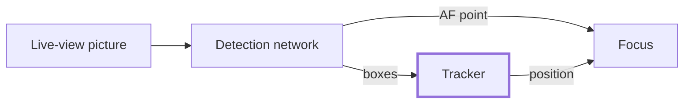

# Subject tracking

<!-- human page -->
<!-- house style -->

## Key points

- A tracker follows the subject between detections, using motion, colour and depth, and hands one position to the focus system.
- On the OM-1, the detector names the subject and the tracker keeps hold of it, and the tracker only jumps to a detection when a new subject part is chosen.
- The OM-5 II firmware has the same tracker core as the OM-1, with a much smaller link from detection to the tracker.
- On our E-M5 III using test firmware, our own detections steer the tracker and the focus point, but fast subjects and a lost subject still need work.

Subject detection finds a bird, an animal or a vehicle in the picture. Subject tracking is what keeps the focus on it
from one frame to the next. This page explains how the two work together in OM System cameras, what the firmware
shows about it, and where our research on the E-M5 III stands.

The detection side, with its networks, our engine program and our models, is on
[Subject detection research](subject-detection.md). This page starts where detection hands over its boxes.

## Overview

*Two ways from detection to focus. The tracker, the subject of this page, has a bold outline. Arrows show data flow.*

Each detection result describes a picture that is already one to three frames old in our tests. There are two ways to
use it.

- **Straight to the AF point.** The focus point jumps to the detected box. This is how continuous AF (C-AF) uses
  detection. The C-AF area chooser has its own cases for it.
- **Through the tracker.** The boxes go into the tracker's subject list. The tracker merges them with its own motion,
  colour and depth readings and hands one position to the focus system. This is how C-AF with tracking (C-AF+TR) uses
  detection.

## Tracker

The tracker is a firmware module that follows a subject across the frame. It reads two search blocks in the image
pipeline every frame. One finds how blocks of the picture moved. The other compares colour and size. It also follows
depth. On its own, the tracker has no idea what a bird is.

Detection gives the tracker that knowledge. The detector writes a list of up to eight subjects. Each subject has a
body, a head and an eye box. The tracker reads the list, picks one subject and part, and merges it with its own
readings.

## OM-1

The OM-1 is the reference we follow, step by step, so that our results feel like an OM System camera.

- **Detection rate.** The live-view pipeline offers the detector a picture at a fixed rate, normally 30 a second. Only
  the newest picture counts. Older ones are dropped.
- **Snap or search.** The tracker jumps onto a detection only when the chosen subject part is new. Otherwise each
  detected box becomes a search window, and the tracker keeps its own position.
- **When the two disagree.** If the tracker leaves the detected box, the detection side picks the subject nearest the
  tracker. The tracker is never pulled back to an old box.
- **Body first.** On the camera's built-in tuning, the tracker and the focus follow the body for every subject type.
- **Picking a subject back up.** When the tracker stops or pauses, the OM-1 restarts it at the next detection. A lost
  bird is found again as soon as the detector sees it.
- **One network per subject type.** Each menu choice, such as birds or motorsport, loads its own network and its own
  tracker settings. Focus itself is not tuned per type.

## Display

The OM-1 shows one subject frame for the body, with three looks.

| look | meaning |
|---|---|
| thin plain grey frame | a subject is detected but not taken, because the AF point is not on it |
| white frame with corner chevrons | the subject is taken |
| green frame | the camera has focused on it |

*Subject frame looks on the OM-1, from screenshots and a video frame of a bird.*

A small square marks the eye. There is no head box. The green brackets sit on the body centre. The camera uses a
detected subject only when the AF point is inside its box. OM System advises C-AF with subject detection rather than
C-AF+TR, because in C-AF+TR the motion tracker takes priority.

## E-M1X and OM-5 II

The E-M1X starts tracking a detected subject from the focus side. It picks a body and hands it to the tracker. It uses
the same subject list layout as the later bodies.

The OM-5 II has no detection network, but its firmware still carries the tracker side. The low-level parts of its
tracker match the OM-1's in size. The link from detection to the tracker is much smaller. The OM-1 also has a
pause step that stops the tracker when its motion readings look unreliable. The OM-5 II firmware does not have it.

## Research state

These results are from our E-M5 III using test firmware.

- **C-AF.** The focus point follows our detected box.
- **C-AF+TR.** The tracker reads our subject list and follows the bird. Focus follows it too, once the tracking point
  is the one driving focus. Tracking felt better than before, but slow to pick up a subject on fast pans.
- **Re-centring.** Letting the tracker keep its own position while it is inside our box, as the OM-1 does, kept it
  there about nine times in ten. Fast circles still lag.
- **Single AF (S-AF).** Our point is set at each half-press, mostly on the body.
- **Lost subjects.** Picking a lost bird back up first needed a second half-press. A restart from our side now puts
  the tracker back on the bird, but the camera's own tracker frame stays hidden after it.
- **Display.** Our body, head and eye boxes are drawn in green. The camera's own white tracker frame shows inside the
  body box.

Between detection passes, the camera's own motion results could move our boxes. We have read where the firmware keeps
them. In a first test, shifting boxes by the tracker's movement helped a little, because the tracker barely moves
between our fast passes.

## Status

Research in progress. Detection steers autofocus on our E-M5 III using test firmware. Matching the OM-1 on fast
subjects, re-finding a lost subject and the display colours are still open.

## Further reading

- [Subject tracking: technical notes](subject-tracking-technical.md)
- [Subject detection research](subject-detection.md)
- [Face and subject AF options](af-detect.md)
- [Autofocus and tracking AF](autofocus.md)
- [Network engine program](nn-engine-program.md)
