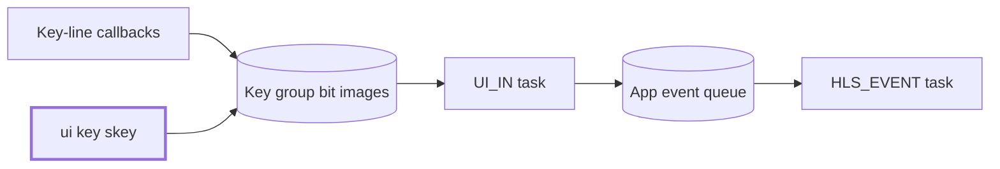

# Wi-Fi debug shell: technical notes

<!-- house style -->
> **Technical reading.** The detailed version of [Wi-Fi debug shell](wifi-debug-shell.md), for readers who want the internals.

*Last reviewed 2026-11-27.*

The stock firmware can start a debug Wi-Fi network and a command shell from a settings file on the card. No firmware
change is needed. We learned about it from fishcu/oly_fw_analysis. A forum user reports it working on an
E-M5 III 1.7.[^inf3] It passed on our own E-M5 III (see [First camera test](#first-camera-test)).[^cam1]

This page covers how the card file starts the network, the shell and its risks, how to try it, the commands we use for
test runs, and how the shell presses buttons. Addresses are E-M5 III 1.7 block0 addresses (base `0x60021020`) and are
listed in [Address reference](#address-reference).

The small numbers after a fact link to [Sources and dates](#sources-and-dates), which say how the fact is known and when.
On the notes site the number's colour shows the evidence: green = seen on our camera, blue = read in the firmware,
grey = inferred or reported by others.

## Start-up from the card file

The start-up runs in four steps on the E-M5 III 1.7.[^fw1]

1. **Card file.** At startup the parameter importer looks for `PARAMDT\CP??????.CSV` on the card. The folder and
   pattern strings are used by the DCF file search in `dcfnum.c`. Each line is `label,ID,count,value`. The label is
   ignored.
2. **Import.** A message handler runs the import step. When the import returns 0, it queues a callback.
3. **Callback.** The callback reads property 63857 (`0xf971`). If it is non-zero, the callback waits until readiness
   bit 7 is set, by polling. It then calls the two Wi-Fi start functions. The second one fills the Wi-Fi request block
   (216 bytes) and starts the debug network.
4. **More properties.** The callback then reads property 63873 (`0xf981`), the 8 KB console log switch, and bit 31 of
   property `0x7b64`.

See also: [OS and framework](../firmware/os-and-framework.md#debug-consoles).

Without the card file, the callback only needs ready bit 7, and then it calls the two start functions.[^fw2] The card
mod loader's Wi-Fi shell row on the Mods menu calls the same two functions from its task at the next power-on.[^fw2]
No stop routine is known, so a power cycle is the only way to turn it off.[^fw2]

The same Wi-Fi starter is reachable from a shell command with the sub-commands `init`, `start`, `info` and `auto`.
`auto` is the second start function.[^fw3]

The setting lasts until power-off. On the PEN-F the import is a RAM override, and no flash write was found on that
path. The E-M5 III uses the same import and callback pattern.[^inf1] Removing the file and power-cycling should undo
it. The test plan checks this.[^inf1]

The forum report describes an open Wi-Fi network and a debug console on port 23.[^inf3] OI.Share still connects. The
camera sometimes needs a brief battery pull before boot.[^inf3]

## The shell

The shell is the user shell (`Tsk_USHL`), with a table of 58 commands.[^fw3]

```
echo help lens aud cam bas pwr bc take stbd per res app usb prm flash rec file sc exp dbg ui mec fcs dbgall
sdet osd mdet face play mddyna disp tpc sdk efct buff api c3d sync usr damage spc mcon wifi qr olis mvr pos
avm iseq img movp md_sve digizoom zoom move albm syscall
```
*The 58 user shell commands, in table order.*

The PEN-F analysis traces the port-23 listener into the same shell. For the E-M5 III this is inferred.[^inf2]

### First camera test

With the card file, the laptop joined the camera's network by DHCP. The laptop got `192.168.0.3`, the router was
`192.168.0.10` and the mask /24.[^cam1]

- `nc 192.168.0.10 23` connected, with no refusal.[^cam1]
- `nc -c 192.168.0.10 23` gives the prompt `USR>`.[^cam1] The shell needs a carriage return (CR) at the end of a line.
    A line feed (LF) alone is ignored.
- `echo hello` returns `hello`.[^cam1]
- `help` lists the 58 user commands, exactly the table above.[^cam1]
- `help <command>` just reprints the command list. Per-command help has another form, not traced yet.[^cam1]

The camera accepts one connection per power-on.[^cam1] After the first `nc` session is closed, a new connection gets no
answer until a power cycle. The prompt appears only after the first Enter. So scripts must be the first and only
connection.

The user shell cuts each line at 31 characters.[^cam2] A longer line silently loses its end.

## Risks

The network has no password. Run the test only where nobody else is in Wi-Fi range, keep the session short, and switch
the camera off after.

Some shell commands write flash or settings. Never run any of these, or anything not on the list in
[How to try it](#how-to-try-it).

- `flash`. On the PEN-F its dump can remap or rewrite blocks.
- `prm` writes. `prm clear` includes a flash target.
- `file` rm and format.
- `usr`, `damage` and `syscall`.
- `sdk`. Its macro writes files.
- `usb` and `tpc`.

More commands write flash or the card.[^fw5]

- `bas load` copies a script file from the card into a flash resource. `bas del` removes it.
- `res write` and `res erase` change the resource store (fonts, sounds and lens tables).
- `mec dmgclear` and `dmgset` touch the damage state.
- `file`, `olis`, `albm`, `pos save`, `spc write_*` and `sdk macro rec` write the card.

> [!WARNING]
> `flash running` erases the factory calibration. That data is unique to the camera, and no update file restores it.
> Never run any `flash` subcommand.

The `flash` command runs a NAND erase, write and read test ("PureNAND Running Start") on `0x40060000`, the first block
of the calibration store.[^fw6] The OM-5 has the same test.[^fw6]

The flash is NAND behind a controller. The firmware reads it in 2048-byte pages.[^fw6] So `file memdump` on
`0x40000000` is not a known way to read it. A flash backup needs the firmware's own read function.[^fw6]

The shell runs inside the normal firmware, so it is no help if the camera won't boot.

## How to try it

This works on stock 1.7, with nothing flashed.

1. **Card.** Use a spare card, formatted in the camera. On a computer, create the folder `PARAMDT` at the card root
   and the file `PARAMDT\CP000001.CSV` with one line, as plain text with a Windows or Unix line ending.

   ```
   Wifi shell,0xF971,1,1
   ```

2. **Location.** Work at home, with nobody else in range. Use the laptop's Wi-Fi only, with no Ethernet bridging.
   The camera runs stock 1.7 or any of our builds. None of them touch this path.
3. Power on with the card in. If no new network shows within about 1 min, power off, pull the battery for about 10 s
   and try again.
4. Join the camera's open network. Note the network name and the laptop's IP and gateway. The camera is probably the
   gateway (`192.168.0.10` on OI.Share networks).[^inf1] Connect with `nc 192.168.0.10 23` or `telnet`.
5. First commands, read-only only. Send `help`, then `echo hello`, then `help` for these groups only: `fcs`,
   `iseq`, `take`, `dbg` and `wifi`. Save the session text (copy the terminal) for the readout.
6. **Undo.** Power off, delete `PARAMDT\CP000001.CSV` (or the whole folder) and power on. Check that the open
   network does **not** appear and that OI.Share pairing behaves as before.
7. Report the network name, the IP, whether a battery pull was needed, the `help` output and step 6's result.

Possible follow-ups, each its own item:

- Add this line to the same file to tee console text into the 8 KB log, then save it with the stock `dbgterm`
    writer. On the PEN-F, 1 = fill once and 2 = circular. The E-M5 III values aren't checked.

    ```
    dbg log,0xF981,1,1
    ```

- Read-only reads of our Live ND and HHHR state while the camera runs.
- `sdk macro` record and replay for repeatable UI tests, with a read-only design first.

## Commands for Live ND and HHHR

Read from the firmware and its block0 strings.[^fw4]

- **`take`** with no argument prints its own help: `func ...`, `dbgmode`, `dbginfo`, `exec COM` and `ev_qname NAME`.
    It also accepts `cont_dbgmode`, `ps` and `pe`.[^fw4]
- **`take dbginfo`** is print-only.[^fw4] It prints the shooting-sequencer state, the event mask and the pending
    imdfunc queue and command. Then it calls seven status printers (job, flag manager, capture counters). No writes
    were found two call levels down.
- **`take dbgmode`** with no value prints the current value. `take dbgmode 1` sets a RAM word that turns on the
    "TAKE_MAIN sequence dbg log", the `.post(%d)`, `.exec(%d)` and `.ipost(%d)` event trace.[^fw4]
    - Four readers in the state dispatcher test only bit 0. They print the state name (state table entry +4) and
        `.exec(n)`, `.ipost(n)` or `.post(n)`, plus `old -> new` on a state change.
    - The trace has no other effect, apart from the time the prints take.
    - Only the `take` command and its init write the word.
- **Do not run** `take exec`, `take ps`, `take pe` or `take func exec`. They post commands to the sequencer.
- **`dbg`**: `dbg put put|off` sets the DBG_PUT output state. `dbg info ...` prints block information.[^fw4]
- **Never run** `dbg test`, `dmyp`, `dmyw`, `nmip` or `nmiw`. They raise dummy warnings and NMIs on purpose.[^fw4]
- **System shell.** A line that is only `:` switches the session to the system shell dispatcher.[^inf1] It has
    `mdump4/2/1` and `mem_get4/2/1` (read memory), but also `mem_put*`, `nmiset`, `arm load*` and `shelloff`. It is
    not tried. Whether its output reaches the Wi-Fi session is unknown, because its `ps` writes straight to the UART.

For a Live ND run, connect, run `take dbgmode 1`, then run the armed capture.[^inf1] The event trace arrives on the
laptop, so it survives a reset or battery pull. During a hang, `take dbginfo` shows the state and event mask if the
shell task still runs.

`take dbgmode N` stores N unmasked.[^fw7] The four stock readers test bit 0 only, so the upper bits are free as
console switches for our builds. Our Live ND builds use bit 1 as the LV Simulation switch. The trace prints with the
firmware's sprintf and puts, with call frames copied from the stock trace code. The system shell's `mem_get4 <addr>`
and `mdump4 <addr> (<size>)` print through the UART path, so they are not expected to reach the Wi-Fi session.[^fw7]

## Sequencer trace

`take dbgmode 1` streams the native shooting-sequencer trace to the port-23 session as it happens.[^cam1] It shows
state names, `.exec(n)`, `.ipost(n)` or `.post(n)` per event, and ` -> NewState` on every change. A normal single shot
reads as follows.[^cam1]

```
Idle → RdyStart → RdyFcsRdy1-3 → RdyTrig2Wait → RdyFcsTake → Standby → StlRdy1 → StlRdy2 → StlTakeCave →
StlEnd1 → StlEnd2 → RdyTrig2Wait → RdyAbort → RdyEnd → Idle
```

`take dbginfo` prints the sequencer status.[^cam1] It includes a `history` line of recent events and the burst fields
`continue_mode`, `uhs_cont_speed`, `capture_count`, `stop#req` and `uhs_cam_packet_queue`.

The body shutter works normally while the debug network and session are up.[^cam1]

So a Live ND or HHHR test run can be traced on the laptop with no logging code in the build, and the trace survives a
reset or battery pull.[^inf1] It has been used on every armed Live ND test run, and a fault at capture start was found
this way. So it works on armed builds.[^cam3]

## Dumping RAM to the card

`file memdump NAME ADR LEN` writes LEN bytes of RAM to the card.[^cam2] ADR is hex and LEN is decimal. The output is
binary-safe, checked against block0 code.

The 31-character line limit matters here. Keep names short, as in `file memdump A a4423ec0 262144` (30
characters).[^cam2] A longer line silently loses the end of LEN, so `262144` became `2`. `status = 0x0000` means
success. The "unknown Command" after it is the extra line ending that `nc -c` sends.[^cam2]

## Simulated button presses

The user shell's `ui` command can press and release the camera's buttons through the same path the real buttons use.
Its sub-commands are `key`, `jog`, `out`, `led`, `sound` and `help`.[^fw8] This was read in block0 and has not been
tried on the camera yet.


*Real presses and `ui key skey` (bold outline) meet at the bit images. Arrows show data flow. The table says who starts each.*

| from | to | what moves | path | started by | how often |
|---|---|---|---|---|---|
| key-line callbacks | bit images | key bits | group image, then bit 0 of UI_IN's event flag[^fw9] | key-line interrupt | each interrupt |
| `ui key skey` | bit images | one key bit | group image under an interrupt lock, then UI_IN's event flag[^fw8] | shell command | each command |
| bit images | UI_IN task | changed group image | UI_IN's event flag, bit 0[^fw9] | UI_IN waits on the flag | each flag set |
| UI_IN task | app event queue | press, release and change events | 12-byte message through `OlyQeWrCpu`[^fw9] | UI_IN's key decoder | each decoded change |
| app event queue | HLS_EVENT task | app events | `appevent::Wait_Event`[^fw9] | HLS_EVENT waits on the queue | each event |

*How a key press moves from the key matrix to the app.*

### Key groups

The key-matrix module (UI_IN) keeps one bit image per key group.[^fw8] Its table has 12-byte records
`{u32 entry lists, u32 image, u8 bytes, u8 bits, u8 count}` for five groups,
which are power, gio (3 bytes), adc, dial and ext.

When an image changes, the module decodes it into app events in its dispatcher.[^fw8]

- `0x2000000 | code` is a press.
- `0x2010000 | code` is a release.
- `0x2020000 | code` is a change.

The dispatcher also sends a half press first when the full press arrives alone, and posts the events.[^fw8]

### The skey command

`ui key skey <code> <state>` calls the key-set function with the code and state.[^fw8]

1. It finds the key's group and bit.
2. It copies the group image.
3. It sets or clears the bit. State 1 is pressed, and the entry's polarity byte is applied.
4. It writes the image back under an interrupt lock.
5. It sets UI_IN's event flag.

UI_IN's own task then handles it exactly like a real press. So `skey` simulates the key matrix, not a GUI event.[^fw8]
Numbers take `0x` for hex. The mode dial is the special code `0x2021901`, with the dial position as the state.

Other `ui key` sub-commands:[^fw8]

- `gkey <code>` gives the current state of a key.
- `gtbl` prints the key table.
- `debug <n>` sets the key log level, which prints every app event as it is sent. This is good for checking which code
    a real button makes.
- `pwr_fact` gives the power-on factor.
- `spkey`, `multi1` and `multi2` are special shutter callbacks. Don't use them.

### Key codes

Key names have 4 letters in the firmware's name table.[^fw8]

| name | code | key |
|---|---|---|
| Trg1 | `0x100` | half press |
| Trg2 | `0x101` | full press |
| MdDi | `0x1901` | mode dial |
| Cut1, Cut2, Cut3 | `0xb`, `0x1209`, `0x120a` | Fn and REC style buttons |
| Cut4, Cut5, Cut8 | `0x120b`, `0x1224`, `0x1227` | Fn and REC style buttons |
| Levr | `0x1223` | lever |
| Play, Menu, Eras | `0x87`, `0x89`, `0x84` | |
| Info, Ok | `0x1205`, `0x4` | |
| Up, Down, Left, Rigt | `0x5`, `0x6`, `0x7`, `0x8` | |

*Key codes from the firmware's name table. Which physical button each Cut code is needs `ui key debug` on the camera.*

Never inject Powr `0xc`, LpSw `0x121c`, UsbC `0x400`, Hdmi `0x501`, MdaC `0x1506`, LnsC `0x2202` or the other cable,
card or lens codes in the table.[^inf1] They fake power, cable, card or lens events. Always send the release (state 0)
after a press. A press with no release stays held until a power cycle, or until a real key in the same group changes.

### Dials and touch

Dials are not keys.[^fw8] The front and rear dials go through the jog driver, which posts `0x2030000 | 0x1902` or
`0x2030000 | 0x1903`. `ui jog` only has `start`, `stop`, `count` and `debug`. So there is no stock way to turn a dial
from the shell. In menus the arrow keys do the same job. A dial turn would need a small helper in one of our builds.

The touch panel is a separate driver, with `[TP]` strings. It has not been traced.[^fw8]

### From the key line to the app

The key lines raise interrupts in a block with two pairs of channels, at `+0x00` and `+0x80`.[^fw9] The status is at
`+0x08` and `+0x88`, written back to clear. That this is a GPIO edge-interrupt block is inferred.[^inf4]

- The interrupt handler calls the callback registered for each channel.[^fw9] Registration also zeroes `+0x00` and
    `+0x04` (or `+0x80` and `+0x84`) and makes one setup call with the arguments (0, 3, 1). UI_IN registers its own
    callback for its gio lines.
- Other key sources register their own callbacks.[^fw9] Two per-channel callbacks sit in records of 56 bytes each,
    likely for the adc keys.[^inf4] The power key's callback goes through a function that takes cross-core lock 8. Its
    reader fills the power image.
- Each callback updates the group's bit image and sets bit 0 of UI_IN's event flag (a u16).[^fw9]
- The UI_IN task loop waits on that flag (bit 0, no timeout) and clears it.[^fw9] It runs the key decoder, which
    leads to the dispatcher above, and then the jog handler. A progress word goes 1 → 2 → 3 on each pass.
- App events go out through a function that allocates a 12-byte message `{u16, u32 event, u32 argument}`.[^fw9] It
    writes the message to a u16 queue with `OlyQeWrCpu`. The HLS_EVENT task reads that queue in `appevent::Wait_Event`
    (also `Wait_ExecuteEvent`). The `api_*.c` modules (api_rec, api_play, api_disp and others) use the same queue id.
- The event poster drops two event codes (`0x40d00b5` and `0x40d00b6`) while a state byte is 119 and a check with the
    value 3008 is set.[^fw9] What that state means is open.

## Other bodies

- **E-M5 II 4.1.** The shell commands (`skey`, `memdump`, `sdk api`) and the card updater are present.[^fw10] Wi-Fi
    runs on the MN103 itself (a BCM43362 over SDIO, with no ARM). So the property-callback entry route must be found
    again.[^inf5]
- **E-M5 (Mark I) 2.3.** The shell commands are present, and there is no Wi-Fi code at all.[^fw10]

See also: [Older bodies](../bodies/comparison-technical.md#older-bodies-e-m5-ii-and-e-m5-mark-i).

## Open questions

- Whether removing the card file and power-cycling turns the network off on the E-M5 III. The undo check has not been
  reported yet.
- The form of per-command help in the shell.
- Whether system shell output reaches the Wi-Fi session.
- The E-M5 III values of the console log switch.
- Which physical button each Cut code is.
- How a half-press app event reaches the shooting sequencer.
- What the event poster's state byte and the 3008 check mean.
- The entry route into the shell on the E-M5 II.

## Address reference

E-M5 III 1.7 block0 addresses (base `0x60021020`) unless a body is named.

| item | address |
|---|---|
| folder and pattern strings | `0x6073e6c8`, `0x6073e6d4` |
| DCF search (`dcfnum.c`) | `0x60615f6d`, called from `0x60615b1b` |
| import message handler | `sub_6005add3`, called from `0x6005d65d` |
| import step | `0x6005bddf` |
| callback queueing | `0x600691c8` |
| callback | `0x6005bafb` |
| property read | `0x6005ce6b` |
| readiness wait, poll | `0x60045d92`, `0x60051a24` |
| Wi-Fi start functions | `0x6122e9b6` (`[],4`), `0x6122e9f6` (`[a2],8`) |
| Wi-Fi request block (216 bytes) | `0xa25c3c2c` |
| console log switch read | `0x60022f9f` |
| Wi-Fi shell command handler | `0x6122ec89` |
| user shell command table | `0x601fbe38` |

*Card file start-up and the shell.*

| item | address |
|---|---|
| `flash` handler, table | `0x6005a245`, `0x601fab64` |
| "PureNAND Running Start" | `0x60059a44` |
| first calibration block | `0x40060000` |
| `flash` NAND test (OM-5) | `0x6005b70a` |
| NAND page reads | `0x60022180`, `0x60022451` |
| `file memdump` start of flash window | `0x40000000` |

*Flash risks.*

| item | address |
|---|---|
| `take` handler, help, help text | `0x602a158b`, `0x602a168b`, `0x6044fceb` |
| `take dbginfo` | `0x602a169b` |
| sequencer state (u16), event mask | `0x62107744`, `0x62107750` |
| status printers | `0x60227bb0`, `0x602a747d`, `0x602c4e43`, `0x602bbe53`, `0x602a2085`, `0x602a19a5`, `0x602aee91` |
| `dbgmode` word (u32, RAM) | `0x62107754` |
| trace strings | from `0x6044fc8d` |
| trace readers | `0x602a0ff9`, `0x602a1125`, `0x602a1256`, `0x602a13ba` |
| trace init | `0x602a0f48` |
| `dbgmode` store | `0x602a1898` |
| sprintf, puts | `0x600e054f` (`[],12`), `0x60022fbf` (`[a2,a3],28`) |
| stock trace call copied | `0x602a101d` |
| `dbg` handler | `0x61401a03` |
| DBG_PUT output state | `0xa2566018` |
| system shell toggle byte | `0xa25b8800` |
| system shell print path (UART) | `0x60055947` → `0x60056f8f` |

*Commands for test runs.*

| item | address |
|---|---|
| `ui` handler, sub-command table | `0x61408cf3`, `0x601b7bd0` |
| `ui key skey` | `0x61408f79` |
| key set, find, write back | `0x60120327`, `0x60120dea`, `0x60120cef` |
| UI_IN event flag (u16), set_flg | `0x60040dd4`, `0x60051078` |
| number parser | `0x60102915` |
| `gkey` | `0x60120227` |
| key log level byte | `0xa2652cd8` |
| key name table | `0x60251248` |
| UI_IN module | `0x6011f000` to `0x60122000` |
| key group table | `0x601b8320` |
| images power, gio, adc, dial, ext | `0xa2652f38`, `0xa2652f34`, `0xa2652f2c`, `0xa2652f2d`, `0xa2652f30` |
| dispatcher | `0x60120ad3` |
| JOG_SendEvent | `0x6011fe86` |
| touch panel strings | `0x601fa531` |

*Key injection.*

| item | address |
|---|---|
| key-line interrupt block | `0x9bd00000` |
| interrupt handler | `0x601231e0` |
| callback table, registration | `0x620b2860`, `0x601230ab` |
| setup call in registration | `0x60071fa6` |
| UI_IN gio callback, registered at | `0x60120011`, `0x6011faf1` |
| adc callbacks, records | `0x60121305`, `0x601213bd`, `0x620b27a8` + 56 × n |
| power key callback, lock function, reader | `0x60121f0d`, `0x60063d13`, `0x60063d81` |
| UI_IN task loop | `0x6011f9d8` |
| key decoder, jog handler | `0x6012092f`, `0x6011fb2d` |
| progress word | `0x620b2784` |
| event poster, message writer | `0x60046008`, `0x602e39b9` |
| app event queue id | `0x60040f24` |
| `appevent::Wait_Event`, `Wait_ExecuteEvent` | `0x602e2f49`, `0x602e32f6` |
| event drop state byte, check | `0xa25b897e`, `0x602e69f9` |

*From the key line to the app.*

## Sources and dates

The small numbers in the text point here. Each note says how a fact is known and when.

[^fw1]: Read in the firmware, 2026-11-11.
[^fw2]: Read in the firmware, 2026-11-22.
[^fw3]: Read in the firmware.
[^fw4]: Read in the firmware and its block0 strings, 2026-11-12.
[^fw5]: Read in the firmware, 2026-11-25.
[^fw6]: Read in the firmware, 2026-11-23.
[^fw7]: Read in the firmware, 2026-11-12.
[^fw8]: Read in block0, 2026-11-17. Not tried on the camera.
[^fw9]: Read in the block0 disassembly, 2026-11-19.
[^fw10]: Read in the firmware, 2026-11-21.
[^cam1]: Seen on our E-M5 III, 2026-11-12.
[^cam2]: Seen on our E-M5 III, 2026-11-19.
[^cam3]: Seen on our E-M5 III on every armed Live ND test run since 2026-11-12, recorded 2026-11-19.
[^inf1]: Inferred.
[^inf2]: Inferred for the E-M5 III from the PEN-F analysis.
[^inf3]: Reported by a forum user on the E-M5 III 1.7, 2026-11-01. Not checked by us.
[^inf4]: Inferred, 2026-11-19.
[^inf5]: Inferred, 2026-11-21.

## History

- 2026-11-12: the first connection used nc's default LF line ending, and `help` and `echo hello` printed nothing. CR
  or CRLF line endings (`nc -c`) fixed it.

