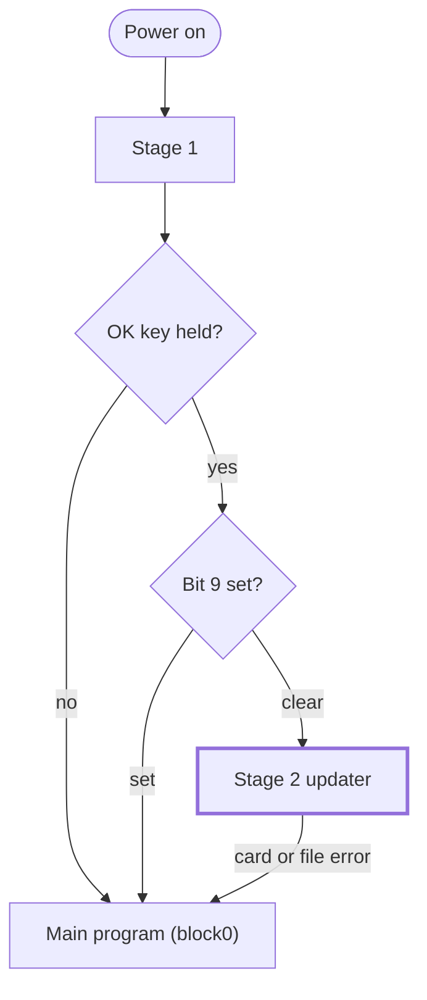

# Recovery: technical notes

<!-- house style -->
> **Technical reading.** The detailed version of [Recovery](recovery.md), for readers who want the internals.

*Last reviewed 2026-11-27.*

Flashing your own firmware always carries the risk of a camera that won't start. This page sets out what the camera
checks at power-on, what a firmware update actually writes and in what order, which kinds of failure you can recover
from with just an SD card, and the step-by-step recovery procedure. It ends with the checks every one of our builds
passes before it goes near a camera.

The short version:

- The card updater checks the whole file before it writes anything, so a corrupt or wrong-model file is harmless.
- Holding OK at power-on runs a card updater in the boot-area loader, below the main program. It works even when the
  main program can't start, as long as the boot area is intact.
- Keep everything we add switched off during boot, and keep a card with the stock firmware handy.

Two terms used below. The **watchdog** is a timer that resets the camera if the software stops "kicking" it. A
**bootloop** is a camera that crashes, resets and crashes again on every start.

The small numbers after a fact link to [Sources and dates](#sources-and-dates), which say how the fact is known and when.
On the notes site the number's colour shows the evidence: green = seen on our camera, blue = read in the firmware,
grey = inferred or seen in an emulator, amber = a correction.

See also: [Boot and section loading](boot-and-sections.md), [Memory map](../hardware/memory-map.md).

## What checks what at power-on

- **The boot-area loader starts block0** at its entry point. It does no checksum of block0.[^fw4] Its two stages are
  described in [The boot-area loader](#the-boot-area-loader).
- **Block0 never checks itself.** The boot stub and the section loader copy without any checksum or signature. A read
  error is only logged. Section 7's constructors run right after it loads.[^fw1]
- **Every boot also reads blocks 1, 2 and 4.** A function in `res.c`, on the `USRSTART_LOAD` path, reads the OSD,
  RESCOM, PIC and data areas of flash.[^fw1]

### Watchdog and resets

- **The watchdog is in the always-on power block.** There is no separate processor for it.[^fix1] The setter writes the
  time-out n to bits 0-5 of the watchdog register and commits with `0x20041001`. A kick writes the key `0x19191012`.
  Boot sets a time-out of 10. The task `PER_WDT` (id 25) kicks every 3 s.[^fw1]
- **A deliberate reboot is a watchdog time-out of 1, then a spin.** "COMMON Reboot", the NMI handlers and the flash
  write guard all do this. The NMI path saves the registers and prints "NMI_INT Hassei!".[^fw1]
- **So any fault resets in about 1 s**, and a fault on every boot is a bootloop.[^fw1]
- **A task-level hang does not reset**, because `PER_WDT` keeps kicking. One Live ND test build needed a battery
  pull.[^fw1][^cam1]

See also: [Power block](../hardware/power-block-technical.md).

## The boot-area loader

The boot area at the start of flash holds two programs, both linked at VMA `0x60020000` (flash offset +
`0x20000000`).[^fw4] We read them from a flash backup of one E-M5 III.

*Stage 1's choice at power-on. Arrows show the order of control. The stage 2 updater, the card rescue, has a bold outline.*

### Stage 1

Stage 1 runs at power-on. It sets up the clocks and then decides.[^fw4]

1. It writes `0x100` to a pad register and reads bit 4 of the pad input. If the bit is 1, it boots normally.
2. Else it reads and clears bit 9 of the always-on control word. If that bit was 1, it boots normally.
3. Otherwise it copies stage 2 to RAM and runs it.

A normal boot copies the first 60 KB of block0 to RAM and enters it. Stage 1 does no checksum of block0.[^fw4]

Stage 1 touches only one byte of the core-shared block. Neither the E-M5 III nor the OM-5 main program addresses that
byte directly.[^fw4]

### Stage 2

Stage 2 is 320 KB, a small OS of its own with a task table. It has a NAND driver, an SD card stack and **its own card
updater**.[^fw4]

- It looks for `DCOLYMP`, `E137????BIN` and `G137????BIN`.
- It handles every component type (USR, OSD, PIC, RESCOM, LUKE, BOOT and more).
- It descrambles, checks the checksum, writes and compares.
- It reports "UPDATE SUCCESS" or "UPDATE FAIL" on the debug serial port and sets a lamp mode.
- The updater is task 5. It does not need block0.

### The OK key

Stage 1 enters stage 2 when the pad reads low at power-on. That pad is entry 2 of block0's pin table (interrupt `0x32`,
gio id 194).[^fw4] **Pad 2 is the OK key.** A read-only pin watch on an E-M5 III logged pad 2 low exactly twice, during
the two 3-second OK holds of an OK-only run, and at no other time.[^cam2]

So "hold OK at power-on" runs the boot-area stage 2 updater, not block0's FIRMUP. A card update therefore works even
if block0 can't start, as long as the boot area is intact and bit 9 of the always-on control word is clear.[^cam2]

### Bit 9 and the power-off path

The main program sets bit 9 in its power-off path, when property `0xa011` equals 9. It is a plain store. The same code
is in the OM-5 and OM-5 II 1.1.[^fix1] Property `0xa011` is the u8 at +6 of the "small" store (layout 10, same packing
in all three bodies, E-M5 III setting id 3016). The E-M5 III has three writers of it.[^fw5]

Stage 1 clears the bit only on an OK-held start. So a program that keeps `0xa011` at 9 makes every hold-OK start skip
the updater. We suspect this for one of our test images.[^inf2] The way out to test is an OK-held start, a battery pull
while running, then an OK-held start with the card.[^inf2]

### Stage 2 exits

The firmup task boots block0 without writing through one exit routine. That routine prints "UPDATE OPERATION WAS NOT
PERFORMED" to the UART, then copies part of block0 from flash to RAM.[^fw5] Five places call it.

- an unmount error
- a mount error
- a file-search error other than not-found
- a load error
- no file found for any of the 11 types

The "File Init" check and the "SCPU Init" check always pass. The always-on cause decode reads `+0x48` and `+0x00` bit 1
and stores a code. No reader of that code was found, and the backup words `+0x08` to `+0x3c` only have a setter. So a
silent skip after stage 2 starts means a card or file problem, not a cause check.[^fw5]

## Flash map and what an update writes

The flash is 128 MB.[^fw1]

| range | contents |
|---|---|
| `0x40000000`–`0x40060000` | boot area. Written only by update kind BOOT (`0x10`). |
| `0x40060000`–`0x40780000` | data window |
| `0x40780000`–`0x41f60000` | block0 (USR) |
| `0x41f60000`–`0x42160000` | data window |
| from `0x42160000` | OSD |
| from `0x43f60000` | RESCOM |
| `0x47180000`–`0x47a80000` | PIC |
| `0x47a80000`–`0x48000000` | data window |

*Flash map. The flash also appears at the alias `0x80000000`.[^fw1]*

Normal-operation writes are allowed only to the three data windows. Anything else trips the flash write guard, which
sets the watchdog to `0x81` and spins, so the camera resets.[^fw1]

Our .BIN files (USR, OSD, RESCOM, LUKE, PIC) never touch the boot area or the settings and adjustment data.[^fw1]

**Write order.** We ran the camera's own writer in om-emu on the stock file.[^fw2]

1. LUKE, to the IS sub-CPU
2. PIC
3. RESCOM
4. OSD
5. **USR (block0) last**

Each flash component is erased over its whole range, programmed and read back. There is no rollback.[^fw2]

## The card updater (hold OK at power-on, `DCOLYMP/e1379999.bin`)

This section covers the updater inside block0. The OK-held start runs the boot-area loader's own updater instead, as
described in [The boot-area loader](#the-boot-area-loader).

- **Tasks.** Same design and task ids as the E-P7. `FIRMUP_CLI` is id 88, `FIRMUP_SRV` id 18 and `FIRMUP_LED`
  id 118.[^fw1]
- **Start.** SRV is started only in the last user-start stage, USRSTART5, after all 10 sections are ready.[^fw1] CLI has
  no static start. It is most likely the camera-app manager's MISC/FIRMUP sub-app.[^inf1]
- **The validator checks every component before writing anything.** It checks the model (`0x1370`), the type ('E'),
  that the header equals the trailer, and a word checksum over the descrambled payload. It does not check the
  version.[^fw1]
- **Validator runs.** We ran it natively in om-emu. Stock and a Live ND test build pass. A flipped byte gives `0x3211`.
  The OM-5 model gives `0x3202`, and so does truncation. All of these runs made **0 flash writes**.[^fw2]
- **It does not check nested sub-block checksums.** A block 2 sub-block with a wrong checksum, with the outer block's
  checksum fixed, passes with `0x0` in modes 2, 1 and 0. Only "... Gets" is printed per component. So nothing before
  flashing catches that, and the pre-flash self-test's `subblock-sum` case can't show F3 failing. A flipped byte,
  where the outer checksum is wrong, still gives `0x3211`.[^emu1]
- **Lamp.** Solid while working (255). Slow blink means success (250). **Fast blink means failure** (100). Then it waits
  for power off.[^fw1] The solid lamp and the blink were seen on the camera.[^cam1]
- **The block0 updater needs almost the whole boot.** That means the boot stub, the loader, all sections, USRSTART2
  to USRSTART5, the file system task and the resource reads.[^fw1][^inf1] Block0's update runs in the camera app's
  MISC/FIRMUP sub-state, and `FIRMUP_SRV` starts in the last user-start stage, so it needs the stage 2-4 tasks too.[^fw5][^inf2]
- **USB updates** (OM Workspace) **and Wi-Fi updates** need even more, the USB stack, the GUI and the ARM. So they are not
  independent rescue paths.[^fw1][^inf1]

### Other bodies

Every body we hold has `FIRMUP_CLI`, `FIRMUP_SRV` and `DCOLYMP`, and a card file pattern with its own model
number.[^fw3]

| body | card file pattern |
|---|---|
| E-M5 III | `E137????BIN` |
| E-M1 III | `E139????BIN` |
| OM-5 | `E144????BIN` |
| OM-1 | `E143????BIN` |
| PEN-F | `E122????BIN` |
| OM-5 II | not found in the unexpanded image |

*Card update file pattern by body. String search of each image, the OM-5 and E-M1 III on the expanded images.[^fw3]*

The NMI message "NMI_INT Hassei" is in all six. "COMMON Reboot" is in all but the PEN-F.[^fw3]

## Which failures are recoverable

| failure | recovery |
|---|---|
| Bad file (corrupt, wrong body, truncated) | rejected before writing, fast blink, camera unchanged[^fw1] |
| Crash only when armed or on a feature path | power off (battery pull if hung), boot, reflash[^cam1] |
| Crash on every normal boot in a shooting, live-view, lens or USB hook | OK + power with the stock file. The OK-held start is run by the boot-area loader's own updater, which needs no block0.[^fix1][^fw4][^cam2] |
| Intermittent boot failure (section-load race) | retry power-on with OK held. It gets through sometimes.[^cam1][^inf1] |
| Crash in the boot chain (USRSTART, loader, section 7 constructors, file system, resource reads) | hold OK at power-on with the stock file on the card. OK is read by the boot-area loader, whose own updater needs no block0.[^fix1][^fw4][^cam2] |
| Power cut while the update writes USR (block0, last) | block0 half-erased, a brick[^fw1][^inf1] |
| Power cut during the earlier blocks | block0 is intact, but boot reads those blocks, so it may still fail[^inf1] |
| Bad persistent state (settings value, trigger file on card) | survives a reflash. Remove card files, reset settings from the menu.[^inf1] |

*Failure kinds and the way back from each. Older readings of three rows are in [History](#history).*

## Recovery procedure

1. Keep a spare card with only `DCOLYMP/e1379999.bin`, a copy of the stock `OLY_E_137_1700_0000_0000.BIN`. No other
   E137 files.
2. Camera hung: battery out, wait 10 s, back in.
3. Remove anything that wakes a feature at boot: our request files (`LND*.ARM` and the like), USB and HDMI cables, and
   the lens.
4. Normal power-on. If it boots, flash stock (or the last good build) the usual way.
5. If it loops or dies at power-on, put the spare card in and **hold OK while switching on**. Keep holding until the
   lamp is solid. Make several tries if the failure was intermittent. Solid, then slow blink, means done, so switch
   off. Fast blink means the file was rejected and nothing was written.
6. Start every flash with a full battery.
7. If there is no lamp at all with OK held, the update boot can't run. Stop and write down what happened. It would
   need service or a flash programmer, which is an open question.

> [!WARNING]
> Never open the battery door while the lamp is solid. A power cut while block0 is written leaves it half-erased.

## Pre-flash check suite

Every build we make goes through a pre-flash check script before it is handed over. It takes the stock file, the build
and an output folder, with an optional manifest. It runs all the checks below in about 90 s and writes `REPORT.md`.
**A build is handed over only with a PASS report, warnings listed, in its zip.**[^fw1][^pol1]

| check | what it checks |
|---|---|
| F1–F4 | the container and checksums, that the components match stock, and the camera's own validator run in om-emu |
| F5 | nested sub-block checksums, statically, because the camera's own validator (F3) only checks the outer USR, OSD, RESCOM, LUKE and PIC blocks[^pol3][^emu1] |
| B1–B3 | the boot stub, the section table and section ends, and the functions on the recovery path and the idle boot |
| S1–S2 | that new bytes sit inside loaded sections, and that no early-section hook jumps into a later section without a ready-bit test |
| R1 | that each feature stays in its own region |
| A1–A2 | native evidence for every absolute address, and plain MN10300 instructions only |
| E1–E2 | om-emu boot plus a 13-step script behaving as stock, and which changed bytes ran with nothing armed |
| N1 | negative control. The manifest's feature probes must match the build and not the previous build (`--prev`).[^pol3] |
| W1 | om-emu write watch over free space (`regions.csv`, `census.csv`) and the build's new bytes. On with `--emu`.[^pol3] |

*The pre-flash checks. The detail of S2, W1 and F5 is below the table.*

- **S2 order.** S2 orders sections by when they become ready (index order 1 to 10), not by the load order 1, 7, 2 and
  so on.[^pol2] The old load-order rule passed a build that boot-looped on the camera.[^cam4]
- **Section ends.** The list of accepted section ends also has section 3's, so a raised section 3 end is a WARN, not a
  FAIL. One raised value is listed as camera-proven, since a later test build passed.[^cam4]
- **W1 control.** Canary stores in idle-boot code are W1's positive control. The self-test saw 280 canary
  writes.[^emu1]
- **F5 reason.** The validator in om-emu returns `0x0` on a file whose nested sub-block checksum is wrong, in modes 2, 1
  and 0.[^emu1]

### Self-test

`selftest.py` follows the om10mi-mods method. It builds deliberately broken images and runs a real build that
boot-looped on the camera. Each must FAIL its named check, and stock must not.[^pol3]

The broken images cover a bad checksum, a section overlap, a boot-stub byte, an unloaded hook, the section-1→4 and
section-2→7 boot races, a dangling address, an AM33 instruction, a misaligned store, a foreign region, text past a
section end, a recovery-path byte, a replaced body, a probe that matches the previous build, and a nested sub-block
checksum.

- All static cases behave as required.[^fw1]
- The om-emu cases behave as required. They are the E1 hang, the E2 unarmed stub, W1 writes to free RAM, and the F3
  flipped byte, which gives `0x3211` checksum_error.[^emu1]
- Every check except the WARN-only F4 and B3 has now been shown failing, and stock passes with W1 on.[^emu1]

**Calibration.** Stock passes. A current HHHR test build passes with warnings. **The build with the boot-race bug
fails on its boot-race hook, the real dead-at-power-on bug.** The corrupt, overlap and unloaded test files fail.[^fw1]

**Limits.** It can't see bugs that only happen when armed, the real boot chain, indirect calls, or blocks 1 to 4
beyond a diff.[^fw1]

## Safety rules for our builds

These rules were proposed for every build we make.[^pol4]

1. **Pre-flight with the camera's own validator** (preflash F3). `fupcheck.mjs EMU FILE 2` in om-emu must return
   `0x0` with exactly USR, OSD, RESCOM, LUKE and PIC. Never ship a BOOT or extra component.[^fw1]
2. **Recovery-path diff** (preflash B2 and B3).
   `recovery_reach.py checkbin recovery-path-functions.csv,idle-executed-functions.csv STOCK BUILD`. Every hit must be
   camera-proven or explained in the PROCEDURE. Today the camera-proven hits are the section-end constants and one
   focus-stack site. The static list (2,579 functions) is a lower bound. It misses indirect calls, so the boot-race
   build's hook is not in it.[^fw1]
3. **Nothing of ours acts during boot.** Guard boot-reached hooks and keep them no-ops until the shooting app is up, so
   the update boot runs stock code.[^inf1]
4. **Arm state only in RAM**, so resets come up disarmed. Read request files only on an armed user action, never at
   boot.
5. **A safe-mode key**, held at power-on so all hooks stay off, and later a boot counter in sub-CPU backup words.
   The OM-5 II shows a camera-proven pattern in the OMKit project. Its loader asks the key-state routine whether OK is
   held and skips all added code.[^cam5] The E-M5 III key-state routine has not been looked up. Both ideas need
   research, the key reader address and free backup words.[^inf1]
6. **A hang-to-reboot watchdog only while armed**, never at boot. At boot it would turn a boot hang into a bootloop.

## Open questions

- **Crash record.** The idea is to hook the NMI path right after its 1 s watchdog set. It would copy the fault frames,
  the task id, the sections loaded and the capture ring into RAM that boot does not clear, and write them to the card
  on the next half-press. It would show the PC of resets that happen before the Wi-Fi shell is up, such as the Live ND
  power-on reset.[^inf3] It is unproven anywhere. Does DRAM survive the watchdog reset? Snapshots of the exception save
  area in two Live ND test runs were inconclusive. The area was all `0xff` after power-off and boot, and the reset
  itself was not captured.[^cam3]
- **Serial rescue.** Block0 sets up the debug UART first and never polls it at boot. So any serial rescue would have to
  be in the loader or the SoC boot ROM. The board pads are unknown.[^fw5][^inf2]
- **What exactly starts `FIRMUP_CLI`, and does the OK-held boot skip the shooting app?** A zero-write dry run on the camera would confirm the trigger and the lamp. The
  test is the stock file with its last byte flipped and OK held. The lamp should blink fast and nothing should be
  written.

## Address reference

E-M5 III 1.7 addresses. Functions are block0 addresses (base `0x60021020`) unless a body is named.

| item | address |
|---|---|
| block0 entry | flash `0x40780020` = VMA `0x60021020` |
| boot area, stage 1, stage 2 | `0x40000000`–`0x40060000`, `0x40000000`–`0x4000ffff`, `0x40010000`–`0x4005ffff` |
| block reads at every boot | OSD `0x42160000`, RESCOM `0x43f60000`, PIC `0x47180000`, data `0x47a80000` |
| always-on control word (bit 9) | `0x98e00000` |
| watchdog register, kick register | `0x98e0008c` bits 0-5, `0x98e00090` |
| pad register written, pad input read | `0x9b8001f0`, `0x9b8001ec` bit 4 |
| core-shared byte touched by stage 1 | `0x8ff00160` |
| NMI register save area (exception save area) | `0x629be000` |
| debug UART | `0x98700000` |
| stage 2 cause code | `0xa25d3d8e` |

*Memory and registers.*

| item | address |
|---|---|
| section loader | `0x60045e2e` |
| section 7 constructor table | `0x611d4364` |
| block reads at boot (`res.c`) | `sub_60166a64` |
| watchdog set, boot time-out write | `sub_600226e1`, `0x60045200` |
| `PER_WDT` entry, kick | `0x600741c0`, `0x4700101b` |
| "COMMON Reboot", NMI handler, flash write guard | `0x6005849f`, `0x60069f5a`, `0x600c4680` |
| flash write guard check | `sub_600c463a` |
| erase, program, read back | `0x60022353`, `0x600c4922` |
| `FIRMUP_CLI`, `FIRMUP_SRV` entries | `0x60c3a1b3`, `0x60c3a638` |
| `FIRMUP_SRV` start in USRSTART5 | `0x6019de8a` |
| validator | `sub_60c3aa36(buf, size, mode, out)` |
| `FIRMUP_LED` lamp | `0x601fca3a` |
| OM-5 `startFirmupSubAppStateMisc`, used at | `0x60fa1b90`, `0x60d31e38` (OM-5) |
| power-off path, bit 9 store | `sub_6005f203`, `0x6005f2f5` → `0x6006423a` |
| writers of property `0xa011` | `0x612a822b`, `0x603ee8f3`, `0x60442c8d` |
| block0 pin table (pad 2) | `0x60026280` |

*Block0 functions and tables.*

| item | address |
|---|---|
| link address of both stages | VMA `0x60020000` |
| stage 1 clock set-up and decision | `0x60022378` |
| pad read, bit 9 read and clear | `0x60022468`, `0x60021f6f` |
| stage 2 copy | flash `0x40010000`–`0x4005ffff` to RAM `0x60030000` |
| normal boot copy, entry | flash `0x40780000` to `0x60021000`, enters at `0x60022730` |
| stage 2 task table, updater task | `0x6006b234`, `0x6004d1ce` |
| exit routine and its copy | `0x60065614`, copies `0x40780000`+`0xf000` to `0xa0021000` |
| exit callers: unmount, mount, file search, load, no file | `0x6004d20e`, `0x6004d234`, `0x6004d2d0`, `0x6004d323`, `0x6004d392` |
| "File Init" and "SCPU Init" checks | `0x6004d3fe`, `0x6004e73d` |
| cause decode, backup word setter | `0x6004f6fe`, `0x6004faea` |

*Boot-area loader, at its own link address.*

| item | address |
|---|---|
| section 3 end immediate, stock value | `0x60045e1b`, `0x605d4000` |
| section 3 end proven on the camera | `0x605da000` |
| section-end constants (camera-proven hits) | `0x60045dee`, `0x60045e16` |
| focus-stack site (camera-proven hit) | `0x6065e5ec` |
| boot-race hook of the failing build | `0x601fce30` |

*Addresses the pre-flash checks name.*

## Sources and dates

The small numbers in the text point here. Each note says how a fact is known and when.

[^fw1]: Read in the firmware, 2026-11-07. Read-only research, nothing flashed.
[^fw2]: Read in the firmware and run in om-emu on the stock file, 2026-11-07.
[^fw3]: Read in the firmware, 2026-11-19, by string search, on the expanded images for the OM-5 and E-M1 III.
[^fw4]: Read from a flash backup of one E-M5 III, 2026-11-23. All 16 files matched their logged sums.
[^fw5]: Read in the firmware, 2026-11-23.
[^inf1]: Inferred, 2026-11-07.
[^inf2]: Inferred, 2026-11-23.
[^inf3]: Inferred, 2026-11-18. The crash record idea came from caduceus-ep7.
[^emu1]: Seen in om-emu, 2026-11-21.
[^cam1]: Seen on our E-M5 III.
[^cam2]: Seen on our E-M5 III, 2026-11-23, with a read-only pin watch.
[^cam3]: Seen on our E-M5 III, 2026-11-18, in two Live ND test runs.
[^cam4]: Seen on our E-M5 III, 2026-11-19. The later test build passed at 18:11.
[^cam5]: Seen on the camera by the OMKit project, on the OM-5 II. Read 2026-11-21.
[^pol1]: Project policy since 2026-11-07.
[^pol2]: Project decision, 2026-11-19.
[^pol3]: Added to the suite on 2026-11-21.
[^pol4]: Proposed 2026-11-07.
[^fix1]: Corrected 2026-11-23. The older reading is in [History](#history).

## History

- 2026-11-07: the loader before block0 had not been read. It was placed at flash `0x40000000`–`0x40060000` or in mask
  ROM, and whether it checked block0 was unknown. Read from a flash backup on 2026-11-23.
- 2026-11-07: the page said the card updater lives only in the main program, so the camera had to boot most of the way
  to run it, and a patch that crashed every normal boot early enough could leave no card rescue. Replaced 2026-11-23 by
  the boot-area loader's own updater.
- 2026-11-07: the watchdog was placed in a power sub-CPU. Corrected 2026-11-23: it is the always-on power block, with
  no separate processor.
- 2026-11-07: a crash on every normal boot in a shooting hook was thought recoverable because the update boot should
  not start the shooting app. Corrected 2026-11-23: block0's OK-held update needs nearly the whole boot, so it would
  help only for faults after start-up. Superseded later that day: the OK-held start runs the boot-area updater.
- 2026-11-07: a crash in the boot chain was thought to leave card and USB unreachable, with service or a flash
  programmer the only way back. Corrected 2026-11-23: hold OK at power-on with the stock file.
- 2026-11-23: answered the open question whether the loader before block0 checks block0 or offers a rescue over USB,
  serial or test pads. It has its own card updater, gated by a pad.
- 2026-11-23: the main program was first thought to set bit 9 at start-up. It sets it in the power-off path.
- 2026-11-23: which control or test point drives the loader's pad was open, the OK key or a factory pad. Answered the
  same day: the OK key.
- 2026-11-19: the pre-flash section check ordered sections by load order. That rule passed a build that boot-looped, so
  it now uses the ready order.

