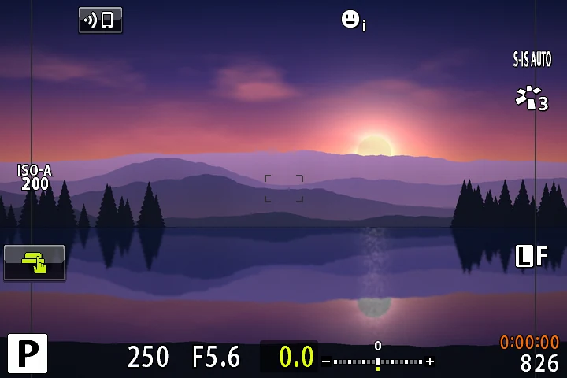

# Live view

*Guide 8 · E-M5 III firmware 1.7 · draft 1, 2026-11-19. New to these guides? Read
[Before you start](before-you-start.md) first. Open questions: research gaps.*

This guide follows one live-view frame: the sensor reads it out, it lands in memory as a small raw frame, the image
engine turns it into a picture, and the display controller lays the menus and shooting information over it and sends
it to the rear screen or the viewfinder (EVF). It describes the stock firmware. How our Live ND preview changes the
path is in its own section at the end.

The two ends are well mapped. They are the raw frame in memory (measured on the camera) and the display side (registers,
layers, drawing engine). The middle, where the raw frame becomes a picture, is not.

## Components

- **The live-view component.** Olympus calls live view the "through image", so this component is named
  `CapThr_ThroughImage`. It is generated C++. It decides when live view runs: start, stop, pause and restart, for
  example around a shot or when a menu opens.
- **The live-view module** (C). Runs once per frame. It takes the new raw frame, starts its processing, and does the
  per-frame bookkeeping.
- **The image engine.** Turns the raw frame into a picture (YC, the brightness-and-colour format displays use) at
  display size. The CPU never touches the pixels.
- **The display driver** (C, always loaded early). Tells the display controller where the newest picture is.
- **The GUI.** Draws menus, icons and shooting information into overlay layers, using a separate 2D drawing engine.
- **The display controller** (VSC). Mixes the picture and the overlay layers and drives the screen, the EVF or HDMI.

Where in the firmware

| what | where | known from |
|---|---|---|
| live-view component | `CapThr_ThroughImage.cpp` ~0x608c8556; singleton `getInstance` 0x608ca1b8, state word 0x61e9cd1c | [code] |
| per-frame routine | 0x603491c8 (frame record getter 0x60325a99) | [code] |
| display driver | request switch 0x6017f904; `display_update_through_image` 0x601907cb | [code] |
| GUI drawing | `osddraw` 0x60c1xxxx → 2D engine at 0x9c100000 | [code] |
| display controller | VSC registers 0x9c000000, 0x4000 bytes per channel | [code] |

Sources: [OS and framework](../firmware/os-and-framework.md#source-file-and-module-names),
[graphics pipeline](../hardware/graphics-pipeline.md), [display](../hardware/display.md).

## 1. The sensor in live-view mode

In live view the sensor doesn't read out every pixel. It runs a mode that reads a much smaller frame (see the next
section), which lets it run fast. The request that switches it on asks for 120 frames a second. The live-view module
then runs every 16.7 ms, 60 times a second, and the screen follows it. Why the request says 120 while the processing
runs at 60 isn't known yet. It may be two readouts per processed frame, or the request value may mean something else.

Each autofocus press sends two requests: first the live-view mode again, then a separate focusing mode at 30 or 60
frames a second. While focusing, frames reach the live-view module about 33 ms apart, so live view slows to about 30
frames a second. Why focusing needs its own mode, and what that mode reads differently, isn't traced yet. When focusing ends, the
sensor goes back to the live-view mode.

Where in the firmware

| what | where | known from |
|---|---|---|
| live-view sensor mode | mode 9 (MSPD), 120 fps in the request | [camera] (request log) |
| live-view module rate | per-frame hook at 0x6034931b: 361 calls in 6 s, 16.7 ms apart | [camera] |
| auto exposure in live view | AE id 323 | [camera] |
| each AF press (S-AF or C-AF) | requests mode 9 at 120 fps, then mode 0 (HSSC) at 30/60 fps | [camera] (request log) |
| frame spacing while focusing | ~33 ms at the per-frame hook during C-AF | [camera] |

Sources: [sensor](../hardware/sensor-technical.md#sensor-mode-requests), [Live ND](../features/live-nd.md).

## 2. The raw frame in memory

Each frame is put in a **live-view raw pool**: four buffers of about 16 MB, of which normal live view uses the first two
in turn (one being filled while the other is processed).

The frame is much smaller than a full photo: **2912 × 544 pixels**, 9 bits per pixel, packed 14 pixels to 16 bytes,
against 5240 × 3912 at 12 bits for a still. This layout was measured on the camera by reading the buffer directly.

A second, similar pool exists, and we once suspected continuous autofocus (C-AF) used it. That isn't proven. Our Live ND
preview drew white lines during C-AF, and the fix that removed them was to skip the frames taken in the focusing mode.
So the problem was the different sensor mode, not a different buffer, and what uses the second pool is still open.

Where in the firmware

| what | where | known from |
|---|---|---|
| live-view raw pool | pool 0x0700: 4 × 0xfe4c00 bytes at 0xaa91d340; slots 0 and 1 (handles 0x0701 / 0x0702) alternate | [camera] |
| frame layout | row pitch 3328 bytes; 16-byte units of 14 pixels × 9 bits, lowest bits first; 544 rows (540 image + filler) | [camera] |
| frame handle | frame record +16 | [camera] |
| second pool | pool 0x3900 at 0xc4000000-0xc7f93000; user unknown | [code] |
| white lines in the Live ND preview during C-AF | fixed by skipping frames by requested sensor mode | [camera] |

Sources: [Live ND](../features/live-nd.md) (live-view raw frame format, 2026-11-12),
[memory map](../hardware/memory-map.md#image-buffer-pool-map-e-m5-iii-vs-om-5-2026-11-12).

## 3. From raw frame to picture

The per-frame routine takes the frame record (a 1 KB structure per frame), hands the raw frame on for processing, and
updates exposure, white balance and the other per-frame values. The image engine then demosaics the raw frame (turns
the colour mosaic into full-colour pixels), applies the picture mode and gamma, and scales the result to the size of
the display.

This is the least mapped part of the path. The per-frame routine is known and hooked on the camera, but which
image-engine program does the conversion, where the finished display-size picture is written, and its stride are not
traced. The frame records hold only display sizes: 720 × 480 and 360 × 240 for the rear screen, 640 × 480 and
720 × 404 for others.

Where in the firmware

| what | where | known from |
|---|---|---|
| frame records | 1032 bytes each at 0xa26591f4; index words 0xa26591a6..ac | [code] |
| frame routine hand-on | `mov a2,a0 ; call 0x6034cd4e` at 0x6034931b (a2 = frame record) | [code] |
| display sizes in records | 720×480, 360×240, 640×480, 720×404 | [camera] |
| live-view exposure output | AE 0x6041e1ce, copied to the output record at 0x60427c71 | [code] |
| which engine job converts the frame | not traced | [open] |

Source: [Live ND](../features/live-nd.md) (E-M5 preview hook point, 2026-11-12).

## 4. Showing the picture

The finished picture is never copied by the CPU. On each frame the display driver writes the picture's address into
the display controller's first image plane, and keeps a copy of that address in RAM. That RAM word is the simplest
way for other code to find "the current live-view frame".

The display controller has two channels. Channel 0 drives either the rear screen or the EVF (one at a time), and
channel 1 drives HDMI. Each channel has six planes: three image planes (live view uses the first) and three overlay
planes for the GUI. Register changes are latched and take effect at the next frame boundary, so the picture and its settings change
between frames, not halfway through one.

Some features that look like software are done by the display controller. The **histogram**, the **highlight
and shadow warning** and **focus peaking** all work on the picture as it is displayed. That's why they reflect the
picture mode and gamma rather than the raw data.

One lesson came from our own probe. Reading the frame's pixels from inside the display update reset the camera within a
second. Code that needs pixels reads them elsewhere.

Where in the firmware

| what | where | known from |
|---|---|---|
| set the image plane | `display_vscdrv_update_set_through_addr` 0x60194e50: Y address → 0x9c000038 + ch×0x4000, C → +0x3c | [code] |
| "current frame" pointer | RAM 0xa26538c4 + ch×0xe28 (C address in the next word) | [code] |
| channel selector | 0x6004404f; active displays word 0xa2653720 (bit 0 screen, bit 1 EVF) | [code] |
| planes | IMG1-3, OSD1-3; enable bits DMA7 +0x30; latched copies at +0x400 | [code] |
| histogram, highlight/shadow, peaking | VSC blocks HIST1-3 +0x244.., HILIGHT1-4 +0x250.., PEAK1-14 | [code] |
| probe reset | hook 0x60190ab1 reading 32×32 Y samples → reset ~1 s after arming | [camera]; cause [inferred] |

Sources: [display](../hardware/display.md#display-controller-vsc),
[graphics pipeline](../hardware/graphics-pipeline.md#3-display-controller-vsc),
[live-view probe](../hardware/display.md#the-live-view-probe-builds).

## 5. The overlays

Menus, icons and the shooting information are drawn by the GUI, but not pixel by pixel. The GUI builds a list of
drawing commands (fill a rectangle, copy a block, draw a bitmap such as a glyph or an icon) and hands the list to a
small hardware 2D engine, which writes into three overlay layers in memory. A redraw of a menu page is about 140
commands. There is no line command, so lines are drawn as thin rectangles.

Each overlay pixel is a 7-bit colour number looked up in a palette, and colour 127 means transparent, so the live
picture shows through. The three layers are stacked in a fixed order on top of the picture.

The overlays are tied to the live picture's timing. When the GUI asks for its changes to be shown, the commit waits
for the next live-view frame. On the rear screen the overlay is shown at 1:1, cropped to a 720 × 480 window. On the
EVF it is drawn at 640 × 480 and scaled up to the 1024 × 768 panel area.

*The shooting screen. Everything except the landscape is overlay drawn by the GUI. The emulator does not produce a live picture, so a generated landscape stands in for it. Emulator screenshot.*

Where in the firmware

| what | where | known from |
|---|---|---|
| 2D engine | 0x9c100000: list base +0x18, start +0x24, status +0x04; commands FILL 0x10, COPY 0x20, BITMAP 0x30, LUT 0x40/0x41 | [code] (om-emu for the command set) |
| overlay layers | pools 0x0b00 / 0x0c00 / 0x0d00, 4 × 896 × 600 bytes each | [code] |
| palette | 128 entries per plane, `alpha<<24 \| Cr<<16 \| Cb<<8 \| Y`; index 127 transparent | [code] (om-emu) |
| commit | `gpiUpdateDisplay` 0x60c9588b; display sync on at start | [code] (om-emu) |
| screen sizes | TFT 720×480 at (30, 8), no scaling; EVF 1024×768, OSD scaled from 640×480 | [code] (om-emu run) |

Source: [graphics pipeline](../hardware/graphics-pipeline.md#1-gui-drawing-goes-through-a-hardware-osd-engine).

## Live ND changes

On the OM-5, Live ND shows a preview of the long exposure in live view: each new frame is averaged with the recent
ones, so the screen shows what the finished photo will look like. Our port adds the same preview to the E-M5 III.

1. **A per-frame hook.** At the point where the per-frame routine hands the raw frame on, the OM-5 calls its preview
   first. The E-M5 III's live-view module is the OM-5's module without those calls, so our build puts a hook at the
   same place.
2. **Averaging in the image engine.** The hook runs the OM-5's image-engine job 12 on the raw frame. It keeps a running
   sum over a ring of recent frames, adding the new frame and dropping the oldest. On the OM-5 the average then takes
   the new frame's place in the frame record, so the rest of the live-view path shows the average without knowing
   anything changed. Our port follows the same design.
3. **Ring size.** The ring holds 30 frames per second of the simulated exposure, up to 240 frames, kept in borrowed
   full-size photo buffers on the E-M5 III.

Details: [Live ND](../features/live-nd.md). Guide 9 (planned) will tell the story of the port.

Where in the firmware

| what | where | known from |
|---|---|---|
| hook point | E-M5 III 0x6034931b; OM-5 twin 0x60359e31, which first calls its preview 0x6035d032 | [code] |
| job 12 on live view | proven on camera: add, slide and average; window up to 240 at 30 fps | [camera] |
| OM-5 ring | pools 0x6700/0x6800, 248 × 0x1ba000 | [code] |

Source: [Live ND](../features/live-nd.md).

## Other cameras

Each step checked against the firmware of other bodies. Nothing is assumed. "Not checked" means we don't know.

| step | E-M5 III 1.7 | OM-5 1.2 | E-M1 III 1.6 | OM-5 II 1.1 | OM-1 | PEN-F |
|---|---|---|---|---|---|---|
| live-view module | 0x603491c8 | **confirmed** same module (same debug strings), plus the Live ND preview call | not checked | not checked | not checked | not checked |
| live-view raw pool 0x0700 | 4 × 0xfe4c00 | **different**: 4 × 0x4e6400, plus pool 0x5c00 | not checked | not checked | not checked | not checked |
| display controller and planes | VSC at 0x9c000000 | not checked | not checked | not checked | not checked | not checked |
| overlay 2D engine | 0x9c100000 | **confirmed** command set (from om-emu, which models the OM-5 family) | not checked | not checked | not checked | not checked |
| live view in om-emu | not modelled | not checked | not checked | not checked | modelled (om-emu drives live view only on the OM-1) | not checked |

Sources: [Live ND](../features/live-nd.md), [memory map](../hardware/memory-map.md),
[graphics pipeline](../hardware/graphics-pipeline.md).
