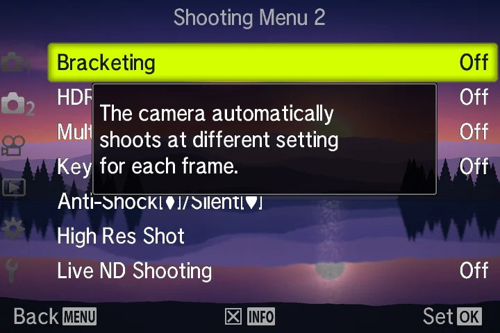
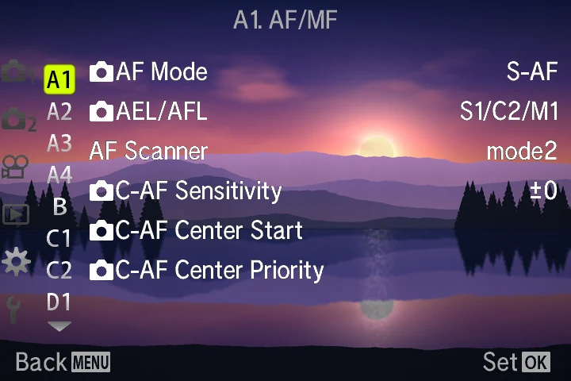
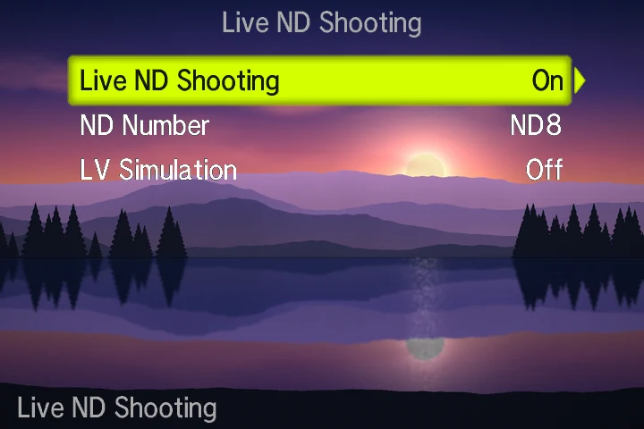
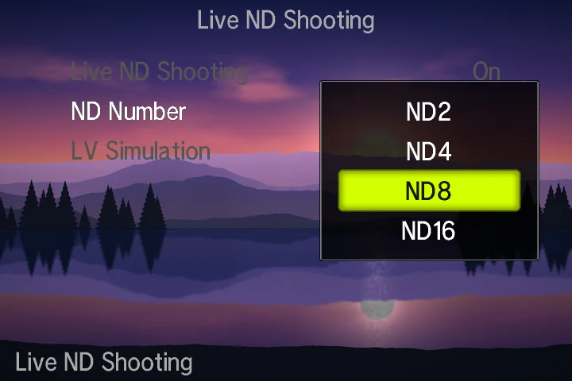

# Settings and menus

*Guide 13 · E-M5 III firmware 1.7 · accepted 2026-11-20. New to these guides? Read
[Before you start](before-you-start.md) and [Boot](boot.md) first. Open questions:
research gaps.*

This guide follows one menu row through the firmware: the setting behind it, where its value is stored, how it is
saved across power-off, and how the menu finds its title, its choices and its place on a page. The first half does
this for a stock row, **High Res Shot**. The second half adds new rows of our own, the Live ND Shooting row and its
page, step by step, in the order you would do it in a port.

The method in the second half is written for the E-M5 III, but each step says what it depends on, so you can check
the same things on another body. What has been proven on a camera, and on which one, is kept apart in its own section.

## The shape of it

```
menu tab ──► row (setting id 772) ──► title and help (string ids) ──► text in the current language
                     │
                     ├──► picker choices (option-value record for 772)
                     │
                     └──► setting table: 772 → property 0xf1a1
                                              │
                                              ▼
                              settings image in RAM (store 50) ──► saved to flash at power-off
```

## 1. Three kinds of number

Three numbers name a setting, and mixing them up is the commonest mistake:

| number | what it is | High Res Shot |
|---|---|---|
| setting id | what menu rows and most code use; differs between camera models | 772 |
| property | the stored value; much more stable between models | 0xf1a1 |
| string id | the text shown for the row's title or help | 2438 / 2439 |

A table turns setting ids into properties. Each entry is just the property number and a small index (for settings
that hold several values). The E-M5 III has 1,650 ordinary setting ids (0-1649) and a few small extra ranges for
special cases.

The property number also tells you the size of the value: its lowest three bits are 4 for a 32-bit value, 2 for a
16-bit one, and anything else means one byte. High Res Shot's property ends in 1, so it is one byte: 0 for off, 1 for
on.

**When comparing bodies, go through the property.** High Res Shot is setting 772 on the E-M5 III, 771 on the OM-5,
770 on the E-M1 III, but property 0xf1a1 on all of them.

<details><summary>Where in the firmware</summary>

| what | where | known from |
|---|---|---|
| setting → property table | 0x604de68c, 4-byte entries {u16 property, u16 index}, ids 0-1649 | [code] |
| extra id ranges | 3000-3019, 4000-4021, 4500-4521, 10000-10071, 15000-15267 (table 0x604e021c); lookup 0x602e6b2a | [code] |
| value size = property & 7 | size switch 0x6005ce8d | [code] |
| High Res Shot | id 772 → {0xf1a1, 0}; default 1 (table 0x604b20ac) | [code] |
| same property, other ids | OM-5 771, E-M1 III 770, OM-5 II 771, OM-1 770, PEN-F 779 | [code]; meaning on other bodies [inferred] |

Sources: [settings and menus: setting ids to properties](../firmware/settings-and-menus.md#from-setting-ids-to-properties).
</details>

## 2. Where the value lives

User settings live in one **store**: a 256 KB image in RAM, loaded from flash at power-on and written back at power-off.
The store keeps a list of its properties, and the values sit in the image **in that list's order, with no ids next to
them**. Reading or writing a property goes through a hash table built at start-up, so code never needs to know where in
the image a value is.

Flash holds two copies (banks) of the image. Each has a header with the store number, a counter and a checksum. At
power-on the camera loads the newer valid bank; if neither is valid, every setting is reset to its default.

Three consequences matter for anyone adding settings:

- **Never insert into the list.** Every later value would be read from the wrong place, and the user's saved settings
  would be scrambled.
- **Never change the store number or the image size.** The bank check would fail and everything would be reset.
- **The image is longer than the values in it.** The tail is never read by stock code, but it is saved and loaded like
  the rest. That is what our rows use (section 7).

<details><summary>Where in the firmware</summary>

| what | where | known from |
|---|---|---|
| user settings store | store 50 (0x32); list 0x60098998-0x600bd004 (1,028 properties); RAM image 0x623d1000, 0x40000 bytes | [code] |
| High Res Shot in the list | 0x600bcc48 | [code] |
| property get / set | 0x6005ce6b(prop, index, 0) / 0x6005cf1c(prop, index, 0, value) | [code] |
| bank check | header = store id, 16-bit sum 0, newer counter wins | [code] |
| load at boot | whole bank into the image, 0x6005aa15 → 0x6005ad45 | [code] |

Sources: [settings and menus: how saved settings are stored](../firmware/settings-and-menus.md#how-saved-settings-are-stored).
</details>

## 3. When it is saved

Changing a setting in the menu changes only the RAM image. The camera writes the image to flash when it powers off:
the save routine compares the whole image with the bank in flash and writes a new bank only if something differs. So
a battery pulled out while the camera is on loses the changes made since the last power-off.

Because the comparison covers the whole image, anything written into the unused tail is saved too, by the camera's own
code, with its own checksum and two-bank protection.

<details><summary>Where in the firmware</summary>

| what | where | known from |
|---|---|---|
| save | 0x6005aaaf: compare, counter, checksum, flash write 0x6005a177 | [code] |
| power-off path | 0x60128eb1 saves store 50, then waits for the power to go | [code] |
| other savers | "acc flash write" 0x60062e44 (all stores), shell `w` 0x6005bad0 | [code] |
| tail bytes survive power-off | Live ND rows | [camera] |

Sources: [settings and menus: when saved settings are written](../firmware/settings-and-menus.md#when-saved-settings-are-written-2026-11-18).
</details>

## 4. Where the row comes from

The menus are not drawn by code that knows about High Res Shot. They are built from tables:

- **The tab list.** Each menu tab (Shooting 1, Shooting 2, Movie, ...) has a short list of setting ids, one per row.
  Shooting Menu 2 lists seven: High Res Shot is the sixth. A tab page holds **at most seven rows**; there is no
  scrolling.
- **Title and help.** Each tab has a list of title entries and a list of help entries, matched to rows by setting id.
  An entry names a string id, and the string table turns that into text in the current language (34 languages, the
  same ids in each).
- **The choices.** When you press right on a row, the picker asks for the row's **option-value record**: how many
  choices there are and the value each one stores. High Res Shot's record has two values, 0 and 1. A row with no
  record gets an empty picker.
- **Pages.** Some rows open a page of their own (Bracketing, for example). That goes through three more tables: a
  screen table, a controller table (which keys open what), and a page record with the page's rows, title and help.

<p class="shots">
<a href="../images/menu-shooting-2-help.webp"></a>
<a href="../images/menu-custom-a1.webp"></a>
</p>

*Left, Shooting Menu 2 with the help text for its Bracketing row. Its last row, Live ND Shooting, is one of ours (section 7). Right, page A1 (AF/MF) of the Custom Menu, the tab with the gear icon. Its rows are split into lettered groups, picked from the column of letters on the left. Emulator screenshots.*

The same tables are often kept in two copies, and the code that walks them has the table length written in as a number
in several places. Both points matter when you add to them.

<details><summary>Where in the firmware</summary>

| what | where | known from |
|---|---|---|
| tab lists | key table 0x6106a714 (keys 0x4e-0x54); Shooting 2 list 0x6106a644 | [code] |
| seven rows at most | an eighth draws over row 0 | [emu] |
| per-tab title / help lists | descriptors 0x610938b0; High Res title 0x61092af0, help 0x61092d84 (kind 4) | [code] |
| string lookup | 0x60c9350c(id); 34 languages × 3,447 strings | [code] |
| option-value records | static table 0x604d4ee4 (1,215 × 20 B), RAM hash 0x62118d08 built at boot | [code] |
| page chain | screen table 0x610b166c → controller table 0x61064b98 → submenu 0x61069f60 → page records 0x610d5794 | [code] |

Sources: [settings and menus: how menus are built](../firmware/settings-and-menus.md#how-menus-are-built).
</details>

## 5. From the row to the value

When the menu draws a row or the picker changes it, it calls one getter and one setter with the setting id. They look
the id up in the setting table and call the property get or set with the property and index. That is the only link
between the menu and the stored value.

```
pseudocode, written from the disassembly (0x602e6a02, 0x602e6f11); byte-matching C waits for the decompile

menu_get(id):
    property, index = setting_table[id]       (special ranges looked up separately)
    return property_get(property, index)

menu_set(id, value):
    property, index = setting_table[id]
    property_set(property, index, value)      (the RAM image only; flash at power-off)
```

So where a row sits in the menu and where its value is stored are independent. Anything that can answer the getter
and setter for an id can sit behind a row.

<details><summary>Where in the firmware</summary>

| what | where | known from |
|---|---|---|
| menu getter / setter | 0x602e6a02 / 0x602e6f11 | [code] |
| called during boot, before any menu opens | yes | [camera] |

Sources: [settings and menus](../firmware/settings-and-menus.md).
</details>

## 6. Why new settings are hard

The obvious route, "add a setting id and a property", is blocked in several ways at once:

- **No free ids.** The id tables and their caches are packed back to back, and every entry is in use. None of the
  ranges can grow in place.
- **Custom modes store ids up to 1649 only.** Growing the main range would break the C1-C4 layout.
- **A new id range** needs a table entry, a default, two per-id arrays, a reset loop and a cache, each with its own
  bounds written into the code.
- **A new property** has to be appended to the store's list, which sits in the part of memory copied first at boot
  and has no room left.

So our method leaves all of that alone: new ids are answered by our own code, and their values live in the unused tail
of the image.

<details><summary>Where in the firmware</summary>

| what | where | known from |
|---|---|---|
| no free id in any range | lookup 0x602e6b2a, 9 `cmp 15267` sites | [code] |
| custom modes by id | property 34260, ids above 1649 ignored | [code] |
| per-id data | defaults 0x602d364d, arrays 0x602e6f35 / 0x602e7088, reset loops 0x602cd3b0 / 0x602d2e0c | [code] |

Sources: [settings and menus: no free setting ids](../firmware/settings-and-menus.md#no-free-setting-ids-2026-11-05).
</details>

## 7. Following along: adding the Live ND rows

The goal: a **Live ND Shooting** row in Shooting Menu 2, after High Res Shot (where the OM-5 has it). Pressing right
opens a page with Live ND Shooting (Off/On), ND Number (ND2-ND16) and LV Simulation (Off/On). The values must survive
power-off. Here are the steps in the order to do them.

**Step 1. Pick ids and a place for the values.** Choose a range nothing uses (we use 16000-16031). Choose a block in
the unused tail of the settings image, and lay it out: a 4-byte marker, then one byte per setting, then spare words.
The marker matters: on a camera that never ran your code the tail holds leftover bytes, so "no marker" means "write
the defaults first".

**Step 2. Hook the getter and setter.** Put a short jump at the start of each. Your code checks the id: if it is one
of yours, read or write your byte (range-checking the value); otherwise run the stock code. Nothing else in the camera
needs to know about your ids.

**Step 3. Make room on the tab.** Shooting 2 is full at seven rows. We moved RC Mode to the end of Shooting 1 and put
the new row after High Res Shot. Change the tab lists in every copy, and their counts.

**Step 4. Add text.** Hook the string lookup so a small range of new string ids (we use 4000-4015) comes from your
table and everything else from the stock one. Title and help entries for the new row use those ids with the "string
id" kind; the "inline text" kind crashes the title drawing.

**Step 5. Add the page.** Copy the screen, controller, submenu and page-record tables into free space with one more
entry each, and change every place in the code that holds their length or address. The new page lists your three ids.

**Step 6. Give the pickers their choices.** Add option-value records for your ids (two values for Off/On, four for
ND2-ND16) and link them into the picker's hash table. Do it on first menu use, not at boot.

<p class="shots">
<a href="../images/live-nd-page.webp"></a>
<a href="../images/live-nd-nd-picker.webp"></a>
</p>

*The result. Left, the new page with its three rows. Right, the ND Number picker with its four values. Emulator screenshots.*

**Step 7. Put the code where boot can't trip on it.** This is the step that failed first, so it gets its own section.

<details><summary>Where in the firmware</summary>

| what | where | known from |
|---|---|---|
| value block | settings image +0x39F00 (RAM 0x6240af00): marker `MOD\x01`, +4 on/off, +5 ND 1-4, +6 LV Simulation, +8..+0x47 spare | [camera] |
| getter / setter hooks | jumps at 0x602e6a02 / 0x602e6f11, ids 16000-16031 | [camera] |
| tab move | RC Mode (180) to the end of Shooting 1 | [camera] |
| string hook | 5-byte jump at 0x60c9350c, ids 4000-4015 | [camera] |
| table counts raised | page records 124 → 125, controllers 169 → 170, submenus 146 → 147 | [camera] |
| picker records | linked into 0x62118d08 on first menu use | [camera] |

Sources: [saved settings and menu rows](../features/saved-settings-and-menu-rows.md).
</details>

## 8. Where the code may sit

The menu getter and setter run **during boot**, long before anyone opens a menu. So the code they jump to must be in
memory by then.

The main program loads in ten sections in the background ([Boot](boot.md)). They are read in one order but become
**ready** in number order, and until a section is ready, any access to it stops the boot. Our first attempt put the
code after section 7, which is read early but ready late: the getter hook reached it too soon, and the camera
boot-looped until it was reflashed from the card. The emulator didn't model this and ran it fine.

The version that works:

- The code and tables sit in the free space after **section 3**, made loadable by raising section 3's end.
- The getter and setter jumps go first to a small **guard** in section 2. The guard checks section 3's ready bit and
  runs the stock code until it is set.
- The string hook sits in section 6, which is ready after section 3, so it needs no guard.
- The picker records are linked on first menu use, so there is no boot hook at all for them.

The rule: a hook may reach code in another section only if that section is ready before the hook can first run, or if
the hook checks the ready bit first. Checking the read order is not enough.

<details><summary>Where in the firmware</summary>

| what | where | known from |
|---|---|---|
| section 3 gap | 0x605d4000-0x605da000; end constant 0x60045e1d raised | [camera] |
| ready bit for section 3 | bit 0x04 of 0xa26565c0 | [camera] |
| first attempt (section 7 gap) | boot loop, recovered from the card | [camera] |

Sources: [saved settings and menu rows: the boot lesson](../features/saved-settings-and-menu-rows.md#where-the-code-goes-the-boot-lesson),
[boot and sections](../firmware/boot-and-sections.md).
</details>

## 9. What has been proven, and where

| step | E-M5 III 1.7 |
|---|---|
| values in the image tail, kept across power-off | camera, 2026-11-19 |
| getter/setter hooks, new ids | camera |
| row after High Res Shot, RC Mode moved | camera |
| new page with three rows and pickers | camera |
| new text in every language | camera (English seen); emulator |
| code after section 3 with ready guards boots | camera |
| code after section 7 | boot loop on the camera |
| settings reset and the restore file leave the block alone | not tested |

One camera, one owner so far. Nothing here has been tried on another body.

## How our features use this

- **Live ND**'s on/off, ND number and LV Simulation are the first values kept in the block.
- **The dev settings page** (a separate page for tuning values) is planned to keep its values in the block's spare
  words, so they survive power-off too.
- **Hidden stock settings**, such as the focus-stack shot count that has a property but no row, need no new ids or
  storage: the stock getter and setter already handle them. They still need the menu steps. In the emulator such a row
  showed its value but couldn't be changed until the page's picker knew the id, which is what step 6 is for.

## Checked on other cameras

Each step checked against the firmware of other bodies. Nothing is assumed: "not checked" means we don't know.

| step | E-M5 III 1.7 | OM-5 1.2 | E-M1 III 1.6 | OM-5 II 1.1 | OM-1 1.9 | PEN-F 3.1 | other projects |
|---|---|---|---|---|---|---|---|
| setting → property table (same first entries) | yes | **confirmed** | **confirmed** | **confirmed** | **confirmed** | **confirmed** | — |
| High Res Shot's property under a different id | 772 | **different**: 771 | **different**: 770 | **different**: 771 | **different**: 770 | **different**: 779 | — |
| ids 0-1649 | yes | **different**: 0-1892 | not checked | not checked | not checked | not checked | — |
| `MODE_*` setting names | yes | **confirmed** | **confirmed** | **confirmed** | **confirmed** | **confirmed** | — |
| store saved by "acc flash write" | yes | **confirmed** | **confirmed** | **confirmed** | **confirmed** | **different**: string not found | — |
| seven rows per tab | yes (emulator) | **confirmed**: Shooting 2 has 7 | not checked | **different**: OM-1-style menus | **different**: OM-1-style menus | not checked | — |
| values kept in the settings image tail | yes (camera) | not checked | not checked | not checked | not checked | not checked | E-P7 (Caduceus): the idea, from their notes |
| own page drawn by the stock list view | yes (camera) | not checked | not checked | not checked | not checked | not checked | E-M10 II (fenykl): own page from one stock row |

"Confirmed" in the first rows means the table or string is present; the code around it wasn't compared.
[settings and menus](../firmware/settings-and-menus.md), [saved settings and menu rows](../features/saved-settings-and-menu-rows.md),
Atlas-linked projects.
