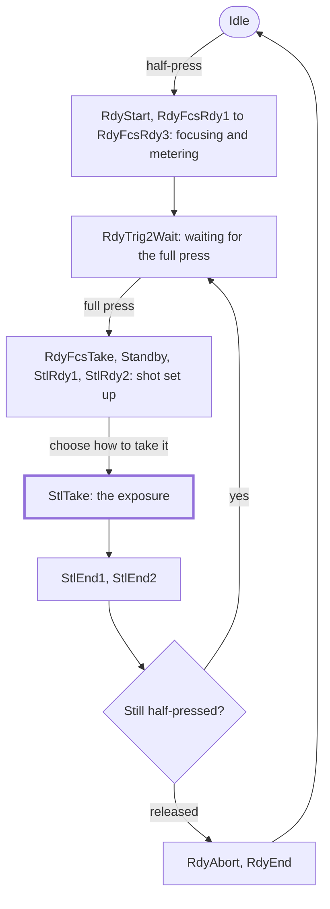

# Taking a photo

<!-- house style -->

*Guide 1 · E-M5 III firmware 1.7 · draft 2. New to these guides? Read
[Before you start](before-you-start.md) first. Open questions: research gaps.*

## Key points

- A shooting sequencer, a state machine of 34 states, runs each shot from half-press to cleanup.
- After a shot the sequencer goes back to waiting for the full press, so a second shot with the button held half-way doesn't refocus.
- The exposure lands as a raw frame in the main frame pool, and the image engine develops it as a series of jobs.
- How the exposure state runs inside is the biggest gap in what we know of this path.

This guide follows a single still photo through the main program. It covers the half-press, focus, full press,
exposure, development, and saving to the card. It describes the stock firmware. How our Live ND feature changes the path is in
its own section at the end.

The middle of the path (the state machine and the exposure set-up) is well mapped. The ends (focusing details, and
everything after development) are only partly mapped, and each section says so.

Each section ends with a collapsed **Where in the firmware** box holding the addresses and how each fact is known.
You can skip them.

## Roles

Four layers of the main program take part:

- **Capture components** (generated C++, see [Rhapsody and OXF](rhapsody-and-oxf.md)). These are the application's
  view of shooting, such as "take a picture", "take a continuous burst" or "take a dark frame". The class `CapTak_Take`
  has a method for each kind of shot. It hands a shot to the sequencer by putting a request into the sequencer's
  message queue ([C++ shooting layer](../firmware/cpp-shooting-layer.md)).
- **The shooting sequencer** (C). A state machine of 34 states that runs one shot from half-press to cleanup. Most of
  this guide is about it.
- **Recording** (C). Prepares the photo's metadata, drives the image processing and hands the result on.
- **Files and card** (C). Chooses the folder and file number and writes to the SD card.

Two pieces of hardware are steered along the way. The **sensor** is switched into a different readout mode for each
phase, and the **image engine** does all the pixel work.

<details><summary>Where in the firmware</summary>

| what | where | known from |
|---|---|---|
| `CapTak_Take` (`takePicture` and variants) | `CapTak_Take.cpp`, ~0x608c3914; `takePicture` 0x608c4e66 | [code] |
| hand-over to the sequencer | `api_rec.c` 0x60302f93, message type 11 to queue 0x60 | [code] |
| sequencer | state table 0x6044f9e4; handlers in `takepic.c` | [code] |
| recording | `rec_precon.c`, `rec_imgpro*.c`, `rec_mem.c`, `rec_media.c` (0x60403xxx-0x6040dxxx) | [code] |
| files and card | `dcf*.c` 0x6060e7f0-0x6061df9a, `sdmem.c`/`sdphy.c` 0x606481a4-0x6064f685 | [code] |

*The four layers and where their code is.*

Module names come from Olympus's own source-file strings
([shooting sequencer](../firmware/shooting-sequencer.md#source-modules-along-the-capture-path)).
</details>

## The state machine

The sequencer is a table of states. Each entry has a name, a function that runs on entering the state, and a list of
events the state reacts to. All state changes go through one function, which takes the number of the next state. That
function is called from 53 places, always with a fixed state number, so reading those call sites gives the whole graph
without running the camera.

For one ordinary photo (single drive, either AF mode) the graph is as follows.


*One ordinary photo through the sequencer. Arrows show state changes. StlTake, where the exposure is made, has a bold outline.*

After the shot, the machine goes back to **RdyTrig2Wait**, not to Idle. If you keep the button half-pressed you are
straight back in "ready to fire", which is why a second shot doesn't need to refocus. Only when the half-press is
released does it unwind through RdyAbort and RdyEnd.

"Standby" is a misleading name. It is the first state *after* the full press, where the shot's parameters are read.

**S-AF and C-AF** don't appear as separate states. Both go through the same RdyFcsRdy1-3 and RdyTrig2Wait. The
difference is presumably handled inside the focus task, which runs alongside the sequencer, but that isn't traced yet.
If the full press arrives early, RdyFcsRdy2 can go to a "fast" variant of the waiting state, RdyFastTrig2Wait, which
leads to the same place.

**Sequential shooting** adds a loop. After StlTake, if more frames are due, the machine goes through ContAf (by its
name, a focus step between frames), ContAfStop and ContWait, back to StlRdy2, and takes the next frame. The
high-speed sequential modes have a separate loop of their own (HsContTake, HsContWait, HsContRdy).

<details><summary>Where in the firmware</summary>

| what | where | known from |
|---|---|---|
| state table | 0x6044f9e4, 34 entries of 20 bytes | [code] |
| state change function | `seq_set_next_state` 0x602a1341 (d0 = state, d1 = argument), 53 call sites | [code] |
| current / next state | u16 0x62107744 / 0x62107746 | [code] |
| back to RdyTrig2Wait or not | StlEnd2 (0x602b5cdf) tests byte 0x62110be8: 0 → state 5, else → 9 | [code]; meaning [inferred] |
| take request (full press) | RdyTrig2Wait queue event 11 → state 7; Standby event 11 → 12 (2026-11-25). Event 18 also → 7, sender open | [code] |
| sequential loop | StlTake → 21 ContAf if byte 0x62110cec ≠ 0, else 19 | [code]; meaning [inferred] |

*The state table, the state change function and the branches described above.*

All 34 state numbers and every transition: [shooting sequencer](../firmware/shooting-sequencer.md#state-names-and-the-single-shot-path).
</details>

## 1. Half-press

Before the half-press the camera is in live view. The sensor reads out a reduced picture 120 times a second, and the
frames flow through the image engine to the screen without the CPU copying any pixels
([graphics pipeline](../hardware/graphics-pipeline.md#live-view-frames)).

During the half-press the sensor runs a different mode at 60 frames a second, used for focusing and metering. The
switch is made with a sensor mode request. Auto exposure switches with it. It has its own mode numbers, one for live
view and one for half-press.

The three RdyFcsRdy states are the focusing phase. What each one waits for isn't traced yet. Focusing itself runs in
the focus task (FCS), and one of the image-engine jobs (job 0) is probably its image processing.

<details><summary>Where in the firmware</summary>

| what | where | known from |
|---|---|---|
| live-view sensor mode | mode 9 (MSPD), 120 fps | [camera] |
| half-press sensor mode | mode 0 (HSSC), 60 fps | [camera] |
| sensor mode request sender | 0x601fce30 | [code] |
| auto exposure ids | live view 323, half-press 270 | [camera] |
| image-engine job 0 | 0xa411f540, `FCS_IP` code cluster | [inferred] |

*Sensor modes and auto exposure ids around the half-press.*

Sources: [sensor](../hardware/sensor-technical.md#sensor-mode-requests), [Live ND](../features/live-nd.md) (a sensor-mode test run),
[image engine](../hardware/image-engine-technical.md#the-e-m5-iiis-own-jobs-0-to-10).
</details>

## 2. Full press

The full press moves the machine through RdyFcsTake into **Standby**. Standby reads the shot's parameters from a
message sent by the layer above. One byte of that message is the **route**, a number from 0 to 4 that says what kind
of capture follows, such as a single frame, a sequential burst or a high-speed stream. On the camera we have seen single
shots use route 0, sequential low-speed route 1, and sequential high-speed route 3.

Next, **StlRdy1** fills in the shot's **exposure record**. This is the one place the rest of the shot reads its
exposure from. It holds the shutter time, sensitivity (ISO) and aperture, each in APEX units (see
[Before you start](before-you-start.md#exposure-units)). They are copied from the current settings, so after this point
changing a setting no longer affects this shot.

<details><summary>Where in the firmware</summary>

| what | where | known from |
|---|---|---|
| Standby reads the shot message | 0x602b2263 | [code] |
| route byte | message byte 10 → 0x6211020e | [code] |
| routes per drive mode | single 0, sequential L 1, sequential H 3, Pro Capture L/H 1/3 | [camera] |
| exposure record | `*(*(0x6210fb6c)+60)`, filled at StlRdy1 0x602b29b9 by 0x602c0cb0 | [code] |
| record fields | shutter time (Tv) +6, sensitivity (Sv) +8, aperture (Av) +10; APEX × 256 | [code] |
| source properties | 41002 (shutter time), 41034 (sensitivity), 41018 (aperture) | [code] |

*The shot message, the route byte and the exposure record.*

Sources: [shooting sequencer](../firmware/shooting-sequencer.md#the-exposure-record).
</details>

## 3. Shot type

At the end of StlRdy2 a short function decides which take state runs. This is pseudocode in our own words,
summarised from the disassembly.

```
choose_take_state:
    if a live-view long exposure is active (Live Bulb, Live Time, Live Composite):
        if Live Composite:  next = LvCompTake
        else:               next = StlLiveTake
    else:
        if route == 4:      next = StlUhs        (high-speed frame stream)
        else if route == 3: next = HsContTake    (high-speed sequential)
        else:               next = StlTake       (everything else, including a single shot)
    go to next
```

For a normal single photo it is **StlTake**.

<details><summary>Where in the firmware</summary>

| what | where | known from |
|---|---|---|
| chooser | `seq_choose_still_take_state` 0x602b3441-0x602b3483 | [code] |
| "live-view long exposure" flag | byte 0x62110344 ≠ 0 | [code]; meaning [inferred] |
| Live Composite test | byte 0x62110345 == 2 → 17 LvCompTake, else 16 StlLiveTake | [code] |
| states | StlTake 14, StlUhs 15, StlLiveTake 16, LvCompTake 17, HsContTake 25 | [code] |

*The chooser, its tests and the state numbers it picks.*

Source: [how a still shot picks its path](../firmware/shooting-sequencer.md#how-a-still-shot-picks-its-path).
</details>

## 4. The exposure

StlTake switches the sensor to its still mode, carrying the shutter time from the exposure record, and the exposure
is made. The raw frame is written into a slot of the main **frame pool**, the set of 20 full-size raw buffers. Code
asks the pool where a slot is rather than working it out, because the pool is split across two separate memory blocks.

The raw frame is the sensor's data before any processing: 12 bits per pixel in a colour mosaic (Bayer pattern), packed
10 pixels to 16 bytes, 5240 × 3912 pixels read out (the picture is 5184 × 3888), and stored upside down relative to the
picture.

How StlTake runs internally is the biggest gap in this guide. We have not traced when the shutter is fired, which interrupt reports that
the frame is in memory, and how it is handed on. The high-speed stream path (StlUhs) is much better mapped, because Live
ND uses it. It is described in the Live ND section below, but it is a different path from an ordinary single shot.

<details><summary>Where in the firmware</summary>

| what | where | known from |
|---|---|---|
| StlTake entry | 0x602b34c6 (state 14) | [code] |
| still sensor mode | mode 14 (STILL), fps 0, set shutter time; single-shot sender 0x602b9d20 | [camera] |
| main pool | class 0, 20 slots × 0x1f47600 bytes; ids 1-8 at 0xb0000000, 9-20 at 0xc4000000 | [camera] |
| pool calls | acquire 0x603f70f5, address 0x603f73e2, release 0x603f71fe | [camera] |
| raw layout | 16-byte groups of 10 pixels, stride 8384 bytes, black level ≈ 256 | [camera] |

*The exposure state, the main frame pool and the raw layout.*

Sources: [frame pools](../hardware/memory-map.md#frame-pools),
[raw format](../hardware/sensor-technical.md#how-a-raw-frame-is-stored-in-ram-one-main-pool-slot).
</details>

## 5. Development

"Development" is the camera's own word for turning a raw frame into a finished picture. The finished frame is handed to
a development queue. At that point the recording layer fills in the black level and white balance (they are measured
for this frame, not fixed when the shot was set up). Then the image engine does the pixel work as a series of jobs.

The best candidate for raw development is image-engine **job 9**, which works through the frame in eight strips and
applies black level and white balance. **Job 5** resizes to full and half size. Both are inferred from their
parameters, not proven.

The hand-over itself is short. It pairs the frame with a free development slot, or parks it until one is free. This
is pseudocode in our own words. Its helpers don't have names yet (see the box):

```
send_to_development(frame):
    if either development queue has no free slot:
        put frame on the wait list
    else:
        check that both queues' next slot matches this frame (log a warning if not)
        send message 0x41 ("develop this frame") with the frame
```

<details><summary>Where in the firmware</summary>

| what | where | known from |
|---|---|---|
| development queue | 0x602c2295; queues 0x62111298 / 0x621113b0, wait list 0x621114c8 | [code] |
| its helpers | count 0x60227916, next id 0x602279b3, push 0x6022793f, send 0x602c2cf2 (names [inferred]) | [code] |
| black level and white balance filled | `rec_precon.c` 0x6040c7f5 | [camera] |
| job 9 (raw development) | 0xa422d140, 0x38000 bytes | [inferred] |
| job 5 (resize) | 0xa420b540 | [inferred] |

*The development hand-over and the engine jobs it likely uses.*

Sources: [image engine](../hardware/image-engine-technical.md#the-e-m5-iiis-own-jobs-0-to-10),
[sensor](../hardware/sensor-technical.md#how-a-raw-frame-is-stored-in-ram-one-main-pool-slot).
</details>

## 6. JPEG and card writing

These steps are mapped in [Still image back end](../firmware/still-backend.md). That page covers the develop
destinations, the CIC raw block, the EXIF header writer, the DCF and FAT layers and the SD host.

The recording layer hands the finished image to a media layer. A group of modules chooses the DCIM folder and file
number, and the SD driver writes the card. The JPEG comes out of the same develop request as the thumbnail and the
preview. The JPEG codec block encodes it with the standard tables, scaled by the quality factor. One function writes
the EXIF header. The FILECLBK task does the card writes.

<details><summary>Where in the firmware</summary>

| what | where | known from |
|---|---|---|
| media hand-over | `rec_media.c` 0x60408cf8 | [code] |
| folder and file numbering | `dcfnum.c` 0x60615758, `dcfproc.c`, `dcfsearch.c` | [code] |
| SD driver | `sdmem.c` 0x6064d4b7, `sdphy.c` 0x6064f685 | [code] |
| JPEG codec block, EXIF writer, FILECLBK card writes | codec block 0x99901000 | [code], 2026-11-25 |

*The media hand-over, file numbering, SD driver and JPEG codec.*

Source: [still image back end](../firmware/still-backend.md).
</details>

## Live ND changes

Live ND (OM-5 donor feature, ported to the E-M5 III) needs many short frames instead of one long one, and has to
merge them before development. It changes the path in three places.

1. **A state of its own.** Our builds copy the state table to free memory with extra entries, and change the chooser so
   that a single shot goes to a copy of StlTake (state 34). When Live ND is armed, that copy runs Live ND instead. When
   it isn't, it behaves exactly like StlTake.
2. **The high-speed stream path.** Live ND takes its frames through **StlUhs**, the stream state normally used for
   route 4. StlUhs runs at a fixed rate (60, 30, 20 or 15 frames a second) whatever the shutter speed. Each finished
   frame raises an interrupt. Because the handler runs in interrupt context, it only posts events. One to refill the
   stream and prepare the next frame (including its EXIF data), and one to send the frame to development. Buffer rows
   must be returned every frame, or the stream stalls after four.
3. **A merge before development.** The frames are averaged with the OM-5's image-engine job 11, and only the merged
   frame goes on to development.

The details, and every place where our code joins the native code, are in [Live ND](../features/live-nd.md) and
[Live ND port layers](../firmware/live-nd-port-layers.md). Guide 9 (planned) will tell that story properly.

<details><summary>Where in the firmware</summary>

| what | where | known from |
|---|---|---|
| copied state table | 0x600d0200, 38 entries; chooser `mov 14` at 0x602b3464 → 34 | [camera] |
| StlUhs template | 0x602b4876: supplier 0x602b4978, completion 0x602b49cb (interrupt context) | [camera]+[code] |
| StlUhs events | refill/prepare ev63 0x602b4f16 (EXIF 0x602c0f6a), development ev85 0x602b50e4 | [code] |
| stream rate | 0x602bb29a picks from {60,30,20,15} | [camera]+[code] |

*Where the Live ND port joins the shooting path.*

Source: [shooting sequencer](../firmware/shooting-sequencer.md#how-the-stluhs-burst-streams-frames).
</details>

## Other cameras

Each step checked against the firmware of other bodies. Nothing is assumed. "Not checked" means we don't know.

| step | E-M5 III 1.7 | OM-5 1.2 | E-M1 III 1.6 | OM-5 II 1.1 | OM-1 | PEN-F |
|---|---|---|---|---|---|---|
| sequencer state table | 0x6044f9e4, 34 states | **different**: 0x60468e74; adds Live ND states 31-33 and a handheld high-res end state 34 | not checked | not checked | not checked | not checked |
| route byte in the Standby message | byte 10 | **different**: byte 11 (`continue_mode`); Live ND flag in byte 15 | not checked | not checked | not checked | not checked |
| chooser | 0x602b3441 | **different**: 0x602be893, also picks Live ND when its flag is set | not checked | not checked | not checked | not checked |
| sensor modes (live view, half-press, still) | seen on camera | not checked | not checked | not checked | not checked | not checked |
| raw geometry and format | seen on camera | **confirmed**: same sensor constants and calibration tables | not checked | not checked | not checked | not checked |
| main frame pool | 20 slots, two blocks | **different**: 18 slots (19 in Live ND) | not checked | not checked | not checked (2 GB memory map) | not checked |
| image-engine jobs 0-10 | own | **confirmed**: same programs | **confirmed**: same | **confirmed**: same | **different**: new engine, no job matches | not checked |

*Each step on other bodies, read in each body's firmware file.*

Sources: [shooting sequencer](../firmware/shooting-sequencer.md), [memory map](../hardware/memory-map.md),
[image engine](../hardware/image-engine.md), [sensor](../hardware/sensor.md).

## Further reading

- [Shooting sequencer](../firmware/shooting-sequencer.md), the detailed reference for this guide.
- [Still image back end](../firmware/still-backend.md), from development to the card.
- [C++ shooting layer](../firmware/cpp-shooting-layer.md), the layer that hands shots to the sequencer.
- [Image engine](../hardware/image-engine.md), the jobs that develop the frame.
