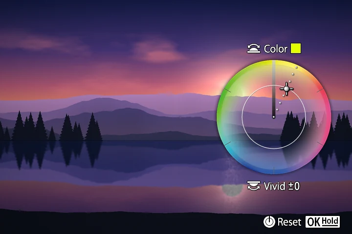

# Drawing with the vector GPU

This guide covers the E-M5 III's second drawing engine: the small vector graphics processor (GPU) that draws the colour
wheels in the Color and Monochrome Profile editors. It covers three ways to use it: through Olympus's own driver,
through the graphics library with your own code, and by writing the GPU's command lists yourself.
[Drawing to the screen](drawing-to-the-screen.md) explains where its picture goes on screen and is worth reading
first. [Drawing your own graphics](drawing-your-own.md) covers the other engine, for boxes, text and pictures on the
GUI layers.

Everything here was read from the stock 1.7 firmware. The second and third routes were then run in the om-emu emulator,
which runs the camera's own code. None of it has been run on a camera yet. The facts and addresses are on the
reference page [c3d GPU](../hardware/c3d-gpu.md).

## The shape of it

```
GUI screen (e.g. the Color Creator)
   │  start / update / end messages
   ▼
c3d task ──► a "draw kind": its renderer ──► OpenVG library ──► command lists ──► GPU ──► draw buffer
                                                                                            │
display controller: picture layer 2 (IMG2), under the GUI layers ◄──────────────────────────┘
```

- **c3d** is a pair of firmware tasks that own the GPU. The GUI never draws on the GPU itself. It sends c3d messages.
- **OpenVG 1.1** is the standard vector graphics interface (paths, paints, images, matrices). The camera carries a
  vendor build by DMP, the company that designed the GPU. It has no OpenGL ES; the older PEN-F does.
- The GPU draws into one of two **draw buffers**. The display controller then shows that buffer as an extra picture
  layer under the GUI's own layers, with per-pixel transparency.

You can step in at three levels, each lower than the last:

1. **The Olympus driver**: use one of c3d's nine "draw kinds" and feed it data, as the profile editors do.
2. **Your own renderer**: put your code where a draw kind's renderer would be, and call OpenVG directly.
3. **Raw command lists**: skip the library and write what the GPU reads.

## 1. The pieces

c3d is two tasks. **c3d_main** takes the GUI's messages: start a kind, update it, end it. **c3d_exe** does the drawing.
For each kind it has a set-up step, a renderer and a tear-down step. A kind is one thing c3d knows how to draw, such as
the Color Creator wheel or the art filter wheel. It brings its own surface size, its place on screen, a work buffer,
and optional artwork sheets.

The library sits under c3d_exe. Its entry points are listed by name in a table, the one `eglGetProcAddress` uses, so
every call can be found without guessing. Only c3d calls it. Underneath it, a render-manager task programs the GPU's
registers and starts each command list.

<details><summary>Where in the firmware</summary>

| what | where | known from |
|---|---|---|
| c3d_main / c3d_exe mailboxes | 0x60041054 / 0x6004123c | [code] |
| library name table (147 calls) | 0x6028c1d4 | [code] |
| GPU registers | 0x9c200000 | [code] |
| render manager task | DMP_RD_MGR, entry 0x611c6090 | [code] |

</details>

## 2. The Olympus driver

Every kind follows the same three messages:

- **Start**: c3d checks that no other kind is running and sets up the surface. The caller passes in the two draw
  buffers. c3d then loads the kind's artwork and builds its paths and paints.
- **Update**: the caller sends a small block of data (the hue, a cursor position, which icon is selected). c3d copies
  it and runs the kind's renderer, which draws one frame. c3d answers with the buffer it drew into, and the GUI shows it.
- **End**: c3d frees everything, so another kind can start.

The nine kinds and what they need:

| kind | surface | on the rear screen | artwork | update data |
|---|---|---|---|---|
| Part Color wheel | 192 × 192 | at (500, 144) | sheet 0 | 4 bytes (hue) |
| Color Creator | 256 × 256 | at (432, 112) | sheet 0 | 4 bytes |
| Color Creator 2 | 256 × 256 | at (432, 112) | none | 13 bytes |
| Monochrome Creator | 256 × 256 | at (432, 112) | none | 2 bytes |
| Shading Creator | 80 × 352 | at (613, 64) | none | 1 byte |
| Art filter wheel | 720 × 480 | full screen | sheet 1 | 36 bytes |
| Tough Gear | 480 × 480 | 638 × 480 at (160, 0) | none | 4 bytes |
| Scene top | 720 × 480 | full screen | sheet 2 | 4 bytes |
| Select shooting | 720 × 480 | full screen | sheet 2 | 30 bytes |

The kinds with artwork draw mostly **sprites**: rectangles cut from a sheet, each placed with a translate (and
sometimes a scale or a rotation) and drawn with one image call. The Color Creator adds a path for the arc and moves a
cursor along it. Four kinds have no artwork and an empty renderer: Color Creator 2, Monochrome Creator, Shading Creator
and Tough Gear. Those empty renderers are where your own drawing goes. The profile editors use Color Creator 2 and
Monochrome Creator this way, and that use is proven on the camera.

To add your own drawing with the driver: pick an empty kind, point its renderer at your code, size the work buffer,
and start it from a GUI screen the way the profile editors do. Section 9 of the reference page has the seven steps.

<details><summary>Where in the firmware</summary>

| what | where | known from |
|---|---|---|
| per-kind tables (surfaces, layer rows, sheets, sprites) | [c3d GPU section 9](../hardware/c3d-gpu.md#9-the-olympus-driver-kind-by-kind-2026-11-21) | [code] |
| sprite draw | 0x60c2764e(kind, id, x, y) | [code] |
| empty renderers | CC2 0x60c26bdb, MC 0x60c26beb, SC 0x60c26bfb, TG 0x60c27096 | [code] |

</details>

## 3. Your own renderer

A renderer is just a function that c3d_exe calls with the update data. Inside it you may call any of the library's
OpenVG calls. They work only there, because c3d_exe owns the drawing context they act on.

We made a C header that names every library call at its address. Two things about the camera make plain C calls go
wrong, and the header handles both:

- **Argument registers.** The control CPU (MN103) passes the first two non-pointer arguments in data registers and the
  first two pointers in address registers. The library goes further and lets leftovers spill into the other kind's
  free registers. For example, `vgClear(x, y, w, h)` takes w and h in address registers. Our compiler does not do
  that spill, so each header entry is a small wrapper that reorders the arguments.
- **Ending the frame.** The stock renderers end with a short "submit" routine. It has no prologue, and called through
  a pointer it returns to the wrong place. Call `eglSwapBuffers` on c3d's display and surface instead. The header's
  `c3d_submit` does this.

The example draws on the empty Tough Gear kind: a half-transparent rounded panel, an orange dot and a white arc,
turned by an angle sent in the update data. It uses `vguRoundRect`, `vguEllipse`, `vguArc`, colour paints, fill and
stroke, translate and rotate. It runs in the emulator, and it reached the right registers on the first try.

The emulator run caught two mistakes worth knowing about:

- In OpenVG, **stroke is 1 and fill is 2**. We had them swapped, and fills came out as one-pixel outlines.
- Settings such as the **stroke width carry over** to the next frame. Set them every frame.

A few more limits apply: there is no linker, so avoid floating-point arithmetic (it calls helper routines that are not
there) and keep static data in mind when you place the code.

<details><summary>Where in the firmware</summary>

| what | where | known from |
|---|---|---|
| argument rule, evidence | [c3d GPU section 11](../hardware/c3d-gpu.md#11-driving-the-library-yourself-2026-11-21) | [code] + [emu] |
| eglSwapBuffers / c3d's display and surface | 0x6119e454 / 0x6253c4a0, 0x6253c4ac | [code] + [emu] |
| stock submit (call only) | 0x60c2639f | [code] + [emu] |
| header, example and list tools | these notes' `tools/c3d_vg/` | |

</details>

## 4. Raw command lists

Under the library, the GPU reads lists of 32-bit words from memory. Each command is a header word followed by its
data. The header holds:

- a register number;
- which bytes to write;
- how many data words follow;
- whether those words go to one register or to consecutive ones.

```
header = register << 16 | byte mask << 12 | (count - 1) << 3 | 4 | consecutive << 1
```

This is the same idea DMP used in the 3DS's GPU, though the register numbers are its own.

Each frame is **two lists**, one for each stage of the GPU:

- **The geometry stage** says what shape to draw: matrices, the path's address in memory, its segment and coordinate
  counts, fill or stroke (with width, caps and joins), antialiasing, then a start write. A tag after each draw numbers it.
- **The pixel stage** says how to colour it: the destination surface, the paint colour as one 32-bit value
  (alpha, blue, green, red), and the same tag. It also holds the blend mode and the scissor rectangle. It opens with a
  fixed set-up that includes a 256-entry table shaped like a gamma curve, and it closes with an end marker.

Paths live in memory as two buffers:

- one byte per segment, using OpenVG's own segment codes (move, line, cubic and so on; arcs arrive already turned into
  cubics);
- the coordinates as floats.

The coordinates stay in the path's own space. Moving or rotating a shape changes only the matrix in the list, so the
same path can be drawn anywhere.

To check the format, we wrote a list for one green rectangle by hand. We compared it with the list the library itself
makes for the same rectangle in the emulator. The pixel list matched word for word. The geometry list differed only
where it should: the buffer addresses, and the way the rectangle's edges were written.

Starting a list means handing the render manager a request that holds the two lists' addresses and sizes. That is
the step only a camera can test, because the emulator has no GPU model. Section 12b of the reference page has the
recipe.

<details><summary>Where in the firmware</summary>

| what | where | known from |
|---|---|---|
| list registers (address, size in 8-byte units, start) | +0x10d4 / +0x10dc / +0x10d0, second list +0x10e4 / +0x10ec / +0x10e0 | [code] |
| request post | 0x611c5fed(count, requests); VG list = request type 1, 8 or 10 | [code] |
| format, registers, path buffers | [c3d GPU section 12](../hardware/c3d-gpu.md#12-raw-command-lists-what-is-known-so-far-2026-11-21) | [code] + [emu] |

</details>

## 5. Trying it in the emulator

The om-emu emulator runs the camera's c3d tasks when the Color Creator is open. It can work in two ways:

- **Stand-in mode.** A stand-in written in JavaScript answers the OpenVG calls and draws the result, so you see your
  renderer's output. It knows only two image formats, the DMP tiled layout and plain RGBA, and has no gradients,
  dashes, masks or blend modes other than normal, so check those on the camera.
- **Native mode.** The real library runs, and the emulator captures the command lists it would send to the GPU.

Our renderers were loaded as compiled objects and wired in place of the empty Tough Gear renderer. Native-mode
captures, with a list decoder, are how the command format above was worked out. The emulator patches and scripts are
in these notes' `tools/om-emu-c3d/` folder, and the header, example renderer and list tools in `tools/c3d_vg/`.

<p class="shots">
<a href="../images/stock-color-creator.webp"></a>
<a href="../images/own-gpu-renderer.webp"></a>
</p>

*Left, the camera's own Color Creator wheel, drawn by c3d in stand-in mode. Right, our own renderer, loaded in place of an unused one and drawn through the same path. Emulator screenshots.*

## 6. Limits and open questions

- Nothing here has run on a camera yet. The safest first step there is the example renderer (route 2), since it only
  uses the library.
- The on-screen position of an own kind depends on the GUI starting it. The emulator test used the Color Creator's
  layer.
- A probe that changed one setting per draw pinned the colour, blend mode, antialiasing (four samples across each
  pixel), stroke width, caps, joins, miter limit, scissor and the matrix. Image formats, dashes, masks and gradients
  are still to do.
- How often the layer can be redrawn (the frame rate) has not been measured.

## Checked on other cameras

| step | E-M5 III 1.7 | E-M1 III 1.6 | OM-5 1.2 | OM-5 II 1.1 | OM-1 1.9 | OM-1 II 1.3 | PEN-F 3.1 |
|---|---|---|---|---|---|---|---|
| same OpenVG library, name table | confirmed | confirmed (vgDrawPath 0x613884f3) | confirmed (0x613dacf3) | confirmed (0x613dacf3) | different GPU ("K3000"), table confirmed (0x617a0910) | as OM-1 | different: no name table, adds OpenGL ES 1.1 |
| c3d draw kinds | all 9 | all 9 | 5 | 5 | all 9 | 5 | older c3d |
| own renderer in the emulator | confirmed | not checked | not checked | not checked | not checked | not checked | not checked |
| command-list format | confirmed (emulator capture) | not checked | not checked | not checked | not checked | not checked | not checked |

## Credit

The emulator is om-emu, by the om-emu contributors (MIT licence). Its c3d support and the list captures were built by
our emulator work on top of it. The profile editors' camera runs (our looks work) proved the driver route and its GUI
start path. The OpenVG and EGL signatures are the public Khronos specifications.
