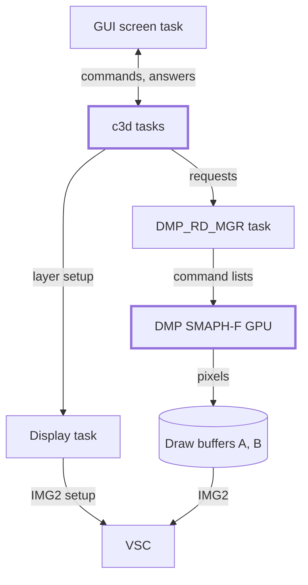
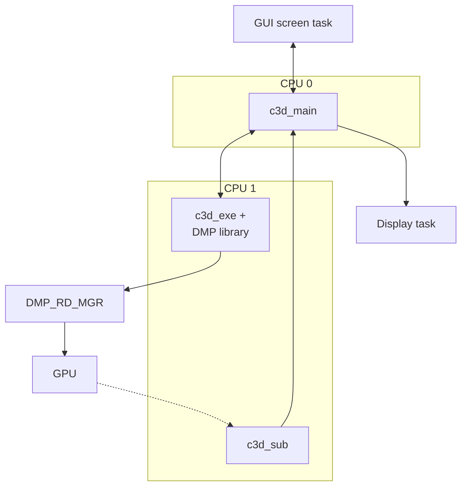

# c3d vector GPU: technical notes

<!-- house style -->
> **Technical reading.** The detailed version of [Vector GPU](../guides/vector-gpu.md), for readers who want the internals.

*Last reviewed 2026-11-27.*

The camera has a second drawing engine besides the 2D on-screen display (OSD) engine. It is a small **vector GPU** from
Digital Media Professionals (DMP), core name **SMAPH-F**, driven through DMP's **OpenVG 1.1 and EGL** library. Only the
colour-wheel editors use it: Color Creator, and the Color and Mono Profile editors we added.

This page goes from the GUI's request down to the GPU's registers and back up to the screen. It ends with how to draw
our own, in om-emu and with raw command lists. The overview of both engines is on
[Graphics pipeline](graphics-pipeline.md). The how-to view is the guide
[Drawing to the screen](../guides/drawing-to-the-screen.md).

Addresses are E-M5 III 1.7 block0 addresses. Body text names each function by what it does, and the
[address reference](#address-reference) gives its address.

The small numbers after a fact link to [Sources and dates](#sources-and-dates), which say how the fact is known and when.
On the notes site the number's colour shows the evidence: green = seen on our camera, blue = read in the firmware,
grey = inferred or seen in an emulator.

## Overview

A request passes through the c3d tasks. One branch draws through the DMP library and the GPU. The other tells the
display task where the layer is.

*The c3d tasks and the GPU (bold outlines) and their neighbours. Arrows show data flow. The table under [Tasks and commands](#tasks-and-commands)
says who starts each transfer.*

1. The GUI screen asks BackGroundCtrl, which calls the bridge into `c3d_main`. `c3d_main` takes 49 commands, START,
   UPDATE, END, UP_POST and END_POST per draw kind.
2. `c3d_main` forwards draw work to `c3d_exe`, which takes 11 commands. `c3d_exe` makes the EGL and OpenVG calls.
3. The DMP client library turns them into requests for the render manager task, `DMP_RD_MGR`, which drives the GPU
   with command lists, fill and copy.
4. eglSwapBuffers finishes a frame into draw buffer A or B (256 × 256 × 4 bytes for Color Creator).
5. `c3d_main` also tells the display task to show the buffer, with DISP_SET_LAYER_CUSTOM (6) and
   DISP_UPDATE_SCREEN_IMG (18). The display controller (VSC) shows it on image plane IMG2 over live view, at (432, 112)
   for Color Creator.

## Tasks and commands

There are three c3d modules, named by their debug dumps: `c3d_main` (the front end), `c3d_exe` (the drawing task) and
`c3d_buff_wrapper` (the two draw buffers). There are also `c3d_lib_if`, `c3d_update` and `c3d_debug`.[^cam1]

*Inside the c3d tasks. Each line is a row of the table below. The CPU of the GUI, display and render manager tasks is
not given.*

| from | to | what moves | path | started by | how often |
|---|---|---|---|---|---|
| GUI screen task (Color Creator, profile editors) | `c3d_main` | START, UPDATE, END per kind. A key sends cmd 46 | BackGroundCtrl bridge, `c3d_main` mailbox | GUI | per screen and per key[^fw1] |
| `c3d_main` (49 commands, one kind active) | `c3d_exe` | cmd and block: START, DRAW 3-11, END, with the copied UPDATE block | `c3d_exe` mailbox | `c3d_main` | per command[^fw1] |
| `c3d_exe` | `c3d_main` | 12-byte answer | reply mailbox | `c3d_exe` | per command with a reply mailbox[^fw1] |
| `c3d_exe` (kind renderer, OpenVG 1.1 and EGL through the DMP client library) | `DMP_RD_MGR` | VG kick with 2 lists, PSC fill, PPF copy | 20-slot request queue | `c3d_exe` | at eglSwapBuffers[^fw1] |
| `DMP_RD_MGR` (render manager) | GPU (VG core, PSC fill, PPF copy) | list address and size, then kick register = 1 | GPU registers | `DMP_RD_MGR` | per request[^fw1] |
| GPU | draw buffer A or B | the frame, written by the pixel stage | RAM, 256 × 256 × 4 B, byte 0 alpha | GPU | per frame[^fw1][^cam3] |
| GPU | `c3d_sub` | frame-done, arriving as cmd 3 | not traced | not traced | per frame[^fw4] |
| `c3d_sub` | `c3d_main` | cmd 48 | `c3d_main` mailbox | `c3d_sub`, while the draw flag is set | per frame[^fw4] |
| `c3d_main` | GUI screen task | the deferred answer to cmd 46 | reply | `c3d_main`, on cmd 48 | per key[^fw4] |
| `c3d_main` | display task | cmd 6 SET_LAYER_CUSTOM (geometry), cmd 18 UPDATE_SCREEN_IMG | display task mailbox | `c3d_main` | cmd 18 on every flip[^fw1] |
| display task | VSC | IMG2 set-up: format 3, per-pixel alpha. Color Creator: 256 × 256 at (432, 112) | VSC registers | display task | per command[^fw1][^emu1] |
| draw buffer A or B | VSC | the layer, over live view and under the OSD planes | plane IMG2 | VSC | not stated[^fw1] |

*Every transfer of the c3d path. CPU placement read in the firmware, frame-done path in om-emu.[^fw2][^fw4]*

### c3d_main

`c3d_main`'s task loop receives on its mailbox. The command word, 0 to 48, goes through a jump table.[^fw1]

- Commands come in groups of five per draw kind: `base+0` START, `+1` UPDATE, `+2` END, `+3` UP_POST, `+4` END_POST.
  Each fifth slot is invalid.
- Kinds in order: PART_COLOR (0), COLOR_CREATER (5), COLOR_CREATER2 (10), MONOCHROME_CREATER (15), SHADING_CREATER
  (20), ART_FILTER (25), TOUGH_GEAR (30), SCN_TOP (35) and SELECT_SHOOTING (40).
- 45 to 48 are shared commands. 46 is the "various draw" block the Color Creator keys send. 48 is the draw-address
  request.

### c3d_exe

`c3d_exe` receives on its own mailbox. `c3d_main` forwards to it with a helper taking (cmd, block).[^fw1]

| command | meaning |
|---:|---|
| 1 | START. Byte 0 of the block is the kind 1 to 9: CP, CC, CC2, MC, SC, ART, TG, ST, SS |
| 2 | END |
| 3-11 | DRAW for kinds 1 to 9 (renderers in [The Olympus driver](#the-olympus-driver-kind-by-kind)) |

*c3d_exe commands.[^fw1]*

**START** sets up a kind.[^fw1]

1. It takes a work buffer for the kind: 7 MB for CP, CC and MC, 6.2 MB for CC2 and SC, 12 MB for ART, 9 MB for TG and
   10 MB for ST and SS.
2. It hands the buffer to the DMP memory manager.
3. It runs the EGL setup with the surface size from the block (+12 width, +14 height).
4. It runs the kind's resource setup: textures, paths and paints.
5. It answers by posting `{code 1}` to the reply mailbox.

**END** frees the textures, paths and paints, then runs the EGL teardown and the DMP memory teardown. It answers
`{code 2}` and releases the work buffer.[^fw1]

Every command whose message carries a reply mailbox gets a 12-byte answer from the loop end. This answer is what
clears the GUI's busy word.[^fw1][^cam4]

### EGL and VG state

c3d's EGL and VG state lives in one RAM block.[^fw1]

| offset | field |
|---|---|
| +0 | display |
| +4 | config |
| +8 | context |
| `+0xc` | window surface |
| `+0x10`, `+0x14` | native display, native window |
| `+0x18`, `+0x1c` | surface width and height, used by every `vgClear` |
| `+0x20` | texture handles (3 slots) |
| `+0x2c` | texture buffers |
| then | path and paint handles |

*c3d's EGL and VG state block. Addresses in the [address reference](#address-reference).*

## The OpenVG and EGL library

Block0 holds DMP's EGL 1.4 and OpenVG 1.1 client. It has **147 entry points** in one `eglGetProcAddress` table of
8-byte records `{char *name, void *func}`.[^fw1]

- 44 `egl*` names come first.
- Then come 103 `vg*` and `vgu*` names. These include the VGU utilities (vguLine, vguRect, vguRoundRect, vguEllipse,
  vguArc, vguPolygon, warp helpers) and 7 DMP calls.
- **The c3d task is the only caller.** Every direct call into the library comes from one range of c3d code.[^fw2]

**Two entries per function.** The table holds each function's `movm` entry, for `calls`. Direct `call` sites use the
address after the prologue (examples in the [address reference](#entry-points-c3d-uses)). So search for callers in the
range func to func+8.[^fw1] See [Two entries per library function](#two-entries-per-library-function).

**Extension strings.**[^fw1]

- EGL: `EGL_DMP_display_query EGL_DMP_commandbuffer_attributes EGL_DMP_colorbuffer_format_attribute
  EGL_DMPX_query_cross_error EGL_DMPX_dump_reference_colorbuffer EGL_NV_native_query`. Platforms
  `EGL_DMP_platform_dmpnative` and `eglnative`.
- VG: `VG_DMP_LA_88 VG_DMP_image_native_format(_direct_load) VG_DMP_color_buffer_dither VG_DMP_draw_subimage
  VG_DMP_multi_draw_image VG_DMP_draw_path_data VG_DMP_debug_query VG_DMP_path_native_format_direct_load
  VG_DMPX_clear_linear_gradient_vertical VG_DMPX_paint_non_affine_matrix VG_DMPX_max_cross_config`.
- Vendor "Digital Media Professionals Inc.", renderer "SMAPH-F".
- Strings name the sources `src/egl/client/dmpdrvconf.c`, `dmpdevconf.c`, `src/vg_client_rmif.c` and
  `src/rm_swap_buffers.c`.

The entry points c3d uses, with c3d's call sites, are in the [address reference](#entry-points-c3d-uses).

Never called by stock code but present and callable: vgDrawImage, vgImageSubData, vgWritePixels, vgCopyImage,
vgGaussianBlur, vgConvolve, vgColorMatrix, vgLookup, masks, fonts and glyphs, the vgu shapes, vgMultiDrawImageDMP and
vgDrawPathDataDMP.[^fw2]

### EGL setup values

The EGL setup passes three attribute lists.[^fw1]

- Config attributes `{EGL_CONFIG_ID 0x3028, 2}`.
- Native window attributes `{0x8000, 0x8002}`.
- Context attributes, which are the DMP command-buffer sizes `{0x3ff7: 0x40000, 0x3ff8: 0x40000, 0x3ff9: 0x20000,
  0x3ffa: 0x20000}`. That is two 256 KB and two 128 KB buffers.

The native display and window come from Olympus' platform layer.[^fw1]

## Library objects

Read from the client library. Offsets are from the object pointer.[^fw1]

**Arguments.** Non-pointers take d0 and d1, and pointers take a0 and a1. Leftovers of either kind fill the other
kind's free registers (see [Calling convention](#calling-convention)). Floats travel as integer bits. With no pointer
arguments that is plain d0, d1, a0, a1, for example `vgCreatePath(format d0, datatype d1, scale a0, bias a1, segHint,
coordHint, caps on the stack)`.[^fw2]

**Current context.** Each API wrapper first calls a helper that goes from EGL's per-caller state to the current VG
context.[^fw2]

- Context +28 is the shared VG state S.
- S+40 is the path pool (object pool at +12), and S+44 the paint pool (at +4).
- **S+128 is the fill paint, and S+132 the stroke paint**, set by vgSetPaint.
- Errors go through an error helper taking (ctx, VG error code).

**Handles.** The pool id is in bits 16-24, and the generation in bits 28-31. A lookup function taking (pool, handle)
returns the object or 0. New objects come from an allocator taking (pool, 0, &handle).[^fw2]

**Path.**[^fw2]

| offset | field |
|---|---|
| +8 | handle |
| +16 | format (must be 0, standard) |
| +20 | datatype (0-3 = S8, S16, S32, F) |
| +24, +28 | scale, bias (floats) |
| +32, +36 | segment hint, coord hint |
| +40 | capabilities & `0xfff` |
| +68 | **coordinate buffer** |
| +92 | **segment buffer** |
| +116 | 0 |

*Path object.*

- A buffer is `{+0 memory block, +4 used count, +12 capacity, +16 data pointer, +20 second pointer}`, grown by a grow
  function.
- Segments are the standard OpenVG command bytes. Coordinates are kept in the path's own datatype, with the size per
  datatype from a table, as passed to vgAppendPathData.
- vgAppendPathData checks bit 1 (APPEND_TO), validates each byte & `0x1e` ≤ 24, and sums the coords per segment from a
  table.
- So an emulator can read a path straight from these two buffers at vgDrawPath time.

**Paint** (144 B).[^fw2]

- +0 reference count, +4 handle.
- **+8 type**, `0x1b00` (colour) by default.
- **+12 packed colour**, with red in bits 0-7 up to alpha in bits 24-31. The default `0xff000000` is opaque black.
- **+16 to +28, the colour as four floats R, G, B, A.** vgSetColor writes both forms. vgSetParameterfv colour writes
  the floats.
- +112 `0x1c00` (ramp spread pad), +76 `0x1d00` (pattern tiling), +96 premultiplied ramp 1, +40 and +64 1.0.
- The gradient and pattern fields +68 to +108 are not traced.
- The meaning of the non-colour defaults is inferred from the OpenVG enums.[^inf2]

**Matrices.**[^fw2]

- S+256 is `VG_MATRIX_MODE` (`0x1400` path, `0x1401` image, `0x1402` fill, `0x1403` stroke, `0x1404` glyph).
- The five 3 × 3 float matrices sit at **S+708 + (mode & 15) × 36**: path S+708, image S+744, fill S+780, stroke S+816.
- They are stored in `vgLoadMatrix` order `{sx, shy, w0, shx, sy, w1, tx, ty, w2}`. vgTranslate builds
  `{1,0,0, 0,1,0, tx,ty,1}` and multiplies.
- c3d switches with `vgSeti(0x1100, 0x1401)` before sprites.

**Images.** The pool is S+36, with objects at +12.[^fw1]

- `vgCreateImageDataDMP(format d0, width d1, data a0, height a1, data size, allowed quality)` checks that the size is
  exactly w × h × bpp / 8 (format 12: w × h / 2), at most 8192 × 8192. It creates the object, then loads the data.
- c3d's sheets use format **`0x401`** (bit 10 = DMP native layout of format 1, sRGBA_8888) and quality 7.
- Image object: +12 allowed quality, +28 VG format, +32 internal format code, +36 a value from a helper, +44 parent
  (self for a root image), +52 data handle, **+56 / +58 width / height**, +60 / +62 allocated width / height, **+72
  stride** (allocated width × bpp / 8), +78 bits per pixel, +88 filter, +92 / +112 storage records.
- The meaning of +32, +36, +92 and +112 is inferred.[^inf1]

**Sprites.** `vgDrawSubImageDMP(image d0, x d1, y a0, w a1, h stack)` checks that the rectangle lies inside the image
and draws it through the image matrix (S+744). c3d's helper does LoadIdentity, Translate and Scale, then draws the
rectangle `{x, y, w, h}` (u16s from the sprite table) from the atlas handle.[^fw1]

**Sheet loading.**[^fw3]

- Per atlas, a buffer comes from the c3d heap (size + 1024), and the pixels from the resource reader.
- Then `vgCreateImageDataDMP(0x401, w, h, data, size, 7)` makes the image. The handle and the buffer go into two
  per-atlas tables.
- Whether the library copies the pixels or keeps the buffer is open. c3d keeps the buffer until END, which suggests it
  may be referenced.

## The GPU and its registers

The GPU's register base is stored in RAM by the render-manager init. All GPU register traffic goes through one read
accessor (off) and one write accessor (off, value).[^fw1]

The render manager is its own task, **DMP_RD_MGR** (priority 55, 2 KB stack).[^fw2]

- `c3d_exe`'s init creates it with the flag `FLG_DMP_RM` and ten semaphores `SEM_DMP_RM`.
- It takes requests of 12 types and logs them as `[kick VG]`, `[kick PSC] dst=` and `[kick PPF] src= dst=`.
- It logs interrupts as `[int VG]`, `[int PPF]` and `[int PSC]`.

Register map, as written by the driver:[^fw1]

| offset | unit | use |
|---|---|---|
| `+0x10` / `+0x14` / `+0x18` / `+0x1c` | **PSC** memory fill | start, end, value, control (`0x0f100201` / `0x0f100211` start, 0 = clear) |
| `+0xe0` / `+0xe4` / `+0xe8` / `+0xec` | PSC, second set | written by the same request when its mode word is set |
| `+0x34` | status | cleared at init |
| `+0x58` | status | bit 26 polled while waiting for the VG core |
| `+0xc00` / `+0xc04` | **PPF** copy engine | source / destination address |
| `+0xc08` / `+0xc0c` | PPF | output / input size (h << 16 \| w) |
| `+0xc10` | PPF | flags (bit 3 = plain copy using `+0xc20` to `+0xc28`) |
| `+0xc18` | PPF | 1 = start, 0 = acknowledge |
| `+0xc1c` | PPF | `0x8000` at init |
| `+0xc20` / `+0xc24` / `+0xc28` | PPF | copy size / source and destination line gaps |
| `+0x1020` | VG core | interrupt acknowledge (0) |
| `+0x10d0` / `+0x10d4` / `+0x10dc` | **VG command list 0** | kick (1) / address / size in 8-byte units (request words / 2) |
| `+0x10e0` / `+0x10e4` / `+0x10ec` | VG command list 1 | kick / address / size |
| `+0x1214` | VG core | `0xffff` or `0x100ffff` before a list, `0x1000000` while waiting |
| `+0x1248` / `+0x1298` | VG core | 1 at init / 0 before each list |

*GPU registers by offset from the base, as written by the render manager.*

- The external units' names (PSC fill, PPF transfer) and the PPF register order match DMP's PICA200, as documented by
  the Nintendo 3DS homebrew community. The VG core's own registers (`+0x1000` up) do not. So treat the 3DS documents as
  a hint for PSC and PPF only.[^inf1]
- The command lists are built inside the client library (`vg_client_rmif.c`). What the VG core's registers mean is not
  decoded. The list format itself is in [Raw command lists](#raw-command-lists).

## Surfaces, buffers and pixel formats

- The EGL window surface is the c3d draw area. `c3d_buff_wrapper` keeps **two draw buffers** of `0x40000` bytes each
  and flips between them (`g_ucDrawBuffFlg`). `c3d_lib_if` holds the current one with **format 7**.[^cam2]
- Draw-buffer pixel bytes: byte 0 is alpha, and bytes 1-3 are colour (decoded as B, G, R). It is straight
  256 × 256, with no padding.[^cam3]
- Textures (atlas sheets) are created with `vgCreateImageDataDMP(0x401, w, h, data, size, 7)` in the sheet loader. The
  bytes are handed over in the GPU's own layout (`VG_DMP_image_native_format`), so sheet bytes are copied, not
  converted.[^fw3]
- Sprites are drawn with `vgDrawSubImageDMP` from those sheets. The rectangle tables per atlas are in block0.[^fw2]

### Native image layout

Format `0x401` stores texels in the GPU's own order.[^fw4]

- 4 bytes per texel: A, B, G, R.
- 8 × 8 tiles, in rows of tiles. Inside a tile, Morton (Z) order, x bit first.
- The first tile row is VG y 0 (the bottom), so the sheets are stored bottom-up.
- Verified on the E-M5 III's atlas 0.

### Sheets in block2

Group-table addresses are flash addresses. In the unpacked block2 body (32-byte OE head stripped), flash address A is
at file offset A − `0x43f60000` − 32.[^fw2]

| item | flash address | size |
|---|---|---|
| group 5's own OE head | `0x45320000` | |
| atlas 0 | `0x45320800` | 1 MB |
| atlas 1 | `0x45420800` | 4 MB |
| atlas 2 | `0x45820800` | 2 MB |

*Sprite sheets in block2 group 5. The entries are `{flash address, size}`.[^fw2]*

The resource reader takes (category d0, entry d1, dest a0, 0 in a1, size on the stack). It returns a `{pointer, size}`
record in a0.[^fw2]

## Layer on the screen

**Layer geometry.** `c3d_main` picks a layer geometry per kind and device. It is a 24-byte record from the geometry
table (+ mode × 240), or by display setting for kind 9. It goes into `g_stLayerInfo`: source w/h, line jump, target
w/h, target x/y, format and buffer size.[^fw1][^cam1] Color Creator on the rear screen is 256 × 256, line 256, at
(432, 112), **format 4**, `0x40000` B.

**Display commands.** `c3d_exe_bridge_disp_init` sends the display task three commands.[^fw1]

- **17 DISP_UPDATE_SCREEN_OSD.**
- **18 DISP_UPDATE_SCREEN_IMG**, with a 40-byte record: device mask, image slots, format 4.
- **6 DISP_SET_LAYER_CUSTOM**, with an 80-byte record holding the geometry.

The per-frame flip sends command 18 again with the new buffer. The device mask comes from the device kind, as masks 1,
2, 4, 8, 16 and 32. 1 = TFT and 2 = EVF, as in the display task.[^fw1]

**Which plane.** DISP_SET_LAYER_CUSTOM's per-channel handler programs image plane 0 from record +8 and plane 1 from
record +12. c3d fills only +12. So **the c3d layer is VSC plane IMG2**, over live view (IMG1) and under the OSD
planes.[^fw1] The OM-3 uses IMG2 too.[^emu2]

It becomes IMGPLANE2 = `0x301100`, VSC format 3 with per-pixel alpha.[^emu1] The registers are in
[Graphics pipeline](graphics-pipeline.md#showing-the-c3d-layer-in-om-emu).

**Display task commands.** The display task logs each as `[DISP] <COM> :...`. Its handler table is indexed by cmd -
2.[^fw1]

| command | name |
|---|---|
| 4 | SET_CPDATA |
| 6 | SET_LAYER_CUSTOM |
| 8 | SET_QUALITY |
| 9, 21, 25 | SET_HI_SH |
| 10, 46 | SET_EG_PK |
| 13-16 | HISTOGRAM_SET, START, STOP, CALC_END |
| 17 | UPDATE_SCREEN_OSD |
| 18 | UPDATE_SCREEN_IMG |
| 28 | SET_LAYER_CUSTOM_VSYNC |
| 30 | SET_AUTO_DIMMER |
| 32 | FPS_CHANGE |
| 33-36 | the `_SUB` variants |

*Display task command names.*

Before a layer appears, the GUI's background type must keep the planes on. Background kinds 5 and 6 switched O1 to O3
off, and type 0 keeps them.[^cam4] See also: UI drawing lessons.

## Debug hooks in the firmware

- The user shell commands `c3d dbginfo` and `c3d dbgall` print every module's state and the command history.[^cam4]
- `c3d test <n> <0|1|2|Y|m>` is in `c3d_debug.c`.[^fw1]
    - `<n>` is parsed into a RAM word that is also `g_ulDeviceKind`.
    - 0, 1 and 2 post a 16-byte message with word 3 = n to `c3d_main`, `c3d_exe` or the reply mailbox.
    - `Y` writes 4 MB from address n to the card as `vg.out`.
    - `m` runs a further debug function.
- So the shell can send c3d commands without a build. The exact argument order is inferred, and the shell cuts lines
  at 31 characters.[^inf1]

## Drawing our own

Yes in principle, with no new driver work. c3d already brings up EGL, an OpenVG context, a 256 × 256 surface and the
IMG2 layer for any kind it starts. Every stock renderer is a plain sequence of OpenVG calls ending in
eglSwapBuffers.[^fw1][^inf1]

Unused kind slots exist. The E-M5 III's TG renderer is a print-and-return stub, as CC2, MC and SC were before the looks
port.[^fw1]

**First plan.**[^inf1]

1. Use a stub kind (TG, or a new kind beside the profile editors) and put our own renderer in it. It calls `vgClear`,
   builds one path with `vgAppendPathData` (or `vguRoundRect` / `vguEllipse`) and one solid paint (`vgSetParameteri`
   type colour, `vgSetParameterfv` colour, `vgSetPaint`). Then it draws with `vgDrawPath` fill and stroke, and ends
   with the stock submit.
2. Start it exactly as the camera-proven profile editors do: the screen's kind (kind table, through `chgBackGround`),
   `OlyApiBackGroundCtrl` start and end, a background type that keeps O1 to O3 on, a big enough work buffer, and
   per-key updates through BackGroundCtrl cmd 5 to the bridge (`c3d_main` command 46).[^cam4] Or post START and
   UPDATE to `c3d_main` from the shell with `c3d test` for a first look. See also:
   UI drawing lessons.
3. Check with `file memdump` of the draw buffer before worrying about the screen.

**Geometry rows** per mode are `{src w, src h, line, dst w, dst h, x, y, format}`. All are format 4.[^fw1]

| mode | kind | surface | shown at |
|---:|---|---|---|
| 0 | CP | 192 × 192 | (500, 144) |
| 1, 2, 3 | CC, CC2, MC | 256 × 256 | (432, 112) |
| 4 | SC | 80 × 352 | (613, 64) |
| 5, 7, 8 | ART, ST, SS | 720 × 480 | full screen |
| 6 | TG | 480 × 480 | shown 638 × 480 at (160, 0). The VSC scales it |

*Layer geometry rows per mode.[^fw1]*

### Drawing a circle on the TG kind

The smallest stub is kind 7, TOUGH_GEAR (TG).[^inf1]

- Its `c3d_exe` draw case (command 9) is the stub. Its START case only loads sheet row 6.
- Its `c3d_main` commands are 30 START, 31 UPDATE and 32 END. The work buffer is 9 MB.

The renderer:

1. `vgClear(0, 0, w, h)`.
2. `p = vgCreatePath(0, 3 (float), 1.0, 0.0, 0, 0, all caps)`.
3. `vguEllipse(p, cx, cy, d, d)`.
4. `paint = vgCreatePaint`.
5. `vgSetParameteri(paint, 0x1a00 type, 0x1b00 colour)`.
6. `vgSetParameterfv(paint, 0x1a01 colour, 4, rgba)`.
7. `vgSetPaint(paint, 2 fill)`.
8. `vgDrawPath(p, 2 fill)`. VG_STROKE_PATH = 1, VG_FILL_PATH = 2.
9. Submit: `call` the stock submit from assembly, or eglSwapBuffers from C ([Driving the library
   yourself](#driving-the-library-yourself)).

No GUI screen starts TG, so borrow the profile editors' start path or the shell `c3d test` route. Its 480 × 480
surface is stretched to 638 wide on the rear screen.

Transparency comes free, with per-pixel alpha. Animation is an UPDATE per frame, and each goes through one flip. The
rate is not measured.[^inf1]

### Two ways to drive it

There are two ways to use this: everything the Olympus driver offers, or the vector library driven directly. The
E-M5 III has **no OpenGL ES** driver. Its GPU library is OpenVG and EGL only. The PEN-F carries OpenGL ES 1.1.[^fw2]

**How tied the DMP library is to c3d.** The library calls back into c3d glue, so it is not a free-standing
driver.[^fw1]

- **Memory.** Every allocation goes to a c3d callback taking (type, size).
    - Type `0x8000` (an EGL window colour buffer) returns c3d's two draw buffers in turn. The two addresses and a
      counter are set at `c3d_main` START.
    - Every other type comes from the DMP heap that START built over the work buffer. The first 512 KB are reserved,
      and the rest is heap.
    - The callback tables treat all 9 kinds alike. Outside a kind (the current-kind byte = 0) a window buffer would
      come from the heap and never reach the screen.
- **Completion.** The platform layer reports through a callback (codes 0-6 become 4-10, posted by the answer
  function). Render-manager task priorities and a context pointer come through two more callbacks.
- **Platform init** is reference-counted. The native display is 0. The native window is created by a platform function
  taking (display, width, attributes `{0x8000, 0x8002}`).

**Route 1, the Olympus driver.** Use c3d as it is. Pick a kind, size its work buffer, load sheets, and write a renderer
that uses any of the 147 calls: paths, vgu shapes, paints, gradients, images, sprites, masks, blur and colour matrix.
c3d does the EGL setup, the layer, flips and answers. This is what the profile editors do on the camera.[^inf1]

**Route 2, drive OpenVG yourself.** Because of the glue above, the practical way is a **"script kind"**. That is a
renderer in a stub kind (TG) that reads a small command buffer posted with each UPDATE and makes the matching OpenVG
calls, then the submit.[^inf1]

- The records are `{op, args}` for clear, path from segments and coords, paint colour or gradient, matrix, draw path
  and draw image rect.
- Callers can then draw anything without writing MN103 renderers. The same buffer format can feed the om-emu stand-in.
- Running EGL from our own task beside c3d is not recommended. The memory and window-buffer callbacks key off c3d's
  current kind and buffers, and c3d's START and END create and destroy the display.

**Route 3, the GPU directly.** Build VG command lists ourselves and kick them at `+0x10d0`. This needs the opcode
format, which is not decoded. See [Raw command lists](#raw-command-lists).

## The Olympus driver, kind by kind

Everything a c3d draw kind is made of, from the E-M5 III 1.7 tables. Use this to read a stock kind or to add one.[^fw1]

| # | kind | surface (START) | layer on rear screen | work buffer | sheets (atlas: size) | sprite list | UPDATE block | renderer (`c3d_exe` cmd) |
|---:|---|---|---|---|---|---|---|---|
| 1 | PART_COLOR (CP) | 192 × 192 | 192² at (500, 144) | 7 MB | 0: 512 × 512 | 19 sprites, atlas 0 | 4 B (hue) | 3 |
| 2 | COLOR_CREATER (CC) | 256 × 256 | 256² at (432, 112) | 7 MB | 0: 512 × 512 | 4 sprites, atlas 0 | 4 B | 4 |
| 3 | COLOR_CREATER2 (CC2) | 256 × 256 | 256² at (432, 112) | 6.2 MB | none | none | 13 B | stub (5) |
| 4 | MONOCHROME_CREATER (MC) | 256 × 256 | 256² at (432, 112) | 7 MB | none | none | 2 B | stub (6) |
| 5 | SHADING_CREATER (SC) | 80 × 352 | 80 × 352 at (613, 64) | 6.2 MB | none | none | 1 B | stub (7) |
| 6 | ART_FILTER (ART) | 720 × 480 | full screen | 12 MB | 1: 1024 × 1024 | 189 sprites, atlas 1 | 36 B | 8 |
| 7 | TOUGH_GEAR (TG) | 480 × 480 | 638 × 480 at (160, 0) | 9 MB (pool 3) | none | none | 4 B | stub (9) |
| 8 | SCN_TOP (ST) | 720 × 480 | full screen | 10 MB | 2: 1024 × 512 | 2 sprites, atlas 2 | 4 B | 10 |
| 9 | SELECT_SHOOTING (SS) | 720 × 480 | full screen | 10 MB | 2: 1024 × 512 | 46 sprites, atlas 2 | 30 B | 11 |

*The nine c3d draw kinds on the E-M5 III 1.7. Renderer addresses are in the [address reference](#renderers).*

Where each column lives:[^fw2]

- **`c3d_main` START** (commands 0, 5, 10 and so on, or 45 with the kind in byte 0 of the block).
    - It waits until no kind is active (state word = 0).
    - It records the kind, surface size and reply mailbox.
    - It installs the **two draw-buffer addresses the caller passes** (block +4).
    - Then it sends `c3d_exe` START. Surface sizes are constants in the START cases.
- **`c3d_main` UPDATE** (1, 6, 11 and so on) works only when the state word equals that kind. It copies the caller's
  block (sizes above) to a RAM area and sends `c3d_exe` the draw command.
- **UP_POST** (3, 8 and so on) and 48 store the drawn buffer address and answer the caller with it.
- **END** (2, 7 and so on) sends `c3d_exe` END and clears the state word.
- **Layer geometry**: the geometry table, 240 B per mode (see [Layer on the screen](#layer-on-the-screen)). **Work
  buffer**: the work-buffer table (see [c3d_exe](#c3d_exe)).
- **Sheets**: loader rows (8 B `{ptr, count}` per mode, pointing at `{u16 atlas, u16 w, u16 h}` records). The byte size
  per atlas is in a table (atlas 0 1 MB, 1 4 MB, 2 2 MB). The sheet loader reads them from block 2 group 5.
- **Sprites**: a type table (8 B `{ptr, u16 count}` per kind) points at records `{u32 sprite id, u16 rect, u16 atlas}`.
  Atlas rect tables (8 B `{ptr, count}` per atlas) point at rects `{u16 x, y, w, h}`.
    - The lookup function takes (kind, id, out) and refuses ids ≥ 261.
    - One drawing helper takes (kind, id, x, y) and does LoadIdentity, Translate(x, y) and vgDrawSubImageDMP.
    - A second helper takes (kind, id, x, y, scale) and adds Scale(scale, 1.0).
- **Paints**: a helper taking (paint, r, g, b, a) sets the type colour (`0x1a00` = `0x1b00`) and the colour (`0x1a01`)
  floats.
- **START resources** (c3d_exe START, resource table).
    - CC and CC2 build two paths and two or three colour paints. MC builds one path and two paints.
    - ART and SS build one more path, a 5-segment path with float coords.
    - All then load their sheet row.

**What the stock renderers call**, in order. These are useful as templates.[^fw2]

- **CP**: clear colour (`vgSetfv 0x1121`), vgClear, matrix mode image, sprite, rotate by the hue around the centre,
  sprite (the hue marker), submit.
- **CC**: as CP, plus a path whose coordinates are rewritten each frame (vgModifyPathCoords), vgSetPaint and vgDrawPath
  for the arc, vgTransformPath and vgPointAlongPath to place the cursor on it, sprites, submit.
- **ART**: up to 9 icon sprites scaled per layout, a rotating wheel sprite, one drawn path (the selection band),
  submit.
- **ST**: clear, two sprites (cursor), submit.
- **SS**: sprites for icons, one drawn path, more sprites, submit.

### Adding your own drawing on the Olympus driver

This builds on the camera-proven profile editors, which did exactly this for CC2 and MC.[^inf1]

1. **Pick a stub kind**: CC2, MC, SC or TG. The editors use CC2 and MC, and TG is free. Point its `c3d_exe` draw stub
   at your renderer (`call renderer; ret`, 10 bytes, as the editors do).
2. **Surface and layer** come with the kind (table above). Change the geometry row only if you need another size or
   position.
3. **Memory**: make sure the work buffer covers your sheets and paths. The editors needed 10-12 MB.
4. **Artwork** (optional): add a sheet row, an atlas size, a sprite list and atlas rects. Raise the sprite id limit,
   and put the sheet in block 2 group 5. Paths and paints need none.
5. **Renderer**: clear, draw with any OpenVG calls, and end with the submit (eglSwapBuffers, see
   [Driving the library yourself](#driving-the-library-yourself)). Data comes in the kind's UPDATE block (a0 = the
   copied block).
6. **Start it from the GUI**: the screen kind table through `chgBackGround`, `OlyApiBackGroundCtrl` start and end, a
   background type that keeps O1 to O3 on, and per-key updates through BackGroundCtrl cmd 5 to the bridge.[^cam4] See
   also: UI drawing lessons.
7. **Check**: `c3d dbgall` (state, history) and `file memdump` of the draw buffer, before worrying about the
   screen.[^cam4]

## Driving the library yourself

This is the second route: your own renderer calls OpenVG directly instead of the stock sprite helpers.[^fw1]

**Where you may call it.** Only inside a c3d renderer, which `c3d_exe` calls with a0 = the copied UPDATE block after
setting the draw flag. `c3d_exe` owns the EGL display, the window surface and the current VG context. The GUI task has
none.[^fw1]

**End of frame.** The stock submit is `eglSwapBuffers(display, surface)` with c3d's own display and surface. Call it
last, so the frame-done path answers the GUI (see [Running it in om-emu](#running-it-in-om-emu)).[^fw1] From C, call
eglSwapBuffers itself (`c3d_submit` in the header).

> [!WARNING]
> Never enter the stock submit through a pointer (`calls`). It has no prologue and must be entered by `call`. Through
> `calls` its `ret [],4` returns to a stack word, which crashed our first example in om-emu.

**Paint modes.** VG_STROKE_PATH = 1 and VG_FILL_PATH = 2. Stock ART fills with 2. vgSet state such as the stroke width
carries over between frames, so set it every frame.[^fw1]

### Calling convention

The library takes non-pointer arguments in d0 and d1, and pointers in a0 and a1, each in argument order. Leftovers of
either kind fill the other kind's free registers. The rest go on the stack from the caller's (4,sp). Floats travel as
their bits.[^fw1]

| call | registers, from stock callers |
|---|---|
| vgClear | x d0, y d1, w a0, h a1 |
| vgCreatePath | scale a0, bias a1, hints and caps on the stack |
| vgSetParameterfv | values a0, count a1 |
| vgCreateImageDataDMP | data a0, height a1, size and quality on the stack |
| eglInitialize | display a0, major* a1, minor* **d0** |
| eglGetDisplay | returns in a0 |

*Argument registers seen at stock call sites. The sites are in the [address reference](#entry-points-c3d-uses).[^fw1]*

The Olympus-ABI GCC alone stacks a third integer. It needs the `areg`/`dreg` type attributes the decompile uses, so
plain prototypes are not enough.[^fw1]

More examples, confirmed in om-emu:[^fw4]

- `vgSetParameteri(obj, type, value)` puts value in a0.
- `vgSetParameterfv(obj, type, count, values)` puts values in a0 and count in a1.
- `vgModifyPathCoords` puts its data pointer in a0 and the segment count in a1.
- Stack arguments start at the caller's (4,sp).
- So `vgPointAlongPath(path, start, x*, y*, numSegs, distance, tx*, ty*)` has x* in a0 and y* in a1.

### Header and example

**Header.** A generator in our decompile tools makes `c3d_vg.h` from the entry-point table.[^fw1]

- It gives `NAME_ADDR` for all 147 entries and typed inline wrappers for 132 calls. They use the standard EGL 1.4,
  OpenVG 1.1 and VGU signatures, plus vgCreateImageDataDMP and vgDrawSubImageDMP read from their callers.
- Rebuild it for another body from that body's table.

**Objects per frame or kept.** Paths and paints made in a renderer can be destroyed at the end of the frame, as the
example does. To keep them between frames, make them on the first frame and drop the handles when the kind ends.
`c3d_exe` END frees the context's pools.[^inf1]

**Example.** `example_tg_renderer.c` (in the same folder) draws a half-transparent rounded panel, a circle that moves
with UPDATE byte 0 and a stroked arc on the free TG kind. It uses vguRoundRect, vguEllipse, vguArc, colour paints and
vgDrawPath.[^inf1]

- Wiring: point the TG draw stub at it (step 1 of [Adding your own drawing](#adding-your-own-drawing-on-the-olympus-driver)).
- It compiles clean, with no AM33-only opcodes and no soft-float calls.
- **It runs in om-emu.** Arguments arrive as expected for every call, including vguRoundRect, vguEllipse and vguArc, and
  the UPDATE angle reaches vgRotate. Two bugs found there were fixed.[^emu1]
- The screen position and the camera are not yet checked.

**Still unread**: the arguments of vgDrawSubImagesDMP, vgMultiDrawImageDMP, vgDrawPathDataDMP,
vgDrawPathDataArraysDMP, vgCreatePathDataDMP and the `egl*DMP` and `*NV` queries. They have no stock caller.[^fw1]

## Running it in om-emu

- **CPU split.** `c3d_exe` (queue `0x100f`) and `c3d_sub` (queue `0x1002`) are CPU-1 tasks. `c3d_main` (queue 158) is
  on CPU 0.[^fw2] `c3d_exe`'s init creates the DMP driver task.[^emu1]
- **c3d_sub.** Command 1 is init, command 2 does nothing, and command 3 is the GPU's frame-done.[^fw4]
    - When `c3d_exe`'s draw flag is set, command 3 posts command 48 to `c3d_main`.
    - Command 48 sends `c3d_main`'s deferred answer to the GUI's request. Command 46 is saved for it.
- **Calls per Color Creator frame:** about 53. They are clear, the wheel sprite, the inner-circle stroke, rotate,
  TransformPath, 8 × PointAlongPath, 9 dot and handle sprites and the swap.[^emu1]
- **Own renderer verified.** The TG example, loaded by `om-emu/c3d/elfload.mjs` (`TG_OBJ=`), draws its panel, dot and
  arc.[^emu1]
    - Every argument arrives in the expected register, vguRoundRect, vguEllipse and vguArc included (path d0, x d1, y
      a0, w a1, the rest from (4,sp)).
    - The UPDATE angle reaches vgRotate.
    - Not verified: the screen position, because the GUI still opens Color Creator's layer.
- **The real library runs.** With the stand-in off (`C3D_NATIVE=1`) and the request poster hooked to dump both lists
  and return 0 (no render manager task, no busy bit or interrupt), the stock library ran 4 Color Creator frames
  without waiting on the GPU.[^emu1] The `+0x10dc` register holds the size in 8-byte units, see
  [Building and kicking a list](#building-and-kicking-a-list-yourself).

### Two entries per library function

The entry-point table address is the `calls` entry. It runs the function's own prologue (`movm` and/or `add -n,sp`).
Stock code uses `call` to the address just after that prologue, because `call label,[regs],n` does that work
itself.[^fw4]

- So both ways work for library functions.
- A stock helper that has no prologue can only be entered with `call`. Example: the submit (`call ..,[],4`).
- Entered with `calls`, its `ret [],4` takes the return address from the caller's (4,sp). This crashed the first TG
  example in om-emu. It now uses eglSwapBuffers.

### ART's selection band

ART's band is fixed at 80 pixels. The renderer's only path is (0,0)-(0,80)-(W,80)-(W,0), black at 50%, under the
thumbnails.[^fw1]

Photos of the camera's normal shooting screen and ART select show this.[^cam5]

- The 80-pixel thumbnail band matches.
- Live view keeps its full width and is not scaled.
- The thumbnails sit on black.

**The translucent grey bar under the "Soft Focus" title** (y about 348-398) is a GUI picture, not dimmed live
view.[^emu3][^cam6] It is a 4-bit run-length picture sent without a colour table. Stock om-emu refuses that, and says so
only on stderr (`osd-engine ERROR BMP_LUT`). With our patch 0004 it draws in om-emu and matches a photo of the camera's
screen. SCN's title bar is the same kind.

## Raw command lists

This is route 3: build the VG core's command lists ourselves. It is work in progress, and the opcodes are not decoded
yet.[^fw1]

### Submission

The client library posts requests to the render manager with a poster taking (count, requests).[^fw1]

- d0 is the **number of requests** (1 in every capture), and a0 the array.
- A copier puts each into a 20-slot queue of 112-byte slots, so the caller's copy may live on the stack. When the queue
  is full it waits and retries.
- A request is `{+0 flags, +4 type, +40 payload}`.

| request type | meaning |
|---:|---|
| 1, 8, 10 | VG list kick |
| 3 | PSC fill |
| 4 | PPF copy |
| 7 | wait or flush |

*Render manager request types.[^fw1]*

The VG kick request is built with type 1, 8 or 10 from the caller's flags. Its payload is
`{list 0 address, list 0 words, list 1 address, list 1 words}`. The render manager writes them to `+0x10d4`, `+0x10dc`
(words / 2, so 8-byte units) and `+0x10d0` = 1, then `+0x10e4`, `+0x10ec` and `+0x10e0`.[^fw1]

**Two lists per submit.** Each VG context owns a command-buffer object at context +944 (100 B).[^fw1]

- It holds two rings, at +0 and +44.
- Each ring is `{+0 size in words, +4 base address, +8 word pointer, +12 limit, +16 last end, +20 write index (words),
  +24 start index, +28 minimum free, +36/+37 flags, +40 pending link}`.
- The sizes come from the context's +60 to +80.

### List format

- Lists are 32-bit words, padded to an even number of words (8-byte steps).[^fw1]
- Each list ends with the pair **`0x00081004`, 1**, plus a zero pad word when needed.[^fw1]
- A ring wrap writes a link pair `{(index << 2) | 3, base address}`.[^fw1]
- The pair form `{header, value}` and a header with a low 16-bit register id (`0x1004`) look like a register-write
  stream, as on DMP's PICA200.[^inf1]

**Captured lists.** We captured the real DMP library's lists on Color Creator's first frame in om-emu: 20 type-1
submits for one frame. A decoder in our tools reads them.[^fw1]

**Header format.** `id << 16 | byte mask << 12 | (count - 1) << 3 | 4 | consecutive << 1`, then `count` data
words.[^fw1]

- Commands are packed with no padding. Only the list end is padded to 8 bytes.
- Consecutive set means the words go to id, id+1 and so on (the 3 × 3 matrix, `0x0041f046` = 9 words). Clear means all
  words go to one id (the 256-entry table, `0x0188f7fc`).
- The end pair `0x00081004`, 1 is a write of 1 to register `0x008` with byte mask 1.
- A word with bit 2 clear where a header is due starts an **inline packet** of that many words (itself included). It is
  seen right after the start write (`0x006` = 1), for small path data. Example: `00000009 07090702 ...` = segment
  bytes 02 07 09 07 (MOVE_TO, HLINE_REL, VLINE_REL, HLINE_REL), then coordinates.
- With this rule every word of the 4-frame Color Creator capture parses.

### Registers seen

Meanings come from the values only.[^inf1]

| id | values seen | likely meaning |
|---|---|---|
| `0x002` / `0x004` | `0xa48468c0` / `0xa4846900`. For a path `0xa48e7900` / `0xa48e7940` | addresses: image source, or a path's segment / coordinate data in GPU memory |
| `0x003`, `0x063` | `0x10000002` (image), `0x10000012` (path in memory), 5 (inline path) | draw mode |
| `0x005` | `0xd0000004`, `0xd000004e`, `0x80000005` | format word. The low bits are the coordinate count for an inline path (5) |
| `0x006` | 1 | start the primitive. A raw packet follows |
| `0x040` | `0x04000400` (256-pixel surface), `0x07800780` (480 pixels). `0x01e001e0` with antialiasing off | **coverage width in samples**: surface width × 4 with antialiasing, × 1 without (probe, below) |
| `0x041` (+8) | 3 × 3 float matrix, written 2-3 times per draw | transform stack: identity, then translate (128, 128), (124, 124) for the Color Creator arc |
| `0x05e` / `0x05f` | 1.0f / 0 | scale / bias |
| `0x065` | `0x2100` fill, `0x2000` stroke, `0x0100` fill without antialiasing. Byte 2 `0x01` round cap, `0x10` round join | **draw flags**: bit 8 fill (clear = stroke), bit 13 antialiasing, bits 16-17 cap, bits 20-21 join (probe) |
| `0x080` (+4) | `0xe0000000` / `0xe0008000`, 0, `0x00f80008` (`0x00e00020` without AA), coverage width, 0 | coverage set-up. Bit 15 of word 0 alternates draw to draw (ping-pong buffer) |
| `0x085` | `0xffff`, `0x10001`, `0x10002` | draw sequence tag |
| `0x1a3` | `0x01000100` (CC), `0x01e001e0` (TG) | **surface size** h << 16 \| w |
| `0x140`, `0x184`, `0x186`, `0x187`, `0x190`, `0x1a2`, `0x1c0` | 0, `0x07000000` | output stage set-up (second list) |
| `0x188` | 256 rising values 0 to `0xff`, concave | output colour table, looks like a gamma (linear to sRGB) curve |

*VG core register ids seen in captured lists. The meanings are inferred from the values.*

### Stages and timing

- **When lists are sent.** The draws of a frame are queued and submitted at eglSwapBuffers. The TG example sends one
  list pair per frame, after the swap. vgClear goes separately as a fill request (constants `0x3fde`/`0x3094`).[^fw1]
- **Image draws.** The 14 short lists (`0x004`, `0x005`, `0x002`, `0x003`, then a matrix) come after the sheet image
  calls and repeat the same source and identity matrix. So they may be image set-up rather than the sprite
  draws.[^inf1]
- **Two lists per frame are two stages.** This comes from the TG example capture, 3 draws a frame.[^fw1]
    - List 0 is the **geometry stage**. Per draw: tag `0x085`, matrices `0x041`, path or image source, mode, start
      `0x006`.
    - List 1 is the **pixel stage**. Per draw: destination `0x1a4`, paint colour `0x185`, rectangle `0x0a0` and tag
      `0x0a6`, matching `0x085`. The set-up and the `0x188` table come first, and the end pair last.
    - Draw N in list 0 and draw N in list 1 carry the same tag (`0x10001`, `0x10002` and so on).

### Path data in GPU memory

From the TG example (vguRoundRect, vguEllipse, vguArc).[^fw1]

- **`0x002` is the segment buffer.** It holds one byte per segment, the standard OpenVG segment codes as the path holds
  them. Relative codes stay relative: vguRect gives `02 07 09 07 00`. Arcs are turned into cubics. A round rect is
  `02 06 0c 0c 0c 08 0c 0c 0c 06 0c 0c 0c 08 0c 0c 0c 00` (MOVE, HLINE, 3 CUBIC, VLINE, ..., CLOSE). `0x003` =
  `0x10000000` | segment count (`0x12` = 18).
- **`0x004` is the coordinate buffer**, at segment buffer + `0x40`. It holds float32 x, y pairs in path user space. For
  example the round rect starts (56, 40), (424, ...). `0x005` = `0xd0000000` | coordinate count (`0x4e` = 78 = 2 + 4 +
  12 cubics × 6).
- The ellipse is MOVE + 6 CUBIC + CLOSE (`0x10000008`). The 90-degree arc is MOVE + 3 CUBIC (`0x10000004`), starting
  at (106.07, -106.07) = 150 at -45 degrees.
- Coordinates stay in user space, and the transform is the `0x041` matrix. Rotating by 30 degrees changes only the
  matrix (first element `0x3f5db3d7` = cos 30), not the path data.
- Small paths may be sent inline instead: mode 5 and an inline packet after the start (Color Creator).

**Paint and stroke.** `0x185` is the paint colour as ABGR8888. The panel is `0x80000000` (black at 50%), the dot
`0xff0099ff` (1.0, 0.6, 0) and the arc `0xe6ffffff` (white at 90%). Stroked draws add `0x05a` (4 words: 0, 0, 4.0 =
half the line width, 15.49) and use `0x065` = `0x2000` instead of `0x2100` for fills.[^fw1]

### Register probe

We drew one square 13 times, changing one OpenVG setting per draw, and diffed each against the first.[^fw1]

| setting changed | registers that changed |
|---|---|
| paint alpha 0.5 | `0x185` colour `0xff0000ff` to `0x800000ff` (ABGR) |
| blend SRC / MULTIPLY | `0x1a0` byte 2 = blend mode - `0x2000` (SRC_OVER 1, SRC 0, MULTIPLY 5). `0x1a5` = 0 for SRC (blending off). `0x0a0` word 5 bit 8 set |
| antialiasing off | `0x065` bit 13 cleared. `0x040` and `0x080` coverage width / 4 (so antialiasing is 4 samples across). `0x0a0` word 5 bit 1 cleared |
| stroke, width w | `0x065` bit 8 cleared. `0x05a` = `{0, 0, w/2 (+0.0005), about miter limit × w/2}` (w 2: 1.0, 3.875. w 6: 3.0, 11.62) |
| round cap / round join | `0x065` bits 16-17 = 1 / bits 20-21 = 1 |
| miter limit 10 | `0x05a` word 3: 11.62 to 29.85 |
| scissor rectangle (0, 0, 120, 120) | the pixel list adds `0x0c0` = `{0x00770000, 0x00770000}` (max 119 << 16 \| min 0, for x and y) and `0x100` = 1 |
| translate (10, 20) | `0x041` words 6-7 = 10.0, 20.0 (the matrix is stored as OpenVG's m[0..8]) |
| fill rule even-odd | nothing (a convex square needs no rule) |

*Register probe: one OpenVG setting changed per draw.[^fw1]*

The scissor enable itself was not tested, because our probe set the wrong parameter number. So `0x100` may follow the
rectangles rather than VG_SCISSORING.[^inf1]

**A hand-made list matches the library's.** A script in our tools writes a list pair that fills one rectangle, with a
captured frame as the template.[^fw1]

- It was compared with the library's own lists for the same shape (vguRect(140, 140, 200, 200), green fill).
- The pixel list is identical word for word.
- The geometry list differs only in the path buffer addresses and the path encoding: 4 absolute LINE_TOs against
  vguRect's relative HLINE and VLINE.
- om-emu has no GPU model, so whether the GPU draws it is a camera test.

### Building and kicking a list yourself

This is the plan, not yet run.[^inf1]

1. **Memory.** Put the two lists and the path buffers in GPU-visible memory the library is not using, such as the c3d
   work buffer. Segment bytes go at P, and float coordinates at P + `0x40`.
2. **Geometry list.** Copy a captured frame's set-up: tag `0x085` = `0xffff`, identity matrices, scale and bias `0x05e`,
   and stride `0x040` twice. Then per draw:
    - `0x063` = segment count, matrix `0x041`.
    - `0x004` = P + `0x40`, `0x005` = `0xd0000000` | coordinate count.
    - `0x002` = P, `0x003` = `0x10000000` | segment count.
    - `0x065` = `0x2100` (fill), or `0x2000` + `0x05a` (stroke). Then `0x066` and the `0x080` rectangle.
    - `0x006` = 1, then `0x085` = `0x10000` + draw number.
    - Pad the list to an even word count.
3. **Pixel list.** Copy the captured set-up (`0x140` up to the `0x188` table, `0x1a3` = surface size). Then per draw,
   the captured block with `0x1a4` = destination surface, `0x185` = colour ABGR8888, `0x0a6` = the draw's tag and
   `0x1a6` = 1. End with `0x008` = 1.
4. **Kick.** There are two ways.
    - Post one request `{+0 flags, +4 type 1, +40 {list0, words0, list1, words1}}` with the poster (1, &request) from
      the `c3d_exe` task while the library is idle, between frames. The other request fields (+8 to +36) are best
      copied from a captured request.
    - Or write `+0x10d4`/`+0x10dc` (words / 2) and `+0x10e4`/`+0x10ec`, then `+0x10d0` = 1, from code that owns the
      GPU. The render manager is the only writer in stock.
5. **Check on the camera.** Draw into the TG surface and read it back with `file memdump` before showing it. Not yet
   run.

## Other bodies

The same library position and table were found in each body named below, by a table scan of each block0 (expanded
images for compressed bodies).[^fw1]

| body | VG core | c3d kinds present |
|---|---|---|
| E-M5 III 1.7 | SMAPH-F | all 9 |
| E-M1 III 1.6 | SMAPH-F | all 9 |
| OM-5 1.2 | SMAPH-F | 5 (no CC, CC2, MC, SC) |
| OM-5 II 1.1 | SMAPH-F | 5 |
| OM-1 1.9 | "K3000", VG 1.1 | all 9 |
| OM-1 II 1.3 | "K3000" | 5 |
| PEN-F 3.1 | "SMAPH-H VG" 1.1, plus "SMAPHA-H" OpenGL ES-CM 1.1 | older c3d |

*The vector library across bodies. Table and vgDrawPath addresses are in the [address reference](#other-bodies-addresses).*

- The OM-1 family's `VG_DMP_image_standard_format_direct_load` replaces `native_format`, so texture bytes may differ
  there.[^fw2]
- The PEN-F also carries an OpenGL ES 1.1 driver. It has no egl/vg name table.[^fw2]
- **E-M5 II 4.1 and PEN-F 3.1** have the same DMP OpenVG set (`vgCreateImageDataDMP`, `vgDrawPathDataDMP`,
  `c3d_exe_bridge_disp_init`).[^fw1]
- **E-M5 (Mark I) 2.3** has a GPU (`play_gpu.c`, `c3d_dbg`) but no OpenVG names.[^fw1]

See also: [Older bodies](../bodies/comparison-technical.md#older-bodies-e-m5-ii-and-e-m5-mark-i).

## Open questions

- The VG command-list opcode format, and how `vg_client_rmif.c` builds lists.
- The flip rate: how many UPDATEs per second c3d can sustain, for animation.
- Whether the library copies sheet pixels or keeps the buffer.
- Whether the GPU draws a hand-made list. That needs a camera test.

## Address reference

E-M5 III 1.7 block0 addresses unless a body is named.

| item | address |
|---|---|
| `c3d_main` task loop, mailbox | `0x60c279d5`, `0x60041054` |
| `c3d_main` jump table, command names | `0x60e580b4`, `0x60e55613` to `0x60e556be` |
| draw-address request (48) | `0x60c2823b` |
| `c3d_exe` task, mailbox | `0x60c25bde`, `0x6004123c` |
| forward to `c3d_exe` (cmd, block) | `0x60c283b9` |
| `c3d_exe` command table | `0x60e55ab8` |
| work-buffer table, allocator | `0x60e55a94`, `0x603f84b8` |
| DMP memory manager hand-over | `0x60c26155` then `0x60c24bf5` |
| EGL setup, teardown | `0x60c26187`, `0x60c26337` |
| resource setup table | `0x60e55a70` |
| answer poster, reply mailbox | `0x60c273e3`, `[0x60041222]` |
| END frees textures, paths, paints | `0x60c2676b` |
| loop-end answer | `0x60c25f91` |
| GUI busy word | `0x61600ba0` |
| EGL and VG state | `0x6253c4a0` |
| path and paint handles | `0x6253c4d8` to `0x6253c4f8` |
| atlas handles, atlas buffers | `0x6253c4c0`[atlas], `0x6253c4cc`[atlas] |
| window surface word | `0x6253c4ac` |
| current kind byte, draw flag | `0x6253c478`, `0x6253c479` |

*c3d tasks and state.*

| item | address |
|---|---|
| `eglGetProcAddress` table (147 entries) | `0x6028c1d4` |
| `egl*` names | `0x6028c1d4` to `0x6028c32c` |
| `vg*` and `vgu*` names | `0x6028c3bc` to `0x6028c6ec` |
| c3d's direct calls into the library | `0x60c2622f` to `0x60c277bb` |
| config, native window, context attributes | `0x60e56c2c`, `0x60e56c38`, `0x60e56c44` |
| platform layer: native display, native window | `0x611c025b`, `0x611c0aa0` |
| platform init reference count | `0x611c01ec` / `0x611c0222`, count `0x61ec7c50` |

*The OpenVG and EGL library.*

### Entry points c3d uses

The table address is the entry for `calls`. Direct `call` sites use the address after the prologue, for example
vgDrawPath `0x611bc4f3` is called as `0x611bc4f8` and vgClear `0x611bc2d3` as `0x611bc2d8`.[^fw1]

| call | address | c3d sites |
|---|---|---|
| eglGetDisplay / eglInitialize / eglBindAPI(`0x30a1` OpenVG) | `0x6119b381` / `0x6119b3a5` / `0x6119c902` | EGL setup `0x60c26187`. eglInitialize at `0x60c26244` |
| eglChooseConfig / eglCreateContext / eglCreateWindowSurface / eglMakeCurrent | `0x6119b882` / `0x6119d4d9` / `0x6119c2e2` / `0x6119db21` | same |
| eglSwapBuffers | `0x6119e454` | `0x60c263ab` (in the submit `0x60c2639f` every renderer ends with) |
| eglDestroySurface / eglDestroyContext / eglTerminate / eglReleaseThread / eglGetError | `0x6119c732` / `0x6119d87e` / `0x6119b461` / `0x6119cb0c` / `0x6119b35c` | teardown `0x60c26337`, error log |
| vgSeti / vgSetf / vgSetfv / vgSetParameteri / vgSetParameterfv | `0x611bbb10` / `0x611bbaf4` / `0x611bbb2c` / `0x611bbcb8` / `0x611bbd7f` | 16 / 1 / 5 / 1 / 1. vgSetParameterfv at `0x60c275c1` |
| vgLoadIdentity / vgTranslate / vgScale / vgRotate / vgGetMatrix | `0x611bba32` / `0x611bba8e` / `0x611bbaa8` / `0x611bbadc` / `0x611bba5e` | 7 / 7 / 1 / 3 / 2 |
| vgClear | `0x611bc2d3` | 5 (one per renderer), for example `0x60c268d6` |
| vgCreatePath / vgAppendPathData / vgModifyPathCoords / vgTransformPath / vgPointAlongPath / vgClearPath / vgDestroyPath | `0x611bc304` / `0x611bc3d0` / `0x611bc3f5` / `0x611bc416` / `0x611bc476` / `0x611bc332` / `0x611bc34e` | 8 / 6 / 3 / 1 / 1 / 1 / 4. vgCreatePath at `0x60c26427` |
| vgDrawPath | `0x611bc4f3` | `0x60c26aaf`, `0x60c26f7c`, `0x60c27370` |
| vgCreatePaint / vgSetPaint / vgDestroyPaint | `0x611bc53e` / `0x611bc584` / `0x611bc555` | 8 / 3 / 5 |
| vgCreateImageDataDMP / vgDrawSubImageDMP / vgDestroyImage | `0x611bcfcb` / `0x611bce25` / `0x611bc636` | texture load `0x60c2751a` (call at `0x611bcfd0`) / sprite draw `0x60c27697`, `0x60c276f9` / free |

*Entry points c3d uses, with c3d's call sites or call counts.[^fw1]*

| item | address |
|---|---|
| current context helper, error helper | `0x611bb962`, `0x611bb8f8` |
| vgSetPaint internal | `0x611a2110` |
| handle lookup, object allocator | `0x611b9a52`, `0x611b97d8` |
| path create, grow, append check | `0x611b2723`, `0x611b2573`, `0x611b2c36` |
| size per datatype, coords per segment tables | `0x611d374c`, `0x611d375c` |
| paint init, vgSetColor | `0x611a1f9c`, `0x611a21f3` |
| vgLoadIdentity, matrix multiply | `0x611be4b6`, `0x611be663` |
| vgCreateImageDataDMP internal, image create, data load | `0x611ae6de`, `0x611a77af`, `0x611a789a` |
| image internal format code, +36 helper | `0x611a770f`, `0x611a7688` |
| vgDrawSubImageDMP internal | `0x611ab1a6` |
| c3d sprite helpers (kind, id, x, y) and (…, scale) | `0x60c2764e`, `0x60c276a1` |
| sheet loader, resource reader | `0x60c27449`, `0x60c27511`/`0x60c274cb` (stack argument sites), `0x60167060` |

*Library objects.*

| item | address |
|---|---|
| GPU register base, stored at | `0x9c200000`, `0x6241bb00` |
| render-manager init | `0x611c60fc` |
| register read, write | `0x611c63eb`, `0x611c63f6` |
| `DMP_RD_MGR` entry, request types | `0x611c6090`, `0x611c6401` |
| PSC request handler | `0x611c6203` |
| VG core wait (polls `+0x58` bit 26) | `0x611c6391` |
| request poster (count, requests) | `0x611c5fed` |
| request copier, queue (20 × 112 B), wait | `0x611c65e0`, `0x6241bb28`, `0x611c70c1` |
| request dispatch table, VG kick handler | `0x611d3b6c` then `0x611c6437` |
| VG kick request builder, other fields, payload | `0x611a131c`, `0x611a12d0`, `0x611a633b` |
| render manager list writes | `0x611c6179` |
| command-buffer object create, list end writer | `0x611a6244`, `0x611a63bb` |
| vgClear fill request | `0x611a151d` |

*The GPU and command lists.*

| item | address |
|---|---|
| draw buffer A, B (Color Creator) | `0xa4423ec0`, `0xa45792c0` |
| layer geometry pick | `0x60c282bc` |
| geometry table (24 B records, 240 B per mode) | `0x60e57198` |
| `g_stLayerInfo` | `0x621db65c` |
| `c3d_exe_bridge_disp_init` | `0x60c255c3` |
| display task mailbox | `0x60041034` |
| DISP_UPDATE_SCREEN_IMG record (40 B), DISP_SET_LAYER_CUSTOM record (80 B) | `0x621db538`, `0x621db570` |
| per-frame flip | `0x60c257c1` |
| device mask from device kind | `0x60c258d1` |
| DISP_SET_LAYER_CUSTOM per-channel handler | `0x60190ad9` |
| record +12 pointer | `0x621db5c0` |
| VSC plane calls (channel, plane 0-2) | `0x60044226`, `0x600445ba`, `0x6004486d`, `0x600449c2` |
| display task handler table, dispatch | `0x601e7fe0`, `0x6017fad2` |
| `c3d test` (`c3d_debug.c`), parsed n, `m` function | `0x60c24e76`, `0x621db534`, `0x60c24dcf` |

*Surfaces, layer and debug hooks.*

| item | address |
|---|---|
| kind table (screen kind), `chgBackGround` | `0x61101974`, `0x60e1d57c` |
| `OlyApiBackGroundCtrl` start, end | `0x6083e6c6`, `0x6083e342` |
| BackGroundCtrl cmd 5, bridge | `0x607f384a`, `0x602fccc9` |
| stock submit | `0x60c2639f` |
| TG draw stub, TG START case | `0x60c27096`, `0x60c26746` |
| `c3d_main` START: kind state word, record, surface size constants | `0xa25c2be0`, `0x60c2841f`, `0x60c27f73` to `0x60c27fd6` |
| draw buffers installed (two addresses, counter) | `0x60c24cd0` into `0xa25c2b00`/`0xa25c2b04`, `0xa25c2b08` |
| UPDATE block copy | `0xa25c2b6c` to `0xa25c2bac` |
| drawn buffer address (UP_POST) | `0x621db674` |
| saved command 46 request | `0x621db678` |
| sheet loader rows, atlas sizes | `0x60e56be4`, `0x60e55af4` |
| sprite type table, atlas rect tables | `0x60e56b58`, `0x60e56320` |
| sprite lookup, id limit (261) | `0x60c275cb`, `0x60c275de` |
| paint colour helper | `0x60c275a0` |
| START resources, extra path | `0x60e55a70`, `0x60c27766` |
| memory callback, DMP heap, heap init | `0x60c24c3c`, `0x60c24c20` then `0x611beb7b`, `0x611bea11` |
| callback tables | `0x60e55408`, `0x60e5542c` |
| completion, task priorities, context pointer callbacks | `0x60c27828`, `0x60c27898`, `0x60c2788f` |
| ART band path, fill call | `0x60c26ee3` to `0x60c26f7c`, `0x60c26f6b` |
| `c3d_sub` entry | `0x60c28732` |

*The Olympus driver.*

### Renderers

| kind | renderer (`c3d_exe` cmd) |
|---|---|
| CP | `0x60c26879` (3) |
| CC | `0x60c2698d` (4) |
| CC2 | stub `0x60c26bdb` (5) |
| MC | stub `0x60c26beb` (6) |
| SC | stub `0x60c26bfb` (7) |
| ART | `0x60c26c0b` (8) |
| TG | stub `0x60c27096` (9) |
| ST | `0x60c270a6` (10) |
| SS | `0x60c2717a` (11) |

*Renderer addresses per kind.*

### Other bodies addresses

| body | entry-point table (vgDrawPath entry) | vgDrawPath |
|---|---|---|
| E-M5 III 1.7 | `0x6028c54c` | `0x611bc4f3` |
| E-M1 III 1.6 | `0x6028ed50` | `0x613884f3` |
| OM-5 1.2 | `0x60293d50` | `0x613dacf3` |
| OM-5 II 1.1 | `0x60293d50` | `0x613dacf3` |
| OM-1 1.9 | `0x603986a0` | `0x617a0910` |
| OM-1 II 1.3 | `0x603986a0` | `0x617aa910` |
| PEN-F 3.1 | no egl/vg name table | none |

*Entry-point table and vgDrawPath by body.*

## Sources and dates

The small numbers in the text point here. Each note says how a fact is known and when.

[^fw1]: Read in the firmware, 2026-11-21.
[^fw2]: Read in the firmware.
[^fw3]: Read in the firmware while building the profile editors, 2026-11-19.
[^fw4]: Read in the firmware and checked in om-emu, 2026-11-21.
[^cam1]: Seen on our E-M5 III with `c3d dbgall`, and read in the firmware, 2026-11-21.
[^cam2]: Seen on our E-M5 III using test firmware, with `c3d dbgall`, 2026-11-19.
[^cam3]: Seen on our E-M5 III using test firmware, in a draw-buffer dump, 2026-11-19.
[^cam4]: Seen on our E-M5 III using test firmware, with the profile editors.
[^cam5]: Seen on our E-M5 III in photos of the shooting screen and ART select, 2026-11-21.
[^cam6]: Seen on our E-M5 III in a photo of the screen, 2026-11-22.
[^emu1]: Seen in om-emu, 2026-11-21.
[^emu2]: From om-emu's documentation for the OM-3, facts only, 2026-11-21.
[^emu3]: Seen in om-emu with our patch 0004, 2026-11-22.
[^inf1]: Inferred, 2026-11-21.
[^inf2]: Inferred from the OpenVG enums, 2026-11-21.

## History

- 2026-11-21: which VSC format value the c3d layer's "format 4" becomes was open. It is IMGPLANE2 = `0x301100`, VSC
  format 3, read in om-emu the same day.
- 2026-11-21: the VGPath and VGPaint object layouts were open. They were read the same day, with images and matrices.
- 2026-11-21: the first TG example in om-emu entered the submit with `calls` and crashed. It now calls eglSwapBuffers.
- 2026-11-21: notes blamed live view for ART's grey bar, first as a 672 × 400 window, then as a dimmed strip. Both were
  wrong. It is a GUI picture (2026-11-22).

