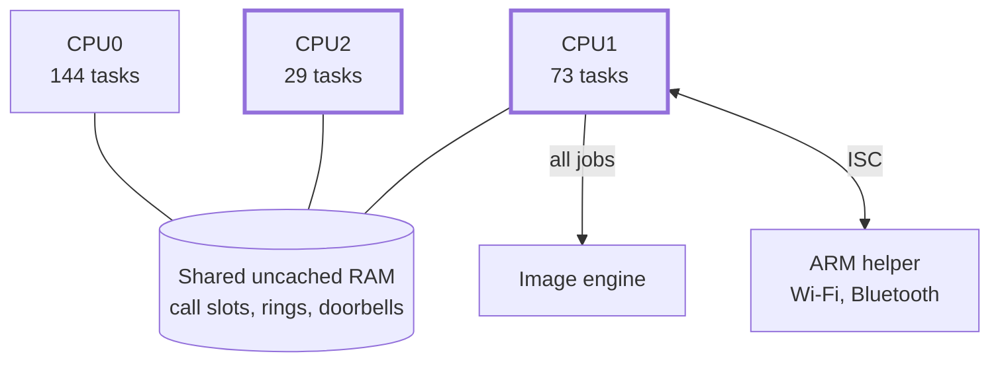
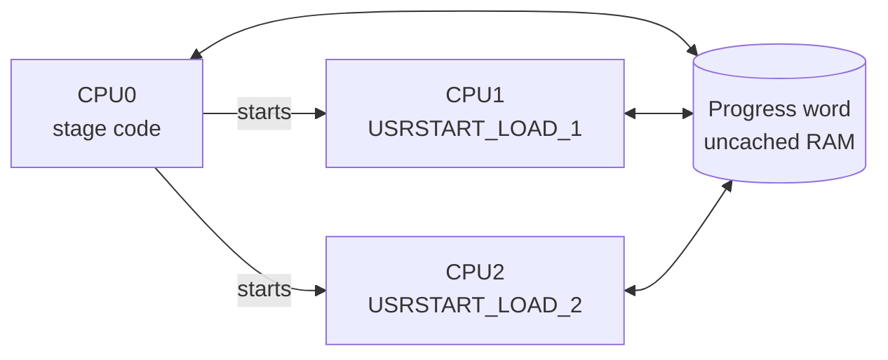

# CPU1 and CPU2: technical notes

<!-- house style -->
> **Technical reading.** The detailed version of [CPU1 and CPU2](cpu1-cpu2.md), for readers who want the internals.

*Last reviewed 2026-11-27.*

This page covers what the second and third MN103 cores of the main chip run, where their tasks and memory are, how they
start and how they talk to CPU0. It was read from E-M5 III 1.7 block0 and compared with the OM-5 II 1.1.[^fw1] Nothing
here was watched on a camera yet.

The mechanisms the cores share, such as lock bits, doorbells, call rings and the Inter System Communication (ISC) mailbox to the ARM, are
explained in [Core communication](../guides/cores.md). The kernel is μITRON.

Addresses are E-M5 III 1.7 block0 addresses (base `0x60021020`) unless a body is named. Function addresses are in the
[address reference](#address-reference).

The small numbers after a fact link to [Sources and dates](#sources-and-dates), which say how the fact is known and when.
On the notes site the number's colour shows the evidence: green = seen on our camera, blue = read in the firmware,
grey = inferred or seen in an emulator.

## Overview



*The three control CPUs and what they share. CPU1 and CPU2, the subject of this page, have bold outlines. The plain lines mean every core uses the shared RAM to call the others.
CPU0 copies the boot code from flash at power-on, and CPU1 and CPU2 then load the program sections. CPU0 reaches the
image engine only through CPU1. The table below says who starts each transfer.*

| from | to | what moves | path | started by | how often |
|---|---|---|---|---|---|
| flash | CPU0 | six copies: the always-ready code, four data blocks (likely the initialised data[^inf1]) and the 6 KB core library | boot stub, see [Boot and sections](../firmware/boot-and-sections.md) | CPU0 | once, at power-on[^fw1] |
| block0 in flash | CPU1 | sections 1 and 7 | section loader, task USRSTART_LOAD_1 | CPU1 | once, at start-up[^fw1] |
| block0 in flash | CPU2 | sections 2 to 6 and 8 to 10 | section loader, task USRSTART_LOAD_2 | CPU2 | once, at start-up[^fw1] |
| calling core | owning core | remote kernel call, one of 8 operations, in a 52-byte slot | incoming kernel-call slots + doorbell bit 0 | the caller's Oly* wrapper, when the object's core bits differ | per call[^fw1] |
| owning core | calling core | result at +8, state 5 | the same slot + doorbell bit 1 | CPUCONN_CPUn | per call[^fw1] |
| calling core | target core | function and argument, run at interrupt level | call ring + doorbell bits 3 to 5 | the caller (79 sites) | per call[^fw1] |
| calling core | target core's CPUCALL task | function and argument, run in task context | 32-slot call table, ring entry, data queue `T_DTQn_0` | the caller (27 sites) | per call[^fw1] |
| sending core | the other two cores | message (content open) | outgoing message slots + doorbell bit 2 | the sender | not traced[^fw1] |
| calling core's kernel | target core | kick, a reschedule request | write 1 to the target's `0x99x00410`, interrupt line 170 | the kernel, after ready-queue updates[^inf3] | per reschedule[^fw1] |
| CPU0 | CPU1 DSP0, DSP1 | image-engine job | call ring (`ipjob_route`) | CPU0, on job submit | per job[^fw1] |
| CPU1 DSP0, DSP1 | image engine | every job, including live view, stills, Live ND and HHHR | see [Image engine](image-engine-technical.md) | DSP0 or DSP1 | per job[^fw1] |
| CPU1 | ARM helper | Wi-Fi, Bluetooth, OI.Share and PTP-IP traffic | ISC | not stated | not stated[^fw1] |

*Transfers between CPU1, CPU2 and their neighbours. The mechanisms are in [How they talk to CPU0](#how-they-talk-to-cpu0).*

## Summary

- CPU1 and CPU2 run **the same block0 program** as CPU0, each under its own μITRON kernel with its own static task
  table. There is no separate firmware image for them. Their task entry points are spread over sections 0 to 9.[^fw1]
- **CPU1** has 73 static tasks.[^fw1] Its roles are the image-engine job workers DSP0 and DSP1, the MN103 half of
  Wi-Fi, Bluetooth LE, PTP-IP and the OI.Share HTTP API, the ARM power manager, the c3d GPU and its EGL layer, the
  movie file writer (AVM) and the C++ AV framework (H.264 encoder area). It also does the second-CPU part of AF image
  processing, face beauty, and the section loading for sections 1 and 7.[^inf2]
- **CPU2** has 29 static tasks.[^fw1] Its roles are the movie recorder pipeline (MVR_*), three still-record helper
  tasks (REC_*_CPU2), motion detection, scene detection, movie white balance, audio level and wake-up, movie-playback
  audio, and the section loading for sections 2 to 6 and 8 to 10.[^inf2] The three helpers do white balance, the
  preview pixel patch and the rec view. The record pipeline itself runs on CPU0.
- Each core has a reset entry in the boot stub, a kernel entry, a kernel config block, a task stack pool, a system
  stack, kernel data, a 6 KB library copied into its local page, and its own doorbell register block.[^fw1]

See also: [Still image back end](../firmware/still-backend-technical.md#tasks-and-cores).

## Task tables

**Record layout.** Each task record is 28 bytes.[^fw1]

```
{u16 id, u16 attr, u32 attr2, u32 exinf, u32 entry, u32 priority, u32 stack bytes, u32 stack address}
```

- The id is `cpu << 12 | index`.
- Bit 15 of the id marks a task with a fixed stack address. These are the debug-output tasks and CPU0's
  `PWR_STANDBY`, whose stack is the local page `0x47000000`.
- attr2 is 2 on the BOOT_CPUn tasks only. Those start when the kernel starts, like μITRON TA_ACT.[^inf1]
- exinf is the start argument. It is the instance number for the shared entries MVR_IMG1/2/POST and the AVMDL
  threads.

With this layout the CPU0 table starts at **`0x60038b5c`**.[^fix1]

**Name tables** use 26-byte records, `{char name[24]; u16 index}`. A record's index is the task index used in the
id.[^fw1]

| core | task table | tasks | name table | first name |
|---|---|---:|---|---|
| CPU0 | `0x60038b5c` | 144 | `0x6143bbf0` | DBG_OUT |
| CPU1 | **`0x6003c460`** | 73 | `0x6143ccee` | DBG_MESSAGE_CPU1 |
| CPU2 | **`0x6003d544`** | 29 | `0x6143d4e6` | BOOT_CPU2 |

*Task and name tables in the E-M5 III 1.7.[^fw1] The OM-5 II 1.1 is in [Other bodies](#other-bodies).*

The tables were cross-checked against om-emu's native CPU1 and CPU2 runs. The ids `0x100f`, `0x1027`, `0x1028` and
`0x2004`, `0x2019`, `0x201a` start the entries om-emu recorded.[^emu1] They were also checked against the ids stage 1
starts, `0x1018` USRSTART_LOAD_1 and `0x2015` USRSTART_LOAD_2.[^fw1]

### Static tasks of CPU1 and CPU2

The section column gives the block0 section that holds the entry. "boot" is the boot stub, and 0 is the always-ready
range. A task can't run before its section is ready.

<details><summary>All 102 static tasks of CPU1 and CPU2 (E-M5 III 1.7)</summary>

| core | id | name | entry | pri | stack | section | role |
|---:|---|---|---|---:|---|---|---|
| 1 | `0x1026` | DBG_MESSAGE_CPU1 | `0x60101b30` | 65 | `0x800` | 1 | debug message output |
| 1 | `0x1001` | BOOT_CPU1 | `0x600274b3` | 1 | `0x800` | boot | core start-up |
| 1 | `0x1002` | C3D_EXE | `0x60c25bde` | 56 | `0x1000` | 6 | c3d GPU command executor |
| 1 | `0x1003` | SCHEAP_DEBUG | `0x601024aa` | 70 | `0x800` | 1 | heap debug |
| 1 | `0x1004` | C3D_UPDATE | `0x60c28732` | 55 | `0x400` | 6 | c3d GPU update |
| 1 | `0x1005` | WIFI_MNGR | `0x6121c0ed` | 47 | `0x600` | 9 | Wi-Fi manager |
| 1 | `0x1006` | WIFI_REMOCON_PROXY | `0x6122aa74` | 48 | `0x200` | 9 | remote-control (OI.Share) proxy |
| 1 | `0x1007` | WIFI_RELEASE_PUSH | `0x61224164` | 47 | `0x400` | 9 | remote shutter release |
| 1 | `0x1008` | IMGPRO_MDL_WORK | `0x6038f12c` | 27 | `0x800` | 2 | image-processing module worker |
| 1 | `0x1009` | AVM_COM | `0x603ef79e` | 26 | `0x800` | 2 | movie file writer (AVM) commands |
| 1 | `0x100a` | AVM_P1_VIDEO | `0x603f4788` | 26 | `0x800` | 2 | AVM stream 1 video |
| 1 | `0x100b` | AVM_P2_VIDEO | `0x603f488d` | 26 | `0x800` | 2 | AVM stream 2 video |
| 1 | `0x100c` | AVM_P1_AUDIO | `0x603f480a` | 26 | `0x800` | 2 | AVM stream 1 audio |
| 1 | `0x100d` | AVM_P2_AUDIO | `0x603f4912` | 26 | `0x800` | 2 | AVM stream 2 audio |
| 1 | `0x100e` | AVM_FILE_MAIN | `0x603f1fa5` | 26 | `0x800` | 2 | AVM file main |
| 1 | `0x100f` | CONTEST_CPU1 | `0x600547ca` | 55 | `0x200` | 0 | core self-test |
| 1 | `0x1010` | FACE_BEAUTY | `0x603dc007` | 55 | `0xb00` | 2 | e-Portrait / face beauty |
| 1 | `0x1011` | FCS_IP_2 | `0x606c9f44` | 25 | `0x2800` | 4 | AF image processing, second CPU |
| 1 | `0x1012` | FCS_IP_2NDCPU_SUBTASK | `0x606c9e1f` | 45 | `0x600` | 4 | AF image processing subtask |
| 1 | `0x1013` | WIFI_REMOCON_CGI | `0x6122557a` | 47 | `0x600` | 9 | remote-control CGI |
| 1 | `0x1014` | WIFI_REMOCON_THROUGH_IS | `0x6122b670` | 66 | `0x400` | 9 | remote live view |
| 1 | `0x1015` | FILEISCAM | `0x60636e6f` | 55 | `0x1000` | 4 | file I/O test |
| 1 | `0x1016` | WIFI_ISC_BSDAPI_RX | `0x61211ef4` | 55 | `0x600` | 9 | socket API over ISC, receive |
| 1 | `0x1017` | WIFI_ISC_BSDAPI_TX | `0x61211e88` | 55 | `0x600` | 9 | socket API over ISC, send |
| 1 | `0x1018` | USRSTART_LOAD_1 | `0x60045513` | 56 | `0x200` | 0 | section loader (sections 1, 7) |
| 1 | `0x1019` | WIFI_STREAM | `0x6122ed2b` | 45 | `0x400` | 9 | Wi-Fi live-view stream |
| 1 | `0x101a` | WIFI_STREAM_SND | `0x612313c4` | 45 | `0x400` | 9 | stream send |
| 1 | `0x101b` | WIFI_STREAM_PIC | `0x61230e9a` | 45 | `0x400` | 9 | stream picture |
| 1 | `0x101c` | SYS_CA9_PWR_MNG | `0x6005978d` | 55 | `0x400` | 0 | ARM power manager (lease) |
| 1 | `0x101d` | BLE_HDLR | `0x612fa350` | 47 | `0x1000` | 9 | Bluetooth LE handler |
| 1 | `0x101e` | WIFI_MNGR_REC | `0x612211f8` | 55 | `0x600` | 9 | Wi-Fi manager, record side |
| 1 | `0x101f` | WIFI_ISC_HTTPD_CGI_TX | `0x6121199d` | 55 | `0x600` | 9 | HTTP CGI over ISC, send |
| 1 | `0x1020` | WIFI_ISC_HTTPD_CGI_RX | `0x61211992` | 55 | `0x600` | 9 | HTTP CGI over ISC, receive |
| 1 | `0x1021` | WIFI_ISC_HTTPD_CGI_MAIN | `0x612119a8` | 55 | `0x600` | 9 | HTTP CGI main |
| 1 | `0x1022` | PTPIP | `0x61214ec6` | 55 | `0x600` | 9 | PTP-IP |
| 1 | `0x1023` | PTPIP_CDC | `0x612159d1` | 55 | `0x600` | 9 | PTP-IP command channel |
| 1 | `0x1024` | PTPIP_EVC | `0x612167ae` | 55 | `0x600` | 9 | PTP-IP event channel |
| 1 | `0x1025` | FCS_IMG_2NDCPU_MAIN | `0x6067e857` | 35 | `0x400` | 4 | AF image work, second CPU |
| 1 | `0x1027` | CPUCONN_CPU1 | `0x6005365e` | 15 | `0x800` | 0 | remote kernel-call server |
| 1 | `0x1028` | CPUCALL_CPU1 | `0x60057917` | 51 | `0x400` | 0 | task-level call service |
| 1 | `0x1029` | S_SHELL_CPU1 | `0x600570bd` | 65 | `0x1000` | 0 | system shell |
| 1 | `0x102a` | ASH_RECEIVE_SHELL | `0x60057065` | 65 | `0x1000` | 0 | shell input |
| 1 | `0x102b` | U_SHELL_CPU1 | `0x6019c924` | 55 | `0x1000` | 1 | user shell |
| 1 | `0x102c`–`0x1040` | AVMDL_THREAD00-20 | `0x6112572f` | 28 | `0x1800` each | 7 | 21 C++ AV-framework (Avfw) threads, one trampoline |
| 1 | `0x1041` | (no name) | `0x61126388` | 28 | `0x1400` | 7 | Avfw / H.264 encoder area |
| 1 | `0x1042` | (no name) | `0x611259cf` | 15 | `0x1400` | 7 | Avfw / H.264 encoder area |
| 1 | `0x1043` | (no name) | `0x6113427b` | 26 | `0x1400` | 7 | Avfw / H.264 encoder area |
| 1 | `0x1044` | (no name) | `0x6119ad99` | 26 | `0x80` | 7 | EGL (c3d GL) area |
| 1 | `0x1045` | (no name) | `0x6119adf9` | 25 | `0x80` | 7 | EGL (c3d GL) area |
| 1 | `0x1046` | (no name) | `0x61195337` | 28 | `0x1000` | 7 | EGL (c3d GL) area |
| 1 | `0x1047` | AVM_DMY_AUDIO | `0x603f0ce6` | 14 | `0x400` | 2 | AVM dummy audio |
| 1 | `0x1048` | DSP0 | `0x603185d1` | 21 | `0x400` | 2 | image-engine job worker 0 |
| 1 | `0x1049` | DSP1 | `0x603185d1` | 21 | `0x400` | 2 | image-engine job worker 1 |
| 2 | `0x2001` | BOOT_CPU2 | `0x600278ae` | 1 | `0x800` | boot | core start-up |
| 2 | `0x2002` | MVR_MAIN | `0x6034804e` | 25 | `0x2000` | 2 | movie recorder main |
| 2 | `0x2003` | MVR_MOVIE | `0x6034fb3a` | 26 | `0x1000` | 2 | movie recorder |
| 2 | `0x2004` | CONTEST_CPU2 | `0x600547d4` | 55 | `0x200` | 0 | core self-test |
| 2 | `0x2005` | MVR_IMG1 | `0x60346021` | 25 | `0x2700` | 2 | movie image path 1 |
| 2 | `0x2006` | MVR_CALC | `0x603441a8` | 46 | `0x800` | 2 | movie calc |
| 2 | `0x2007` | MVR_IMG2 | `0x60346021` | 25 | `0x2700` | 2 | movie image path 2 |
| 2 | `0x2008` | MVR_ENC | `0x60344f67` | 26 | `0x800` | 2 | movie encode control |
| 2 | `0x2009` | EXP_MOVIE2 | `0x6040fdbc` | 35 | `0x800` | 2 | movie exposure |
| 2 | `0x200a` | MVR_IMG_POST | `0x60346021` | 25 | `0x1000` | 2 | movie image post |
| 2 | `0x200b` | MVR_WIFI | `0x6035266e` | 45 | `0x1200` | 2 | movie over Wi-Fi |
| 2 | `0x200c` | MVR_RECVIEW | `0x603520b1` | 27 | `0x1000` | 2 | movie rec view |
| 2 | `0x200d` | AUD_LEVEL_MONITOR | `0x607ba099` | 27 | `0x600` | 5 | audio level meter ([audio](audio-technical.md#tasks)) |
| 2 | `0x200e` | MDET_CALC_MAIN | `0x605e2303` | 28 | `0x800` | 4 | motion detection calc |
| 2 | `0x200f` | MDET_EVENT_SEND_CPU2 | `0x605e25c6` | 28 | `0x400` | 4 | motion detection events |
| 2 | `0x2010` | WB_MOV | `0x60352daf` | 55 | `0x1600` | 2 | movie white balance |
| 2 | `0x2011` | SDET | `0x603d6694` | 55 | `0x400` | 2 | scene detection |
| 2 | `0x2012` | REC_MAIN_CPU2 | `0x603fe951` | 55 | `0x2000` | 2 | still record helper: white balance, work info (main pipeline is CPU0) |
| 2 | `0x2013` | REC_PRE_V1_CPU2 | `0x6040d414` | 26 | `0x2000` | 2 | still record pre-view |
| 2 | `0x2014` | REC_VIEW_CPU2 | `0x6040f5aa` | 25 | `0x2000` | 2 | still rec view |
| 2 | `0x2015` | USRSTART_LOAD_2 | `0x60045599` | 56 | `0x200` | 0 | section loader (2-6, 8-10) |
| 2 | `0x2016` | MOVP_AUDIO_SUB | `0x612ce8fc` | 55 | `0x500` | 9 | movie playback audio |
| 2 | `0x2017` | AUD_WAKEUP | `0x60794510` | 55 | `0x400` | 4 | codec power-on and DSP program upload at start-up, started by CPU0 AUD_MAIN[^fw1] ([audio](audio-technical.md#tasks)) |
| 2 | `0x2018` | MVR_EXEC | `0x603454a6` | 24 | `0x800` | 2 | movie recorder exec |
| 2 | `0x2019` | CPUCONN_CPU2 | `0x6005365e` | 15 | `0x800` | 0 | remote kernel-call server |
| 2 | `0x201a` | CPUCALL_CPU2 | `0x6005799a` | 51 | `0x400` | 0 | task-level call service |
| 2 | `0x201b` | S_SHELL_CPU2 | `0x600570bd` | 65 | `0x1000` | 0 | system shell |
| 2 | `0x201c` | U_SHELL_CPU2 | `0x6019c924` | 55 | `0x1000` | 1 | user shell |
| 2 | `0x201d` | AVM_IF_VIDEO | `0x603f4664` | 26 | `0x400` | 2 | AVM video interface |

*Static tasks of CPU1 and CPU2. Roles are inferred from names and neighbouring code.[^inf2] The rest is read in the firmware.[^fw1]*

</details>

The unnamed CPU1 records `0x1041` to `0x1046` have no entry in the CPU1 name table. Their entries sit in the Avfw and
H.264 encoder area (`0x61126388`, `0x611259cf`, `0x6113427b`) and in the EGL area (`0x6119ad99`, `0x6119adf9`,
`0x61195337`).[^fw1]

### Other object names

After the three task name tables come three more groups of per-core name tables, for CPU0, CPU1 and CPU2 each.[^fw1]
Their object types were pinned from ids used in code.

| object type | name tables (CPU0 / CPU1 / CPU2) | example names | how the type is known |
|---|---|---|---|
| event flags | `0x6143eb2a` / `0x614407c2` / `0x61440c36` | `HTTPD_CPU0_EVENT`, `MOV_ENC_VIDEO_CPU1`, `IMGPRO_MDL_CPU2`, `FCS_IMG_2NDCPU` | the CPUCONN link flags `0x00ea`, `0x101c` and `0x2012` (doorbell bit 0) resolve to `CPUCONN_CPU0/1/2` here[^fw1] |
| data queues | `0x6144108c` / `0x61442df6` / `0x6144324c` | `MOV_COMMAND`, `MVR_POST_ASYNC`, `REC_EXEC_VIEW_CPU2` | the watchdog queue `0x43` resolves to `PER_WDT_EXEC` and the ARM power queue `0x101a` to `CA9_POWER_MNG_REQ`[^fw1] |
| semaphores | `0x6143d86a` / `0x6143e7e2` / `0x6143e9e0` | `BUFF_EXTAREA_CPUn`, `MVR_VIDEOBUFF` | by elimination, the only kernel object kind left among those the Oly* layer names[^inf1] |
| pools and message buffers | fifth group, `0x61440f06` | `DSP_MSG01/11/02/12`, `MPF`, `MPF_CPU0`, `MPF_CPU1` | from the names[^inf1] |

*Name tables of other kernel objects.*

`MOV_ENC_VIDEO_CPU1`, `MOV_ENC_AUDIO_CPU1`, `AUD_BRIDGE_LITE_CPU1` and `IMGPRO_MDL_CPU1/2` are names in these other
tables, not tasks.[^fix2]

## Memory each core uses

Each core has a kernel config block of `0x18c` bytes. Each kernel stores its config address in the shared word
`0x8ff00004` + 4 × core at start-up.[^fw1]

| offset | content |
|---|---|
| +`0x2c` / +`0x30` | task stack pool base and size |
| +`0x68` | initial kernel stack (`0x200` bytes) |
| +`0x70` / +`0x74` | system stack |
| +`0x7c` | task table |
| +`0x13c` | kick routine |
| +`0x140` | a count (`0x40`, `0x40`, `0x10`) |

*Kernel config block fields.[^fw1]*

**Kernel kick.** Each core's kick routine takes a target core and writes 1 to the target's `0x99x00410`. That raises
interrupt line 170 on that core. The kernel reaches the kick routines through a stub that loads the calling core's
config from `0x8ff00004` + 4 × core and jumps through +`0x13c`. The stub has five call sites in kernel routines, each
passing a core number. The line 170 handler only clears the line (`0x99x00414`).[^fw1] So the kick is a reschedule
request. The other core dispatches the newly ready task on interrupt return.[^inf3]

| what | CPU0 | CPU1 | CPU2 |
|---|---|---|---|
| reset entry (boot stub) | `0x60021020` | **`0x6002731c`** | **`0x60027791`** |
| kernel entry | `0x60032696` | `0x600326a3` | `0x600326b1` |
| kernel config | **`0x600413ec`** | **`0x60041578`** | **`0x60041704`** |
| task stack pool | `0x61f27680` +`0xb1000` | **`0x61fd8680`–`0x62048680`** | **`0x62048680`–`0x62078680`** |
| fixed debug-task stacks | `0x62078f40`–`0x62079740` | `0x62079740`–`0x62079f40` | none |
| system (interrupt) stack | `0x62079f40` +`0x2000` | `0x6207bf40` +`0x800` | `0x6207c740` +`0x800` (to `0x6207cf40`) |
| kernel data (init stack first) | `0x6207cf40` to ~`0x62091170` | **`0x6253c580` to ~`0x62549400`** | **`0x62559480` to ~`0x62560500`** |
| uncached kernel words | `0xa26ade80` to `0xa26adf8c` | `0xa26ae2b0` to `0xa26ae3bc` | `0xa26ae4d8` to `0xa26ae524` |
| local page (early stack `0x470007fc`, library at `0x47000800`) | `0x47000000`–`0x47001800` | same address | same address |
| doorbell register block | `0x99200400` | `0x99300400` | `0x99b00400` |
| incoming kernel-call slots (31 × 52 bytes) | `0xa25ea2c8` | `0xa25ea914` | `0xa25eaf60` |
| outgoing message slots (16 × 52 bytes) | `0xa25eb5ac` | `0xa25eb8ec` | `0xa25ebc2c` (to `0xa25ebf6c`) |

*Memory and registers of each core.[^fw1] Inferred: the interrupt use of the system stack, the kernel data ends and one local page per core.[^inf1]*

The kernel data ends are the highest pointer in each config.

- **6 KB core library.** CPU0's boot stub stages `0x1800` bytes from flash `0x41be2000` at
  **`0xa1483000`–`0xa1484800`** (cached `0x61483000`). It copies them to its local page `0x47000800`. **CPU1 and CPU2
  each copy the same `0xa1483000` block again when they come out of reset.** memcpy and other shared helpers live in
  it.[^fw1]
    - So `0xa1483000`–`0xa1484800` is memory the other cores read at start-up, and the margin rule applies to it.
    - The stock section-10 end `0x61478000` leaves `0x61478000`–`0x61483000` (44 KB) free.[^fw1] Of that, a 12 KB
      margin was proven on the camera.[^cam2] See
      [Live ND](../features/live-nd-technical.md).
- **BSS is split across cores.** CPU0 clears `0x61f22900`–`0x61f27670` and `0x62527100`–`0x626b0888` at reset. CPU1
  clears **`0x620a2000`–`0x62527100`** (4.5 MB, marks `bcs`/`bce`) before it starts its kernel. CPU2 clears
  nothing.[^fw1] This is shared global data, not memory private to CPU1.[^inf1]
- **Cross-core areas** are uncached, and all cores write them.[^fw1]
    - Call rings and indexes are at `0xa2623fdc`–`0xa26248f2`.[^fix3]
    - Task-level call slots are at `0xa26248f4`–`0xa2624f00`, six tables of 32 × 8 bytes.
    - The CPUCALL data-queue ids are at `0xa2624af4` (CPU0), `0xa2624cf8` (CPU1) and `0xa2624efc` (CPU2).
- The shared SRAM block `0x8ff00000` holds the start words, the kernel config pointers and the boot magic words. The
  lock bits are at `0x8fe00000`.[^fw1] See [Core communication](../guides/cores.md).

## Start-up

1. **CPU0 releases the other cores.** After `DSS`/`DSE`, CPU0's boot stub writes CPU1's entry `0x6002731c` to
   **`0x98d00140`** and CPU2's `0x60027791` to **`0x98d00144`**. It sets clock and enable bits (`0x98800148 |= 1`,
   `0x9880014c |= 0x400000`, `0x98800154 |= 4`, then `|= 8`) and writes 1 to `0x98800240` and `0x98800244`. That
   releases the two cores. It then clears the start words `0x8ff0004c` and `0x8ff00050`.[^fw1] Which write is the
   reset release is inferred.[^inf1]
2. **Each core's reset code** masks interrupts and sets its vector registers (`0x8000`–`0x801c`) and its early stack
   `0x470007fc`. It prints `1` or `2`, copies the 6 KB library, writes `0x40` to its block +`0x2a8` and enters its
   kernel. CPU1 also clears the BSS piece above (`bcs`/`bce`).[^fw1]
3. **Kernel start** runs BOOT_CPUn at priority 1.[^fw1][^emu2]
    - BOOT_CPU1 waits for `0x8ff00044 = 0x77777777` and sets up a timer. It writes `0x8ff00048 = 0x77777777`, the
      word BOOT_CPU2 waits for. It starts CPUCONN, CPUCALL and CONTEST, waits for CPU0's driver bring-up word
      `0x8ff006fc` and for section 1, then idles in its command loop.
    - BOOT_CPU2 waits for CPU1's word, runs the parameter-bank bootstrap, starts its link tasks and idles.
4. **The section loader runs on CPU1 and CPU2.** Stage 1 on CPU0 starts USRSTART_LOAD_1 (`0x1018`) and USRSTART_LOAD_2
   (`0x2015`). Both drop to priority 56 and call the loader with the section number. They hand off through the
   progress word **`0xa265658c`** (uncached), polling with a 2-tick delay.[^fw1]
    - CPU1 loads section 1 and sets bit 1 (`0x2`). It waits for bit 6 (`0x40`), loads section 7 and sets bit 7
      (`0x80`).
    - CPU2 waits for bit 1, calls a first routine and sets bit 11. It loads section 2 and sets bit 2. It waits for
      bit 14 (CPU0), calls a second routine and sets bits 12 and 13. It loads section 3 (bit 3) and section 4
      (bit 4). It waits for bit 16 (CPU0) and loads section 5 (bit 5) and section 6 (bit 6). It waits for bit 7, loads
      sections 8, 9 and 10 (bits 8, 9 and 10), then calls a final routine.
    - CPU0's stage code sets bits 14, 15 and 16. It reads bit 2, bit 10, and bits 11 to 13 and 15 to 16, the last
      group in section 1.

So sections are **read in number order**, 1 to 10, split over the two cores. CPU0's boot stages gate the order.[^fix4]
The boot-loop lesson that depends on it still holds, because it is about the ready bits at `0xa26565c0`. A waiter sets
those later.[^fw1]



*Section loading on CPU1 and CPU2. Each line is one or two rows of the table below.*

| from | to | what moves | path | started by | how often |
|---|---|---|---|---|---|
| CPU0 stage 1 | USRSTART_LOAD_1, USRSTART_LOAD_2 | task start (ids `0x1018`, `0x2015`). Both drop to priority 56. | kernel task start | CPU0 | once |
| USRSTART_LOAD_1 | progress word | bit 1 = section 1 loaded, bit 7 = section 7 loaded | uncached word | CPU1 writes | once each |
| progress word | USRSTART_LOAD_1 | bit 6 (section 6 loaded), before section 7 | uncached word | CPU1 polls | every 2 ticks |
| USRSTART_LOAD_2 | progress word | bits 2 to 6 and 8 to 10 as each section loads. Bit 11 after the first routine, bits 12 and 13 after the second. | uncached word | CPU2 writes | once each |
| progress word | USRSTART_LOAD_2 | bit 1 before section 2, bit 14 before section 3, bit 16 before section 5, bit 7 before section 8 | uncached word | CPU2 polls | every 2 ticks |
| CPU0 stage code | progress word | bits 14, 15 and 16, as CPU0 reaches later boot stages | uncached word | CPU0 writes | once each |
| progress word | CPU0 stage code | bits 2, 10, 11 to 13 and 15 to 16 | uncached word | CPU0 reads | not stated |

*Every progress-word transfer during section loading.[^fw1] Bit n up to 10 means section n is loaded.*

## How they talk to CPU0

Three services come on top of shared memory, lock bits and direct cross-core kernel calls. Those are described in
[Core communication](../guides/cores.md).[^fw1]

### Doorbell bits

The doorbell is interrupt 169 on every core. Each core has its own handler, and a handler acknowledges a bit by
writing it to +`0x0c`. CPU0 installs all three handlers and enables the interrupt on each core, right after it
releases CPU1 and CPU2.[^fw1]

- **Bit 0** means a remote kernel call is waiting. The handler sets bit 31 of the core's link event flag, which wakes
  CPUCONN.[^fw1]
- **Bit 1** means a reply has arrived. The handler scans the core's own 31 slots for state 5 and sets state 6. It then
  sets the event flag pattern stored in the slot, which wakes the waiting caller.[^fw1]
- **Bit 2** means a message from another core. The handler scans the other two cores' outgoing slot sets (ids 16, 17,
  18 for senders CPU0, 1, 2).[^fw1]
- **Bits 3, 4 and 5** mean the call ring from CPU0, CPU1 or CPU2 has entries. Each core has a drain routine per
  ring.[^fw1]

### Remote kernel calls (CPUCONN)

Eight small wrappers each fill a 52-byte slot.[^fw1]

| slot offset | content |
|---|---|
| +0 | op code |
| +20 on | arguments |
| +40 | object id |
| +44 | the caller's flag |
| +48 | state, 3 when posted |
| +8 | result |

*Kernel-call slot layout.[^fw1]*

The wrapper then calls a post routine. It rings bit 0 on the core that owns the object (id >> 12) and makes the caller
wait. On the owner, CPUCONN_CPUn wakes. It runs at priority 15, and all three cores share its entry. `acrTskCpu`
collects the slots and a dispatcher runs the operation. The result goes to +8, the state becomes 5, and bit 1 is rung
on the caller's core. Operations on another core's object go this way.[^fw1]

Each op code was matched to the Oly* wrapper that calls the same kernel routine.[^fw1]

| op | proxy | kernel routine | call |
|---:|---|---|---|
| 1 | `0x600537ea` | `0x6003712b` | send to data queue (`OlyQeWr`) |
| 2 | `0x60053884` | `0x60036d56` | receive from data queue (`OlyQeRd`) |
| 3 | `0x600538fd` | `0x60035b26` | set event flag (`OlyEvSt`) |
| 4 | none | none | unused |
| 5 | `0x6005396b` | `0x600389c9` | wait event flag (`OlyEvWt`) |
| 6 | `0x600539f7` | `0x60030a47` | clear event flag (`OlyEvCl`) |
| 7 | `0x60053a32` | `0x60035c2a` | signal semaphore (`OlySmSi`) |
| 8 | `0x60053a66` | `0x600372fc` | wait semaphore (`OlySmWt`) |
| 9 | `0x60053aa2` | `0x60030727` | start task (`OlyTaSt`) |

*CPUCONN op codes and the wrappers and kernel routines behind them.*

The Oly* layer picks local or remote with one test. A call is remote when the object's core bits (`id & 0x3000`)
differ from the calling task's. In interrupt context it logs and calls locally.[^fw1]

### Task-level call service (CPUCALL)

The call service takes a target, a function and an argument. It is the task-level sibling of the ring post
`sys_callrequest`. The ring post's name comes from its log strings, and the call service is unnamed.[^fw1]

1. On the same core, it calls the function directly.
2. Otherwise it stores {function, argument} in a free slot of the 32-slot table for this core and the target.
3. It posts a ring entry whose function sends (source << 16 | slot) to the target's data queue `T_DTQn_0`.
4. CPUCALL_CPUn on the target receives it and runs function(argument) **in task context**.

Unlike the ring, these functions may wait. A full table logs an error (code 525).[^fw1]

There are 27 call sites. They cover ARM power and boot, the Wi-Fi manager and HTTP, Bluetooth, the live-view stream
and file numbering (`dcfnum.c`).[^fw1]

### Interrupt-level call ring

The ring post has 79 call sites.[^fw1] They cover these paths.

- The image-engine job path, including `ipjob_route`. A job submitted on CPU0 is handed to CPU1's DSP workers.
- AF image processing (FCS_IP).
- Movie.
- Still record.
- Motion detection.
- Audio, including `post_end`.

Engine and AF work mostly targets CPU1. Movie, record and audio work mostly targets CPU2.[^fw1] Where a site takes the
core from a variable, its target is inferred.[^inf1]

## Dependencies

- **Every image-engine job** runs through CPU1's DSP0 and DSP1 workers. That covers live view, stills, Live ND jobs 11
  and 12, HHHR jobs and, on the OM-5 II, job 13.[^fw1] Live ND's per-frame job counts had to separate CPU1
  jobs.[^cam1] A later probe's job time includes the CPU1 hand-off.[^cam3]
- **Wi-Fi, Bluetooth, OI.Share and PTP-IP.** The MN103 side lives on CPU1 and reaches the ARM over ISC. The ARM power
  lease task `SYS_CA9_PWR_MNG` (`0x101c`) is a CPU1 task.[^fix5]
- **Movies.** The recording pipeline is on CPU2 (MVR_*). The encoder framework and the file writer are on CPU1 (Avfw,
  AVM).[^inf2]
- **AF.** FCS_IP_2 and FCS_IMG_2NDCPU_MAIN on CPU1 do second-CPU AF image work. CPU0 has the first-CPU halves, by the
  object names `FCS_IP_ISP_1STCPU` and `FCS_IMG_1STCPU`.[^fw1] The split is inferred.[^inf2]
- **Graphics.** The c3d GPU executor and EGL are on CPU1, by their names.[^fw1]
- **Boot.** The section loader is described above. A CPU1 stall holds CPU2 and every section after 1.[^fw1][^inf1]

**Patching rules follow from the mechanisms above.**[^inf1]

- Hooks in code that CPU1 or CPU2 run must not touch objects of CPU0's kernel directly, unless the kernel call is
  cross-core safe.
- Our hooks check the core number (`0x8050`) and act only on CPU0.
- Hooks inside DSP0 or DSP1, the movie or the Wi-Fi paths run on CPU1 or CPU2. They must use their core's objects or
  the call services.

## Other bodies

| item | E-M5 III 1.7 | OM-5 II 1.1 |
|---|---|---|
| task tables | `0x60038b5c` / `0x6003c460` / `0x6003d544` (144/73/29) | `0x60038b5c` / `0x6003c9a8` / `0x6003db10` (158/75/32) |
| CPU1 adds | — | WIFI_MNGR_REBOOT, BLE_MAIN_HDLR |
| CPU2 adds | — | OSD_DRAW_CPU2, MDET_DL_SEND_IMAGE_CPU2, MDET_DL_RECEIVE_SUBJECT |
| tasks moved between cores | none | none |
| stack pools | `0x61f27680` / `0x61fd8680` / `0x62048680` (`0xb1000`/`0x70000`/`0x30000`) | `0x61ed2fc0` / `0x61f83fc0` / `0x61ff3fc0` (same sizes) |
| system stacks | `0x62079f40` / `0x6207bf40` / `0x6207c740` | `0x62025880` / `0x62027880` / `0x62028080` |
| kernel data | `0x6207cf40` / `0x6253c580` / `0x62559480` | `0x62028880` / `0x625b4800` / `0x625d3300` |
| 6 KB core library staging | `0xa1483000`–`0xa1484800` | `0xa16a3000`–`0xa16a4800` |
| BSS cleared by CPU1 | `0x620a2000`–`0x62527100` | `0x6205bd80`–`0x6259ed80` |
| BSS cleared by CPU0 | `0x61f22900`–`0x61f27670`, `0x62527100`–`0x626b0888` | `0x61ec9e80`–`0x61ed2fc0`, `0x6259ed80`–`0x627811c8` |
| kick routines | `0x600300a1` / `0x600300c3` / `0x600300e5` | same addresses |

*CPU0, CPU1 and CPU2 layout in the E-M5 III 1.7 and the OM-5 II 1.1. Read in both firmwares.[^fw1]*

## Open questions

- What the CPUn message slots (doorbell bit 2) carry.
- The static object tables behind the name groups, that is where each semaphore and queue is defined. The semaphore
  type of group 2 is by elimination only.
- A live check needs no build. The system shell's `od tsk1`, `od tsk2` and `syscall` print the CPU1 and CPU2 task
  states and call rings. So a Wi-Fi shell session could confirm the tables on the camera.

## Address reference

E-M5 III 1.7 block0 addresses unless a body is named.

| item | address |
|---|---|
| kernel config address store at start-up | `0x600326e3` |
| kick routines CPU0 / CPU1 / CPU2 | `0x600300a1` / `0x600300c3` / `0x600300e5` |
| kick stub (jumps through config +`0x13c`) | `0x600386ef` |
| kick stub call sites | `0x60031ad6`, `0x60036525`, `0x6003652e`, `0x60036545`, `0x60036551` |
| library copy on reset, CPU1 / CPU2 | `0x6002744b` / `0x60027846` |
| memcpy in the 6 KB library | `0x47001024` |
| boot stub core release | `0x6002131a` to `0x60021376` |
| kernel start CPU1 / CPU2 | `0x600335b2` / `0x60033662` |
| BOOT_CPU1 / BOOT_CPU2 | `0x600274b3` / `0x600278ae` |
| USRSTART_LOAD_1 / USRSTART_LOAD_2 entries | `0x60045513` / `0x60045599` |
| section loader (n) | `0x60045e2e` |
| CPU2 loader: first, second and final routine | `0x6005c249`, `0x6005c34d`, `0x603182d2` |
| CPU0 stage code setting bits 14 to 16 | `0x600453f9` to `0x6004546e` |
| CPU0 reads of bit 2, bit 10 | `0x60045356`, `0x60045487` |
| CPU0 reads of bits 11 to 13 and 15 to 16 (section 1) | `0x6019cf05` to `0x6019d515` |
| section ready bits, set by the waiter | `0xa26565c0`, `0x60045eb3` |

*Start-up and kernel functions.*

| item | address |
|---|---|
| doorbell handlers CPU0 / CPU1 / CPU2 | `0x60053f11` / `0x60054012` / `0x60054116` |
| doorbell handler install, enable (in `0x600535f7`) | `0x60069f14`, `0x60069f44` |
| link event flag ids CPU0 / CPU1 / CPU2 (u16) | `0x60040f00` / `0x600411f8` / `0x600412dc` |
| message slot scan (bit 2) | `0x60054218` |
| ring drains on CPU0 (from CPU0, 1, 2) | `0x600573ee`, `0x60057442`, `0x60057496` |
| ring drains on CPU1 | `0x600574ea`, `0x6005753e`, `0x60057592` |
| ring drains on CPU2 | `0x600575e6`… |
| CPUCONN wrappers | `0x600537ea` to `0x60053aa2` |
| CPUCONN post | `0x60053d86` |
| CPUCONN_CPUn task (all cores) | `0x6005365e` |
| `acrTskCpu`, op dispatcher | `0x60053afb`, `0x60053c1c` |
| local or remote test | `0x6005370e` |
| CPUCALL call service | `0x600576e2` |
| `sys_callrequest` (ring post) | `0x6005730b` |
| ring functions to `T_DTQn_0` for CPU0 / CPU1 / CPU2 | `0x6005780a` / `0x60057838` / `0x60057866` |
| CPUCALL_CPU1 / CPUCALL_CPU2 | `0x60057917` / `0x6005799a` |
| CPUCALL sites: ARM power and boot | `0x60058e21`, `0x60058f93` |
| CPUCALL sites: Wi-Fi manager and HTTP | `0x6120f44e`, `0x6121dd3b`, `0x6121f132`… |
| CPUCALL sites: Bluetooth, live-view stream, file numbering (`dcfnum.c`) | `0x612f98ea`…, `0x6122e818`, `0x6061592e` |
| ring sites: image-engine job path, `ipjob_route` | `0x603185eb`, `0x60318688`, `0x60318884` |
| ring sites: AF (FCS_IP), movie, still record | `0x606a5836`…, `0x6068d29b`…, `0x6033c87d`…, `0x6042b0a1`… |
| ring sites: motion detection, audio, `post_end` | `0x605e2b19`…, `0x607b9533`, `0x607be9ae` |
| DSP0 / DSP1 entry | `0x603185d1` |
| `SYS_CA9_PWR_MNG` loop | `0x6005978d` |
| core number register | `0x8050` |

*Call services and their users.*

## Sources and dates

The small numbers in the text point here. Each note says how a fact is known and when.

[^fw1]: Read in the firmware, 2026-11-25. E-M5 III 1.7 block0, checked against the OM-5 II 1.1.
[^inf1]: Inferred, 2026-11-25.
[^inf2]: Inferred from task names and neighbouring code, 2026-11-25.
[^inf3]: Inferred, 2026-11-25. The handler does nothing else, and the call sites follow ready-queue updates.
[^emu1]: Seen in om-emu's native CPU1 and CPU2 runs.
[^emu2]: Seen in om-emu running the E-M5 III 1.7 program, 2026-11-22.
[^cam1]: Seen on our E-M5 III in the Live ND work, 2026-11-12.
[^cam2]: Seen on our E-M5 III in the Live ND work, after a test build reset at power-on.
[^cam3]: Seen on our E-M5 III using test firmware.
[^fix1]: Correction, 2026-11-25. The CPU0 task table starts 12 bytes before the `0x60038b68` given earlier.
[^fix2]: Correction, 2026-11-25. These names were listed earlier as task names.
[^fix3]: Correction, 2026-11-25. The call-ring area was given earlier as ending at `0xa26249f4`.
[^fix4]: Correction, 2026-11-25. The read order was given earlier as 1, 7, 2, 3 and so on.
[^fix5]: Correction, 2026-11-25. The ARM power lease task was described earlier as a CPU0 task (`TSK_CA9PWR_MNGR`).

## History

- 2026-11-25: the CPU0 task table was found to start at `0x60038b5c`, 12 bytes before `0x60038b68`. The "+16 field,
  mostly N+1" seen before is the next record's id.
- 2026-11-25: `MOV_ENC_VIDEO_CPU1`, `MOV_ENC_AUDIO_CPU1`, `AUD_BRIDGE_LITE_CPU1` and `IMGPRO_MDL_CPU1/2` moved from
  task names to other object names.
- 2026-11-25: the call-ring area end was corrected from `0xa26249f4` to `0xa26248f2`.
- 2026-11-25: the section read order "1, 7, 2, 3, ..." was corrected to number order, 1 to 10.
- 2026-11-25: the ARM power lease task moved from CPU0 (`TSK_CA9PWR_MNGR`) to CPU1 (`SYS_CA9_PWR_MNG`).

