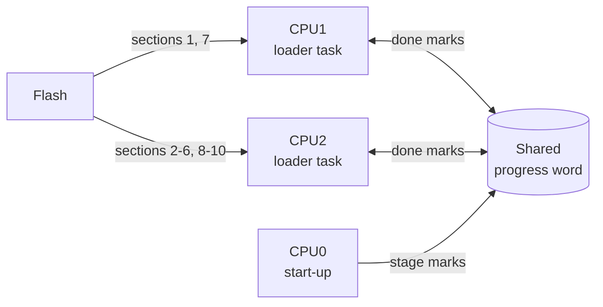

# CPU1 and CPU2

<!-- human page -->
<!-- house style -->

## Key points

- CPU1 and CPU2 run the same main program as CPU0, each with its own copy of the operating system.
- CPU1 does image-engine jobs, the camera's half of Wi-Fi and Bluetooth, graphics, the movie file writer and part of
  autofocus.
- CPU2 does the movie recorder, helpers for the still-picture record pipeline, motion and scene detection, and movie
  audio.
- CPU1 and CPU2 load the main program's ten sections from flash during start-up, while CPU0 carries on booting.

The E-M5 III's main chip has three control cores of the same kind, called CPU0, CPU1 and CPU2. CPU0 runs the menus,
the shooting sequence and most of what we patch. This page explains what the other two do, where their memory is, how
they start and how they hand work to each other. Everything here was read from firmware 1.7. None of it has been
watched on a running camera yet.

There is no separate firmware for CPU1 and CPU2. Each core runs its own copy of the operating system with its own
fixed list of tasks. CPU1 has 73 tasks and CPU2 has 29.

How the cores share memory and signal each other in general is on [Core communication](../guides/cores.md).

## CPU1 tasks

- **Image-engine jobs.** Two worker tasks, DSP0 and DSP1, start every job on the image engine. Live view, stills and
  every engine job we have added go through them. A job asked for on CPU0 is handed over to CPU1.
- **Wi-Fi and Bluetooth.** The Wi-Fi manager, the smartphone app's web interface, picture transfer over the network
  (PTP-IP) and the Bluetooth handler are CPU1 tasks. They talk to the ARM processor, which runs the radios.
- **Powering the ARM.** The task that switches the ARM processor on and off runs on CPU1. Earlier notes put it on CPU0.
- **Graphics.** The 3D graphics unit's command task and its drawing library run here.
- **Movies.** The task group that writes movie files, and a framework of 21 worker threads around the H.264 encoder,
  run here.
- **Autofocus helpers.** Two tasks do the second half of the autofocus image work.
- **Other.** Face beauty processing, a debug message task, two shells and the core's link tasks.

## CPU2 tasks

- **The movie recorder.** Eleven tasks run the movie recording path.
- **Helpers for still photos.** Three tasks help the photo recording. They work out white balance, patch the preview
  and make the review image. The recording itself runs on CPU0 ([still image back end](../firmware/still-backend.md)).
- **Detection.** Motion detection, scene detection and movie white balance run here.
- **Audio.** The audio level meter, audio wake-up and movie playback audio.
- **Other.** Two shells and the core's link tasks.

## Start-up

CPU0 starts first. Early in its start-up it writes a start address for each of the other two cores into a hardware
register and switches them on. Each core then sets up its own small stack, copies a 6 KB library of shared helpers into
its own local memory, and starts its operating system.

The three cores then pass "ready" words to each other in a shared memory block. CPU1 waits for CPU0, and CPU2 waits
for CPU1. So a stall on CPU1 holds up CPU2 as well.

## Loading the program sections

The main program arrives in ten sections that load in the background. The loading is done by one task on CPU1 and one
on CPU2, not by CPU0.

1. CPU1 loads section 1, then waits.
2. CPU2 loads sections 2 to 6, pausing twice for CPU0 to reach a later boot stage.
3. CPU1 loads section 7 once section 6 is in.
4. CPU2 loads sections 8, 9 and 10 once section 7 is in.

*Who loads which sections, and the shared word they use to wait for each other. Arrows show data flow.*

They signal each other through one shared progress word. So sections are read in number order. Earlier notes gave a
different order. The rule that a hook must wait for a section's "ready" bit is unchanged, because CPU0 sets the ready
bits later, after each section is set up.

## Work between cores

There are three ways one core gets another to do something.

1. **A direct operating-system call.** A task can set a signal that belongs to another core's task. If the call has to
   wait, the request goes to a server task on the owning core, and the caller waits for the reply. The server
   handles eight calls. They send to and receive from queues, set, clear and wait for signals, take and give
   semaphores, and start tasks.
2. **A quick call.** One core can ask another to run a small function straight away, inside an interrupt. The image
   engine path uses this to pass jobs to CPU1. Movie and audio code uses it to reach CPU2.
3. **A task-level call.** For longer work, the function goes into a queue on the other core and a task there runs it.
   Wi-Fi, Bluetooth and the ARM power code use this one.

## Memory of the other cores

Each core keeps its own stacks and system data in fixed places in memory. A patch must not grow into them. Each core
has these areas.

- A pool of task stacks. The three pools sit back to back.
- A system stack for interrupts.
- Its own operating-system data.
- A small local memory page at the same address on every core.

One more area matters for patches. CPU0 places the 6 KB helper library in main memory just after the end of the
program. CPU1 and CPU2 copy it from there when they start.

> [!WARNING]
> A test build once grew the program's last section right up to that library, and the camera reset once at every
> power-on. Our rule since then is to leave at least a cache line, and better 4 KB, between our code and any memory
> another core uses.

## Other cameras

The OM-5 Mark II has the same split. Its CPU1 adds two Wi-Fi and Bluetooth tasks. Its CPU2 adds an on-screen drawing
task and the two tasks of the subject-detection link. No task moved from one core to another. The memory areas are the
same size but sit at different addresses.

## Open questions

- What the message slots between cores carry.
- A check on a camera would need no new build. The debug shell can print the task lists of CPU1 and CPU2.

## Further reading

- [CPU1 and CPU2: technical notes](cpu1-cpu2-technical.md) has the task tables, every memory address and the
  start-up and call details.
- [Core communication](../guides/cores.md) explains the lock bits, doorbells and call rings the cores share.
- [Still image back end](../firmware/still-backend.md) covers the record pipeline on CPU0.
- [Caches and the access monitor](caches.md) gives the likely reason for the power-on reset.
