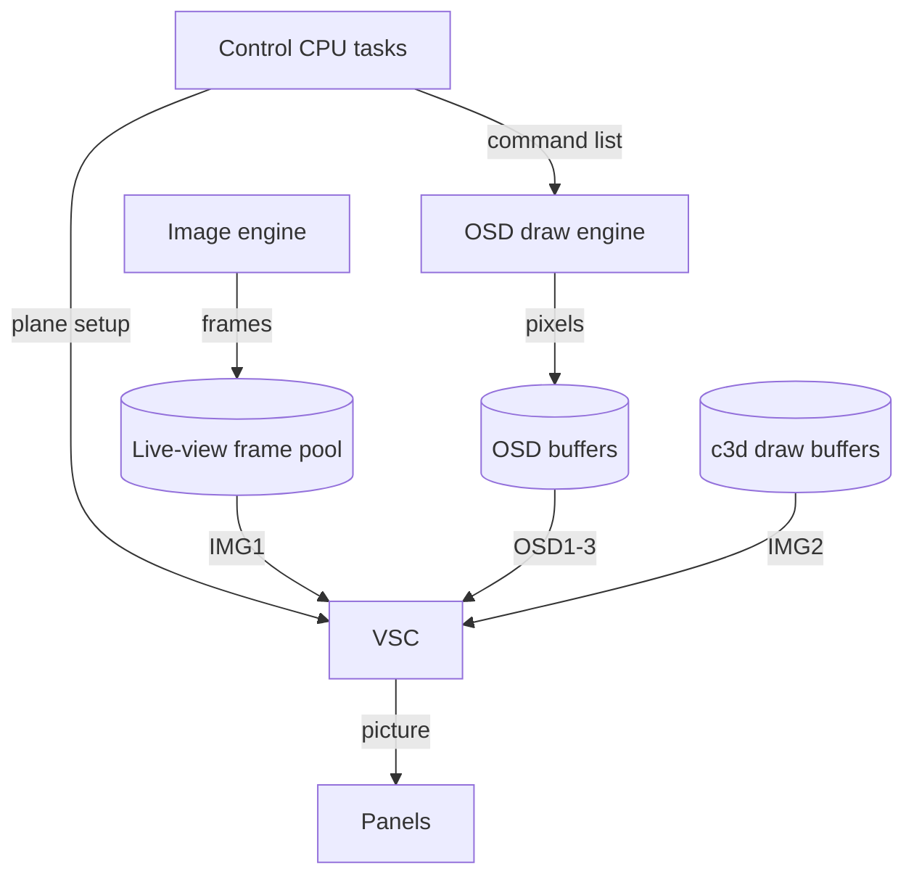
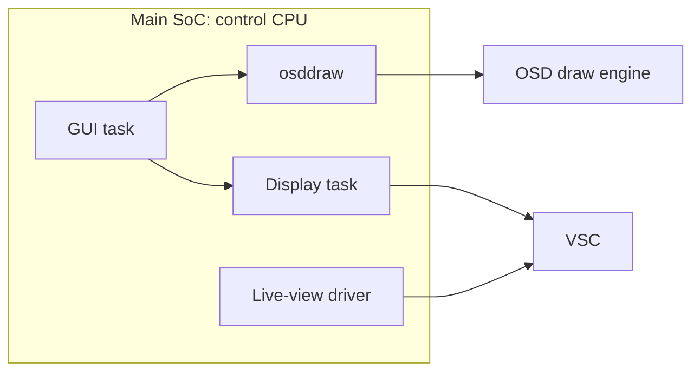

# Graphics pipeline: technical notes

<!-- house style -->
> **Technical reading.** The detailed version of [Drawing to the screen](../guides/drawing-to-the-screen.md), for readers who want the internals.

*Last reviewed 2026-11-27.*

This page follows a pixel from the camera's software to the rear screen or the electronic viewfinder (EVF). The
graphical user interface (GUI), meaning the menus, icons and shooting info, is drawn into on-screen display (OSD)
buffers by a small hardware 2D engine. The display controller (VSC) lays those buffers over the live-view picture and
sends the result to the panel. This page is the overview. Register-level detail, the display's built-in features
(histogram, highlight warning, peaking) and the live-view frame pointer are on [Display and OSD](display.md).

Terms used here:

- **GUI**: the part of the main program that draws menus and the shooting screen.
- **OSD**: the layers the GUI draws into, shown on top of the picture.
- **VSC**: the display controller that mixes layers and drives the rear screen (TFT), the EVF and HDMI.
- **Live view**: the moving picture from the sensor before a shot.
- **om-emu**: a third-party emulator that runs the E-M5 III GUI. We use facts from it only, never its code. "E144"
  marks OM-5 facts that om-emu applies to the E-M5 III through its port. "E137" is the E-M5 III.

The small numbers after a fact link to [Sources and dates](#sources-and-dates), which say how the fact is known and when.
On the notes site the number's colour shows the evidence: green = seen on our camera, blue = read in the firmware,
grey = inferred or seen in an emulator.

## Overview

Two flows meet in the display controller (VSC). The live picture comes from the sensor through the image engine. The
GUI comes from the control CPU through the OSD drawing engine. The c3d layer joins them as a third source.

*The graphics pipeline and its sources. Arrows show data flow. The table under [Control CPU tasks](#control-cpu-tasks)
says who starts each transfer.*

### Control CPU tasks

The control CPU side opens into four tasks or modules. They feed the OSD draw engine and program the VSC.

*Inside the control CPU side. Each line is a row of the table below, which also covers the overview's arrows.*

| from | to | what moves | path | started by | how often |
|---|---|---|---|---|---|
| image engine | live-view frame pool | YC 4:2:x frame (demosaic, picture mode, gamma, resize done)[^inf1] | pool `0x0a00`, `0x0e00` or `0x0f00`, 1920 × 1080 slots | image engine[^inf1] | not stated |
| live-view driver | VSC | frame address for plane IMG1 | `set_through_addr` | live-view driver | every frame[^fw1] |
| GUI task | osddraw | `gpiDraw*` calls, queued as 108-byte requests | function calls | GUI task | per draw[^fw1] |
| osddraw | OSD draw engine | command list | list base register, start register = 1 | osddraw | per batch[^fw1] |
| OSD draw engine | OSD buffers | 8-bit palette pixels (index 127 = transparent) | GUI layers 0, 1, 2 = pools `0x0c00`, `0x0d00`, `0x0b00`, 4 × 896 × 600 each | engine, running the list | per list, interrupt when done[^emu1] |
| GUI task | display task | `gpiUpdateDisplay` | call to the display task | GUI task | per update[^emu3] |
| display task | VSC | commit: plane addresses, palette bank | latched registers | display task | held until the next live-view sync[^emu3] |
| display task | VSC | DISP_SET_LAYER_CUSTOM, sets IMG2 (the c3d layer) | display task command | c3d | per layer set-up[^fw3] |
| live-view frame pool | VSC | YC picture | plane IMG1 | VSC | not stated |
| OSD buffers | VSC | palette indices through 128-entry palettes | planes OSD1-3 | VSC | not stated[^emu1] |
| c3d draw buffers | VSC | 256 × 256, 4 B per pixel, byte 0 alpha | plane IMG2, format 3, per-pixel alpha | VSC | not stated[^cam1][^emu4] |
| VSC | panels | mixed picture | channel 0: TFT 720 × 480 (OSD 1:1) or EVF 1024 × 768 (from 640 × 480). Channel 1: HDMI | VSC panel timing | not stated[^fw1][^emu2] |

*Every transfer in the graphics pipeline. The image engine stage is inferred.[^fw1]*

The steps in order:

1. The image engine writes a YC 4:2:x frame into one of the display-size pools `0x0a00`, `0x0e00` or `0x0f00`, which
   have 1920 × 1080 slots.[^inf1]
2. The live-view driver points VSC plane IMG1 at that frame each frame. It keeps a copy of the frame's Y address in
   RAM, the "current live-view frame" pointer.[^fw1]
3. The GUI's widgets and `gpiDraw*` calls become requests. The `osddraw` module turns them into a command list and
   runs the OSD drawing engine, which writes 8-bit palette pixels.[^fw1]
4. The pixels land in the OSD buffers, pools `0x0b00`, `0x0c00` and `0x0d00`, with four 896 × 600 buffers each.[^fw1]
5. `gpiUpdateDisplay` asks the display task to commit them.[^emu3]
6. VSC channel 0 drives the rear screen or the EVF, and channel 1 drives HDMI. Each channel takes IMG1 (live view),
   IMG2, IMG3 and OSD1 to OSD3 with their palettes. It scales them (RSZ), mixes them over the background BG1, applies
   the histogram, highlight and shadow, and peaking blocks, and sends the result through the panel timing.[^fw1]

The OSD planes sit on top of the image planes. The original diagram notes put OSD1 at the bottom and OSD3 at the
top.[^fw1] The addresses of each step are in the [address reference](#address-reference).

## OSD drawing engine

The GUI never sets pixels one by one. It builds a list of drawing commands and hands it to a 2D engine.

`osddraw` builds command lists and kicks a 2D draw engine. The engine has registers for the command-list base, a status
word cleared by writing 1, a start register (1 = run the list), a sync trigger mask and an enable bit. The kick code
makes 39 register stores.[^fw1] In an emulator run on the E-M5 III the command list sat in uncached RAM.[^emu1] The
offsets and addresses are in the [address reference](#address-reference).

The engine's commands, from om-emu's reading of the OM-5 family:[^emu1]

| opcode | command |
|---|---|
| `0x10` | FILL |
| `0x20` | COPY |
| `0x30` | BITMAP (packed glyphs and icons, optional colour table, scaling) |
| `0x40`, `0x41` | LUT (colour table) |
| `0x60` | BITMAP2 |
| `0xff` | END |

*OSD engine commands. The engine works on 8-bit pixels, has a FIFO mode and raises an interrupt when done.*

- There is no line opcode. So `osddraw_exec_line` draws lines as 1-pixel FILLs or runs, and diagonal lines are likely
  costly.[^inf1]
- `osddraw_exec_line` queues a 108-byte request with a stride of 896.[^fw1] The primitives dot, line, rect, bitmap,
  font and copy, and the `OSDControl::*` and `gpiDrawOsd*` wrappers, are listed on [Display and OSD](display.md).

An om-emu run on the E-M5 III shows the engine at work.[^emu2]

- The engine executed about 2,600 commands from start-up to the menu, with zero errors.
- A menu page redraw is about 125 BITMAP (glyphs and icons), about 13 COPY (buffer sync) and 1 FILL.
- The INFO histogram is a 266 × 50 box. It is drawn as 266 × 1 and 1 × 50 FILLs, plus one FILL 3 or 4 pixels wide
  per bin (128 columns). So lines really are thin FILLs.
- Every command used stride 896.

## OSD buffers and palettes

The engine draws into three layers of 8-bit pixels. Each pixel is a colour number looked up in a palette. One number
means "transparent", so the live picture shows through.

- The three GUI layers are pools `0x0b00`, `0x0c00` and `0x0d00`, with four `0x83400`-byte buffers each. `0x83400` is
  896 × 600 bytes at 8 bits per pixel.[^fw1] om-emu reads the same layout for E137. It reads a GUI screen of
  800 × 1200 that spans two buffers, with front and back pairs synced by COPY.[^emu1]
- Pixels are 7-bit palette indices. **Index 127 is transparent**, so live view shows through.[^emu1]
- Each OSD plane has a 128-entry palette in VSC space. It is double-buffered, and the bank flips at commit.[^emu1]
- Palette entries are `alpha(0..31) << 24 | Cr << 16 | Cb << 8 | Y`. They are converted from the GUI's RGB by
  BT.601.[^emu1]
- Stacking: the VSC register OSD1 holds 3 on the E-M5 III family. So GUI layer 0 is the bottom plane and layer 2 the
  top.[^emu1]
- EVF: the GUI draws a 640 × 480 canvas, and the VSC scales it to the 1024 × 768 panel area (RSZ18/24/30 = `0x11`,
  step `0x9fc`).[^emu3]

The register dump below was taken at the shooting screen in om-emu on the E-M5 III.[^emu2]

| register | TFT | EVF | meaning |
|---|---|---|---|
| AREA22/23/24 (`+0xf8`/`+0xfc`/`+0x100`) | `0x1e02d0` / `0x80008` / `0x1e0` | `0x300400` / `0x260026` / `0x300` | video area: TFT 720 × 480 at (30, 8). EVF 1024 × 768 at (48, 38) |
| DMA12/13/14 (`+0x44`/`+0x48`/`+0x4c`) | `0xafef9800` / `0xafcec800` / `0xafadf800` | same | OSD1/2/3 buffer = pools `0x0b00`/`0x0c00`/`0x0d00`. Flips by `0x106800` (two records) to `0xafdf3000`/`0xafbe6000`/`0xaf9d9000` |
| DMA18/19/20 (`+0x5c` to `+0x64`) | `0xe` | `0xe` | OSD stride 14 × 64 = 896 B |
| DMA7 (`+0x30`) | `0x7` | `0x7` | only OSD1-3 enabled (no live view in the emulator) |
| RSZ18/24/30 | 0 (1:1) | `0x11`, step `0x9fc` | OSD scaling: none on the TFT, 640 to 1024 on the EVF |
| OSD7-9 (`+0x2e0` up) | `0x100` (100%) | `0xcc` (80%) | OSD plane level |
| SYNC2 / SYNC8 | `0x1ef` (495 lines) | SYNC8 `0x339` (825 lines) | vertical totals |
| OSD1 / OSD4 / BG1 | 3 / `0x111111` / `0x80800b` | same | stacking / mix / black background |
| `0xa2653720` (RAM) | 1 | 2 | active display mask: bit 0 TFT, bit 1 EVF |

*VSC registers at the shooting screen, from an om-emu run on the E-M5 III.*

So on the TFT the OSD is shown 1:1. The GUI's 896-wide buffer is cropped to a 720 × 480 window.[^emu2]

## Display controller (VSC)

- **Channel 0 serves the TFT and the EVF**, one at a time. Channel 1 serves HDMI. A selector maps device mask bits 0
  and 1 to channel 0 and bits `0xff000004` to channel 1.[^fw1]
- There are six planes per channel. IMG1 to IMG3 are YC images, and IMG1 is live view. OSD1 to OSD3 are the GUI
  layers. Their enable bits are in DMA7.[^fw1][^emu1]
- Registers have latched copies at `+0x400` (`*_VL`) that take effect at the frame boundary. INTST1 bit 0 is the frame
  interrupt.[^fw1][^emu1]
- The histogram (HIST1-3), highlight and shadow (HILIGHT1-4), peaking (PEAK1-14), colour matrix (COLMAT), gamma (GAM),
  colour gains (ROT) and resize (RSZ) are VSC blocks. So they act on the displayed YC image, not on raw.[^fw1] ROT is
  the saturation for the display colour mode, not a rotation.[^fix1]
- The background BG1 is `0x80800b`, black in YCbCr.[^emu1]
- The plane level OSD7-9 is 2 × floor(p × 128 / 100) for a level of p percent.[^emu1]

See also: [VSC register map](vsc-display-controller-technical.md), with writers and fields.[^fw4]

## When the screen updates

- `gpiUpdateDisplay` asks the display task to commit the dirty OSD buffers, meaning new plane addresses and the
  palette bank.[^emu3]
- The E-M5 III GUI turns display sync on at start (`guiUtility::setDispSync`). So OSD commits are held until the next
  image (live-view) sync for that device.[^emu3]
- So overlays drawn by us appear with the next live-view frame, and a GUI redraw can overwrite them. Draw after the
  GUI's update, from task context.[^inf1]

## Live-view frames

The live-view picture is never copied by the CPU. The image engine writes a YC frame, and the driver points VSC IMG1 at
it each frame. The CPU-readable pointer is a RAM word per channel, with the C plane's address in the next
word.[^fw1] The frame's geometry and stride are still to be measured (see [Open questions](#open-questions)).

## The c3d vector engine

Besides the 2D OSD engine, the camera has a vector-graphics GPU. The `c3d` task uses it for the colour wheels: Color
Creator, and the Color and Mono Profile editors we added. How the GUI starts it and how its layer reaches the screen is
on [profile editor](../features/pen-f-profiles-technical.md#on-camera-editor).

- Block0 carries an **OpenVG 1.x** library with **EGL**, from Digital Media Professionals (DMP). It has 95 `vg*`
  names (vgCreatePath, vgDrawPath, vgCreateImage, vgCreatePaint, vgClear and others) and EGL calls (eglCreateContext,
  eglCreateWindowSurface and others).[^fw2]
- It has DMP extensions too: `vgCreateImageDataDMP`, `vgCreatePathDataDMP`, `VG_DMP_multi_draw_image`,
  `VG_DMP_image_native_format` and `EGL_DMP_commandbuffer_attributes`. There are no shader or OpenGL ES drawing
  names.[^fw2]
- So c3d draws with OpenVG paths, paints and images into an EGL surface, the 256 × 256 RGBA draw buffers. The renderers
  we ported call this library.[^fw2][^inf2]

See also: [c3d GPU](c3d-gpu.md), with the registers, command lists, the c3d tasks' commands, the 147-entry entry-point
table and the display path. The layer is VSC **IMG2**, set by DISP_SET_LAYER_CUSTOM.[^fw3]

| body | `osddraw`, `c3d` and EGL names | OpenVG names |
|---|---|---:|
| E-M5 III | yes | 95 |
| OM-1 | yes | 95 |
| OM-5, E-M1 III, OM-5 II | yes | 94 |
| PEN-F | yes | 8 |

*Graphics library names by body. String scan of each body's block0.[^fw2]*

The PEN-F has an older library, which still has `vgCreateImageDataDMP`. Names missing on the OM-5, E-M1 III and OM-5 II
(`COLOR_CREATER`, `gpiUpdateDisplay`) may sit in their compressed parts.[^fw2]

## om-emu and the display

- om-emu models VSC kind 2 (registers, latches, OSD planes, palettes, scaling and stacking) and the OSD engine.[^emu1]
- It runs the GUI, `osddraw` and the display task natively. Its output is the composed frame, which our `emurun.mjs`
  saves.[^emu1]
- Stock om-emu does **not** model the IMG planes on the E-M5 III, so live view is skipped. It doesn't model the
  histogram, highlight and shadow, or peaking. Live view is only driven on the OM-1.[^emu1]
- Our om-emu patch draws the 32-bit IMG planes, which is the c3d layer. Live view (format 0) is still not
  drawn.[^emu4]
- Use: an `osddraw` overlay (frame lines, markers) can be smoke-tested in om-emu before a camera run. Anything that
  reads live-view pixels cannot.[^inf1]

### Showing the c3d layer in om-emu

The om-emu facts here come from its version `ccfe2e0` for the E-M5 III.[^emu5]

**Why stock om-emu shows nothing from c3d.** There are three separate reasons.[^emu5][^emu6]

1. The E-M5 III's VSC compositor (`emu/src/dev/vsccompose2.mjs`, kinds 2 and 3) skips every enabled IMG plane as "not
   modelled". Only the OSD planes are drawn.
2. The DMP OpenVG library and the c3d task never run there. om-emu has no model of the GPU. Its OM-3 notes
   (`docs/hle-gaps.md` 4.12) say the same for that body: the stack is dormant and the wheel plane stays empty.
3. The GUI's background drawer is an om-emu stand-in. The GUI busy word is only cleared by the c3d engine's answer, so
   editor screens stall after the first key.

**What the layer is on the E-M5 III.** It is two flipping 256 × 256 draw buffers with 4 bytes per pixel. Byte 0 is
alpha, and bytes 1-3 are colour, decoded as BGR. It is shown at (432, 112) on the rear screen.[^cam1] It is VSC plane
**IMG2**, with c3d layer format 4.[^fw3] See also: [c3d GPU, layer](c3d-gpu.md#layer-on-the-screen).

The VSC sees it as IMGPLANE2 = `0x301100`. That is **format 3** (bits 20-23), per-pixel alpha (bit 12) and level
`0x100`.[^emu4] On the OM-3 the same kind of wheel uses IMG2 in format 3 (`R8G8B8a8`, per-pixel alpha).[^emu1][^inf2]

**The plan, in three steps, smallest first.**[^inf2]

1. *Compose IMG planes* (about 1 day). Add the 32-bit per-pixel-alpha format, and the YC format for a still picture
   underneath, to the kind-2 compositor. Any buffer we fill ourselves then shows in om-emu. So this step alone lets the
   2D UI work test full-colour, anti-aliased, transparent drawing done by the CPU, with no GPU involved. This step is
   done.[^emu4]
2. *Stand in for OpenVG at the API* (about 2-4 days, after the c3d entry points and handle layouts are mapped). Hook
   the `vg*` and `egl*` calls c3d actually uses: clear, paths with fill and stroke, paints, image draws with a
   transform, and the surface swap. Rasterise them in JavaScript into the draw buffer, and send c3d's completion so the
   GUI busy word clears. This shows our wheels and any OpenVG drawing we add, close to but not pixel-exact with the
   camera. This step is done too (see below).
3. *Model the GPU itself* (open-ended). That means the registers and command buffers of the DMP core. It is only worth
   it if step 2 is not faithful enough, and is not recommended now.

So "basic" (steps 1-2) was estimated at about 3-5 working days, gated by the c3d entry-point mapping. A faithful match
(step 3) has no estimate. om-emu is MIT-licensed, so these can be our own patch set on top of it.[^inf2]

**IMG plane registers.** The VSC writes when stock Color Creator opens in om-emu give the kind-2 IMG plane
registers. Plane p is 0 for IMG1 up to 2 for IMG3.[^emu4][^cam1]

| register | for plane p | IMG2 value |
|---|---|---|
| address | DMA9 + 4p | `+0x3c` = `0xa4423ec0`, c3d draw buffer A |
| stride, in 64-byte units | DMA15 + 4p | `0x10` = 1024 B |
| area, in the OSD areas' three-word form | AREA1 + 12p | `0x1ce0100` / `0x780078` / `0x100` = 256 × 256 at (432, 112) in the 720 × 480 window |
| control | IMGPLANE1 + 4p | `0x301100` |
| enable | DMA7 bit 5 - p | `0x7` to `0x17` |

*IMG plane registers as written when Color Creator opens in om-emu.*

- Also written then: DMA2 `+0x1c` `0x10` to 0, and DMA22 `+0x6c` `0x17` to `0x10`. Their meaning is open.[^emu4]
- Pixels are straight (not premultiplied) alpha. 5,788 pixels of the camera's dump have a colour byte above
  alpha.[^cam1]
- So DMA10 (`+0x3c`) is IMG2's address. This questions the older reading of DMA9 as IMG1's Y and DMA10 as its C
  ([Display and OSD](display.md)). IMG1's YC may use one address, since om-emu's format 0 is interleaved. This is
  open.[^inf2]

**Drawing tests.** With our patch, om-emu draws format-3 IMG planes at 1:1. The camera's own profile-editor buffer
dump, poked into buffer A, shows the wheel in the camera's place under the stock labels.[^emu4]

- om-emu redraws only when the GUI does, so poke before a key press.
- Open Color Creator (SCP > Picture Mode, INFO) and write any 256 × 256 picture to draw buffer A (`img2poke.py`).

**OSD over IMG2, and the order codes.** With the c3d layer showing and three overlapping gpi boxes on GUI layers 0, 1
and 2, all OSD layers draw over IMG2 under every OSD1 order code.[^emu4]

| order code | stacking, top to bottom |
|---:|---|
| 0 | L1 > L0 > L2 |
| 1 | L0 > L1 > L2 |
| 2 | L1 > L2 > L0 |
| 3 (stock) | L2 > L1 > L0 |
| 4 | L0 > L2 > L1 |
| 5 | L2 > L0 > L1 |

*GUI layer stacking per OSD1 order code, from om-emu's own order table and plane order.*

These come from om-emu's own `ORDER_CODES` table and plane order, which are inferred there. So only code 3 and "OSD
over the c3d layer" are camera-backed.[^emu4]

**Stock c3d running in om-emu.** Opening Color Creator draws the stock wheel through our JavaScript OpenVG stand-in,
and each key redraws it. Each of these was found on the way.[^emu4]

- **Dormant tasks.** `c3d_main` (task 67) and task 70 are dormant in om-emu. Start them with `act_tsk`, take queue 158
  out of S-MODACK and pass the GUI's synchronous sends to it to the native kernel.
- **CPU-1 tasks.** `c3d_exe` (queue `0x100f`) and `c3d_sub` (queue `0x1002`) are CPU-1 tasks, so posts to them ring
  the CPU-1 doorbell. Run each post on CPU 0 as one pass of the task loop (`lab.task_message`). `c3d_exe`'s init runs
  once. Skip the DMP driver task it creates (priority 55).
- **Frame done.** `c3d_main` answers the GUI's command 46 late. It saves the request and replies on command 48.
  `c3d_sub` posts command 48 when it gets command 3 (the GPU's frame-done) while `c3d_exe`'s draw flag is set. Without
  a GPU, post command 3 to `c3d_sub` after each draw that swapped.
- **Sprite sheets** come from the resource reader (category `0x8006`). om-emu runs no resource loader on E137, so serve
  them from block2.
- **GPU registers.** Treat the DMP GPU registers as plain stub memory. The DMP memory manager is given two pools
  (`0xa46ce6c0` + `0x80000`, `0xa474e6c0` + `0x680000`), and allocations come from the second.
- **Not modelled:** gradient paints, dashes, blend modes other than source-over, and masks.
- There is no stock-versus-camera pixel comparison yet. The camera dump we have is from the ported editor, not stock
  Color Creator.

Before the stand-in existed, om-emu reached the c3d bridge but nothing after it, because its module-ack stand-in
(S-MODACK, `emu/src/lab/camapp.mjs`, queue C3D) answers the C3D queue. That is why the stand-in also has to start and
feed the c3d tasks.[^emu4] The first test for it was the traced CC2, MC and SC renderer draw streams, which stop at the
final c3d submit.[^emu4]

Other om-emu limits met while building the profile editors are on
UI drawing lessons, with the tools that worked. They include 4-bit
pictures without a colour table (fixed by our patch 0004, see [OSD drawing, pictures](osd-drawing.md#pictures)), the
histogram drawn as a stand-in block, and the editor closing after about 6 s without keys.[^emu4][^emu7]

**More screens and a stand-in live view.**[^emu4]

- The ART carousel matches the camera's artwork, checked by eye. Part Color (SCP, ART14) draws.
- Patch 0003 adds `OM_BACKDROP` (`session.mjs`) and `BACKDROP` (`c3drun.mjs`). These draw a 720 × 480 RGB picture
  under every plane, so OSD and IMG2 transparency show. The picture comes from `c3d/backdrop.py`: a generated
  lake-at-dusk landscape by default, a hard-edged test scene with `--test`, or a photo.
- `mode:N` turns the mode dial (2 ART, 3 SCN). SCN screens get START and END but no UPDATE. Why is open.

**Screens made before patch 0004 lack some pictures.**[^emu7] Stock om-emu refuses every run-length picture sent
without a colour table. It reports this only on stderr (`osd-engine ERROR BMP_LUT`), so the screen looks complete.

- A re-run with 0004 shows what the older screens lacked. ART select lost 7 pictures (the translucent title bar under
  the art name), SCN 2 (title bar) and Color Creator 1. The shooting screen lost its exposure-value box, and the AF
  target screen its whole grid and the boxes under its icons.
- The shooting screen alone had none missing.
- `c3drun.mjs` now prints `ENGINE_ERRORS {name: count}` at the end. Any count means the picture is incomplete.

**Upstream.**[^emu8] om-emu's `main` was still `ccfe2e0`, the base our three patches are made against, and they apply
to it cleanly in order. Nothing upstream overlaps them.

- No recent commit touches IMG planes on kind 2, a live-view picture, c3d or OpenVG, object loading or a VSC write
  log. Its last commits are menu, TAKE-fill and setting-name work. Its `lv` token switches the display, not a picture.
- Its six open pull requests touch none of the patched files (`vsc.mjs`, `vsccompose2.mjs`, `lab/display.mjs`,
  `host/session.mjs`). One, docs only, names the OM-3 colour wheel as C3D's user feature, already in its
  `docs/hle-gaps.md` 4.12.
- Risk: upstream commits several times a day and edits `host/session.mjs` often. Re-check before moving the base.

See also: [Drawing on the GUI layers](osd-drawing.md), for calls, arguments, palettes, layer order, animation and
other bodies.[^emu4]

## Open questions

- The engine register map beyond `+0x04` to `+0x50` on the E-M5 III, and how `osddraw` turns a diagonal line into
  commands.
- Which pool holds the live-view through-image in each mode, and its stride and format. The live-view probe answers
  this.
- The IMG-plane (live view) registers stay unknown until the live-view probe runs, since om-emu has no live view on
  the E-M5 III.
- Whether IMG1's YC uses one address or a Y and a C address.
- Why SCN screens get no UPDATE in om-emu.

## Address reference

E-M5 III 1.7 block0 addresses unless a body is named.

| item | address |
|---|---|
| OSD draw engine registers | `0x9c100000` |
| status (write 1 to clear), enable | `+0x04`, `+0x08` |
| command-list base, start (1 = run list) | `+0x18`, `+0x24` |
| FIFO mode, sync trigger mask | `+0x28`, `+0x30` |
| command list in the E137 emulator run | `0xaf8c2840` |
| VSC registers, per channel | `0x9c000000` + ch × `0x4000` |
| VSC latched copies (`*_VL`) | register + `0x400` |
| VSC OSD palettes | `+0x800` + `0x800` × plane |
| VSC OSD1 (stacking) | `+0x1a4` |
| VSC DMA7 (plane enable) | `+0x30` |
| VSC DMA9, DMA10 | `+0x38`, `+0x3c`. Read earlier as IMG1 Y and C. DMA10 is IMG2's address in om-emu |
| DMP GPU registers | `0x9c200000` |

*Registers.*

| item | address |
|---|---|
| `osddraw` module | `0x60c1xxxx` |
| OSD engine kick | `0x60c1dc85` to `0x60c1dcfd` |
| engine register stores (39) | `0x60c1daed` to `0x60c1e6da` |
| `osddraw_exec_line`, its stride store | `0x60c1f13e`, `0x60c1f1e0` |
| `gpiUpdateDisplay` | `0x60c9588b` |
| `display_update_through_image` | `0x601907cb` |
| `set_through_addr` (points IMG1 at the frame) | `0x60194e50` |
| VSC channel selector | `0x6004404f` |
| current live-view frame pointer (Y address, C in the next word) | `0xa26538c4` + ch × `0xe28` |
| active display mask | `0xa2653720` |
| GUI busy word | `0x61600ba0` |
| c3d draw buffer A | `0xa4423ec0` |

*Functions and variables.*

| item | address |
|---|---|
| c3d bridge | `0x602fccc9` |
| `c3d_exe_bridge_disp_init` | `0x60c255c3` |
| EGL set-up | `0x60c26187` |
| swap (submit) | `0x60c2639f` |
| eglSwapBuffers | `0x6119e454` |
| vgDrawPath (direct-call entry) | `0x611bc4f8` |
| `c3d_exe` reply | `0x60c25f91` |
| `c3d_main` entry (task 67) | `0x60c279d5` |
| task 70 entry | `0x60c26090` |
| `c3d_exe` entry, init | `0x60c25bde`, `0x60c25b35` |
| `c3d_sub` entry | `0x60c28732` |
| DMP driver task entry | `0x611c6090` |
| saved GUI request | `0x621db678` and up |
| `c3d_exe` draw flag | `0x6253c479` |
| resource reader | `0x60167060` |
| DMP memory manager, allocator | `0x611bea11`, `0x611beb7b` |

*c3d addresses used by the om-emu stand-in. None of the bridge-onward ones were reached before the stand-in.*

## Sources and dates

The small numbers in the text point here. Each note says how a fact is known and when.

[^fw1]: Read in the firmware, 2026-11-05.
[^fw2]: Read in the firmware, 2026-11-20, by a string scan of each body's block0.
[^fw3]: Read in the firmware, 2026-11-21.
[^fw4]: Read in the firmware, 2026-11-22.
[^emu1]: om-emu's reading of the firmware, for the OM-5 family unless E137 is named, facts only, 2026-11-05.
[^emu2]: Seen in an om-emu run on the E-M5 III image, 2026-11-06.
[^emu3]: om-emu's reading for the E-M5 III, 2026-11-05.
[^emu4]: Seen in om-emu with our patches, 2026-11-21.
[^emu5]: Read in om-emu at `ccfe2e0` (2026-11-19), 2026-11-21.
[^emu6]: Seen in om-emu while building the profile editors, 2026-11-19.
[^emu7]: Seen in om-emu, 2026-11-22.
[^emu8]: Checked 2026-11-21 against om-emu `main` at `ccfe2e0` (2026-11-19). The commit window searched starts 2026-11-14. The docs-only pull request is from 2026-11-02.
[^cam1]: Seen on our E-M5 III, 2026-11-19, in a dump of the profile editor's draw buffer.
[^inf1]: Inferred, 2026-11-05.
[^inf2]: Inferred, 2026-11-21.
[^fix1]: Corrected 2026-11-22. See [History](#history).

## History

- 2026-11-05: the GUI was first thought to rasterise in software. It builds command lists for a hardware 2D engine.
- 2026-11-05: we first read one VSC channel each for TFT, EVF and HDMI. Channel 0 serves both TFT and EVF.
- 2026-11-06: answered the TFT panel area and OSD scaling on the rear screen (720 × 480, no scaling), from an om-emu
  register dump.
- 2026-11-21: which VSC plane and format register carry the c3d layer was open. It is IMG2, VSC format 3.
- 2026-11-21: the om-emu stand-in was first blocked at the c3d bridge, with VGImage untraced. The revised estimate for
  step 2 was then about a week. Both were resolved the same day.
- 2026-11-22: the VSC block ROT was read as rotation. It is colour gains, the saturation for the display colour mode.

