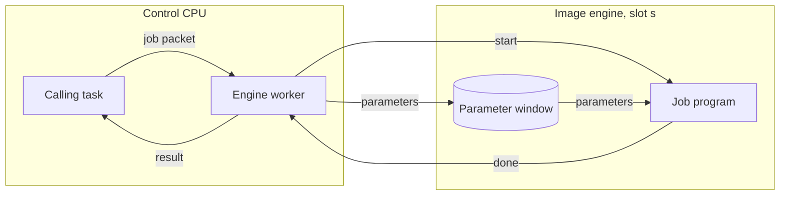

# Image engine: technical notes

<!-- house style -->
> **Technical reading.** The detailed version of [Image engine](image-engine.md), for readers who want the internals.

*Last reviewed 2026-11-27.*

The system-on-chip (SoC) has an image engine beside the control CPUs. It is hardware built for heavy pixel work, such as developing raw
frames, resizing and merging. It doesn't run the main program. The control CPU loads a small program for it, called a
job, fills in a parameter record and submits it. We call the engine "the DSP" and its programs "jobs". The programs
are wide microcode words.

This page covers where the job programs are stored, which jobs each camera has, the E-M5 III's own jobs 0 to 10, what
our camera tests showed about job 11, and how to submit a job without hanging the camera. Two of our feature ports
depend on jobs. Live ND's frame merge is job 11, and Handheld High Res (HHHR) uses jobs 14 to 17.

The instruction set is now largely decoded. That decode is the work of atx, on the E-M10 II, in the fenykl project
(https://github.com/atx/fenykl, branch `feat-dsp`, and the write-up https://m.atx.name/dsp.html). The E-M10 II uses the
same instruction format as the E-M5 III. Read the model there. This page keeps our own findings. Where an earlier
reading of our own turned out wrong under that model, the page gives the corrected reading, and the
[History](#history) section lists what changed.

The small numbers after a fact link to [Sources and dates](#sources-and-dates), which say how the fact is known and when.
On the notes site the number's colour shows the evidence: green = seen on our camera, blue = read in the firmware,
grey = inferred.

## Where the programs live

In flash, the job programs sit in block 2 of the firmware file, in resource `0x8007`. We call it "bank 6". It has one
entry per job, indexed by job number.[^fw1]

- After the E-M5 III's own programs, bank 6 has room. Our Live ND staging used the first part of it, and 868 KB of
  zeros after that are free for HHHR jobs. The [address reference](#address-reference) lists the ranges.[^fw1]

At run time the programs are copied into RAM.

- Native programs occupy one RAM range, from job 0 to the end of job 10. The 296 KB after it has no code references.[^fw1]
- Jobs from another body (the "donor") can't use their own load addresses. OM-5 job 14's load address overlaps E-M5
  job 9. Load them elsewhere.[^fw1]
- The program loader takes a destination, a flash address, a size and the constant 258.[^cam1]
- Jobs don't need their native address. Job 11 ran from spare RAM after section 4 and from a descriptor pool slot.[^cam1]

> [!WARNING]
> The loader's destination must be in the uncached view of RAM (`0xa0000000` to `0xbfffffff`). Any other destination
> resets the camera.

See also: [Frame pools and memory](../guides/frame-pools-and-memory.md).

## Jobs by camera

| job | E-M5 III | E-M1 III 1.6 | OM-5 1.2 | OM-5 II | use |
|---|---|---|---|---|---|
| 0-10 | yes | same | same | same | the camera's own jobs, see the next section |
| 11 | empty (`0x600` placeholder) | `0x4400` | same | same | **Live ND photo merge** (average of N raw frames) |
| 12 | empty | `0xb600` | same | same | **Live ND live-view accumulator** (start, add, roll) |
| 13 | empty | empty | empty | empty | placeholder everywhere |
| 14 | empty | `0x48000` | `0x41800` | `0x42a00` (changed) | HHHR compose into 4 planes |
| 15 | empty | `0xe000` | `0xd600` | `0x9000` (changed) | HHHR hole fill |
| 16 | empty | `0x29c00` | same | same | HHHR RGB |
| 17 | empty | `0x7200` | `0x7600` | same | HHHR resize |
| 18 | absent | `0x4400` | same | same | unknown (OM-5 setter `0x603292c0`) |

*Job programs by body, with the program size in bytes. Read in each body's firmware file.*

### Older and newer bodies

- **PEN-F 3.1 and E-M5 II 4.1** (TruePic VII) use the same program format, in block 2 bank 5. Their empty
  `0x600` stub and their memcpy job (their job 16, our job 8) are byte-identical to the E-M5 III's. Their other programs
  are their own. The E-M5 II has jobs 7-13 and 15-17, the PEN-F has jobs 7, 13, 15, 16 and 17, and those five are
  identical between the two. Both reference the job-program register `0x9d200010`. So this is an older engine
  generation with the same program format. Whether a TruePic VIII or IX job (OM-5 job 11) runs on it is untested.[^fw2]
- **E-M5 II jobs 8 to 12** match no program in any other body (best similarity 0.05). Its job 11 is about
  36% like the TruePic IX job 6. Over all 112 fields of our field map, these jobs use no lane or field value that the
  E-M5 III, E-M1 III, OM-5, OM-5 II and PEN-F programs don't already use. The one exception is a control-op variant
  (bits 313-319 = `0x0f`, 30 words, job 9 only). So they add no new operations. They are only more examples of the known
  vocabulary.[^fw6]
- **PEN-F** job 16 is byte-identical to our job 8 (hardware memcpy). Its job 7 is 88% the same as job 2 (Live
  Composite). Only words 1411-1589 differ. Its jobs 13, 15 and 17 match nothing in the newer bodies. So the PEN-F (2016)
  to the OM-5 II (2023) share one microcode generation.[^fw3]
- **E-M5 (Mark I) 2.3** has no programs of this format in any block and no `0x9d200010` reference.[^fw3] See
  [older bodies](../bodies/comparison-technical.md#older-bodies-e-m5-ii-and-e-m5-mark-i).
- **OM-1 and OM-1 II** have a new engine. **None** of their job programs match any of the above (compared by sha256 per
  entry), so OM-1 jobs can't be used.[^fw3]

See also: [Body comparison: technical notes](../bodies/comparison-technical.md).

## The E-M5 III's own jobs 0 to 10

### How the firmware runs them

- A wrapper function per job reloads the job's program if bit `1<<job` of the reload mask is set (jobs 2-7 and 9).
  It then calls the submit function with (job, 0, record, flags), which copies 17 record words. Records start with {callback,
  context, ...}.[^fw4]
- A table of setter functions writes each job's parameters. The setters for jobs 3-6 and 9 choose a
  window slot from record byte `+0x3f`. The window is `0x9d000000 + (slot << 24)`, so **`0x9e000000` is slot 1 of the same
  engine**. Job 0 always uses it.[^fw4]
- Jobs 2, 3, 5, 7, 9 and 10 read default values from the end of their own program. Job 14 does the same.

### What each job does

| job | RAM program | size | purpose |
|---|---|---|---|
| 0 | `0xa411f540` | `0x51400` | AF image processing (FCS_IP cluster, caller `0x606aff4c`)[^inf3] |
| 1 | after job 0 | `0x5b200` | unknown (no setter, frame + rectangle, callers `0x602aaa89`, `0x6056281e`) |
| 2 | `0xa41cc140` | `0x19000` | full-sensor raw combine of 2-3 frames, used by **Live Composite** (`0x602a7745` → `0x602bf7b4` → `0x603720a9`).[^inf3] One 0/1 option (record word 10). Natively only 0 runs. The blend mode is inside the microcode. 0 is likely lighten.[^inf3] 1 is unknown, and proving it needs a camera run.[^fw4] |
| 3 | `0xa41e5540` | `0x14400` | focus-stack merge step (6 buffers)[^inf3] |
| 4 | `0xa41f9d40` | `0x11400` | **motion-compensated warp**. It aligns a 4736 × 3616 YC frame into 4480 × 3360 planar, using a 22 × 16 motion-vector field (buffer `0x36016` from `MDET_CALC_FLAME_VECTOR` `0x605de1f5`, caller `0x60381776`).[^fw4] Part of a native multi-frame align-and-merge pipeline (shot kind 19, maybe in-camera HDR).[^inf3] |
| 5 | `0xa420b540` | `0xb600` | resize to full and half size[^inf3] |
| 6 | `0xa4217540` | `0x4800` | focus-stack merge step (3 buffers)[^inf3] |
| 7 | `0xa421c540` | `0xe800` | focus-stack merge step (3 buffers, also the final pass)[^inf3] |
| 8 | `0xa422b540` | `0x1600` | **hardware memcpy** (`CAvpiPcomMemToMemHwcpy`, `0x603f43b8`). 128 KB chunks, waits on flag `0x60041200`. Window `0x00` source, `0x04` destination, `0x08` length[^fw4] |
| 9 | `0xa422d140` | `0x38000` | raw development in 8 strips (14-bit OB/WB clip)[^inf3] |
| 10 | `0xa4265540` | `0x11c00` | fixed-coefficient filter or resampler, **not a gain map**. Record: input `0x10`, output `0x14`, mode class `0x18` (from caller record +40). The setter `0x60319cfd` copies static tables from `0x604e22dc`.. by mode: 3-tap weights summing to 1024 (614/205/205, 410/614/...), a monotonic index ramp (0,1,3,4,6,8,...), and 102 phase weights in steps of 71 = 853/12. It has no per-pixel or per-row gain input, so it can't give a smooth GND. Still task `0x6056175a`, caller `0x60561eb2`[^fw4][^inf3] |

*Jobs 0 to 10 on the E-M5 III. RAM program is the load address. Size is in bytes.*

### The focus-stack pipeline

Jobs 3 to 7 together are the **in-camera focus-stack merge**. That is shot kind 19, which takes 3-15
frames plus a reference. The motion detector (MDET) estimates motion vectors, first coarse and then fine. Job 4 warps
each frame. Jobs 5, 3, 6 and 7 then run in that order.[^inf2]

In the same kind table, 11 is HDR1/HDR2 and 14 is Hand-held Starlight. Both also use `MDET_CALC_FLAME_VECTOR`, but they
merge through the IPCR command path.[^fw4]

### Reuse

- Job 8 gives fast frame copies.
- Job 2 gives lighten-style raw stacking. Its mode is not yet proven.
- Job 4 with the motion vectors gives native frame alignment. That is the missing piece for handheld multi-frame noise
  reduction or handheld Live ND.
- No native average, minimum or subtract job was found, so Live ND still needs the OM-5's job 11.[^inf3]

## Program format

We first worked out the format by comparing the job programs of the E-M5 III, OM-5 1.2, OM-5 II 1.1,
E-M1 III 1.6 and PEN-F 3.1 byte for byte. Readings that atx's decoded model corrected carry a note.

### Lines and words

- **A program is an array of 64-byte lines.** In a code line only the first 40 bytes are used. They hold one
  **320-bit** instruction word, little-endian. The last 24 bytes are zero.[^fw5]
- Lines whose last 24 bytes aren't zero are data. They hold the defaults that jobs 1, 2, 3, 5, 7, 9 and 14 read from the
  end of their own program, 2 to 22 lines.[^fw5]
- Identical instructions encode identically at every position, because the placeholder program repeats lines. So the
  words aren't scrambled or encrypted.[^fw5]
- The words are dense. The OM-5's 19 programs hold 31,148 code words, and 27,993 of them are different. Every bit
  position varies except bits 133-140 and 233-239, which are always 1. So this is horizontal (VLIW-style) microcode
  with many fields per word, not a compact opcode stream.[^fw5]

### The common frame

- Every program starts with the same 10-11 words. The `0x600` "empty" program (E-M5 jobs 11-17, and job 13 everywhere)
  is that start sequence plus an end. It is a stub that does nothing.[^fw5]
- **Every E-M5 III and OM-5 program has the same frame**[^fix1]. Word 0 calls the job routine at word
  10. The routine's last real word is a return. The halt is word 5, where the call returns. Our own lister checked this
  on all 19 OM-5 programs and on E-M5 III jobs 0-10, which have one halt each, at word 5.[^fw5]

### Control ops[^fix1]

The op field is bits 313-319 (7 bits).[^fw5]

| op | meaning |
|---|---|
| 0 | `loop`, a counted loop end. It branches back while ra > 0 and writes ra - 1 back |
| 1 | `brf`, branch if ra == 0 |
| 2 | `br`, branch if ra != 0 |
| 3 | jump. It is a call when its delay slots store the return word |
| 4 | return, a jump to the word a G register holds |
| 7 | halt |
| 8-73 | data ops |
| 127 | idle |

*Control ops in the op field.*

- Every control op has four delay slots.[^fw5]
- The branch condition is the register named by ra (bits 123-127).[^fw5]
- Bits 224-228 name the G register that a write port (enable bits 272-273) writes.[^fw5]

### Branch targets

- **Branch targets are absolute word indexes**, 13 bits. The low 8 bits are in bits 15-22 and the high 5 bits in bits
  128-132. Every changed branch fits this reading.[^inf4]
- The evidence is version diffs. Where one version of a program inserts or removes words, exactly this field moves by
  the size of the change, in every word that points past it. Examples are OM-5 vs OM-5 II job 14 (+35, +37 and +68 in
  about 75 words), OM-5 vs E-M1 III job 17 (-19), OM-5 vs OM-5 II job 15 (-117) and PEN-F job 7 vs job 2 (-2 and +4).
  Word 2845 of OM-5 job 14 targets 2844, a loop.
- In OM-5's programs, 1,013 words have bits 315-319 = 0 and bit 229 = 0, and 1,012 of them have a target inside their
  own program. 159 of the 231 branches confirmed by diffs have this form. Most of the rest have bits 315-319 = 2.[^inf4]
### Immediates

- Apart from branch targets, the commonest change between versions of the same job is in bits 0-14 alone. Examples are
  3584 → 4096 and 3072 → 3584 (OM-5 vs OM-5 II job 14, words 1792-1793), and 8 → 16 (job 15, with bits 105-108 going
  from 1 to 2 in the same words). Bits 0-14 are the X0 and X1 immediates. In some formats they hold flag bits instead
  (128 is common).[^fw5][^fix1]
- **Parameter offsets appear as immediates.** They are op-slot immediates of local-memory loads, counted in words
  (96, 99, 100 and 102 × 4 = 384, 396, 400 and 408). In OM-5 job 11, the 11-bit field from bit 109 holds the job's window
  byte offsets far more often than in any other job. It holds 396 (pitch) 30 times, 400 (Hw) 28, 384 (output) 18, and
  398, 392 and 390. It also holds 12, the stride of the input table, 27 times.[^fw5][^fix1]

### Job 11 and job 8 skeletons

- **Job 11** (OM-5, 272 words).[^fix1] Word 0 calls word 10. The routine runs from word 10 to its return
  at 264. Setup is words 10-69, and word 65 is a `brf` that skips to the return when there is nothing to do. The
  per-line loop is words 70-259 (`br` 259 → 70). The per-input accumulation loop is words 97-140 (`br` 140 → 97). The
  output stage is words 145-251. The short back-jumps (127 → 126, 169 → 168, 221 and 224 → 223) are counted `loop`
  ops.[^fw5]
- **Job 8** (memcpy, 88 words). The routine runs from word 10 to its return at 79.[^fw5]

## Job 11 on the camera

We ran OM-5 job 11 on the E-M5 III in five rounds of tests, at 80 × 64 pixels. The test inputs were
gradients and constants, such as A = 256 + 32x and B = 1280. Each round changed the program or the record, ran the
job and compared the output. Over 1,700 passes ran.[^cam2]

### Robustness

- **No change stalled or crashed the engine.** All 382 passes of round 1 (one lane of one main-loop word made idle),
  all 474 of round 2 (single flipped bits), all 746 of round 3 (every value of 84 fields) and all 73 of round 4
  (record only, black level 0-512 per input, clip 1000-4095) ended cleanly.[^cam2]
- A run at this size takes 10-11 ms whatever the change, so the time is fixed overhead.[^cam2]

### The merge rule

- With two inputs the output is exactly (A + B) / 2, black level included.[^cam2]
- The full rule fits every printed value: out = OB + round_half_even(Σ(in − OB) × ceil(2^19/N) / 2^19).[^cam3]
- Job 11 merges **up to 32 inputs** unchanged, in about 10 ms whatever N, the rows or the width. 3 and 15 inputs only
  fit rounding to nearest.[^cam2]
- Input order does not matter. Black inputs darken the result by exactly k/N.[^cam2]
- A record can cover a band of rows, at 1-row granularity. Width is written in 10-pixel groups (Hw 45 writes 50).[^cam2]
- So ND32 is a frame-count and memory question, not a microcode one. A stepped Live GND can be built from job 11 runs
  on row bands with black inputs.[^cam2]

See also: [Live ND: technical notes](../features/live-nd-technical.md).

### Black level and clip

- Each input's own black level is subtracted, and input 0's black level is added back to the output.[^cam2]
- Values below the black level go negative and still average correctly.[^cam2]
- WBClip clips **each input before the merge**, at black level + clip.[^cam2]
- The record sets black levels and clips but not brightness. Live ND does not need a gain, because the merge is an
  average. So ND32 needs more inputs.[^inf5]
- The record has room for 32 inputs (32 × 12 bytes before the output address at +384). Our guard and the native callers
  stopped at 16.[^cam4]

### What single words do

Rounds 1 to 3 changed single words of the main loop and recorded the effect. The words "destination", "source" and
"gain" in our first notes were guesses. Under the decoded model each is a write-port register number or an operand
of a vector unit. The camera results below stand.[^cam3]

- 95 of the 382 lane changes altered the output (49 in lane A, 46 in lane B). 285 did nothing visible. Most effects hit
  only the start or only the end of a line. The start and end words repeat at a fixed offset (116-122 ↔ 129-135,
  155-161 ↔ 172-178), so the main loop holds one copy of a block per line segment.
- Word groups:
    - input B fetch or add (w151, w155, w130, w172, w173, w213, w228). Changing them gives (A + 256) / 2.
    - black-level add-back (w194). Changing it removes 256.
    - weights (w129 gives A + B − 640, w171 gives A at full weight, w198 gives slope 20 instead of 16)
    - clip (w211 → 4095)
    - constants (w128 → 640, w199 → 256)
- Round 2 found 40 bits that change the output: w155 bits 45-52, w198 bits 77 and 79 (weight), w211 bits 41-44 and 79
  (79 saturates to 4095), w151 and w194 bits 147-150, w129 and w171 bits 155-158, w171 bits 179-181, and w199 bits
  163-164 and 167-170 (output becomes 256).
- Round 3 found 10 fields that matter.
    - w199 bits 167-170 (stock 1). Any other value leaves the output at the black level (256).
    - w151 and w194 bits 147-150 (stock 0). Any other value reads an empty register, so input B or the black-level
      add-back is lost.
    - Read through w211 bits 41-44 at the line start, the registers hold r0 = 256 (black level), r1 = the result,
      r2 = 4095 (clip level), r5 = a value that changes along the line, r14 = 3515 and r15 = 181. The rest hold 0.
    - w198 bits 76-79 scale around the black level, as (x - OB) * g + OB. Stock g is 1.0. Other values pick 1.25, about
      1.177 or about 1.013. These constants are not in job 11's data lines, and they do not follow the black level.
    - w211 bit 79 (values 8-15) forces 4095. w171 bits 179-181 (stock 1) set the middle segment to the black level for
      values 2-7.
    - In the middle bits of w151, bits 106-109 replace or break input A, bits 110-116 act like a read offset (middle and
      end segments), and bits 123-127 drop input B in the middle and end segments. Bits 88-105 and 117-122 have no
      effect.
- Words 230-251 changed nothing in rounds 1 and 2 at two inputs. They likely serve more inputs or a line segment the
  tests did not sample.[^cam3]
- Round 4 showed that r2 stays 4095 whatever the clip, r14 = 3514 and r15 = 181. r5 changes between runs and is likely
  not set.[^cam2]

### Harness lessons

- The first run of round 5 stopped at the first 3-input pass. Our harness bridge refuses Number > (its input-size
  words) / 12 with `0xa124`, and the harness had left those words at 2 inputs.[^cam4]
- 17 inputs were refused before the engine ran (`0xa224`), by a second 16-input check in our own Live ND code (the job-11
  completion gate). A build with both checks raised to 32 then ran all 36 passes.[^cam2]

## The parameter window at 0x9d000000

The address range from `0x9d000000` is how the CPU hands parameters to a job. It is a **parameter window** into the
engine's local memory, not separate hardware. Each job has a setter function in a per-job table, indexed by job
number. A setter writes the job's parameter words and writes the job's program address to `0x9d200010`.[^fw5]

- On the E-M5 III, job 8 uses `0x00`-08, job 10 uses `0x10`-18 and job 7 uses `0xac`-c0. The range `0x1c`-0x54 is unused.[^fw5]
- The OM-5's job 12 setter writes 15 words at `0x1c`-0x54. They include **65536/N and log2(N)** from field +36, where N
  is the number of frames. The job 18 setter writes `0x1c`-0x3c.[^fw5] Porting the Live ND
  live-view preview needs job 12's setter.[^inf5]
- The OM-5's job 11 setter writes window words through a computed base (`0x9d000000 + (slot << 24)`). A search for
  absolute `0x9d` addresses misses it for that reason. It copies the record into the window, with the layout in the next
  section.[^fw5]
- The OM-5's four HHHR setters don't call other functions. Job 14's setter writes 610 words.
  It reads defaults from the last `0x100` bytes of its own program (`prog + 0x41700`). If you move the program, move that
  pointer with it.[^fw5]

## The job 11 record (420 bytes)

Job 11 (the Live ND merge) takes everything from one record in memory.

| offset | field |
|---|---|
| 0 | 32 × 12-byte inputs: u32 address + 4 × u16 OB (black level) |
| 384 | output address |
| 396 / 400 / 404 / 408 | Number, MemHw (pitch), Hw (width), Vw (height) |
| 412 | 4 × u16 WBClip |

*Job 11 record layout. Offsets are in bytes.*

What we saw on the camera:[^cam1]

- OB (black level) read 1025 (256<<2). A full frame has Number N, 5240/5240/3912 and stride `0x1f47600`.
- The output is the average of the inputs, in the same packed 12-bit format. We checked 80 of 80 sampled pixels.
- The same input address may appear more than once. That is how ND2 and ND4 work (input i = frame (i mod K)).
- Timing: 2 frames 32.5 ms, 8 frames about 87 ms, 16 frames 142.5 ms.
- The output can be written in place into one of the input frames, which then becomes the saved photo.

How the OM-5's job 11 setter hands the record to the microcode (`W = 0x9d000000 + (slot << 24)`):[^fw1]

| window | value |
|---|---|
| W+12i, i < Number | input i address |
| W+12i+4 / +8 | input i OB pairs, each u16 >> 2 (mask `0x3ffc3ffc`, so OB 1025 becomes 256) |
| W+384 | output address |
| W+388 / +392 | output OB = max(OB0, OB3) >> 2, both halves (the setter also writes this back into record +388/+392) |
| W+396 | MemHw / 10 × 16, the line pitch in bytes, because the packed format stores **10 pixels per 16 bytes** (12-bit, padded) |
| W+400 / +404 / +408 | Hw, Vw, Number |
| W+412 / +416 | engine slot, constant 2 |
| W+420 / +424 | WBClip pairs |
| W+0x200010 | program address (OM-5 `0xa4297540`) |

*Window words written by the OM-5's job 11 setter. W is the window base of the slot.*

The black level and clip level in registers r0 and r2 most likely come from W+388 and W+420.[^inf1]

## How the worker drives the engine

*A job's path on the E-M5 III. Arrows show data flow. The table below says what moves on each arrow and who starts it.
s is the engine slot, 0 or 1, and E is that slot's window base.[^fw5]*

| from | to | what moves | path | started by | how often |
|---|---|---|---|---|---|
| calling task | engine worker | 76-byte packet with 17 record words, `submit(job, d1, record, flags)` | worker queue, or started at once in mode 1[^fw5] | calling task | per job |
| engine worker | parameter window | record words and the program address at `E+0x200010` | the job's setter, after memory-port select and IRQ 21+s enable[^fw5] | engine worker, holding slot semaphore 4103 + s | per job |
| engine worker | job program | start | write `E+0x800004 = 1`[^fw5] | engine worker | per job |
| parameter window | job program | its parameters | engine local memory, base E[^fw5] | job program reads | per run |
| job program | engine worker | done | interrupt bit 21+s sets event flag 4132 + s[^fw5] | image engine | once per job |
| engine worker | calling task | C+4 = 2 done or 3 failed. A wait result of -50 is a time-out.[^fw5] | the job record | engine worker | per job |

*Interfaces on a job's path.*

Read in the E-M5 III's engine worker. Per engine slot s (0 or 1, the low nibble of packet byte +71),
`E = 0x9d000000 + (s << 24)`.[^fw5]

- **Submit.** The submit function (d0=job, d1, a0=record, a1=flags) allocates a 76-byte packet and copies 17 words. It stores
  the job at +68, a global mode byte (`0x8050`) at +69, d1 at +70 and a1 at +71 (low nibble = slot, high nibble =
  chained-job flag). It then either runs the job at once (mode 1) or posts it to the worker queue.[^fw5]
- **Lock.** Each slot has a semaphore (4103 for slot 0, 4104 for slot 1) and an event flag (4132 and 4133).[^fw5]
- **Start**, in order:[^fw5]
    1. Memory-port select words at `0x99200264` / `0x99300264` / `0x99b00264` + 4s. The port named by packet +69 gets 16, the
       others 0.
    2. Interrupt enable `0x98800148 = 1 << (21 + s)`.
    3. `E+0x800000 = 0`, `E+0x800040 = 1`, `E+0x603404 = 15`.
    4. Call the job's setter. It fills the window and sets `E+0x200010` to the program address.
    5. `E+0x200004 = 0`, `E+0x200000 |= 0x400 | 8 | 2`, `E+0x80000c = 1`.
    6. **`E+0x800004 = 1` starts the program.**
- **Status** is `E+0x200000` bit 5.[^fw5]
- **Stop:** `E+0x800040 = 0`, `E+0x800000 = 1`, interrupt clear `0x988001c4 = 1 << (21 + s)`.[^fw5]
- **Reset:** `E+0x800004 = 0`, `E+0x800000 = 2`, then wait for `E+0x800008` bit 2.[^fw5]
- **Completion.** The worker waits on the slot's event flag, which the slot's interrupt (bit 21+s) sets. A wait result
  of -50 is a timeout. The per-job timeouts in ms are below.[^fw5]

| job | 0 | 1 | 2-4 | 5-7 | 8 | 9 | 10 | 11 | 12 | 13 | 14 | 15 | 16 | 17 |
|---|---|---|---|---|---|---|---|---|---|---|---|---|---|---|
| timeout (ms) | 20 | 13 | 2,000 | 1,000 | 100 | 4,000 | 4 | 600 | 18 | 100 | 2,000 | 500 | 3,500 | 500 |

*Time limit per job in the E-M5 III's timeout table.*

- The E-M5 III already has entries for jobs 11-17, so the framework was never cut down for the missing programs.[^fw5]
- Besides the setter table, each job has four more hook tables in RAM, called around the run and indexed by job.[^fw5]

## Safe submission

- Call the submit function with d0=job, d1=1, a0=packet and a1=16. The worker then sets C+4 to 2 when done, or 3 when the
  worker failed.[^fw1]
- A bridge function checks every record. Capacity is min(BC+12, BC+16)/12, and there are limits on Number.[^cam1]

> [!WARNING]
> If the bridge refuses a record, the worker parks. The camera then hangs the next time anything uses the image engine,
> until the battery is pulled. Read the bridge's checks for every change you make to a record.

- Running job 12 without its setter "executes, output unverified".[^cam1]

## Origin of the engine

- No vendor or core name appears in any E-M5 III block. We searched for Milbeaut, Socionext, Fujitsu, CEVA,
  Tensilica/Xtensa, Synopsys, VLIW, microcode and Venus. The only vendor strings are Panasonic device-tree names
  (`panasonic,dc13`, `panasonic,irqcon`, ...).[^fw5]
- The SoC is Panasonic's (later Nuvoton Japan's) "dc13" family, the same lineage as the Lumix Venus Engine. The control
  CPU is Panasonic's own MN103. The 320-bit horizontal microcode with a per-job parameter window looks like an in-house
  Panasonic image engine, not licensed DSP IP. So a published instruction set is unlikely.[^inf5]
- Public Panasonic sources give no instruction set for this engine. The closest description is
  Matsushita patent US6671708 (1998). It describes a program-controlled image processor with a sequencer, **two
  address generators, two data memories and two pipeline units**, plus fixed-function pipelines. Panasonic's UniPhier
  media SoCs (Panasonic Technical Journal 58-1, 2012) pair an "Instruction Parallel Processor" (IPP) with a "Data
  Parallel Processor" (DPP2, 128-bit SIMD, some 256-bit). Other hits were unrelated (MPEG decoders, ARM NEON, a Ricoh
  SIMD patent). Treat these as hints only, because none names this chip.[^inf5]
- Lumix bodies of the same era probably run the same engine, but **we don't use Lumix firmware**. Panasonic's download
  licence forbids reverse engineering, and our Olympus bodies are enough to compare.[^pol1]

## Address reference

E-M5 III 1.7 addresses unless a body is named. Functions are block0 addresses (base `0x60021020`).

### Memory

| item | address |
|---|---|
| job programs in flash, bank 6 (block 2 resource `0x8007`) | end of native programs `0x45c77400` |
| our Live ND staging | flash `0x45c77400`-0x45c86e00 |
| free for HHHR jobs (868 KB of zeros) | flash `0x45c86e00`-0x45d60000 |
| native programs in RAM | `0xa411f540` (job 0) to `0xa4277140` (end of job 10) |
| unreferenced RAM after them (296 KB) | `0xa4277140`-0xa42bf540 |
| OM-5 job 14 native load address | `0xa42a7d40` (overlaps E-M5 job 9 at `0xa422d140`-0xa4265140) |
| OM-5 job 11 program address | `0xa4297540` |
| reload mask (bit per job) | `0x8ff001b8` |

*Memory ranges.*

### Functions and tables

| item | E-M5 III | OM-5 |
|---|---|---|
| program loader (a0=dst, a1=flash, d0=size, d1=258) | `0x6005a177` | |
| job wrappers | `0x60318301`..`0x603185c3` | |
| submit function | `0x603185eb` | |
| engine worker | `0x603185eb`-0x60319646 | |
| start function | `0x60319559` | |
| status check | `0x60319485` | |
| setter table | `0x60257b88` | `0x6025f8e8` |
| job 11 setter | | `0x6032a626` |
| job 12 setter | | `0x6032a739` |
| job 18 setter | | `0x603292c0` |
| HHHR setters (jobs 14-17) | | `0x6032a094`, `0x6032a26f`, `0x6032a2d6`, `0x6032a419` |
| semaphore table (per slot) | `0x604e1f08` | |
| event flag table (per slot) | `0x604e1efc` | |
| timeout table (per job) | `0x604e1f98` | |
| hook tables (per job) | `0x61e92ff0`, `0x61e93038`, `0x61e93080`, `0x61e930c8`, `0x61e93110` | |
| IPCR command path (HDR, Hand-held Starlight) | `0x603741e0` | |

*Functions and tables. Block0 addresses, base 0x60021020.*

### Registers

| register | address |
|---|---|
| parameter window, slot 0 / slot 1 | `0x9d000000` / `0x9e000000` (`0x9d000000 + (slot << 24)`) |
| job program address | window + `0x200010` (`0x9d200010` for slot 0) |
| memory-port select, per core | `0x99200264`, `0x99300264`, `0x99b00264` (+4 per slot) |
| engine interrupt enable | `0x98800148` (bit 21 + slot) |
| engine interrupt clear | `0x988001c4` (bit 21 + slot) |

*Engine registers.*

## Sources and dates

The small numbers in the text point here. Each note says how a fact is known and when.

[^fw1]: Read in the firmware.
[^cam1]: Seen on our E-M5 III.
[^inf1]: Inferred, not tested directly.
[^fw2]: Hashes read in the firmware. The generation is inferred, 2026-11-21.
[^fw3]: Read in the firmware, 2026-11-21.
[^fw4]: Read in the firmware, 2026-11-06.
[^inf2]: Inferred from strong evidence, 2026-11-06.
[^inf3]: Inferred, not tested directly, 2026-11-06.
[^fw5]: Read in the firmware, 2026-11-19.
[^fw6]: Read in the firmware, 2026-11-21. Bank 5 at base 0x43160000 in the E-M5 II file, field histogram over all words.
[^inf4]: Inferred from strong evidence, 2026-11-19.
[^cam2]: Seen on our E-M5 III, 2026-11-19.
[^cam3]: Seen on our E-M5 III. The meaning is inferred, 2026-11-19.
[^inf5]: Inferred, not tested directly, 2026-11-19.
[^cam4]: Seen on our E-M5 III and read in the firmware, 2026-11-19.
[^pol1]: Project policy, 2026-11-19.
[^fix1]: Corrected on 2026-11-24 under atx's decoded model of the instruction set. The older reading is in [History](#history).

## History

- 2026-11-19: before the decoded model, the static analysis limit was the lane fields. Control flow, field boundaries,
  constants and the host side were readable from code. What the lane fields compute was not, so we used differential
  camera tests.
- 2026-11-19: we read bits 315-319 as the op field. They are the top five bits of the 7-bit op field 313-319, so our
  "op 0" lumped ops 0-3 together and our "op 1" lumped ops 4-7. Corrected 2026-11-24.
- 2026-11-19: we read the words job 8 word 79, job 11 word 264 and the stub's word 12 as "END". They are returns.
  Corrected 2026-11-24.
- 2026-11-19: we read bits 224-228 as a condition code and the short back-jumps in job 11 as wait loops. Bits 224-228
  name a G register, and the back-jumps are counted loops. Corrected 2026-11-24.
- 2026-11-19: we read the word as two identical lanes, lane B being lane A 106 bits later, with 4-bit register fields
  holding 0-14 and 15 for unused. The first fields lined up (41-68 ↔ 147-174) but the tail did not. Under the decoded
  model there are no two lanes. The word has four SIMD heads over 32 lanes. Withdrawn 2026-11-24.
- 2026-11-19: a field-boundary sketch from bits that change together between words. Bits 0-14 small fields, 15-22
  branch low, 23-30 one 8-bit field, 33-104 and 141-208 mostly 4-bit fields (taken as lanes A and B), 109-119 window
  address, 120-127 condition, 128-132 branch high, 133-140 constant, 1-2-bit control bits up to 291, wider fields
  292-312. Fields held their value over runs of 10-60 words in job 11 and changed where the camera tests had effects
  (words 116-135, 154-178, 198-212, 222-229). Job 11 used register values 0-5 only. Superseded 2026-11-24 by the
  decoded model.
- 2026-11-19: an early control-flow read of job 11 had a skip 92 → 145, short waits 85/87 → 86, a loop condition c07
  and END at 264. The skeleton above replaces it.
- 2026-11-19: a byte-level sketch of the word from per-byte idle rates (two datapath lanes, address bytes 12-16).
  Superseded 2026-11-24.
- 2026-11-19: the window was first thought to be separate hardware. It is the engine's local memory. Corrected
  2026-11-24.
- 2026-11-19: a guess that the w198 gain is 1 + black level / 1024 was wrong. Round 4 showed the gains do not follow
  the black level.
- 2026-11-19: the job 11 setter was first thought not to write the window, because a search for absolute `0x9d`
  addresses missed its computed base. Corrected the same day.
- 2026-11-19: job 10 was a candidate gain map for Live GND. It is a fixed-coefficient filter or resampler.

