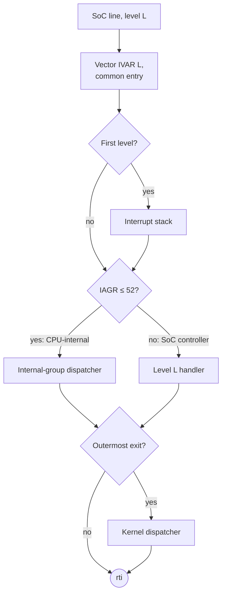

# Interrupts, timers and DMA: technical notes

<!-- house style -->
> **Technical reading.** The detailed version of [Interrupts, timers and DMA](interrupts-timers-dma.md), for readers who want the internals.

*Last reviewed 2026-11-27.*

This page covers how the main chip's three MN103 cores take interrupts, how the timer block keeps time, and how data
moves by DMA. It is desk research only, and nothing was run on the camera. The OM-5 II 1.1 program was checked for the
same structures (see [OM-5 II 1.1 program](#om-5-ii-11-program)).

Addresses are E-M5 III 1.7 block0 addresses (base `0x60021020`) unless a body is named. Function and table addresses
are in the [address reference](#address-reference). Related pages are [CPU1 and CPU2](cpu1-cpu2-technical.md)
(per-core stacks, doorbell line 169), [shutter](shutter-technical.md) (line 2, timer channel 5) and
[power block](power-block-technical.md) (watchdog).

The small numbers after a fact link to [Sources and dates](#sources-and-dates), which say how the fact is known and when.
On the notes site the number's colour shows the evidence: green = seen on our camera, blue = read in the firmware,
grey = inferred.

## Summary

- **Two layers.** Each MN103 core has its own MN103-style interrupt unit in the system register window. It has the
  vector registers at `0x8000` to `0x801c`, the group registers GxICR at `0x8900` + 4n and the acceptance register
  IAGR at `0x8a00`. In front of it sits a **per-core SoC interrupt controller** with **182 lines**. CPU0's is at
  `0x99200000`, CPU1's at `0x99300000` and CPU2's at `0x99b00000`.[^fw1]
- **One word per line and core.** Each line has one word per core at base + 4 × line. The word is one-hot. Bit L routes
  the line to priority level L (0-6). Writing 0 masks it on that core. The kernel keeps a shadow copy, 728 bytes per
  core.[^fw1]
- **Seven outputs.** The controller has one output per level. Output L is MN103 group 16 + L (GxICR `0x8940` + 4L, set
  at boot to `0x0101` + L × `0x1000`: enable, clear, level L). Its handler reads **base + `0x300` + 4L**, which returns
  (line + 1) × 4 for the next pending line and 0 when none is left.[^fw1]
- **Level handlers.** A μITRON static table (12 bytes per entry: number, attribute, handler) installs the seven level
  handlers. They re-enable interrupts (`or 0x800,psw`), so a higher level can nest. Each calls the per-line handler
  from its core's handler table for every pending line, then rewrites its GxICR.[^fw1]
- **About 100 lines** are registered in stock 1.7, at levels 1-5 (see [Line table](#line-table)). Most hardware sits at
  level 2-5.[^fw1]
- **Timers.** One 28-channel timer block at `0x98900000`. Channels 1-3 are the kernel tick of CPU0-2, with reload 999.
  That is 1 ms if the block counts at 1 MHz.[^inf1] Channel 27 is the free-running counter `hw_tick_read`. Channels
  10-13 serve the micro-timer API, and channels 14-25 the 12 hardware slots of the timer API.[^fw1]
- **DMA.** No shared general-purpose DMA controller is used. Each block masters the bus itself (display DMA1-22, sensor
  read DMA, USB, SD, image pipeline). The MN103 core DMA (4 channels per core, done on internal group 10) has a driver,
  but in stock 1.7 only the `cpudma` test command calls it.[^fw1]

## CPU side: vectors, groups and entry

**Vector registers.** The boot stub writes the low half-words of the level handlers to `0x8000`, `0x8004` to `0x8018`
and a full word to `0x801c`.[^fw1] This settles the earlier question. `0x8000` to `0x801c` are the MN103 interrupt
vector registers, IVAR0-6 plus one more word. The upper half comes from the vector base, which here is
`0x6003xxxx`.[^fw1]

| register | value |
|---|---|
| IVAR0 | `0x60030020` |
| IVAR1 | `0x60030058` |
| IVAR2 | `0x60030060` |
| IVAR3 | `0x60030068` |
| IVAR4 | `0x60030070` |
| IVAR5 | `0x60030078` |
| IVAR6 | `0x60030080` |

*Interrupt vector values written by the boot stub.[^fw1]*

**Level 0 stub.** It saves sp and the two words on top of the stack (the pushed PSW and PC) before the common entry. It
reads as a snapshot for crash reports.[^inf1] Levels 1-6 jump straight to the common entry.[^fw1]

**Common entry.** It saves a2, a3 and other with `movm`, calls the context save and then the entry body.[^fw1]

- The per-core kernel block is the word at `0x8ff00004` + 4 × core. The core id comes from `(0x8050)`.
- An optional trace hook runs (flag at `+0x104`, hook at `+0x114`), called with the level from PSW bits 8-10.
- A nesting counter byte sits at `(+0x1c)`. On the first level the entry switches to the core's interrupt stack
  (`+0x74` base, `+0x70` size).
- The handler is the word `(+0x58)[IM level × 4]`. It is called with interrupts still masked to the current level.
- On exit the entry masks, does kernel bookkeeping, restores PSW and decrements the nesting count. On the outermost
  exit it runs the dispatcher (the delayed work loop, the reschedule check, the task switch), then `rti`.

*Interrupt path from a SoC line to `rti` on one MN103 core (CPU0, CPU1 or CPU2). Arrows follow control flow. The
table below gives what each step does.[^fw1][^inf1]*

| step | what happens |
|---|---|
| SoC line word | The line word at base + 4 × line is one-hot. Bit L means level L, and 0 means masked. Output L raises MN103 group 16 + L (GxICR: enable, clear, level L).[^fw1] |
| vector IVAR L | Level 0 runs a stub first that saves sp, PSW and PC (likely a crash snapshot[^inf1]). Levels 1-6 go directly to the common entry.[^fw1] |
| common entry | `movm` save and context save. The kernel block is picked by core id.[^fw1] |
| first level? | The kernel block's nesting counter decides. On the first level, sp switches to the core's interrupt stack, with base and size from the kernel block.[^fw1] |
| level-table call | The entry calls the level-table handler, masked to this level.[^fw1] |
| IAGR ≤ 52? | IAGR holds the accepted group × 4. Up to 52 (groups 10-13) is a CPU-internal source. Which code reads IAGR is not traced.[^fw1][^inf1] |
| internal-group dispatcher | Calls the per-core group handler table, then rewrites GxICR(group). It keeps bits 12-15, as (old & `0xf000`) \| `0x0707`.[^fw1] |
| level L handler | Re-enables interrupts, reads the pending register, which gives (line + 1) × 4, and calls that entry of the per-line handler table. It repeats until it reads 0, then rewrites its GxICR.[^fw1] |
| exit | Both handlers mask, do bookkeeping, restore PSW and decrement the nesting count.[^fw1] |
| outermost exit? | On the outermost exit the dispatcher runs the delayed work loop, the reschedule check and the task switch. Then `rti`.[^fw1] |

*Steps of the interrupt path. Addresses are in the [address reference](#address-reference).*

**IAGR** (`0x8a00`) holds the accepted group × 4.[^fw1]

- Values up to 52 (groups 10-13) are CPU-internal sources. They go to one dispatcher, which calls the handler at
  `0xa2566910` + 16 × core + 4 × (group − 10). It rewrites GxICR(group) as (old & `0xf000`) | `0x0707`.
- Larger values come from the SoC controller.

**Group 10** is the core DMA completion. Its handler is set by the core DMA code, which also writes GxICR `0x8928`.
Groups 11-13 have no handler installed in stock 1.7.[^fw1]

**Interrupt mask helpers.** There are four: enable (`or 0x800,psw`), disable, raise the mask to a level and return the
old PSW, and restore. Two wrappers also take a cross-core lock when the `0x8ff006fc` magic is `0x77777777` and the
caller is a task.[^fw1]

**"Am I in an interrupt?"** One function reads the same per-core nesting byte.[^fw1]

## SoC controller and registration API

| function | what |
|---|---|
| register | on the current core. d0 line, d1 level, a0 handler. |
| register on core | on core a1 (0-2) |
| enable / disable | a line on the current core |
| enable / disable on core | a line on core d1 |
| worker | line < 182, level clamped to 6. Masks the line on the other two cores, stores the handler (null = a dummy that prints "!!Dummy IRQ from CPUn"), writes 1 << level to shadow and controller. |
| enable / disable on a given core | enable copies the shadow word, disable writes 0 |
| CPU0 controller set-up at boot | line 170 word = 0, `0x99200414` = 1, GxICR `0x8940`-`0x8958` = `0x0101` + L × `0x1000` |

*Registration functions. Addresses are in the [address reference](#address-reference).[^fw1]*

- **One owner per line.** A line is owned by one core at a time. Registering on core n clears the same line on the
  other cores. Drivers that must run on all cores (doorbells, faults, movie, pins) register three times, then disable
  the line on the cores that should not take it.[^fw1]
- **Range check.** Out-of-range lines print "!!Wrong IRQ Number".[^fw1]
- **CPU1 and CPU2** have their own copies of the level handlers. They read `0x99300300` and `0x99b00300`
  onwards.[^fw1]
- **Second layer in the system block.** Some blocks have their own enable and clear bits in the system control block.
  The image engine sets `0x98800148` = 1 << (21 + slot) and clears `0x988001c4`. EMS1/EMS2 use `0x9880014c` /
  `0x988001c8`.[^fw1] That these are per-source enable (`+0x140`..) and clear (`+0x1c0`..) words in front of the SoC
  line is inferred.[^inf1]

## Line table

Level is the priority (0 highest, 6 lowest). "all" means registered on all three cores. "arg" means the level is
passed in by the caller. Owners marked "open" are not known yet.[^fw1]

All registered interrupt lines in stock 1.7

| line | level | block | owner |
|---:|---|---|---|
| 1 | 0 | `0x9b900000` | flash timing block ([flash](flash-technical.md#the-flash-timing-block-0x9b900000)) |
| 2 | 1 | `0x9ba00000` | shutter (MECHA) block, set up by the mec driver (MOT_COM / MAG_COM tasks) ([shutter](shutter-technical.md)) |
| 3 | arg | `0x9bb00000` | lens serial block ([lens communication](lens-communication-technical.md)) |
| 4-6 | 2 | `0x9b000000` | sensor input (`cam_sg`, LVDS/SLVS receiver), status `+0x004` / `+0x018` with per-line masks ([sensor link](sensor-link-technical.md)) |
| 7 | 2 | `0x9b000200` | sensor serial command unit (status `+0x004` bits 20-22, mask `+0x014`)[^fix1] ([sensor link](sensor-link-technical.md)) |
| 8-11 | 2 | `0x9b200000` + `0x800` n | image pipeline block with 4 units (open) |
| 12-16 | 2 | `0x9b400000` + `0x800` n | image pipeline block with 5 units (open) |
| 17, 18, 19 | 2 | `0x9c500000`, `0x9b100000`, `0x9b300000` | image pipeline units (open) |
| 20 | 3 | `0x9c400000` | AF phase-detect focus calculation (PFC) unit, driven by the `[fcs]p_pfc_*` functions |
| 21 | 2 | `0x9c900000` | image pipeline unit (537 registers, the largest block) (open) |
| 22 | 2 | `0x9c800000` | sensor frame sync and timing (FSYC, used by `rs_sht_speed` and `lens_sync`) |
| 23 | 3 | `0x9bf00000` | serial audio port (record and play ping-pong DMA, [audio](audio-technical.md#serial-audio-port-0x9bf00000-irq-23)) |
| 24 | 5 | `0x9c600000` | audio sample converter `sca_drv` (mix and format conversion, not the codec chip, [audio](audio-technical.md#sample-converter-0x9c600000-irq-24)) |
| 25, 27 | 4 | `0x9c000000` | display controller VSC channel 0 / 1[^inf1] |
| 29, 30 | 5, 3 | `0x9b800030`/`34` | external pin interrupts, all cores[^inf1] |
| 31-34 | 2, 1, 3, 3 | `0x9b800038`-`44` | external pin interrupts[^inf1] |
| 88, 89, 90 | 5 | `0x98900004`/`08`/`0c` | timer channels 1-3 = kernel tick of CPU0 / CPU1 / CPU2 |
| 91-97 | 5 | `0x98900010`.. | timer channels 4-10 |
| 98 | 5 | `0x98900160` | timer channels 11-18 (shared, status word `0x98900160`) |
| 99 | 5 | `0x98900164` | timer channels 19-26 (shared) |
| 100-121 | 5 | `0x98200000` .. `0x9a200000` | serial ports, 3 lines each (see [Serial ports](#serial-ports)) |
| 124 | 5 | `0x98f0c000` | USB 3 device controller (DWC3) |
| 125, 127, 129 | 3 | SD host | SD card (`sd_asic` / `sd_mount` area)[^inf1] |
| 126 | 3 | | SD file test path (open) |
| 132 | 5 | | display (TFT) driver, registered by display init, not the flash ([flash](flash-technical.md#open-questions)) |
| 133, 136, 137, 147, 152 | 5 | `0x9cc00000`, `0x9cf00000`, `0x9cd00000`, `0x9ca00000`, `0x9cb00000` | image request engine units, all cores[^fix1] |
| 146 | 5 | `0x99901000` | JPEG codec, all cores ([still image back end](../firmware/still-backend-technical.md#jpeg)) |
| 148-151 | 4, 5 | `0x9f000000` / `0x9f80a000` | image pipe, all cores, same set-up as lines 133 to 152 |
| 134 | 5 | `0x9b500000` | motion search unit EMS1 |
| 135 | 5 | `0x9b600000` | colour/size search unit EMS2, on CPU2 |
| 138, 140, 141, 143 | 5 | `0x99400000` | CPU1 video unit, the H.264 codec block, shared by recording and playback (below) |
| 145 | 5 | `0x9b700000` | CIC RAW codec, used by `play_cic_decode_raw` for playback and Edit RAW ([playback](../firmware/playback-technical.md#decoding)) |
| 153, 154 | 4 | | all cores, `api_user` area (open) |
| 155, 156 | 5 | | face-detection area (open) |
| 158 | 5 | `0x9c100000` | OSD 2D draw engine |
| 163 | arg | `0x98c00000` | A/D converter (`PER_ADCONV`) |
| 165 | 5 | `0x9bd00000` | key-line edge interrupts (buttons) |
| 166, 167 | 5 | `0x98e00000` | always-on power block, alarms / wake |
| 168 | 4 | `0x99x00400` | cross-core fault reports ("[SYS WANA]" reboot requests, ARM exceptions), all cores |
| 169 | 2 | `0x99x00408` | cross-core event-flag doorbell (`iset_flg`), all cores |
| 170 | 0 | `0x99x00410` / `0x99x00414` | cross-core kick, all cores (see [Line 170](#line-170)) |
| 171 | ? | | ARM co-processor watchdog ("ARM WDT!!!"), CPU0 |

*Registered interrupt lines, levels and owners. Handlers and set-up are in the [address reference](#address-reference).*

**CPU1 video unit.** Its set-up runs in `boot_create_tpc_camc_tasks`, between the MOVE_TIMELAPSE and AVM_FILE /
AVM_COM / AVM_P1V task starts. Its 53 driver functions follow `CAvpiVsoVideoSource.cpp`. It is the H.264 codec block,
shared by recording and playback.[^fw1] See also: [movie encoder stack](../firmware/movie-stack-technical.md#codec-hardware).

### Serial ports

One driver serves 8 channel slots. It has register tables at `0x5c` bytes per channel and three line tables (level,
line, handler).[^fw1]

| ch | base | lines |
|---:|---|---|
| 0 | `0x9a200000` | 115, 116, 117 |
| 1 | `0x98200000` | 100, 101 |
| 2 | `0x98500000` | 103, 104, 105 |
| 3 | `0x98600000` | 106, 107, 108 (SPI control line of the audio codec, 4 MHz, [audio](audio-technical.md)) |
| 4 | `0x98400000` | none registered |
| 5 | `0x98700000` (debug UART) | 120, 121 |
| 6 | `0x98300000` | 109, 110, 111 |
| 7 | `0x9a100000` | 112, 113, 114 |

*Serial port channels, bases and interrupt lines.[^fw1]*

Callers do not use these port numbers. They pass a logical channel (1-13) that a channel map turns into a port.[^fw1]
See also: [small devices](small-devices-technical.md#serial-channels).

The first two lines of a channel go to the common handler. The third goes through a per-channel function
table.[^fw1]

- **First and second line.** The common handler reads status `+0x44` and tests mask `0x4c` for errors, bit 16 of
  `+0x14` for receive and `+0x28` for transmit. Both lines share it.
- **Third line.** A per-channel function from the table. It is likely completion of the block-transfer (DMA)
  mode.[^inf1]

### Line 170

Line 170 runs at level 0, the most urgent level. Its set-up registers it on all three cores. Each handler only writes 1
to `0x99x00414`, which clears the line. Writing 1 to `0x99x00410` raises it.[^fw1]

There are two kinds of raiser.[^fw1]

- The kernel's kick routines (config `+0x13c`). This is likely a reschedule request.[^inf1] See also:
  [CPU1 and CPU2](cpu1-cpu2-technical.md#memory-each-core-uses).
- Two core-library routines. They store a command (`0x20001` or `0x20002`) in a mailbox word (`0x8ff00070` for CPU1,
  `0x8ff00098` for CPU2). They kick line 170 for `0x20002`, then poll an answer word (`0x8ff00078` / `0x8ff000a0`).

The empty handler suggests the kick only wakes the core from idle, so it reads the mailbox.[^inf1]

## Timers

The timer block is at `0x98900000`. A channel table holds 20 bytes per channel: control, reload, counter, enable word
and status word. The driver has set, start, stop and attach-interrupt functions.[^fw1]

| offset | what |
|---|---|
| `+0x00` + 4 ch | control: bit 6 load, bit 7 run (set `0x40`, five `nop`, then `0x80`) |
| `+0x70` + 4 ch | reload value (count − 1) |
| `+0xe0` + 4 ch | current count |
| `+0x150` / `+0x154` / `+0x158` | interrupt enable bits for channels 1-10 / 11-18 / 19-26 (bit = ch − first) |
| `+0x15c` / `+0x160` / `+0x164` | interrupt status, write 1 to clear, same grouping |
| `+0x14c` | channel 27 counter, free-running. `hw_tick_read` returns `0x3fffffff` − value. |

*Timer block registers.[^fw1]*

- **Lines.** Channel 0 has no interrupt. Channels 1-10 have their own line (88-97). Channels 11-18 share line 98 and
  19-26 share line 99. The shared handlers read the status word and call each set channel.[^fw1]
- **Period.** The driver takes a period in µs, and the timer API passes ms × 1000. Above 65535 it loads 65534 and keeps
  the rest. So the reload register is 16 bits wide and long periods are chained.[^fw1]
- **Count rate.** That one count is 1 µs (1 MHz clock) is inferred from the ms × 1000 scaling and the 999 tick
  reload.[^inf1]
- **One-shot.** Bit 12 (`0x1000`) of the mode selects one-shot.[^fw1]
- **Channel numbers.** Driver channel numbers are 1-26. Channels 0 and 27 are not handed out.[^fw1]

| channel | user |
|---|---|
| 1, 2, 3 | kernel tick of CPU0, CPU1, CPU2 (reload 999, level 5). The handler acks `0x9890015c` and calls the kernel tick. On CPU0 it also calls `irot_rdq(55)` every tick, giving priority-55 tasks 1 ms time slices. |
| 5 | shutter (mec driver) and one other user |
| 7 | two drivers in `0x6020xxxx`-`0x6022xxxx`, level 5 (open) |
| 8, 9 | one set-up function, started from stage 1, level 2 (open) |
| 10-13 | micro-timer API (channel = slot + 10, "MICROTIMER1" strings) |
| 14-25 | the 12 hardware slots of the timer API (modes 0 and 128, channel = slot + 14). The common handler runs the callback on the owning core, or posts it with the cross-core call. |
| 26 | movie (`move_util_system.c` / `movp_util_system.c`) picks a channel at run time[^inf1] |

*Timer channel users in stock 1.7.[^fw1] Set-up functions are in the [address reference](#address-reference).*

**Time slices.** `irot_rdq(55)` on every CPU0 tick rotates the ready queue of priority 55. The queue rotation moves the
queue head to the tail. So tasks at that priority share CPU0 in 1 ms time slices.[^fw1]

**Software timers.** Modes 1, 2, 129 and 130 of the timer API use a 32-entry pool, which ticks every 2 ms (see the
[MN103 CPU](mn103-cpu.md) table).[^fw1]

- The pool's own 2 ms tick is a periodic (mode 128) hardware slot. So pool callbacks run in that channel's interrupt.
- Hardware slots are for short or precise periods.
- A card mod that polls every 50 ms through the pool gets 2 ms granularity.

**Watchdog.** It is not in this block. It is the always-on block `0x98e00000`, kicked by PER_WDT.[^fw1] See also:
[power block](power-block-technical.md).

**Clock gates.** A table of 8 setters writes `0x988000d0` to `0x988000e4` and `0x98800048`/`50`. The timer init calls
it.[^fw1] These are probably timer clock or prescaler settings.[^inf1]

## DMA

**MN103 core DMA ("cpudma").** Its driver is in the always-ready code, with allocate (a0 = request), start, release and
a done handler. The done handler runs on internal group 10 and calls request `+0x0c`.[^fw1]

- The slot table has 32 bytes per core, 8 bytes per slot (state, request). Only slots 2 and 3 are handed out, so 2
  per core.
- The register pointer table is in RAM, 20 bytes per channel (control, source, destination, count, mode). It is
  filled before the copy code runs, so the register addresses are not in block0.
- Control bits seen: 31 checked before start, 16 = start, 24 = busy (polled), transfer unit at bits 26 and 30, mode
  << 11.

**It is not used in normal operation.** The start function has one caller, the `cpudma` test command. It times a
transfer with `hw_tick_read`.[^fw1]

**Bus masters per block.** Each has its own address registers, and there are no shared channels.[^fw1]

- display VSC DMA1-22 at `0x9c000000` ([graphics pipeline](graphics-pipeline.md))
- sensor read DMA (`SG_READ_DMA_SETTING`)
- USB DWC3
- SD host (DMACNT, DMA_START_ADR strings)
- image pipeline units, image engine, EMS1/EMS2, OSD draw engine, GPU

**Cache rule.** For all of them, hand data to a bus master through the uncached view, or write back first.[^fw1] See
also: [caches](caches-technical.md).

## OM-5 II 1.1 program

- Same vector set-up, same 182-line check, same level registers `0x99200300` to `0x99200318`, same IAGR split, same
  tick reload 999 on `0x98900074`.[^fw2]
- The registration functions move (see the [address reference](#address-reference)).[^fw2]
- The registered line numbers and levels match stock 1.7 for every line found statically. The one exception is line
  129 (SD mount), which the OM-5 II program does not register with a constant.[^fw2] So the line table above holds for
  the OM-5 II program.

## Peripheral census

The census lists every 1 MB block in `0x88000000` to `0x9fffffff` that decoded instructions reference as an immediate,
with counts and a name where known.[^fw1]

- It finds `0x9b500000` (407 references), which the earlier byte scan missed.
- It still undercounts table-driven drivers. The timer block shows 21 references because channels go through the
  channel table.
- Data tables of register addresses (the serial and timer tables) cover part of that gap.

## Read-only camera check

A check anyone can run over the Wi-Fi shell. It only reads, it changes nothing, and nothing is flashed.

1. Read the kernel system time (milliseconds) twice, 60 s apart by a stopwatch. The tick channels reload at 999, so
   the two agree only if the block counts at 1 MHz. The free-running counter `0x9890014c` is 16 bits and wraps every
   65.5 ms at 1 MHz, too fast to time by hand.
2. Read `0x61a026a4` to `0x61a026f4` (mem_get4). Non-zero words are the core DMA register addresses per channel.

## Open questions

- Register addresses of the core DMA. The pointer table is RAM filled at run time and has no static source, so it needs
  a camera RAM read.
- What core DMA slots 0 and 1 are kept for.
- Owners of the image pipeline blocks `0x9b100000` to `0x9b400000`, `0x9c500000` and `0x9c900000` (lines 8-19 and 21).
  Names would come from the OM-1 strings.
- Who reads the line 170 mailbox and what commands `0x20001` / `0x20002` mean.
- Timer clock speed on the camera.

## Address reference

E-M5 III 1.7 block0 addresses unless a body is named.

| item | address |
|---|---|
| vector registers IVAR0-6 + one word | `0x8000` to `0x801c` |
| vector set-up in the boot stub | `0x60021092` to `0x600210cb` |
| group registers GxICR, acceptance register IAGR | `0x8900` + 4n, `0x8a00` |
| core number register | `0x8050` |
| SoC interrupt controller CPU0, CPU1, CPU2 | `0x99200000`, `0x99300000`, `0x99b00000` |
| controller shadow copy | `0xa25f0030` + 728 × core |
| μITRON static table of level handlers | `0x6003c354` |
| level handlers, level 0 to level 6 | `0x60054d1e` .. `0x60054b8c` |
| per-line handler tables CPU0, CPU1, CPU2 | `0xa25f08b8`, `0xa25f0b90`, `0xa25f0e68` |
| CPU1, CPU2 level handlers | `0x60027489`.., `0x60027884`.. |
| level 0 stub, its snapshot words | `0x60030020`, `0x629be004`/`08`/`0c` |
| common entry, context save, entry body | `0x60038885`, `0x60030107`, `0x60038895` |
| kernel bookkeeping, delayed work loop | `0x60031bce`, `0x600361bd` |
| reschedule check, task switch | `0x60034413`, `0x60034436` |
| internal-group dispatcher, handler table | `0x60054d61`, `0xa2566910` |
| group 10 handler set-up | `0x60069edd` |
| mask helpers: enable, disable, raise, restore | `0x60054b50`, `0x60054b57`, `0x60054b5f`, `0x60054b80` |
| locking wrappers | `0x60069e11`, `0x60069e5a` |
| "in an interrupt" check | `0x600386ae` |

*CPU side.*

| item | address |
|---|---|
| register on the current core, on core a1 | `0x60069ec9`, `0x60069f14` |
| enable / disable on the current core | `0x60069f28` / `0x60069f36` |
| enable / disable on core d1 | `0x60069f44` / `0x60069f4f` |
| worker, dummy handler | `0x60054d8e`, `0x60054fa8` |
| enable / disable on a given core | `0x60054f55` / `0x60054f11` |
| CPU0 controller set-up at boot | `0x6005210b` |
| OM-5 II: register on the current core, on a given core | `0x6006e6fd`, `0x6006e748` |

*Registration API.*

| line | handler and set-up |
|---|---|
| 1 | ISR `0x60171866`, registered by `0x6017104f` (OM-5 II `0x6018416f`) |
| 3 | set-up `0x6021c2db` |
| 7 | handler `0x6015a175` |
| 23 | handler `0x607b88e8` |
| 132 | ISR `0x6018cf5f`, registered by display init `0x6018c9b8` via `0x6018e145` |
| 133, 136, 137, 147, 152, 148-151 | set-up `0x6036e970` |
| 146 | handler `0x6036e7a7` |
| 138, 140, 141, 143 | set-up `0x603eb1ae`, run in `boot_create_tpc_camc_tasks` (`0x6019dc06`). Driver functions `0x6118bf27` to `0x61192654`. |
| 145 | `play_cic_decode_raw` (`0x612ad059`) → driver `0x60c22b6a` |
| 170 | set-up `0x6002409b`. Handlers `0x6019e4a3` / `0x6019e4ae` / `0x6019e4b9`. |
| 170 raisers | kernel kick routines `0x600300a1` / `0x600300c3` / `0x600300e5`, core-library routines `0x61483000` and `0x61483057` |

*Interrupt line handlers and set-up functions.*

| item | address |
|---|---|
| serial driver init, interrupt set-up | `0x6006e7aa`, `0x6006e853` |
| serial register tables | `0x600c1ee8` + `0x5c` × ch |
| serial line tables | `0x600c2328` / `0x600c23e8` / `0x600c24a8` |
| logical channel map | `0x600c2580` |
| serial common handler, third-line function table | `0x6006faae`, `0x600c253c` |

*Serial ports.*

| item | address |
|---|---|
| timer block, channel table | `0x98900000`, `0x600c420c` |
| timer driver: set, start, stop, attach interrupt | `0x600736db`, `0x60073706`, `0x6007372a`, `0x600736ac` |
| `hw_tick_read`, free-running counter | `0x60022e5c`, `0x9890014c` |
| shared channel handlers (lines 98, 99) | `0x60073a3d`, `0x60073a52` |
| kernel tick set-up CPU0, CPU1, CPU2 | `0x600557fd`, `0x6005588b`, `0x600558e9` |
| kernel tick, `irot_rdq`, queue rotation | `0x60031f39`, `0x60031dfc`, `0x60033dfa` |
| channel 5 users | mec driver set-up `0x600eec39`, `0x607c005d` |
| channels 8, 9 set-up | `0x6012861f` |
| micro-timer API, handler table | `0x6006bae6`, `0x600c1400` |
| timer API, slot stubs, common handler | `0x6006be97`, `0x6006c0a5`.., `0x6006c171` |
| cross-core call | `0x6005730b` |
| software timer pool | `0x6006c3ba` |
| clock gate setter table, timer init | `0x600c3698`, `0x60073666` |

*Timers.*

| item | address |
|---|---|
| core DMA allocate, start, release, done handler | `0x60022745`, `0x60022809`, `0x60022b0f`, `0x60022b5a` |
| core DMA slot table | `0xa256601c` + 32 × core |
| core DMA register pointer table (RAM) | `0x61a026a4` |
| `cpudma` test command | `0x600656c9` |

*DMA.*

## Sources and dates

The small numbers in the text point here. Each note says how a fact is known and when.

[^fw1]: Read in the firmware, 2026-11-25, with mn10300-elf objdump of block0 and a decoded-instruction census.
[^fw2]: Read in the OM-5 II 1.1 firmware, 2026-11-25.
[^inf1]: Inferred, 2026-11-25.
[^fix1]: Read in the firmware, 2026-11-25. Corrects an earlier reading (see [History](#history)).

## History

- 2026-11-25: line 7's unit was first guessed as `0x9c800100`. It is the sensor serial command unit at `0x9b000200`.
- 2026-11-25: lines 133, 136, 137, 147 and 152 were first guessed as `mvr`. They are the image request engine units.
- 2026-11-25: closed line 2 (shutter), lines 7, 20, 22 and 145, the CPU1 unit `0x99400000`, the serial line roles and
  line 170.

