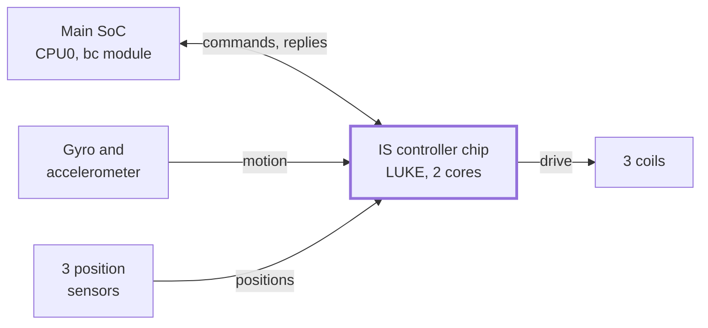
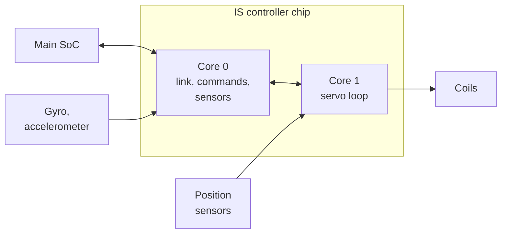

# Image-stabiliser controller: technical notes

<!-- house style -->
> **Technical reading.** The detailed version of [Stabiliser controller](is-controller.md), for readers who want the internals.

*Last reviewed 2026-11-27.*

The image-stabiliser (IS) controller is a separate chip with two MN10300-family cores. Its program ships in every
update file as block 3, called "LUKE" (block kind `0x10e`). This page covers that program, read end to end: the memory
layout, the two cores, the maths extension ops, the I/O blocks, the command path from the main processor, and how the
program differs between the E-M5 III, OM-5 and OM-5 II.[^fw1]

How the main program drives the stabiliser is on [Image stabiliser: technical notes](stabiliser-technical.md).

Addresses are core 0 addresses (LUKE file offset + `0x40002400`) unless core 1 is named. They are E-M5 III 1.7 unless
the OM-5 1.2 or OM-5 II 1.1 is named.

The small numbers after a fact link to [Sources and dates](#sources-and-dates), which say how the fact is known and when.
On the notes site the number's colour shows the evidence: blue = read in the program, grey = inferred.

## Overview



*The IS controller (bold outline) and its neighbours. Arrows show which way the data flows. [Two cores](#two-cores) opens up the
controller, and its interface table says who starts each transfer and how often.*

## Disassembling it

Use plain `mn10300`, not `am33-2`.

```
mn10300-elf-objdump -b binary -m mn10300 --adjust-vma=0x40002400 --start-address=0x40009000
```

LUKE's extension ops share encodings with AM33 instructions. So `-m am33-2` shows `fadd`, `mcst48` and similar ops
that LUKE never uses.[^fw1][^fix1]

File offset `0x400` is address `0x40002800`. The header at file offset `0x3e0` gives the load address.[^fw1]

| field | E-M5 III | OM-5 |
|---|---|---|
| header bytes | `OE 13 70` | `OE 14 40` |
| load address | `0x40002800` | |
| size | `0x35800` | |
| kind | `0x0e` | |

*LUKE block header.[^fw1]*

## Layout

| range | what | where it runs |
|---|---|---|
| `0x40002800` | magic `0x12345678`, then `0xff` up to `0x40009000` | |
| `0x40009000`-`0x4000fb74` | shared library (maths helpers, `memcpy`, spinlocks, mailboxes) | core 0 in place, and copied to core 1 at the same address |
| `0x4000fb74`-`0x40023424` | core 0 code and read-only data | core 0 in place |
| `0x40023424`-`0x400235e4` | core 1 initial data | core 1 RAM `0xa74` |
| `0x400235e4`-`0x40023701` | core 1 vectors and reset code | core 1 `0x40000000` |
| `0x40023701`-`0x4002b95d` | core 1 program | core 1 `0x40000120` (3 bytes later than contiguous) |
| `0x4002b95d`-`0x4002bb29` | core 0 initial data | core 0 RAM 0 |

*LUKE's layout. The copy plan is in core 0's start-up task.[^fw1]*

- **Boot program.** The boot program below `0x40002800` is not in the update file. The update commands `0xf0` to
  `0xf4` have no handler in LUKE, so the boot program most likely serves them.[^inf1]
- **Factory parameters** sit above the program in the controller's flash. Command `0x89`, "read parameter from flash",
  takes numbers 18 to 211 and reads words such as `0x4003f42c`.[^fw1]

## Two cores



*Inside the IS controller. Each line is one row of the table below.*

| from | to | what moves | path | started by | how often |
|---|---|---|---|---|---|
| main SoC CPU0 | core 0 | command packet, wire command byte first | `bc_sio` serial link (SPI channel 0, IRQ 19), up to 8 MHz | main SoC | on demand |
| core 0 | main SoC CPU0 | reply, such as the 44-byte status for wire `0xa0` | same link | core 0, answering | per command |
| gyro | core 0 | register reads | SPI channel 1 | core 0 polls | every 250 µs (timer channel 2, IRQ 21) |
| accelerometer | core 0 | register reads | its own serial port | core 0 polls | not pinned |
| core 0 | core 1 | message to `task_drive` (22 kinds) | shared RAM slot + doorbell | core 0 | per command |
| core 1 | core 0 | reply message, such as message 20 with the three positions | shared RAM slot + doorbell | core 1 | after a move |
| position sensors | core 1 | three ADC readings (likely hall sensors) | ADC block | core 1 reads | every servo step, about 24 kHz |
| core 1 | coils | three PWM duty values (likely Y, X1, X2) | timer/PWM channels | core 1 writes | every servo step |

*Every transfer of the IS controller.[^fw1][^inf1] Addresses are in [How the cores talk](#how-the-cores-talk), [I/O blocks](#io-blocks) and the [address reference](#address-reference).*


- **Core number.** Each core reads the half-word at `0x8050`, where 0 = core 0.[^fw1]
- **Memory per core.** RAM runs from 0, with the stack top at `0x7ffc`. Vector registers at `0x8000` to `0x801c` hold
  the low half-words of the vectors, base `0x40000000`. These are the same register addresses as the main processor's
  boot stub.[^fw1]
- **Core 1 start.** Core 0 copies core 1's pieces through `0x10000000` (core 1 RAM) and `0x10010000` (core 1 program
  memory), then starts its kernel.[^fw1] That the two windows are core 1's memory is inferred.[^inf1] Core 1's reset
  at its `0x40000000` jumps to `0x40000090`. That code sets the stack, fills `0x7800` to `0x7fff` with `0xdeadbeef`,
  starts the kernel and then loops on its message queue.[^fw1]
- **Kernel.** The kernel is µITRON style (`snd_dtq`, `rcv_dtq`, `get_mem`, `set_flg`, `wai_flg`, `dis_dsp`,
  `ena_dsp`), like the main program's. Core 0 runs the tasks `task_cmd`, `task_comm` and `task_detect`, a start-up task
  and a shell. Core 1 runs `task_drive`.[^fw1]
- **Division of work.** Core 0 talks to the main processor, decodes commands and reads the gyros and accelerometer
  (`task_detect`). Core 1 runs the servo filters and drives the coils (`task_drive`). The code each core holds is read
  in the program.[^fw1] The roles are inferred from it.[^inf1]
- **Debug shells.** There is one shell per core (`Usr0`, `Usr1`). The commands are `mdump4 <addr> <size>`,
  `mput <addr> <value>`, `per` (adc, timer8, timer16), `stack`, `nmi`, `tcmd`, `tdet`, `tdrv`, `dbg <block> on|off`
  and `dbglog`.[^fw1] They are most likely on a UART that only a service jig reaches.[^inf1]

### How the cores talk

| address | what |
|---|---|
| `0x98000000`-`0x98000006` | hardware semaphores, 4 half-word registers with 8 lock bits each. Taking one spins |
| `0x99000000`-`0x990007ff` | shared RAM. `0x99000000`-`0x14a` is a 40-field block core 1 copies in and out. `0x99000400` + 256 × n: 3 mailbox slots (busy bytes `0x9900015c`-`15e`). `0x99000700` + 64 × n: 4 small slots (busy bytes `0x9900015f`-`162`). `0x99000164`/`168`: one word per core. `0x990007f0`/`7f4`: read by the NMI report |
| `0x9c080000`, `0x9c090000` | doorbells. Core 0 writes 1 to `0x9c080000`, core 1 writes 1 to `0x9c090000` |

*Shared hardware between the two cores. The accesses are read in the program, the names are inferred.[^fw1][^inf1]*

## Same chip or separate

The IS controller is a **separate chip**, not more cores inside the main SoC.[^fw1][^inf1]

- The main program reaches it only through `bc_sio`, a serial link with reset, chip-select, ready and request lines.
  See [Image stabiliser: technical notes](stabiliser-technical.md).
- LUKE runs from its own flash at `0x40002800`, which the main program writes over that link during an update. The main
  SoC's own boot area also sits at `0x40000000` and holds different code.[^fw1]
- LUKE never touches main-SoC DRAM (`0x6xxxxxxx`, `0xa` to `0xf`), the main CPUs' doorbells (`0x99200400` and nearby)
  or the ISC. Its `0x98`, `0x99` and `0x9c` blocks are its own.[^fw1]
- LUKE calls the main chip the "ASIC" (`rs_data_num_2_asic`).

So the main SoC has three MN103 cores (CPU0 to CPU2), and the camera has **five** MN103-family cores across two chips.
The power and watchdog block is not a processor. See also: [Power and watchdog block](power-block.md).

## Rates and the servo loop

The rates come from the timer reloads, at 50 ticks per µs.[^fw1]

| what | core | timer | period |
|---|---|---|---|
| kernel tick | 0 | 16-bit ch 0 | 50,000 ticks = 1 ms |
| gyro and detection tick | 0 | 16-bit ch 2 | 12,500 ticks = 250 µs (4 kHz). Set in the detect init, which also enables IRQ 21 |
| servo loop | 1 | 16-bit ch 1 | 2083 ticks ≈ 41.7 µs (about 24 kHz). Set up in core 1, with create, start and stop functions |

*Timer-driven loops on the two cores.[^fw1] Handlers are in the [address reference](#address-reference).*

One servo step on core 1 runs in three parts.[^fw1]

1. Read the three ADC positions.
2. Run the filters.
3. Write the three coil duty registers.

**Interrupts.** The dispatcher reads the IRQ number at `0x8a00` and calls the handler from a RAM table at `0xabc` +
8 × n. The known IRQs are 19 for the link, 21 for detection and 34 to 39 for the 16-bit timers.[^fw1]

## The gyro

- **Port.** The gyro sits on SPI channel 1 (`0x9c020000`). A register write takes (reg, value). A read sends
  reg | `0x80`.[^fw1]
- **Start-up.** Start-up writes 6 (or 2) to registers `0x22`, `0x42` and `0x62` and checks that they read back 6. It
  also writes 5 to `0x0b`.[^fw1] Three identical register blocks `0x20` apart suggest one control block per axis.[^inf1]
  The chip is not identified.

## The drives (constant speed and rotation)

Core 1 moves the servo target through a "trajectory hook". A hook function takes (step_fn, done_fn), stores both at
core 1 `0x1074` / `0x1078`, sets `0x107c` and starts the servo timer if it is stopped. The servo loop then asks the
hook for each axis's target. The axes are 0, 1 and 2.[^fw1]

### Constant speed (wire 0x73, message 9)

- **Start.** The handler stores the axis and the speed, then starts the move.[^fw1]
- **Speed.** Speed is a signed 16-bit number. Its sign picks the direction (`0x1e5c`) and its size is kept at
  `0x1e5a`. The start position and the centre of each axis are snapshotted.[^fw1]
- **Step.** The step function computes `target = start ± speed × t / 800`, where `t` (`0x1e70`) is a step
  counter.[^fw1]
- **Limit.** The move stops at the axis limit `centre ± stroke` (stroke table `0x1e80`) and sets a done flag
  (`0x1e78`).[^fw1]
- **Units.** So the units are sensor position counts per 800 steps per unit of speed.[^inf1] The step's wall-clock rate
  is not pinned yet.

### Rotation (wire 0x77, message 21)

- **Start.** The handler stores a signed 16-bit amount, then starts the move.[^fw1]
- **Current angle.** The start estimates the current roll angle from the three axis positions and adds the
  amount.[^fw1]
- **Targets.** A converter turns the new angle into three axis targets. It uses small-angle maths (θ and θ²) and fixed
  geometry constants (18301, 1536, 1920, 1408, 3000).[^fw1]
- **Profile.** The step function moves along a half-cosine (S-curve) profile. The phase runs 0 → 16384 over counter
  values 0 to 161 and 16384 → 32768 over 162 to 321 (`× 13026 >> 7`, with a sine helper). Then it holds the final
  targets (`0x24f8`).[^fw1]
- **Unit.** The relative amount is therefore an angle. 18301/32768 equals π/180 × 32, which fits an amount in
  fixed-point degrees.[^fw1] The exact unit is inferred.[^inf1]
- **Reply.** After the move, core 1 sends message 20 back with the three positions.[^fw1]

### What the drives can do

Both drives are relative to where the sensor is now. Both clamp to the mechanical range, and neither takes a target in
sky coordinates. A star-tracking feature would have to send a stream of constant-speed or rotation commands from the
main processor.[^inf1]

## Maths extension ops

LUKE uses MN10300 `udf` (user-defined function) instructions. They run on an extension unit next to each core. The
main program's block0 does not use them. The counts are from a linear disassembly.[^fw1] The meanings are inferred from
how the ops are used.[^inf1]

| op | core 0 | core 1 | meaning, from how it is used |
|---|---:|---:|---|
| `udf00` | 115 | 27 | signed multiply (Q15 pattern: `x * 18301`, then a rounding shift) |
| `udfu01` | 281 | 21 | unsigned multiply (array strides) |
| `udf02` | 53 | 18 | signed divide |
| `udf03` | 10 | 8 | unsigned divide (`100000000 / f - 1` for timer reloads) |
| `udf35` | 5 | 594 | multiply into the unit's product register |
| `udf06` | 5 | 623 | add the product, shifted right by the operand, to the destination |
| `udf14 n` / `f9 e8 nn` | 6 | 30 | read / write unit register n. The interrupt entry saves registers 0-3, 22 and 23 |
| `udf09`, `udf33` | few | 21 / 15 | used with registers 22/23 in core 1's filters |

*Extension ops by core, counted in a linear disassembly.[^fw1][^inf1]*

Core 1's servo code is long chains of `udf35` + `udf06` pairs over coefficient tables. That is how its IIR filters
are written.[^fw1]

## I/O blocks

The table says which core and function uses each block.[^fw1] The names are inferred unless a string names them.[^inf1]

| block | core | what |
|---|---|---|
| `0x9c000000` | 0 | serial port for the accelerometer (`accel read error!!`). A register read sends the address with bit 7 set[^fix1] |
| `0x9c010000` | 0 | SPI/serial channel 0, the link to the main processor (`ms_comm`, IRQ 19) |
| `0x9c020000` | 0 | SPI/serial channel 1, the gyro. Channel table of 80 B per channel. The shell's `per adc` and `per timer8` handlers are stubs[^fix1] |
| `0x9c030000` | 0 | set up once at start, likely the debug UART |
| `0x9c050000` | 0, 1 | 16-bit timers, 6 channels at +`0x20` × n (+0 control, +8 period, +`0x10`/+`0x14` count), IRQs 34-39. 50 ticks per µs: the delay helper loads µs × 50 − 1 into channel 5 |
| `0x9c060000` | 0, 1 | ADC. Core 1's servo interrupt reads `0x9c060038`/`3c`/`40`, most likely the three hall position sensors. Command `0x0a` "HW status" returns `0x9c060024`/`28` |
| `0x9c070000` | 0 | I/O port bits (sensor chip selects, link lines). The gyro chip select is `0x9c070004` bit 1 for phase 3 or more, `0x9c070001` bit 0 below |
| `0x9c0c0000`, `0x9c0d0000`, `0x9c100000`, `0x9c110000` | 1 | four identical timer/PWM channels: +`0x20` duty, +`0x24` period, +`0x2c` control. Three duty registers are written together at the end of each servo step, likely the Y, X1 and X2 coils |
| `0x9c040000`, `0x9c0a0000`, `0x9c0b0000`, `0x9c0f1020` | 0, 1 | not identified |

*The controller's I/O blocks.[^fw1][^inf1] Function addresses are in the [address reference](#address-reference).*

## Command path

1. The main processor sends a packet. Its first byte is the **wire command**. The main program's table (58 entries of
   16 bytes: u16 wire, u16 type, encoder, aux, decoder) maps each `bc` id to it, with id = table index + 1.[^fw1]
2. `task_comm` receives it. It answers wire `0xa0` itself, from a 4-entry queue of 44-byte replies. The rest goes to
   `task_cmd`.[^fw1]
3. `task_cmd` indexes a 248-entry handler table with the wire byte. 49 wire codes have a handler. The others hit a
   default that is a bare `retf`, so LUKE does nothing and sends no reply.[^fw1]
4. Drive and IS handlers become internal messages to core 1, whose `task_drive` has a 22-entry message table.
   Examples are constant-speed drive `0x73` → message 9 (axis, speed), rotation `0x77` → message 21, prototype phase
   `0x02` → message 22 (core 1 keeps its own copy at its `0x5c8`), and IS parameters `0x40`-`0x43` → messages 15 to
   18.[^fw1]

| wire codes | group |
|---|---|
| `0x01`-`0x0a` | set-up and status |
| `0x10`-`0x12` | detection and mode |
| `0x20`-`0x27` | drives and IS start/stop |
| `0x30`-`0x36` | state reads |
| `0x40`-`0x43` | parameters |
| `0x70`-`0x77` | test drives |
| `0x80`-`0x8c` | parameters, memory, zero tables and flash reads |
| `0xf0`-`0xf9` | update and adjustment |

*Wire command groups.[^fw1]*

### Commands LUKE ignores

| wire | `bc` id | what | note |
|---|---|---|---|
| `0x22` | 11 | drive to a target position (x, y, roll) | encoded by the main program, no handler in either body's LUKE |
| `0x36` | 23 | level gauge / horizontal correction state | E-M5 III host only, no handler in either LUKE |
| `0xf0`-`0xf4` | 50-54 | firmware update | most likely the boot program's[^inf1] |

*Wire commands the main program knows but LUKE does not handle.[^fw1]*

So the target-position drive cannot be used for star tracking with this LUKE. The constant-speed drive (`0x73`, id 31)
and the rotation drive (`0x77`, id 35) do have handlers.[^fw1][^inf1][^fix2]

## The prototype phase

The main program sends a phase with command `0x02`. It sends 4 when the board byte `0x8ff0019c` is 7 or more,
otherwise the byte itself. Core 0 keeps it at `0x5c8` and forwards it to core 1. Core 1 loads different filter
coefficient tables (120-byte blocks) when the phase is 2 or more.[^fw1]

## E-M5 III vs OM-5

- **Same structure.** The layout, kernel, tasks, shared library address and handler table are the same. The 49 handled
  wire codes use the same handler addresses in both.[^fw1]
- **Core 0** is the same, apart from the prototype-phase branches the OM-5 dropped, for example the `0x9c070001` port
  set-up.[^fw1]
- **Core 1.** The OM-5's is 4 KB smaller (it ends at `0x400073cc` against `0x4000837c`) and has 230 fewer multiply
  pairs.[^fw1] The two large E-M5 III-only stretches an earlier compare found are filter code. The second rescales
  coefficient tables by gains at core 1 `0x1e34`-`0x1e3c`, and runs only for phase 2 or more with flag `0x126f` set.
  They are **not** handlers of commands 22 and 23.[^fw1][^inf1][^fix1]
- **Main program.** The OM-5 host table has no wire `0x36` and keeps `0x35` (ICT log state). So `bc` ids match through
  22, and from 23 up the OM-5's are one lower.[^fw1][^fix2]

## Across bodies: E-M5 III, OM-5, OM-5 II

The question here is whether the stabiliser software changed between these bodies. The short answer is that the servo
and its tuning did not. The bodies compared are E-M5 III 1.7, OM-5 1.2 and OM-5 II 1.1.[^fw2]

- **Servo core (core 1).** From E-M5 III to OM-5, 14,384 of the OM-5's 14,523 instructions line up. The six 120-byte
  coefficient tables loaded at start-up are byte-identical.[^fw2]
    - The E-M5 III holds two copies of the coefficient-rescale step, one for phase 2 or more and one below. They
      differ only in the RAM slots they scale.
    - The OM-5 keeps one copy and loads its tables without the phase test.
    - From OM-5 to OM-5 II the changes are relocation only, plus one 15-byte addition in a reply builder and one reply
      type 19 → 20.
- **Gyro-input filters (core 0).** Each gyro axis runs through up to three second-order filter stages before the servo.
  Stage 1 and 2 coefficients have the shape of notch filters (b1 = −a1). Roll and stage 3 are pass-through. The
  E-M5 III and the OM-5 tables have the same bytes.[^fw2]
- **OM-5 II filter bank.** The OM-5 II moves this code from the shared library into core 0. It indexes stage 1 and 2
  by a selector byte (`0x4932`), over 16 sets of 120 bytes.[^fw2]
    - Set 0 is the OM-5 / E-M5 III filter.
    - Sets 1 to 6 are other stage 1 notches with stage 2 off.
    - Sets 7 to 15 are pass-through.
    - The selector comes from bits 10-13 of a mode word. Both callers pass a single byte, so stock code always selects
      set 0.[^fw2] A path we did not see, or a debug `mput`, could select another set.[^inf2]
- **New command on the OM-5 II.** Wire `0x37` is `bc` id 23, so ids above 23 shift up by one again against the OM-5.
  Its LUKE handler queues internal message 15. The host sends 1 byte and reads back three 16-bit values. It is not the
  E-M5 III's wire `0x36`. Its purpose is open.[^fw2]
- **Main-program tuning.** The 50 IS tuning properties the bc module reads have the same default values in all three
  bodies. The OM-5 and OM-5 II arrays are longer only because they carry the movie IS Level set (128s, or repeats of
  existing values).[^fw2][^fw2]
- **Calibration layout.** No IS calibration entry (`PRM_*` index) is added, removed or resized between the three
  bodies.[^fw2]
- **Main-program IS code.** 671 of 994 bc-module functions are identical in all three after masking addresses. Most
  others differ by line numbers, shifted ids or struct offsets.[^fw2] The real changes are these.
    - The IS Level parameter path.
    - The `bc com` debug parser, removed on the OM-5 and back on the OM-5 II from the OM-1 line.
    - The new wire `0x37` entry.
    - The IS EXIF writer.

**Summary.** The update files carry the same servo code, filter coefficients, tuning defaults and calibration layout
from the E-M5 III to the OM-5 and the OM-5 II. The OM-5's visible stabiliser change is the movie IS Level setting.
Other differences between the bodies sit outside the update file, for example in factory calibration in the
controller's own flash, its boot program or lens data.[^inf2]

## Open questions

- The link framing on SPI channel 0 (`0x9c010000`). The block is settled, the packet format is not.
- The wall-clock rate of the drive step counters, and the exact unit of the rotation amount.
- Names of the 22 core 1 message types and of `0x9c040000`, `0x9c0a0000` and `0x9c0b0000`.
- Proof that `0x9c0c0000`-`0x9c110000` drive the coils and that `0x9c060038`-`40` are the hall sensors. The servo step
  reads the one and writes the other, so both are likely.
- The gyro chip.
- The boot program, which the update file does not carry.
- What the OM-5 II's wire `0x37` reads, and whether any OM-5 II path selects a gyro filter set other than 0.

## Address reference

LUKE addresses are core 0 addresses unless core 1 is named. Main-program addresses are block0 addresses.

| item | address |
|---|---|
| `memcpy` in the shared library | `0x4000acdf` |
| core 0 start-up task (copy plan), copy helper | `0x4001826c`, `0x400183cc` |
| command `0x89` parameter switch | `0x40010760` |
| core 1 kernel start | `0x4001898c` |
| core 0 task table | `0x40023090` |
| `task_cmd`, `task_comm`, `task_detect` | `0x40012a6f`, `0x400144ba`, `0x40014808` |
| start-up task, shell | `0x4001826c`, `0x40018947` |
| semaphore take (spins), give | `0x4000b4a2`, `0x4000b4ed` |
| doorbell writer | `0x4000b5c6` |

*Layout, kernel and inter-core functions.*

| item | address |
|---|---|
| kernel tick handler | `0x400183bf` |
| detect init, IRQ 21 enable, detection tick handler | `0x4001df0c`, `0x4001dfee`, `0x4001dfc3` |
| servo timer set-up, create, start, stop | core 1 `0x400053e5`, `0x40009a22`, `0x40009ac2`, `0x40009b44` |
| servo handler (reads the ADC positions) | core 1 `0x40000abc` |
| filter step, filter functions | core 1 `0x40000ff6`; `0x4000243a`, `0x40003c32`, `0x400001c7`, `0x40000c37` |
| coil duty write | core 1 `0x40005192` |
| interrupt dispatcher, register, enable, disable | `0x4000a4f5`, `0x4000a3e4`, `0x4000a46e`, `0x4000a4a9` |
| gyro register write, read, read-back check | `0x4001e1da`, `0x4001e201`, `0x4001e230` |

*Servo loop, interrupts and gyro.*

| item | address |
|---|---|
| trajectory hook | core 1 `0x40000a3c` |
| constant speed: handler, store, start, mover, step | core 1 `0x400005f2`, `0x400042c6`, `0x400042d3`, `0x40003ea9`, `0x40003f2f` |
| rotation: handler, store, start, mover, step | core 1 `0x400004be`, `0x40005dd2`, `0x40005ddc`, `0x40005c8c`, `0x40005d22` |
| roll angle estimate, angle to targets, sine helper | core 1 `0x40009079`, `0x40009000`, `0x4000ab85` |
| message 20 reply | core 1 `0x400008a2` |
| rounding shift (`udf00` pattern) | `0x4000aacc` |
| interrupt entry (saves unit registers) | `0x40021102` |

*Drives and maths ops.*

| item | address |
|---|---|
| accelerometer access | `0x40017a69`, `0x40017c2c` |
| link handlers (IRQ 19) | `0x40015953`, `0x40015be8` |
| gyro channel table, transfers | `0x40020c28`, `0x40016ffd`, `0x40017267` |
| `per adc`, `per timer8` stubs | `0x4000a10a`, `0x40016b71` |
| delay helper | `0x400052f6` |
| gyro chip select | `0x4001e2ba` |
| PWM init | core 1 `0x40004ec2` |

*I/O block functions.*

| item | address |
|---|---|
| main-program wire table (E-M5 III) | `0x601b6598` |
| `task_comm` reply queue | `0x40014661` |
| `task_cmd` dispatch, handler table, default handler | `0x40012c82`, `0x4001ee70`, `0x40014365` |
| `task_drive` message table | core 1 `0x40005e14` |
| prototype phase filter switch | core 1 `0x40000ee8` |
| OM-5 dropped port set-up | `0x4001e3c3` |
| E-M5 III-only core 1 stretches | core 1 `0x400019ca`, `0x4000243a` |

*Command path and prototype phase.*

| item | address |
|---|---|
| coefficient tables load | E-M5 III core 1 `0x40000ee8`, OM-5 `0x40000dfb` |
| coefficient-rescale copies (E-M5 III) | core 1 `0x4000243a` (phase 2 or more), `0x40002bb5` (below) |
| OM-5 II reply builder addition | core 1 `0x4000046d` |
| gyro filter tables | E-M5 III `0x40020f24`, OM-5 `0x40020c40` |
| OM-5 II filter code, sets | `0x4001e385`, `0x40021b10` and `0x40022290` |
| OM-5 II mode word unpack | `0x4001585d` |
| OM-5 II wire `0x37`: LUKE handler, host encoder, decoder | `0x40013801`, `0x601279d4`, `0x601279ed` |
| OM-5 IS Level path, init | `0x6011aac6`, `0x6011b6b3` |

*Across bodies.*

## Sources and dates

The small numbers in the text point here. Each note says how a fact is known and when.

[^fw1]: Read in the controller program, 2026-11-23.
[^inf1]: Inferred, 2026-11-23.
[^fw2]: Read in the firmware, 2026-11-25. Instruction diffs, gyro filter tables and IS properties compared across the E-M5 III 1.7, OM-5 1.2 and OM-5 II 1.1.
[^inf2]: Inferred, 2026-11-25.
[^fix1]: Corrected 2026-11-23. The older reading is in [History](#history).
[^fix2]: Corrects a note of 2026-11-06. See [History](#history).

## History

- An earlier note disassembled LUKE with `-m am33-2`. That shows AM33 ops LUKE never uses. Corrected 2026-11-23.
- `0x9c000000` was labelled "accelerometer and gyro". It is the accelerometer port only. Corrected 2026-11-23.
- `0x9c020000` was labelled "8-bit timers". It is the gyro's SPI channel. Corrected 2026-11-23.
- The two E-M5 III-only stretches in core 1 were guessed to be handlers of commands 22 and 23. They are filter code.
  Corrected 2026-11-23.
- 2026-11-06: the target-position drive (wire `0x22`) was listed for star tracking. LUKE has no handler for it.
  Withdrawn 2026-11-23.
- 2026-11-06: `bc` ids were noted to shift by one between the E-M5 III and the OM-5 "above 18", from the `bc com`
  parser. Refined 2026-11-23: they match through 22.

