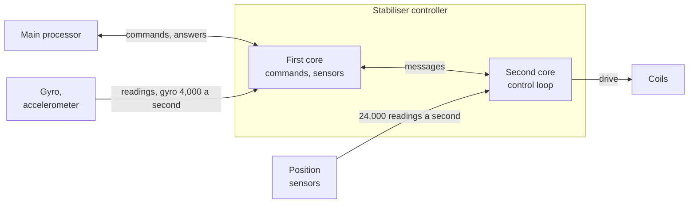

# Stabiliser controller

<!-- human page -->
<!-- house style -->

## Key points

- The stabiliser has its own chip, with two processor cores of the same MN10300 family as the main processor.
- One core takes commands and reads the motion sensors, and the other runs the control loop about 24,000 times a second.
- The controller ignores the "drive to a position" command, so star tracking would have to use its constant-speed or
  rotation drive.
- The control loop and its tuning are the same in the E-M5 III, OM-5 and OM-5 II.

The E-M5 III's in-body stabiliser has its own small computer. The main processor tells it what to do, and it does the
fast work of keeping the sensor steady. This page describes that computer and the program it runs. The program ships
inside every firmware update as the part called "LUKE".

The main processor's side of the story is on [Image stabiliser](stabiliser.md).

## A separate chip

The controller is not part of the main processor chip. The main processor reaches it only over a serial link with a
few extra signal lines for reset and handshaking. The controller has its own flash memory, its own working memory and its
own hardware blocks. Its program never touches the main processor's memory. It even names the main processor "the
ASIC".

So the camera has five processor cores of the MN10300 family. Three sit in the main processor. Two sit in the
stabiliser controller. The power and watchdog block is plain hardware, not a processor.

## Program layout

The update file carries LUKE as one block of 256 KB. It is copied into the controller's own flash memory, just after a
small boot program that the update never changes.

The block holds the code for both cores. The first core runs its part straight from flash. When it starts, it copies the
second core's part into that core's own memory and then lets it run. A library of shared helpers is copied across too, so
both cores can use it.

The controller's factory calibration lives in the same flash, after the program.

## Two cores

The first core handles everything that is not time critical. It receives commands from the main processor, checks
them and answers. It also reads the gyro and the accelerometer, each over its own serial port. It reads the gyro 4,000 times a
second.

The second core runs the control loop. It takes the measured motion, filters it and sets the drive for the coils that
move the sensor. It does this about 24,000 times a second. Each step reads the three position sensors, runs the filters
and sets the drive for the three coils. Most of its code is long chains of multiply and add steps, which is how digital filters look in
machine code.

The two cores share a small block of memory. They leave messages for each other there, and each can ring a bell that
wakes the other. Hardware locks stop them writing to the same place at once.

*The stabiliser controller and what it talks to. Arrows show which way the data flows. The cores fetch the sensor
readings themselves, on their own timers.*

Each core also has a small text console for the factory, with commands to read and write memory and to show timers and
the analogue inputs. We have not found a way to reach it from outside.

## The maths unit

The basic instruction set has no fast multiply-and-add. The controller adds one through instructions the MN10300
family reserves for extra hardware. The program uses them for multiplying, dividing and for the multiply-and-add steps
of its filters. The control loop uses the unit all the time.

These instructions look like other operations to the usual disassembler settings. Reading the program correctly needs
the plain MN10300 setting.

## Commands

The main processor sends a command number as the first byte of each message. The controller looks it up in a table of
248 slots. 49 slots hold a command. The rest do nothing.

Some commands the main program knows are not in the controller's table:

- **Drive to a position.** The main program can build this command, but the controller ignores it. This rules it out
  as a way to point the sensor for star tracking.
- **Level gauge state.** Only the E-M5 III's main program has it, and neither controller program answers it.

The constant-speed drive and the rotation drive are both present. They remain the commands to study for star tracking
or horizon correction.

## The two drives

The constant-speed drive moves one axis at a steady speed. The command gives the axis and a signed speed. The sign sets
the direction. The sensor moves from where it is now and stops at the end of its travel.

The rotation drive turns the sensor by a given angle. The controller first works out the current tilt from the three
axis positions. It adds the requested angle and turns the result into a new position for each of the three coils. The
move follows a smooth S-shaped curve and then holds.

Both drives work relative to the current position, and both stay inside the mechanical range. Neither knows anything
about the sky. A star-tracking feature would have to keep sending small moves from the main processor.

## Compared with the OM-5

The OM-5's controller program is laid out the same way and handles the same commands with the same code. The
differences are small.

- It drops code for early prototype boards. The main program tells the controller which board it is on, and the OM-5
  no longer supports the oldest ones.
- Its second core is about 4 KB smaller. The removed code adjusts filter settings for those older boards.

The two programs use the same hardware registers, so the controller chip is very likely the same.

## Compared with the OM-5 II

The OM-5 II's control loop is the same as the OM-5's. Two things are new.

- A bank of 16 gyro filter settings. The first one is the OM-5's filter, and the stock program always picks it.
- One new command that reads back three values. What it reads is not known yet.

## Stabilisation across bodies

The control loop, its filter settings and its tuning values are the same in the E-M5 III, OM-5 and OM-5 II. The OM-5
adds the movie "IS Level" setting. Other differences between the bodies sit outside the update file, for example in
the factory calibration that the controller keeps in its own memory. That last point is inferred, not traced.

## Open questions

- The packet format on the link to the main processor.
- The exact units of the drive speed and rotation angle.
- Which gyro chip the camera uses.
- The names of the internal messages the first core sends to the second.
- Proof of which hardware blocks drive the coils and read the position sensors. The control loop makes the guesses
  strong.
- The boot program, which no update file contains.

## Further reading

- [Stabiliser controller: technical notes](is-controller-technical.md) has the memory layout, the command table,
  the I/O blocks and the addresses.
- [Image stabiliser](stabiliser.md) covers the main processor's side.
- [Power and watchdog block](power-block.md) explains why that block is not a processor.
