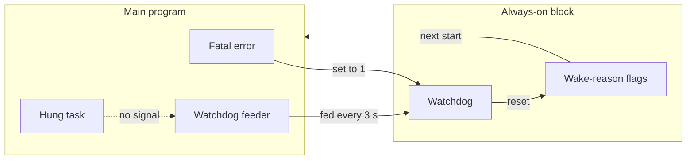

# Power and watchdog block

<!-- human page -->
<!-- house style -->

## Key points

- The E-M5 III has no separate power processor. A small always-on part of the main chip handles power and the clock.
- That part keeps time, wakes the camera, records why it woke and runs the watchdog.
- The same part, with the same unlock numbers, is in the OM-5, E-M1 III and OM-1.
- The E-M1 III and OM-1 add a real power microcontroller. The E-M5 III and OM-5 don't have one.

The E-M5 III has no separate power processor. Its power-on, power-off, clock and watchdog jobs are done by a small
always-on part of the main chip. That part keeps running on a trickle of power while the camera is off.

We used to call it "the power sub-CPU". The code shows no messages and no answers, only registers. The main program
writes a register, then writes a fixed "commit" value so the always-on part takes the new setting. Nothing in any
update file is a program for it.

## Functions

- **Keeps the time.** A seconds counter runs while the camera is off. When the clock is set, the firmware reads it back
  and leaves a "clock is valid" mark.
- **Keeps 14 small memory words.** They survive power-off. The flash guard uses two of them to record which write it
  blocked before it reset the camera.
- **Wakes the camera.** Five inputs can turn the camera on: the power switch, a memory card going in, and three others
  whose wiring is not yet known. Two alarms can wake it at a set time.
- **Tells the firmware why it woke.** On each start the firmware reads which input or alarm woke it, or whether the
  battery had just gone in, or whether the watchdog had reset it. It turns that into a "power-on factor" number.
- **Turns the camera off.** The firmware writes a fixed key to a power-off register.
- **Runs the watchdog.** The watchdog resets the camera unless it is fed. It is set to 10 at start and fed every
  3 seconds by a task called PER_WDT. The unit is probably seconds.

## Keys

Four fixed numbers unlock these jobs: one to commit, two to feed the watchdog, and one to power off. They read like
dates: 1919-10-12, 1945-08-15, 1972-10-30 and 2004-10-01. The first is the founding date of Olympus. The last is when
Olympus Imaging was set up. The same four numbers appear in the E-M5 III, OM-5, E-M1 III and OM-1 firmware, so they are
not a per-model check.

## Fault handling

When the firmware hits a serious fault, it sets the watchdog to 1 and stops. The camera resets about a second later.
On the next start the "why it woke" flags say "watchdog".

*Why a fatal error resets the camera but a hang freezes it. Arrows show what happens next.*

A fatal error here also covers an error dump and a blocked flash write. The fatal error sets the watchdog to 1 and stops. About a second later the watchdog resets the camera and
sets its flag, and the next start-up reads it as "watchdog". A hung task leaves the rest of the program running, so the
feeder keeps feeding the watchdog and it never fires. The camera stays frozen until the battery comes out.

## Other bodies

- **OM-5:** the same block, driven the same way, with the same table of wake reasons. The two cameras do not differ
  here.
- **E-M1 III and OM-1:** the same block, plus a real power processor (an STM32 microcontroller) for the battery,
  charging and USB power. Its program ships inside their update files.
- **E-M5 III:** its only separate processor with its own program is the one that drives the [stabiliser](stabiliser.md).

## Further reading

- [Power and watchdog block: technical notes](power-block-technical.md) has the register map, the wake reasons and the
  addresses.
- [Boot](../guides/boot.md) shows where the block is set up.
- [Recovery](../firmware/recovery-technical.md) covers what happens after a fault.
