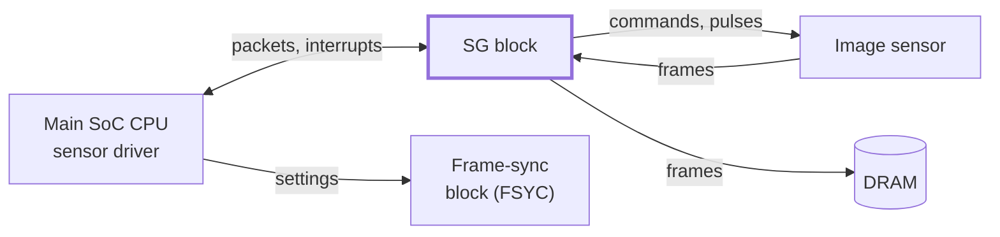
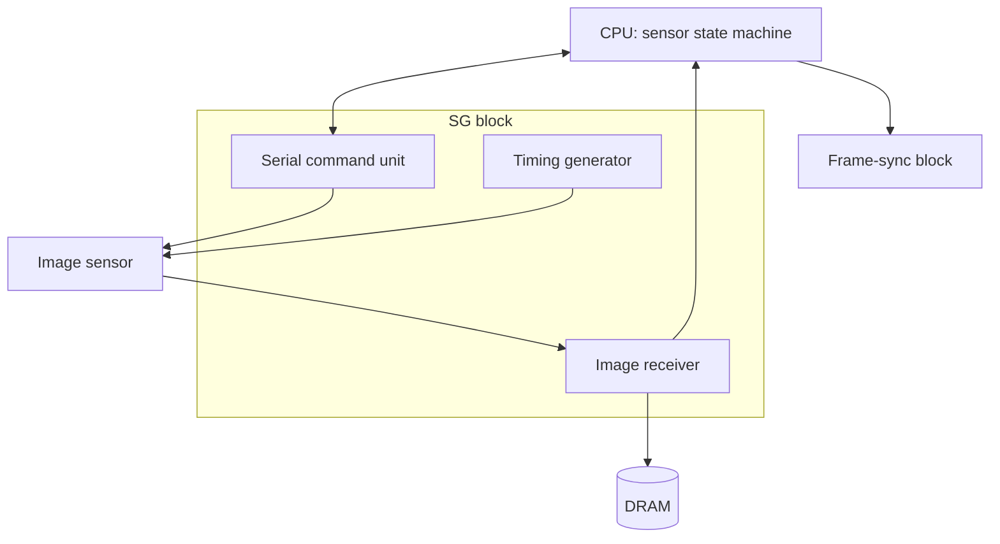

# Sensor control link: technical notes

<!-- house style -->
> **Technical reading.** The detailed version of [Sensor control link](sensor-link.md), for readers who want the internals.

*Last reviewed 2026-11-27.*

This page covers how the main chip controls the image sensor and receives its frames. It describes the serial command
unit that writes sensor registers, the fixed and runtime packets the firmware sends, the per-mode packets and readout
windows, the image receiver, the clocks, and how live view and stills set up the sensor. This is desk research only.
Nothing here was run on the camera.

Addresses are E-M5 III 1.7 block0 addresses (base `0x60021020`) unless a body is named. The comparison bodies are the
OM-5 1.2, the OM-5 II 1.1 and the E-M1 III 1.6.

The small numbers after a fact link to [Sources and dates](#sources-and-dates), which say how the fact is known and when.
On the notes site the number's colour shows the evidence: blue = read in the firmware, grey = inferred.

See also: [Sensor and calibration](sensor-technical.md) for the mode enum and geometry,
[Interrupts, timers and DMA](interrupts-timers-dma-technical.md) for lines 4 to 7, and the
[shooting sequencer](../firmware/shooting-sequencer.md) for the type-7 sensor requests.

## Overview

*The SG block (bold outline) and its neighbours. Arrows show which way the data flows. [Inside the SG block](#inside-the-sg-block)
opens up the block, and its interface table says who starts each transfer and how often.*

## Summary

- **Two paths, one block.** The body talks to the sensor over two paths, both in one SoC block, the SG block. The
  driver sources are `cam_sg.c`, `cam_sgdrv.c`, `cam_imgdev_serial.c` and `cam_siodrv.c`.[^fw1]
    - A **serial command unit** at `+0x200` writes sensor registers. It has a **120-entry transmit FIFO** at `+0x800`,
      8 bytes per entry, and uses interrupt line **7**.[^fw1]
    - The **image receiver** has LVDS and SLVS front ends, line counting and a read DMA to DRAM. It uses interrupt
      lines **4 to 6**.[^fw1]
- **Register writes.** A sensor register write is a chip id (the register page), an 8-bit address and an 8-bit value.
  The shell help gives the format.[^fw1]
  `cam tg [address:8bit+ID:8bit(hex)] [data:8bit(hex)] [cs 1=Chip1,2=Chip2] [type 0=IMD,1=BLANK]`
  The chip ids in use are 02, 03, 04, 05, 07, 08, 09, 0a, 0c and 0d.[^fw1]
- **Packets.** Writes go out in packets, which are lists of entries. block0 stores **47 fixed packets**. Nine more
  runtime packets sit in RAM, and the exposure and timing code fills in their values.[^fw1]
- **One packet per mode.** Each sensor mode has its own packet, which starts with register **02:02 = readout mode**.
  The driver's mode index is the same enum the [sensor page](sensor-technical.md#sensor-modes) lists (HSSC, MSSC, ...
  FULL_LQ). That is inferred from the fit described under [Modes and readout windows](#modes-and-readout-windows).[^inf1]
- **The same in four bodies.** The **47 packets are byte-identical in E-M5 III 1.7, OM-5 1.2, OM-5 II 1.1 and
  E-M1 III 1.6**. The OM-5 II program also uses the same receiver registers the same number of times, and maps modes to
  packets the same way. The OM-5 II program drives the sensor exactly like the E-M5 III program.[^fw1]
- **Timing from the SoC.** The SG block has a timing generator (`TG VD CYCLE[HD]`, `TG HD CYCLE[CLK]`) and counts its
  own `ext tg` pulses. Lines per frame is also a sensor register pair, 02:13-14. The sensor is the timing follower,
  which is inferred from the names.[^inf1]
- **Frame sync.** A separate frame-sync block on line 22 (FSYC) times the shutter and lens against the frames. It is
  used by `rs_sht_speed` and lens sync.[^fw1] See also: [Interrupts, timers and DMA](interrupts-timers-dma-technical.md).
- **SLVS.** The link is SLVS with 12 lanes, after the clocks CLKSLVS0L-11L. LVDS receivers A to C also exist, and
  `cam movie` has a `test_lvds` option. Which one stock uses at run time was not traced. The SLVS name on the start
  event (`IMGDEV_SLVS_START`), the SLVS error tools and the factory test `SLVS.Check` point to SLVS.[^inf1]

### Inside the SG block

*Inside the SG block. Each line is one row of the table below.*

| from | to | what moves | path | started by | how often |
|---|---|---|---|---|---|
| CPU sensor state machine and serial driver | serial command unit | packet list, 8 bytes per entry, up to 120 entries per transfer | serial driver into the transmit FIFO | CPU | per state change. IMD packets at once, BLANK packets before the next send |
| serial command unit | CPU | packet done | interrupt line 7 | serial command unit | per packet |
| serial command unit | image sensor | register writes: chip id, address, 8-bit value | serial command link | serial command unit | per packet entry |
| timing generator | image sensor | VD and HD pulses. The sensor follows them[^inf1] | | timing generator | every frame and line |
| image sensor | image receiver | frame data | SLVS[^inf1], 8 of 12 lanes mapped[^inf1] | image sensor | every frame |
| image receiver | DRAM | the frame | read DMA | image receiver | every frame |
| image receiver | CPU | status | interrupt lines 4 to 6 | image receiver | not traced |
| CPU | frame-sync block (FSYC) | SG_CLKTIM setting (kind 25) | frame-sync driver | CPU | on demand |

*Every transfer between the CPU, the SG block and the sensor.[^fw1][^inf1] Registers are in the sections below and in the [address reference](#address-reference).*

## Serial command unit

The unit sits at `+0x200` in the SG block.[^fw1]

| register | use |
|---|---|
| `+0x200` | start. Bits 8-15 = number of entries, bit 0 = go |
| `+0x204`, `+0x20c`, `+0x214` to `+0x224` | set-up, loaded from a 9-word block before each transfer |
| `+0x208` | bit 16 is set by one function, cleared by another and read by two more. Meaning open |
| `+0x800` to `+0xbbf` | transmit FIFO, 120 × {u32 control, u32 data} |
| `+0x000` bit 4 | cleared while a packet runs, set when it ends |
| `+0x004` bits 20-22, mask `+0x014` | interrupt line 7. The handler calls three registered callbacks |

*Serial command unit registers. The functions that touch each one are in the [address reference](#address-reference).[^fw1]*

### Set-up blocks

There are three set-up blocks, chosen by the packet's type byte: one for type 0, one for type 3 and one for type 4.
Their values are `0x2100`, `0x810`, 0, -, 0/1/1, `0x00010001` / `0x00030001` / `0x00780001`, 0, `0x10101` and
`0x10101`. They differ only at `+0x214` and the high half of `+0x218` (1, 3, 120). The bit meanings are open.[^fw1]

### Entry format

- **Data word.** Byte 0 is the chip id, byte 1 the address and byte 2 the value.[^fw1]
- **Control word.** It is `0x58000000` in 46 of the 47 packets.[^fw1]
- **The odd packet.** One packet alone uses `0xe0000000`, with chip 01, address 00 and value 00. It is the first
  packet of every still capture. The three still steps send its list first, then the full readout packet. What the
  different control byte does is open. It could mark a second device, a sync marker or another word length.[^fw1]
- **No second chip in use.** `cam tg` builds its write in a one-entry RAM packet. Control is forced to `0x58000000`,
  and data = the address+ID argument | value << 16. The `cs` argument is stored in the request at +8 but never read. So
  the shell help's Chip1/Chip2 is a leftover. Every stock write uses the same control word, except the odd packet
  above.[^fw1]

### Driver path

1. Callers build a packet list and call the packet sender.
2. The sender builds a 20-byte request {kind, channel, done callback, packet} and passes it to the serial driver.
   Kind 7 = set callback, 9 = send, 10 = lock, 11 = unlock.
3. A poster puts packets into a per-channel message buffer.
4. A drain function moves up to 120 entries into the FIFO and starts the unit.
5. Completion comes back on line 7.[^fw1]

### IMD and BLANK

A type 0 (IMD) packet is sent at once. A type 1 (BLANK) packet is parked and posted ahead of the next send.[^fw1] That
it lands in vertical blanking is inferred from the name.[^inf1]

### Shell

`cam tg` has its own shell handler. The `MSB` and `LSB` it prints are the two words of the entry it sent, copied into
the request at +24 and +28. They are not a read-back. No sensor read path was found.[^fw1] `cam tg` works only through
the Wi-Fi debug shell, and only when the cam module is powered (`Please poweron`).

## Packets

The firmware sends fixed packets from block0 and runtime packets from RAM.[^fw1]

- **Start-up.** Two packets, one of 137 entries on chips 02 to 0d and one of 198 entries on chip 08 only. A step chain
  sends them.[^fw1]
- **Control.** Small packets on 02:00, 02:6d, 02:6f and 02:70, for example 02:6f = `0x70` / `0x30` and
  02:00 = 00 / 02 / 04.[^fw1] They look like standby and streaming control.[^inf1]
- **Per mode.** 28 packets of 75 to 86 entries, one or more per mode. See [Modes and readout
  windows](#modes-and-readout-windows).[^fw1]
- **Runtime packets.** These sit in RAM. One function writes their chip and address, and the values are filled in
  before each send.[^fw1]

| registers | filled with |
|---|---|
| 02:06-0b | three 12-bit values (low byte, high nibble) from four RAM words. Exposure timing[^inf1] |
| 02:11-14 | two 16-bit values. 02:13-14 = lines per frame. The FULL packet carries `0x0f64` = 3940. MSHR carries `0x048e` = 1166, the MSHR line count in the per-mode table |
| 02:25, 02:35-38, 02:b0, 05:a8-aa, 05:b3-b6, 02:b2, 02:bf, 09:3b, 09:3f, 03:1e | 18 entries |
| 02:05 / 02:da-db / 02:4b-4f / 02:3d-3e / 02:52-56 / (one more) | six smaller packets |

*Runtime packets and what fills them.[^fw1] Descriptor addresses are in the [address reference](#address-reference).*

A state change runs one of about 40 step functions. Each sends one packet list and names the next step as its done
callback. The state words sit behind a pointer in RAM. Bits 7-12 hold the setting id, which indexes a 52-entry RAM
table, and bits 20-23 hold the mode index.[^fw1]

## Modes and readout windows

One function fills two mode tables in RAM. The first holds the full switch, the mode packet plus timing and exposure.
The second holds the same mode with timing and exposure only. Another function indexes them with the mode index.[^fw1]

| index | KB name | 02:02 | notes |
|---:|---|---|---|
| 0 | HSSC | 0c | |
| 1 | MSSC | 0e | |
| 2 | LSSC | 12 | |
| 3 | CLIP | 04 | |
| 4 | HSHR | 0b | |
| 5 | MSHR | 0b | own lines-per-frame 1166 |
| 6, 7 | MOVIE_4K, MOVIE_C4K | 04 | one packet for both |
| 8 | PD | 08 | |
| 9 | MSPD (live view) | 15 | window on: 02:3b = 04, 02:3f = 01, start `0x024d`, length `0x0b38` (2872) |
| 10 | LSPD | 17 | 8 packets. Same as each other except the window: starts `0x025d` to `0x089d`, length `0x04e0` (1248), and three add a second window. Picked from a 3 × 6 table by two RAM bytes |
| 11 | MOVIE_HQ | 0a | |
| 12 | FULL | 00 | lines per frame 3940. A variant packet (02:02 = 01) serves setting id 47 |
| 13 | FULL_LQ | 02 | |
| still | | 00/01 | six packets, sent by the three still steps |

*Mode packets by mode index, with the readout-mode value each writes to 02:02.[^fw1]*

Packet addresses are in the [address reference](#address-reference).

- **The fit.** Three things support index = KB enum. 4K and C4K share one packet, and they have the same binning and
  line count in the KB table. MSHR's own line count matches. The only packets with a readout window are those of the
  PD modes MSPD and LSPD.[^inf1]
- **Registers that change with the mode** are 02:02, 02:03, 02:0e (06 binned, 14 for CLIP, 4K and FULL_LQ), 02:10,
  02:17, 02:1c, 02:29, 02:2f, 02:72, 02:a9, 02:b5, 02:c0, 02:da-db, 02:dd, 03:20, 03:f0-f5, 05:a9-b6, 07:00-0c,
  09:15-3d and 0a:20. What each does is open. The side-by-side table is `mode-diff-e137.txt`.[^fw1]
- **The LSPD band.** The windowed band in LSPD reads like the phase-detect rows for the active AF area. It bears on the
  open question of why AF switches the sensor mode.[^inf1] See also: research gaps.

## Receiver

The receiver registers are offsets from the SG block base.[^fw1]

| offset | use |
|---|---|
| `+0x004`, masks `+0x008` / `00c` / `010` / `014` | status A for lines 4 / 5 / 6 / 7. Each handler reads status, keeps its bits and writes them back |
| `+0x018`, masks `+0x01c` / `020` / `024` | status B for lines 4 / 5 / 6 |
| `+0x0d0` to `0x0d8` | TFT sync (`tft hd cnt` at `+0x0d8`) |
| `+0x180` to `0x194` | test pattern, `cam test 0-4` |
| `+0x6c0` / `6c8` / `6d0` / `6d4` | counters `ext tg`, `free`, `read img`, `q read` |
| `+0x6dc` / `6e0` / `6e4` | read DMA `busy`, `burst cnt`, `vw cnt` |
| `+0x700` to `0x710` | LVDS `state`, `fi`, `err`, `wait1`, `wait2` |
| `+0x720` to `0x744` | SLVS `state`, `err`, `dlyout`, `decode err`, `wait`, `linenum`, `wdr it`, `emb line`, `phase err`, `ana rsv` |
| `+0x1000` and up | second channel (`+0x108c`, `+0x1240` to `0x1254` used) |

*Receiver registers. Names from the `cam dbginfo` dump.[^fw1]*

Start and stop code writes `+0x060` to `0x0e8` and `+0x400` to `0x5ec`.[^fw1]

### Setting groups

A setter table holds 13 pairs of {setter, callback stub}, in the order of the cam layer's setting names. The fit is
checked on the groups whose content is clear, LVDS, SLVS and CLKTIM.[^fw1] The names per pair are inferred.[^inf1]

| setting | registers |
|---|---|
| SYNC_SETTING_EXPOSE | `+0x084` to `0x088` |
| SYNC_SETTING_EXPOSE_2 | `+0x08c` to `0x0bc` |
| SYNC_SETTING_CAPTURE | `+0x0c4` to `0x0c8` |
| SG_COMPOSITION | `+0x0d0` to `0x0d8` |
| SG_CYCLE | `+0x104` to `0x130` |
| SG_TFT_SYNC | `+0x140` to `0x168` |
| SG_REARRANGE | `+0x240` to `0x27c` |
| SG_READ_COUNT | `+0x340` to `0x398` |
| SG_INTR | `+0x3c4` to `0x468`, through a helper |
| SG_CLKTIM | not this block. It sends kind 25 to the frame-sync driver, which programs the frame-sync block (line 22) |
| SG_LVDS | `+0x068` to `0x078` |
| SG_SLVS | `+0x1c8` to `0x1f0`, then `+0x1c0` / `+0x1c4` through a helper |
| SG_VL_POINT | `+0x2c0` to `0x31c` |

*SG setting groups and the registers each setter writes. Setter addresses are in the [address reference](#address-reference).*

SG_READ_DMA, SG_VL_EXT and the `_2` copies have no entry in this table.[^fw1]

### SLVS set-up

- **Lane map.** The SLVS setter writes `+0x1e8` = `0x76543210` and `+0x1ec` = 0 every time.[^fw1] That is a
  nibble-per-lane map with eight lanes in order and the rest zero. It points to **8 SLVS lanes in use** of the 12 the
  clock list names.[^inf1]
- **Bit depth tables.** The setter uses two 17-byte tables indexed by bit depth. They are the same in the OM-5 II.
  Depth 8/10/12/14/16 maps to format code 0/4/7/10/11 in `+0x1f0` bits 0-3. It also maps to pixels per 512-bit word
  64/48/40/36/32, used to work out words per line.[^fw1] The meaning of the values is inferred.[^inf1]
- **12 receiver lanes.** CLKSLVS0L-11L are in the SoC's own clock list, so the chip's SLVS receiver has 12 lanes. The
  8-entry lane map leaves receiver lanes 8 to 11 without data. Nothing in the firmware states how many output lanes the
  sensor has.[^fw1]
- **Other bodies.** E-M1 III 1.6, OM-5 1.2 and OM-5 II 1.1 run the same setter with the same 8-lane map. The OM-1 1.9,
  a newer chip, writes `0x76543210` into two lane-map words, which reads like 2 × 8 lanes.[^fw1] That the spare lanes
  are capacity on a chip shared by several bodies is inferred.[^inf1]

### Interrupt lines

Lines 4 to 6 are set up by one function with three handlers. Line 7 is set up by the serial unit's own set-up function.
All four are level 2. The handler's extra read of `0x9b80060c` is a bus flush, which the same code does on every
register write.[^fw1][^fix1]

### SLVS error tools

The shell has `cam slvserr info|clrcount|clrcom` and `cam slvserrt [MON22] [MON23] [MON25] [MON30]` or
`[ENDCODE_L or STARTCODE_L] [FORCE_LOW VS]`. The monitor registers MON22 to MON30 and the sync-code test show that the
SLVS front end checks start and end codes on every line.[^fw1]

## Clocks

The `chgimggclk` and `per clk` help lists these clocks.[^fw1]

- CLK_CAMOUT, the clock driven out to the sensor, with divider DIVCAMOUT.
- CLKCAMDA, CAMDB and CAMDS, the camera data domain.
- CLKLVDSA-C and CLKLVDSCDIV.
- CLKSLVS, CLKSLVSAMP and CLKSLVSCNT.
- **One clock per SLVS lane, CLKSLVS0L-11L.**

The frequencies were not read.

## Live view and still set-up

- **Mode switch.** The AE request chooser picks a mode id (see [Sensor and calibration](sensor-technical.md)). The
  sensor state machine sends the mode's packet from the full-switch table, then the timing (02:11-14) and exposure
  (02:06-0b) packets.[^fw1]
- **Live view** runs MSPD (02:02 = `0x15`) with the long PD window. Half-press goes to HSSC (02:02 =
  `0x0c`).[^fw1]
- **Stills** use the full readout packets, with 02:02 = 00 or 01 and lines per frame 3940.[^fw1]
- **Still step names.** The step names in `cam_stl_seq.c` include `STILL_T_VDRST_EXP`, `STILL_T_VDRST_CAP`,
  `STILL_T_FT_CAP`, `STILL_CR_FT_MODE_CHG_HIGH`, `STILL_CR_SEND_SERIAL`, `STILL_M_SEND_SERIAL` and
  `STILL_M_VDRST_MOV`.[^fw1] They suggest a VD reset to line the frame up with the shutter, and serial sends inside the
  sequence.[^inf1]

## Open questions

- The physical meaning of the readout-mode values and of the mode-dependent registers.
- What the `0xe0000000` control word does in the still-capture opener.
- The serial set-up register bits and the serial clock rate.
- Whether the shipped link is SLVS only, and a camera read of `+0x1e8` to confirm 8 lanes.
- A safe read-only check on the camera: `cam dbginfo` and `cam slvserr info` over the Wi-Fi shell, in live view.
  Don't use `cam tg` writes.

## Address reference

E-M5 III 1.7 block0 addresses unless a body is named.

| item | address |
|---|---|
| SG block | `0x9b000000` |
| serial command unit | `0x9b000000` + `0x200`, FIFO + `0x800` |
| frame-sync block (line 22) | `0x9c800000` |
| bus flush read | `0x9b80060c` |

*Hardware blocks.*

| item | address |
|---|---|
| `cam tg` help string | `0x6144c67d` |
| fixed packets (47) | `0x601c6610` to `0x601cc270` |
| runtime packets in RAM (9) | `0x620cc854` to `0x620cc9b0` |
| start bit writer (`+0x200`) | `0x6015a5ba` |
| set-up loader (9-word block) | `0x6015a42a` |
| `+0x208` bit 16: set, clear, readers | `0x6015a363`, `0x6015a390`, `0x6015a339` / `0x6015a651` |
| FIFO filler | `0x6015a537` |
| line 7 handler, callbacks | `0x6015a175`, `0x620cd340` / 344 / 348 |
| set-up blocks for types 0, 3, 4 | `0x601cc2a4`, `0x601cc2c8`, `0x601ccaa8` |
| packet sender (picks the set-up block) | `0x60148165` |
| still-capture opener packet, its list | `0x601cc270`, `0x601cc27c` |
| still steps | `0x601476e1`, `0x60147744`, `0x601477bc`, `0x60147780` |
| `cam tg` RAM packet, builder | `0x601c6604`, `0x601480d1` |
| done callback, serial driver entry | `0x601482d8`, `0x6015a260` |
| packet poster, per-channel buffers | `0x6015a2b5`, `0x620cd358`[ch] |
| FIFO drain | `0x6015a4ca` |
| IMD send, BLANK park and post | `0x60148353`, `0x620ccb68`, `0x60148277` |
| `cam tg` shell handler | `0x6140bd4b` |

*Serial unit functions and data.*

| item | address |
|---|---|
| start-up packets (137 and 198 entries) | `0x601c6a58`, `0x601c70bc` |
| start-up step chain | `0x60144c78` → `0x60144cc7` |
| runtime packet chip and address writer | `0x6014599d` |
| runtime packet, 02:06-0b, and its filler | `0x601c65d4`, `0x60146a78` |
| exposure timing source words | `0x620cc9b6`, `0x620cc9be`, `0x620cc9b8`, `0x620cca10` |
| runtime packet, 02:11-14 | `0x601c65ec` |
| runtime packet, 18 entries | `0x601c65b0` |
| six smaller runtime packets | `0x601c65a4` / `65bc` / `65c8` / `65e0` / `65f8` / `6604` |
| per-mode table (line counts) | `0x601de514` |
| step functions (about 40) | `0x60144338` to `0x6014597f` |
| state word pointer, setting id table | `0x620cc850`, `0x61e8cd50` |

*Packets and the sensor state machine.*

| index | name | packet |
|---:|---|---|
| 0 | HSSC | `0x601c740c` |
| 1 | MSSC | `0x601c76c0` |
| 2 | LSSC | `0x601c7974` |
| 3 | CLIP | `0x601c7c28` |
| 4 | HSHR | `0x601c7edc` |
| 5 | MSHR | `0x601c81d0` |
| 6, 7 | MOVIE_4K, MOVIE_C4K | `0x601c8484` |
| 8 | PD | `0x601c8738` |
| 9 | MSPD | `0x601c89ec` |
| 10 | LSPD | 8 packets `0x601c8ca0` to `0x601c9e74`, table `0x620ccb1c`, selectors `0x620cca12` / `0x620cca13` |
| 11 | MOVIE_HQ | `0x601ca128` |
| 12 | FULL | `0x601ca424`, variant `0x601ca6f8` |
| 13 | FULL_LQ | `0x601ca9cc` |
| still | | `0x601cad9c`/`b060`, `0x601cb398`/`b66c`, `0x601cbc4c`/`bf30` |

*Mode packets by mode index.*

The mode tables are filled by `0x6014599d` at `0x620ccaa4` (full switch) and `0x620ccae0` (timing and exposure only),
and indexed by `0x60146a09`.

| item | address |
|---|---|
| `cam dbginfo` dump | `0x61413fef` |
| `cam test` | `0x6015f35d` |
| setter table, setting names | `0x601df6f4`, `0x601decf0` |
| SYNC_SETTING_EXPOSE, SYNC_SETTING_EXPOSE_2, SYNC_SETTING_CAPTURE | `0x6015e35e`, `0x6015e393`, `0x6015e412` |
| SG_COMPOSITION, SG_CYCLE, SG_TFT_SYNC | `0x6015e42e`, `0x6015e453`, `0x6015e4bd` |
| SG_REARRANGE, SG_READ_COUNT | `0x6015e50f`, `0x6015e590` |
| SG_INTR, its helper | `0x6015e669`, `0x6015d43a` |
| SG_CLKTIM, frame-sync driver | `0x6015e689`, `0x60133fb2` |
| SG_LVDS, SG_SLVS, SLVS helper, SG_VL_POINT | `0x6015e6ae`, `0x6015e6e5`, `0x6015d1db`, `0x6015e81a` |
| bit depth tables | `0x601df568`, `0x601df579` (OM-5 II `0x601f454c`) |
| SLVS setter in other bodies | E-M1 III `0x601704a3`, OM-5 `0x6016f0a5`, OM-5 II `0x6016f989`, OM-1 `0x601b10d3` |
| lines 4-6 set-up, handlers | `0x6015d5b6`, `0x6015d249`, `0x6015d2ae`, `0x6015d313` |
| line 7 set-up | `0x6015a1f8` |
| `cam slvserr`, `cam slvserrt` | `0x6140bf66`, `0x6140c09b` |
| clock help (`chgimggclk`, `per clk`) | `0x61447c1c`, `0x61448092` |
| AE request chooser | `0x60411219` |
| still step name strings | `0x6144a86c` to `0x6144b13c` |

*Receiver, clocks and set-up.*

## Sources and dates

The small numbers in the text point here. Each note says how a fact is known and when.

[^fw1]: Read in the firmware, 2026-11-25. Desk research on the E-M5 III 1.7 program, compared with the OM-5 1.2,
    OM-5 II 1.1 and E-M1 III 1.6 programs.
[^inf1]: Inferred, 2026-11-25.
[^fix1]: Corrected 2026-11-25. The older reading is in [History](#history).

## History

- 2026-11-25: line 7 was first guessed to belong to the frame-sync block at `0x9c800100`. It belongs to the serial
  command unit.

