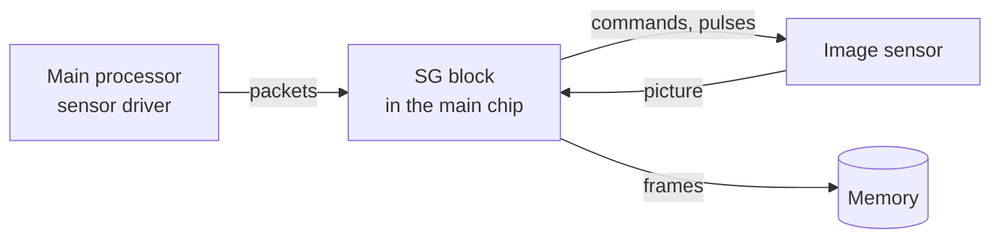

# Sensor control link

<!-- human page -->
<!-- house style -->

## Key points

- The main chip controls the sensor over a slow serial link and receives the picture over a fast link.
- The firmware stores 47 ready-made command packets, including one packet per readout mode.
- The main chip sets the frame timing, and the sensor follows it.
- All 47 packets are identical in the E-M5 III, OM-5, OM-5 II and E-M1 III programs.

This page explains how the camera's main chip controls the image sensor and receives its pictures. It covers the
E-M5 III 1.7 program and the OM-5 II 1.1 program, read from its update file. Both do it the same way. This is desk
research. Nothing here was run on the camera.

## Two connections

The main chip and the sensor are joined by two links.

- A slow serial link carries commands. The chip uses it to set the sensor's registers.
- A fast link carries the picture. It uses a signalling standard called SLVS. The chip has 12 lanes for it, and the code sets up 8.

Both links end in one block of the main chip. The firmware calls it the SG block.

*The sensor link and its neighbours. Arrows show which way the data flows. Commands go over the slow serial link and
the picture over the fast SLVS link.*

## Commands

Every command sets one sensor register. It names a register page, an address in that page and an 8-bit value.

Commands travel in groups called packets. The chip can queue up to 120 commands and send them in one go. When a
packet is done, the block raises an interrupt.

A packet can go out at once or wait for the gap between two frames. Waiting avoids changing a setting halfway
through a frame.

## Stored packets

The firmware stores 47 ready-made packets. One set starts the sensor. Small ones switch it between standby and
streaming. The largest group holds one packet per readout mode.

Each mode packet starts by naming the readout mode. The rest sets the area to read, the binning and the timing.

Some settings change all the time. Exposure time and frame length live in small packets that the firmware fills in
before each send.

## Readout modes

The camera has about 15 readout modes. The [sensor page](sensor.md) lists them.

Live view uses a fast mode that skips pixels. It also reads a band of phase-detect pixels for autofocus.

Another autofocus mode has eight versions. Each one reads a different band of the frame, probably the band under the
chosen AF area.

Still pictures use full readout packets. 4K and C4K movie share one packet.

## Timing

The main chip sets the pace. A timing generator in the SG block sends the frame and line pulses, and the sensor follows
them. The frame length is also written into the sensor.

## Picture data

The receiving side checks every line for its start and end codes. It counts lines and errors and writes the frame to
memory by itself.

The firmware has debug commands that show this state. They print error counters, line numbers and the state of the
fast link. They can be run over the Wi-Fi debug shell.

## Other bodies

All 47 packets are identical in the E-M5 III, the OM-5, the OM-5 II and the E-M1 III programs. The OM-5 II program
also uses the same registers of the SG block.

This is why the OM-5 II program drives the E-M5 III's sensor with no changes. It is also strong evidence that these
bodies share the sensor and its timing.

## Open questions

- What most sensor registers do.
- What one odd command at the start of every still capture does.
- A camera check of the lane count. The code points to 8 of the 12 lanes.
- A read-only check on the camera with the debug commands.

## Further reading

- [Sensor control link: technical notes](sensor-link-technical.md) has the registers, the packet tables and the
  addresses.
- [Sensor and calibration](sensor.md) lists the sensor modes and the raw frame layout.
- [Interrupts, timers and DMA](interrupts-timers-dma.md) covers the interrupt lines the link uses.
