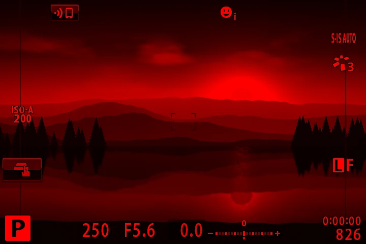
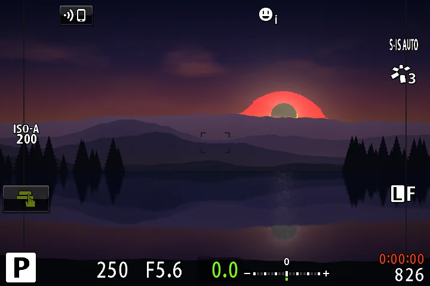

# Display controller

<!-- human page -->
> The dense reference for this page is [Display controller registers](vsc-display-controller-technical.md).

The display controller is the last stop before the screen. It reads the live-view picture and the menu and information
layers from memory, mixes them, applies a few picture adjustments, and sends the result to the rear screen, the
viewfinder or HDMI. The firmware calls it the VSC.

Because everything you see passes through it last, it is the natural place for **view assists**. These change only what
you see, never the photo. Examples are a red night view, zebra stripes on bright areas, an RGB clipping view and
peaking colours.

## Status

- **The registers are mapped.** The firmware carries a table naming all 422 of them, and most now have a known function
  that writes them.
- **Two view assists work on the camera** as card mods, a red night view and an RGB clipping view.
- **Zebras need more work,** because the camera keeps rewriting the registers involved.

## What it can do

The controller has several built-in picture blocks:

- **Gamma**, a brightness curve for each colour channel
- **Colour**, saturation gains for the display's colour modes
- **Highlight and shadow**, which turns out to be a zebra unit with two thresholds, two colours and a blink rate
- **Peaking**, which outlines in-focus edges in one of four colours
- **Histogram**, measured as the picture passes through
- **A colour matrix**, which the stock firmware never uses

## View assists

**Red night view.** Setting the green and blue gamma curves to zero leaves only red. It works on both screens.

**RGB clipping view.** Each channel is dimmed to half brightness, except values near the top, which stay at full. A
clipped channel then shows up in its own colour.

*Left, the red night view. Right, the RGB clipping view, where only the brightest parts of the sky stay at full strength. The emulator does not apply gamma, so each mod's own curves were applied to the frame afterwards. Emulator screenshots.*

Both work by changing gamma, and gamma applies to everything on screen, menus included. So these views tint the menus
too. A view that leaves the menus alone would need its own overlay built from the live frame.

**Zebras.** The camera rewrites the zebra registers all the time, even with its own highlight and shadow view switched
off. A mod that writes them directly ends up fighting the camera. Zebras need a hook at the point where the driver sets
those registers.

**Other ideas.** Peaking colours could be any colour, but the camera rewrites them too. Desqueeze for anamorphic lenses
might use the scaler. No register for mirroring the picture has been found.

## Lessons from the camera

- **A change needs an update request.** The stock code ends every change by asking for an update, which is applied at
  the next frame. A register written without that request only takes effect at the camera's next own update.
- **Requests during start-up can be lost** while live view comes up. A mod that applies something at power-on should
  repeat it for a while.
- **Two mods that both change gamma must coordinate.** Otherwise one saves the other's curves as the camera's own and
  leaves the screen dark after switching off.
- **The emulator does not draw these effects.** It logs the register writes, so the look of a view assist can only be
  judged on the camera.

## Other cameras

The E-M5 III, OM-5, E-M1 III and OM-5 II have the identical controller, with the same 422 registers. The OM-1 and
OM-1 II have a newer one with native zebras, night vision and colour management. The E-M5 II and PEN-F have an older
one.

## Further reading

- [Drawing to the screen](../guides/drawing-to-the-screen.md) explains the layers the controller mixes.
- [Card mods](../features/card-mods.md) covers how the view assists are loaded.
- [Graphics pipeline](graphics-pipeline.md) and [Display and live-view frames](display.md) cover the parts before the
  controller.
